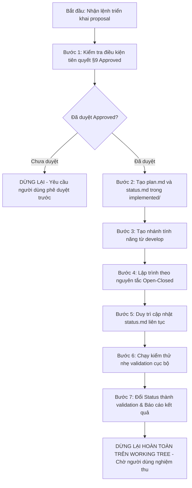

# Kỹ Năng Lập Kế Hoạch & Lập Trình Triển Khai (build-implementation)

Kỹ năng này chịu trách nhiệm biến một đề xuất đã được phê duyệt thành sản phẩm phần mềm thực tế trong dự án **GDMAS**, nối tiếp giữa `write-proposal` (dừng chờ duyệt) và `review-pr` (chỉ commit/push khi có lệnh riêng).

> [!IMPORTANT]
> - **Điều Kiện Tiên Quyết Bắt Buộc:** Phải kiểm tra tệp đề xuất `.agents/notes/proposed/<id>-<slug>.md`. Mục `## 9. Human Review` **bắt buộc phải là `Decision: Approved`** và có chữ ký xác nhận của người dùng. Nếu đang là `Pending`, `Changes Requested` hoặc để trống thì Agent **phải dừng lại và yêu cầu phê duyệt trước**.
> - **Dừng Cứng Tại Validation (Strict No Auto-Commit):** Sau khi lập trình và chạy kiểm thử xong, Agent **bắt buộc phải DỪNG LẠI ở trạng thái `validation`**. Giữ nguyên toàn bộ tệp đã sửa đổi trên **Working Tree** để người dùng trực tiếp kiểm tra và chạy thử trên local. **Tuyệt đối KHÔNG tự ý chạy `git commit` hay `git push`**.
> - **Tuân Thủ Tuyệt Đối RULE-03 (Open-Closed):** Mọi chức năng mới phải được viết dưới dạng bổ sung tệp mới (Service Runner mới, Route mới, Schema/Model mới, Chart Component mới). Cấm sửa đổi phá vỡ mã nguồn cũ.

---

## 🧭 Quy Trình Thực Thi Dành Cho AI Agent



---

## 🛠️ Hướng Dẫn Chi Tiết Từng Bước

### Bước 1: Kiểm Tra Điều Kiện Tiên Quyết
1. Tìm tệp đề xuất: `.agents/notes/proposed/<id>-<slug>.md`.
2. Kiểm tra phần `## 9. Human Review`:
   - Phải có dòng: `- **Quyết định:** Approved` (hoặc `Decision: Approved`).
   - Phải có tên người duyệt và ngày duyệt.
   - Nếu vẫn là `Pending`, `Changes Requested`, hoặc chưa điền: **DỪNG LẠI NGAY** và thông báo cho người dùng rằng tính năng chưa được duyệt chính thức.
3. Nếu thư mục `.agents/notes/implemented/<id>-<slug>/` đã tồn tại: Xác định đây là phiên **làm tiếp** tác vụ dở dang, đọc `plan.md` và `status.md` để tiếp tục, không ghi đè.
4. Rà soát thư mục `.agents/notes/bugs/`: Nếu có bug mức độ `critical` liên quan đến module sắp sửa đổi, phải thông báo cho người dùng trước khi tiến hành.

### Bước 2: Tạo Kế Hoạch `plan.md` & Nhật Ký `status.md`
Tạo thư mục `.agents/notes/implemented/<id>-<slug>/` chứa 2 tệp:

1. **`plan.md` (Kế hoạch triển khai kỹ thuật):**
   ```markdown
   # [KẾ HOẠCH TRIỂN KHAI - IMPLEMENTATION PLAN]
   - **Proposal ID:** <YYYY-MM-DD-NNN>
   - **Tên tính năng:** <Tên tính năng>
   - **Người duyệt:** <Tên người dùng>
   - **Ngày duyệt:** <YYYY-MM-DD>

   ## 1. Phạm Vi Thực Hiện (Scope)
   - **In Scope (Chỉ làm những mục này):**
     * Tệp mới 1: apps/api/src/gdmas/services/<service>/runner.py
     * Tệp mới 2: apps/web/src/components/charts/<ChartName>.tsx
   - **Out of Scope (Tuyệt đối không đụng vào):**
     * Không can thiệp apps/api/src/gdmas/main.py (bảo vệ T6)
     * Không sửa đổi connection.py và base.py

   ## 2. Các Bước Lập Trình Tuân Thủ Open-Closed
   - Bước 1: Tạo Schema Pydantic và Model SQLAlchemy mới (nếu có DB).
   - Bước 2: Tạo migration mới qua Alembic.
   - Bước 3: Viết logic xử lý cốt lõi hoặc service runner.
   - Bước 4: Viết UI component và kết nối API/SSE.

   ## 3. Tiêu Chí Validation Cục Bộ
   - Backend: uv run pytest <test_file>
   - Frontend: pnpm build
   ```

2. **`status.md` (Nhật Ký Tiến Độ Sống):**
   ```markdown
   # [TRẠNG THÁI TIẾN ĐỘ - STATUS LOG]
   - **Trạng thái:** planned
   - **Ngày bắt đầu:** <YYYY-MM-DD>
   - **Nhánh làm việc:** feature/<slug>

   ## Danh Sách Tác Vụ
   - [ ] Khởi tạo nhánh làm việc an toàn
   - [ ] Viết code Backend
   - [ ] Viết code Frontend
   - [ ] Chạy kiểm thử validation cục bộ

   ## Quyết Định Phát Sinh Trong Khi Code (Decisions Made)
   - (Ghi lại các thay đổi kỹ thuật nhỏ phát sinh ngoài dự kiến ban đầu)

   ## Lệch Kế Hoạch (Deviations From Plan)
   - (Nếu có bất kỳ khác biệt nào so với plan.md, bắt buộc phải giải thích tại đây)

   ## Lần Cập Nhật Gần Nhất (Last Update)
   - <YYYY-MM-DD HH:mm>: Khởi tạo kế hoạch làm việc.
   ```

### Bước 3: Tạo Nhánh Làm Việc Chuẩn GDMAS
Chuyển nhánh hoặc tạo nhánh làm việc an toàn tách từ `develop`:
```powershell
git checkout develop
git pull origin develop
git checkout -b feature/<slug>
```
*(Tuyệt đối không bao giờ làm việc trực tiếp trên nhánh `main` hay commit thẳng lên `develop` khi chưa hoàn thiện).*

### Bước 4: Triển Khai Mã Nguồn (Lập Trình Thực Tế)
Tuân thủ nghiêm ngặt 4 mô hình mở rộng của GDMAS:
- **Thêm Service Worker (Đáp ứng 7 Terminals):** Tạo file `runner.py` riêng biệt trong `apps/api/src/gdmas/services/<service>/runner.py` để chạy độc lập tại Terminal tương ứng. **Tuyệt đối không nhúng worker ngầm vào `main.py`**.
- **Thêm REST API Route:** Tạo tệp route mới trong `apps/api/src/gdmas/api/routes/<route_name>.py` và đăng ký vào router chính bằng `router.include_router()`.
- **Thêm Bảng CSDL:** Khai báo ORM model mới, tạo migration Alembic mới bằng lệnh:
  ```powershell
  uv run alembic revision --autogenerate -m "bổ sung bảng <tên_bảng>"
  ```
  *(Cấm sửa đổi các tệp migration cũ).*
- **Thêm Giao Diện Biểu Đồ (6 Patterns):** Tạo component mới trong `apps/web/src/components/charts/<PatternName>.tsx`.
- **Cập Nhật Hợp Đồng (`contracts/`):** Đảm bảo đồng bộ schema giữa Backend và Frontend, sử dụng thời gian UTC ISO 8601 và tọa độ WGS84.

### Bước 5: Duy Trì `status.md` Sống
Trong suốt quá trình code:
- Đổi trạng thái: `planned` $\rightarrow$ `in_progress` $\rightarrow$ `validation`.
- Đánh dấu các checkbox công việc đã hoàn thành.
- Nếu có quyết định kỹ thuật phát sinh hoặc sai lệch nhỏ so với `plan.md`, bắt buộc phải ghi ngay vào mục `Deviations From Plan` và `Decisions Made`.

### Bước 6: Chạy Validation Nhẹ Cục Bộ (Local Verification)
1. **Kiểm tra cú pháp & build:**
   - Backend: Chạy unit test liên quan bằng `uv run pytest <path_to_test>` hoặc kiểm tra cú pháp Python.
   - Frontend: Kiểm tra biên dịch TypeScript và đóng gói `pnpm build` (hoặc `pnpm lint`).
2. **Kiểm tra an toàn mã nguồn:**
   - Chạy kỹ năng `source-guard` để thẩm định xem có tệp nào bị xóa nhầm hoặc có tệp lõi nào bị can thiệp trái phép không.

### Bước 7: DỪNG LẠI TẠI `validation` (Cốt Lõi)
- Đặt trạng thái trong `status.md` thành: `- **Trạng thái:** validation`.
- **DỪNG MỌI HOẠT ĐỘNG.**
- **TUYỆT ĐỐI KHÔNG CHẠY `git commit` hay `git push`.**
- Thông báo cho người dùng:
  > *"Đã hoàn thành lập trình tính năng theo kế hoạch và vượt qua các bước kiểm thử nhẹ. Trạng thái hiện tại là `validation`. Toàn bộ mã nguồn đang được giữ nguyên an toàn trên Working Tree để bạn trực tiếp kiểm tra và chạy thử. Khi nào bạn muốn đóng gói và đẩy lên GitHub, xin vui lòng yêu cầu tôi commit (hoặc kích hoạt kỹ năng `review-pr`)."*

---

## 🚫 Điều Kỹ Năng Này Tuyệt Đối Không Làm
- Không tự ý commit hay push mã nguồn lên Git.
- Không tự ý mở Pull Request hay merge nhánh.
- Không sửa đổi hoặc xóa các tệp note trong `.agents/notes/proposed/`.
- Không tự ý triển khai khi Mục 9 trong proposal chưa được duyệt `Approved`.

