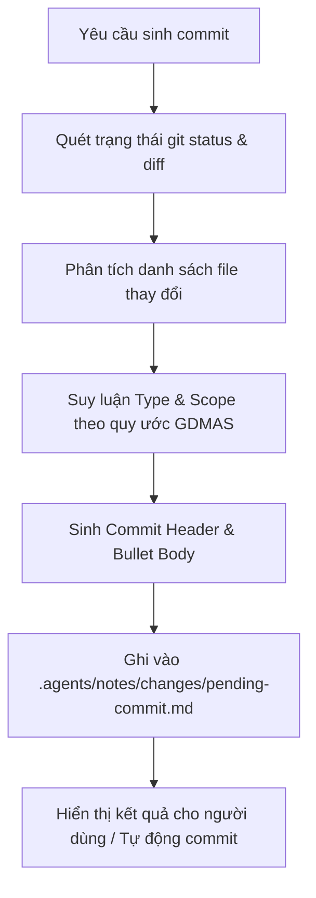

# Generate Commit Skill (GDMAS)

Kỹ năng này chịu trách nhiệm **phân tích sự thay đổi giữa working tree hiện tại so với mã nguồn gốc**, tự động ghi nhật ký vào thư mục `.agents/notes/changes/pending-commit.md`, và sinh ra **Conventional Commit message** chuẩn hóa theo đúng quy ước của dự án GDMAS.

---

## 🧭 Quy Trình Hoạt Động (Workflow)



---

## 📋 Tiêu Chuẩn Phân Loại Tự Động (Auto-classification Rules)

| Vùng tệp thay đổi | `type` | `scope` | Mục tiêu commit |
| :--- | :--- | :--- | :--- |
| `docs/setup.md` | `docs` | `setup` | Cập nhật yêu cầu cấu hình local & lệnh chạy |
| `docs/architecture/*` | `docs` | `architecture` | Cập nhật SAD, ERD và mô hình hệ thống |
| `docs/api/*` | `docs` | `api` | Cập nhật đặc tả REST API & kênh SSE |
| `docs/*` tổng quát | `docs` | `core` | Hoàn thiện tài liệu kỹ thuật dự án |
| `apps/api/src/gdmas/services/ingestion` | `feat` / `fix` | `ingestion` | Nạp dữ liệu địa chấn từ USGS |
| `apps/api/src/gdmas/services/analysis` | `feat` / `fix` | `analysis` | 6 Patterns phân tích chuỗi thời gian |
| `apps/api/src/gdmas/services/clustering` | `feat` / `fix` | `clustering` | Phân cụm không gian DBSCAN / KMeans |
| `apps/api/src/gdmas/services/prediction` | `feat` / `fix` | `prediction` | Dự báo định lượng & phân loại rủi ro |
| `apps/api/*` tổng quát | `feat` / `fix` | `api` | Triển khai Backend API |
| `apps/web/*` | `feat` / `fix` | `web` | Triển khai Frontend Dashboard & Bản đồ |
| `.agents/skills/*` | `chore` | `agents` | Thêm hoặc cải tiến AI skills |
| `scripts/*` | `chore` | `scripts` | Công cụ tự động hóa, test suite |

---

## ⚡ Cách Kích Hoạt & Sử Dụng

### 1. Kích hoạt thông qua AI Agent (Tự nhiên)
Chỉ cần yêu cầu trong chat:
- *"Hãy phân tích thay đổi và sinh commit message cho tôi"*
- *"Ghi lại thay đổi vào notes/changes và tạo commit"*

Agent sẽ đọc diff, cập nhật vào `.agents/notes/changes/pending-commit.md`, và đưa ra thông điệp commit đã được định dạng chuẩn mực.

### 2. Chạy kịch bản tự động bằng PowerShell
```powershell
# Chỉ sinh commit và ghi vào notes/changes:
.\.agents\skills\generate-commit\scripts\generate-commit.ps1

# Sinh commit VÀ tự động commit luôn:
.\.agents\skills\generate-commit\scripts\generate-commit.ps1 -Commit

# Sinh commit, commit VÀ push luôn lên remote:
.\.agents\skills\generate-commit\scripts\generate-commit.ps1 -Push
```

### 3. Chạy kịch bản bằng Bash / Linux / macOS
```bash
bash .agents/skills/generate-commit/scripts/generate-commit.sh
```

---

## 📁 Nhật Ký Thay Đổi Được Sinh Ra
Tệp kết quả sẽ được lưu tại:
- [`.agents/notes/changes/pending-commit.md`](file:///D:/KHDLKPDL/GDMAS/GDMAS/.agents/notes/changes/pending-commit.md)

Tệp này chứa toàn bộ lịch sử chi tiết: thời gian, nhánh, phân loại, thông điệp 1 dòng và danh sách các tệp bị tác động.
