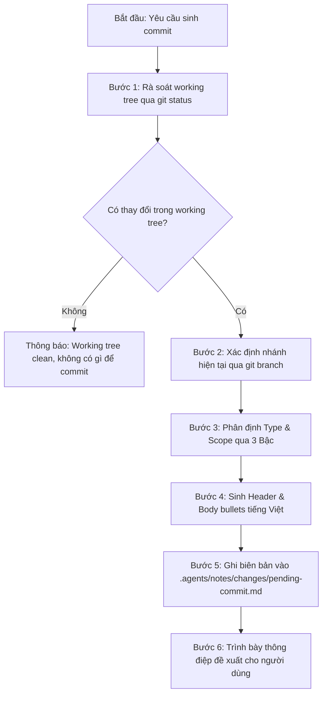

# Kỹ Năng Tự Động Sinh Commit Tiếng Việt (generate-commit)

Kỹ năng này hướng dẫn AI Agent **tự động phân tích toàn diện thay đổi mã nguồn trong Git working tree**, ánh xạ phạm vi kiến trúc theo quy chuẩn dự án GDMAS, sinh **Conventional Commit hoàn toàn bằng tiếng Việt** và lưu biên bản cục bộ vào `.agents/notes/changes/pending-commit.md`.

> [!IMPORTANT]
> - **Thực thi trực tiếp bằng Agent (No External Scripts):** Agent tự thực hiện quy trình bằng các lệnh Git và công cụ thao tác tệp, không phụ thuộc vào script `.ps1` hay `.sh` bên ngoài.
> - **Tiêu chuẩn ngôn ngữ:** Mọi thông điệp commit (cả Header và Body bullets) bắt buộc phải là **tiếng Việt**, văn phong kỹ thuật chuẩn mực, súc tích, chữ thường, không chấm câu cuối tiêu đề.
> - **Context-First (Tiết kiệm Token):** Ưu tiên đọc Mục 5 & Mục 6 của Cửa Sổ Ngữ Cảnh [`.agents/notes/memory/context-memory.md`](file:///d:/KHDLKPDL/GDMAS/.agents/notes/memory/context-memory.md) để xác định ngữ cảnh nhánh trước khi quét toàn bộ diff.
> - **Lưu trữ cục bộ an toàn:** Tệp biên bản ghi nhận tại `.agents/notes/changes/pending-commit.md` được loại trừ trong `.gitignore`, không bao giờ commit tệp này lên remote repository.

---

## 🧭 Quy Trình Thực Thi Dành Cho Agent (Agent Execution Workflow)



---

## 🛠️ Hướng Dẫn Từng Bước Cho Agent

### Bước 1: Rà soát cây làm việc (Working Tree Inspection)
Agent thực thi lệnh kiểm tra trạng thái Git:
```bash
git status --porcelain -uall
git diff --cached --stat
git diff --stat
```
* Nếu không có dòng nào xuất ra: Thông báo cho người dùng `Working tree sạch sẽ, không có thay đổi nào cần commit`.
* Nếu có tệp nhạy cảm (như `.env`, `.env.local` không phải `.env.example`): Cảnh báo và dùng `git restore --staged <file>` để loại khỏi staging ngay lập tức.

### Bước 2: Xác định nhánh hiện tại (Branch Resolution)
```bash
git branch --show-current
```
* Ghi nhận tên nhánh hiện tại (ví dụ: `feature/ingestion-usgs-api-test`, `develop`, `chore/skills-update-system`).
* Nếu nhánh theo chuẩn `<type>/<scope>-<slug>`, Agent có thể tận dụng `<type>` và `<scope>` từ tên nhánh làm gợi ý ưu tiên.

### Bước 3: Phân định Type & Scope qua Cơ chế 3 Bậc (3-Tier Engine)

1. **Bậc 1 (Người dùng chỉ định):**
   * Nếu người dùng truyền thông điệp hoặc yêu cầu cụ thể (ví dụ: *"commit: sửa lỗi sse kết nối lại"*), Agent ưu tiên trích xuất nội dung từ yêu cầu của người dùng.
2. **Bậc 2 (Cửa Sổ Ngữ Cảnh - Token Saver):**
   * Đọc Mục 5 của [`.agents/notes/memory/context-memory.md`](file:///d:/KHDLKPDL/GDMAS/.agents/notes/memory/context-memory.md).
   * Nếu tên nhánh trong memory khớp với nhánh hiện tại, nạp `Type`, `Scope` và `Tiêu đề đề xuất` từ snapshot có sẵn.
3. **Bậc 3 (Ánh xạ động từ danh sách tệp thay đổi):**
   * Dựa vào danh sách đường dẫn tệp thay đổi, tra cứu Bảng Ánh Xạ Kiến Trúc GDMAS:

| Đường dẫn tệp thay đổi | `type` | `scope` | Mô tả tiếng Việt chuẩn |
| :--- | :--- | :--- | :--- |
| `apps/web/src/components/charts/*` | `feat` | `web` | `trực quan hóa biểu đồ chuỗi thời gian địa chấn` |
| `apps/web/src/layouts/*` | `feat` | `web` | `cập nhật cấu trúc layout giao diện frontend` |
| `apps/web/src/features/dashboard/*`| `feat` | `web` | `cập nhật bảng điều khiển tổng quan dashboard` |
| `apps/web/src/features/statistics/*` | `feat`| `web` | `tích hợp hiển thị 6 patterns chuỗi thời gian` |
| `apps/web/src/features/earthquakes/*`| `feat` | `web` | `cập nhật danh mục và bộ lọc sự kiện địa chấn` |
| `apps/web/*` tổng quát | `feat` | `web` | `cập nhật giao diện người dùng và tương tác frontend` |
| `apps/api/src/gdmas/services/ingestion/*` | `feat` | `ingestion` | `cập nhật tiến trình nạp dữ liệu USGS` |
| `apps/api/src/gdmas/services/analysis/*` | `feat` | `analysis` | `cập nhật thuật toán phân tích chuỗi thời gian` |
| `apps/api/src/gdmas/services/clustering/*` | `feat` | `clustering` | `cập nhật thuật toán gom cụm không gian` |
| `apps/api/src/gdmas/services/prediction/*` | `feat` | `prediction` | `cập nhật mô hình dự báo địa chấn` |
| `apps/api/src/gdmas/api/routes/stream.py` | `feat` | `realtime` | `cập nhật dịch vụ streaming dữ liệu SSE thời gian thực` |
| `apps/api/src/gdmas/api/routes/patterns.py` | `feat` | `patterns` | `cung cấp endpoint truy vấn 6 patterns CSDL` |
| `apps/api/src/gdmas/db/*` & `alembic/*` | `feat` | `db` | `cập nhật cấu trúc cơ sở dữ liệu và migrations` |
| `apps/api/*` tổng quát | `feat` | `api` | `cập nhật dịch vụ backend và endpoint REST/SSE` |
| `contracts/*` | `chore` | `contracts` | `chuẩn hóa hợp đồng dữ liệu dùng chung API-Web` |
| `docs/testing/*` | `docs` | `testing` | `cập nhật hệ thống kịch bản kiểm thử chức năng và phi chức năng` |
| `docs/yeucaubatbuoc.md` | `docs` | `requirements` | `cập nhật đặc tả yêu cầu đồ án cuối kỳ` |
| `docs/*` tổng quát | `docs` | `core` | `cập nhật hệ thống tài liệu kỹ thuật dự án` |
| `.agents/*` hoặc `.claude/*` | `chore` | `agents` | `chuẩn hóa và tối ưu hóa các kỹ năng AI agent` |
| `scripts/*` | `chore` | `scripts` | `cập nhật kịch bản kiểm thử và tự động hóa` |
| Gốc dự án / Dockerfile / dev.ps1 | `chore` | `project` | `cập nhật tài nguyên và cấu hình môi trường dự án` |

---

### Bước 4: Soạn thảo thông điệp Conventional Commit

Định dạng bắt buộc:
```text
<type>(<scope>): <tiêu đề ngắn gọn bằng tiếng Việt, chữ thường, không dấu chấm cuối câu>

- <Gạch đầu dòng 1: Mô tả ngắn gọn nội dung thay đổi chính>
- <Gạch đầu dòng 2: Mô tả ngắn gọn nội dung thay đổi liên quan>
- <Gạch đầu dòng 3: Tác động kiến trúc hoặc kiểm thử>
```

**Quy tắc biên soạn nội dung:**
* Tiêu đề: Tối đa 72 ký tự, động từ hành động tiếng Việt ở đầu (ví dụ: `bổ sung`, `cập nhật`, `tối ưu`, `sửa lỗi`, `chuẩn hóa`).
* Body: Từ 3 đến 8 gạch đầu dòng, mỗi dòng từ 10 - 25 từ, đi thẳng vào bản chất công việc kỹ thuật đã thực hiện.

---

### Bước 5: Ghi nhật ký vào `.agents/notes/changes/pending-commit.md`

Agent sử dụng công cụ `write_file` để lưu bản ghi vào đường dẫn:
`d:\KHDLKPDL\GDMAS\.agents\notes\changes\pending-commit.md`

Nội dung mẫu biên bản:
```markdown
# [BẢN GHI COMMIT ĐANG CHỜ - PENDING COMMIT RECORD]
- **Thời gian tạo:** YYYY-MM-DD HH:mm:ss (UTC+07:00)
- **Nhánh hiện tại (Branch):** <branch-name>
- **Nguồn xác định:** ⚡ Phân tích động Working Tree
- **Phân loại (Type):** <type>
- **Phạm vi (Scope):** <scope>

## 1. Thông Điệp Commit Đề Xuất (Conventional Commit)
### Tiêu đề (Header):
```text
<type>(<scope>): <subject>
```

### Nội dung chi tiết (Body tiếng Việt):
```text
- <Chi tiết 1>
- <Chi tiết 2>
- <Chi tiết 3>
```

## 2. Danh Sách Tệp Tác Động
```text
<Kết quả git status rút gọn>
```

---
*Bản ghi này được sinh tự động bằng tiếng Việt bởi kỹ năng generate-commit và chỉ lưu trữ cục bộ tại .agents/notes/.*
```

---

### Bước 6: Trình bày cho người dùng
* In ra thông điệp commit rõ ràng trong khung code block.
* Báo cáo đường dẫn tệp pending-commit đã được cập nhật.
* Gợi ý người dùng: *"Bạn có muốn thực hiện commit và push ngay bằng kỹ năng `/git-commit-push` không?"*
