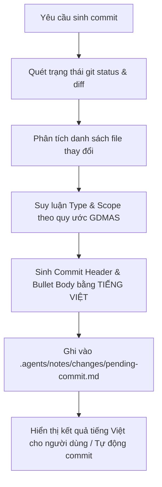

# Kỹ Năng Tự Động Sinh Commit Bằng Tiếng Việt (generate-commit)

Kỹ năng này chịu trách nhiệm **phân tích sự thay đổi giữa working tree hiện tại so với mã nguồn gốc**, tự động ghi nhật ký vào thư mục `.agents/notes/changes/pending-commit.md` và sinh ra **Conventional Commit message hoàn toàn bằng tiếng Việt** chuẩn hóa theo đúng quy ước của dự án GDMAS.

> [!IMPORTANT]
> - **Tiêu chuẩn ngôn ngữ:** Mọi thông điệp commit bao gồm phần tóm tắt (Subject) và nội dung chi tiết (Body bullets) bắt buộc phải được tạo bằng **tiếng Việt**.
> - **Lưu trữ cục bộ:** Tệp nhật ký chỉ được lưu trữ cục bộ tại `.agents/notes/changes/pending-commit.md` (được bảo vệ trong `.gitignore`, không đẩy lên remote repository). Không bao giờ tạo thư mục `.agents` lồng nhau.

---

## 🧭 Quy Trình Hoạt Động (Workflow)



---

## 📋 Tiêu Chuẩn Phân Loại & Mẫu Commit Tiếng Việt

| Vùng tệp thay đổi | `type` | `scope` | Ví dụ Commit Header (Tiếng Việt) |
| :--- | :--- | :--- | :--- |
| `docs/setup.md` | `docs` | `setup` | `docs(setup): cập nhật cấu hình môi trường local và lệnh cài đặt` |
| `docs/architecture/*` | `docs` | `architecture` | `docs(architecture): hoàn thiện tài liệu thiết kế SAD và ERD` |
| `docs/api/*` | `docs` | `api` | `docs(api): đặc tả chi tiết REST API và kênh streaming SSE` |
| `docs/*` tổng quát | `docs` | `core` | `docs(core): hoàn thiện hệ thống tài liệu kỹ thuật toàn diện` |
| `apps/api/src/gdmas/services/ingestion` | `feat` / `fix` | `ingestion` | `feat(ingestion): bổ sung cơ chế retry nạp dữ liệu động đất từ USGS` |
| `apps/api/src/gdmas/services/analysis` | `feat` / `fix` | `analysis` | `feat(analysis): hoàn thành thuật toán phân tích 6 patterns chuỗi thời gian` |
| `apps/api/src/gdmas/services/clustering` | `feat` / `fix` | `clustering` | `feat(clustering): tối ưu hóa tham số eps và min_samples cho DBSCAN` |
| `apps/api/src/gdmas/services/prediction` | `feat` / `fix` | `prediction` | `feat(prediction): tích hợp mô hình dự báo rủi ro động đất` |
| `apps/api/*` tổng quát | `feat` / `fix` | `api` | `feat(api): cập nhật các endpoint và controller dịch vụ backend` |
| `apps/web/*` | `feat` / `fix` | `web` | `feat(web): vẽ marker địa chấn trên bản đồ Leaflet và tích hợp SSE` |
| `.agents/skills/*` | `chore` | `agents` | `chore(agents): chuẩn hóa kỹ năng tạo commit tiếng Việt và đề xuất nhánh` |
| `scripts/*` | `chore` | `scripts` | `chore(scripts): bổ sung script kiểm thử tự động nội bộ` |

---

## 📝 Định Dạng Thông Điệp Chuẩn

Khi sinh commit, kỹ năng phải định dạng:

**Header:**
```text
<type>(<scope>): <mô tả ngắn gọn hành động bằng tiếng Việt, chữ thường, không dấu chấm cuối câu>
```

**Body (Các gạch đầu dòng chi tiết bằng tiếng Việt):**
```text
- Bổ sung/Cập nhật <chi tiết tính năng, logic thay đổi>
- Tối ưu hóa/Sửa lỗi <nguyên nhân và cách xử lý>
- Đồng bộ hóa tài liệu hoặc cấu hình liên quan
```

---

## ⚡ Cách Kích Hoạt & Sử Dụng

### 1. Kích hoạt tự nhiên qua hội thoại
Chỉ cần yêu cầu trong chat:
- *"Hãy phân tích thay đổi và sinh commit message bằng tiếng Việt"*
- *"Ghi lại thay đổi vào notes/changes và tạo commit"*

Agent sẽ đọc diff, cập nhật vào `.agents/notes/changes/pending-commit.md`, và phản hồi thông điệp commit bằng tiếng Việt.

### 2. Chạy kịch bản tự động bằng PowerShell
```powershell
# Chỉ sinh commit tiếng Việt và ghi vào notes/changes:
.\.agents\skills\generate-commit\scripts\generate-commit.ps1

# Sinh commit tiếng Việt VÀ tự động commit luôn:
.\.agents\skills\generate-commit\scripts\generate-commit.ps1 -Commit

# Sinh commit tiếng Việt, commit VÀ push lên remote:
.\.agents\skills\generate-commit\scripts\generate-commit.ps1 -Push
```

### 3. Chạy kịch bản bằng Bash
```bash
bash .agents/skills/generate-commit/scripts/generate-commit.sh
```

---

## 📁 Nhật Ký Thay Đổi Cục Bộ
Tệp kết quả được lưu tại:
- [`.agents/notes/changes/pending-commit.md`](file:///D:/KHDLKPDL/GDMAS/.agents/notes/changes/pending-commit.md)

Tệp này ghi nhận đầy đủ lịch sử: thời gian, nhánh, phân loại, tiêu đề commit và danh sách tệp bị tác động.
