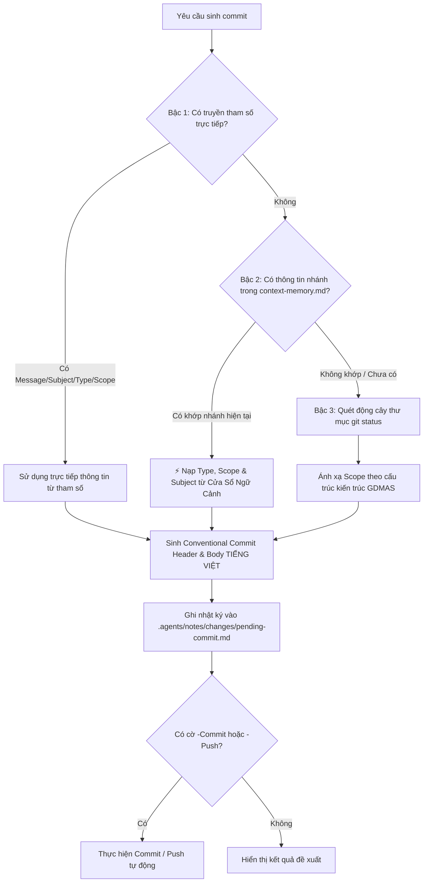

# Kỹ Năng Tự Động Sinh Commit Bằng Tiếng Việt (generate-commit)

Kỹ năng này chịu trách nhiệm **phân tích sự thay đổi giữa working tree hiện tại so với mã nguồn gốc**, tự động ghi nhật ký vào thư mục `.agents/notes/changes/pending-commit.md` và sinh ra **Conventional Commit message hoàn toàn bằng tiếng Việt** chuẩn hóa theo đúng quy ước của dự án GDMAS.

> [!IMPORTANT]
> - **Nguyên tắc Bất Biến (Skill Stability):** Kỹ năng được thiết kế theo cơ chế **Phân Định 3 Bậc (3-Tier Resolution Engine)**. Tuyệt đối không hardcode nội dung tác vụ tạm thời vào code. Kỹ năng thích ứng tự động với mọi nhánh và mọi tác vụ mới.
> - **Tiêu chuẩn ngôn ngữ:** Mọi thông điệp commit bao gồm phần tóm tắt (Subject) và nội dung chi tiết (Body bullets) bắt buộc phải được tạo bằng **tiếng Việt**.
> - **Tiết kiệm Token (Context-First Workflow):** Kỹ năng **ưu tiên đọc thẳng Mục 5 & Mục 6 của Cửa Sổ Ngữ Cảnh (`.agents/notes/memory/context-memory.md`)** để nạp phân loại `Type`, `Scope` và tóm tắt đã được đánh dấu theo nhánh.
> - **Lưu trữ cục bộ:** Tệp nhật ký chỉ được lưu trữ cục bộ tại `.agents/notes/changes/pending-commit.md` (được bảo vệ trong `.gitignore`, không đẩy lên remote repository). Không bao giờ tạo thư mục `.agents` lồng nhau.

---

## 🧭 Cơ Chế Phân Định 3 Bậc (3-Tier Resolution Engine)



---

## 📋 Tiêu Chuẩn Phân Loại Kiến Trúc GDMAS

| Vùng tệp thay đổi | `type` | `scope` | Tiêu đề mặc định (khi không truyền tham số) |
| :--- | :--- | :--- | :--- |
| `apps/web/src/components/charts/*` | `feat` | `web` | `trực quan hóa biểu đồ chuỗi thời gian địa chấn` |
| `apps/web/src/layouts/*` | `feat` | `web` | `cập nhật cấu trúc layout giao diện frontend` |
| `apps/web/*` tổng quát | `feat` | `web` | `cập nhật giao diện người dùng và tương tác frontend` |
| `apps/api/src/gdmas/services/ingestion` | `feat` | `ingestion` | `cập nhật tiến trình nạp dữ liệu USGS` |
| `apps/api/src/gdmas/services/analysis` | `feat` | `analysis` | `cập nhật thuật toán phân tích chuỗi thời gian` |
| `apps/api/src/gdmas/services/clustering` | `feat` | `clustering` | `cập nhật thuật toán gom cụm không gian` |
| `apps/api/src/gdmas/services/prediction` | `feat` | `prediction` | `cập nhật mô hình dự báo địa chấn` |
| `apps/api/src/gdmas/realtime` | `feat` | `realtime` | `cập nhật dịch vụ streaming dữ liệu SSE` |
| `apps/api/src/gdmas/db` & `alembic` | `feat` | `db` | `cập nhật cấu trúc cơ sở dữ liệu và migrations` |
| `apps/api/*` tổng quát | `feat` | `api` | `cập nhật dịch vụ backend và endpoint REST/SSE` |
| `contracts/*` | `chore` | `contracts` | `chuẩn hóa hợp đồng dữ liệu dùng chung API-Web` |
| `docs/setup.md` | `docs` | `setup` | `cập nhật hướng dẫn cài đặt và cấu hình môi trường` |
| `docs/architecture/*` | `docs` | `architecture` | `cập nhật tài liệu kiến trúc hệ thống và luồng dữ liệu` |
| `docs/*` tổng quát | `docs` | `core` | `cập nhật hệ thống tài liệu kỹ thuật dự án` |
| `.agents/*` | `chore` | `agents` | `chuẩn hóa và tối ưu hóa các kỹ năng AI agent` |
| `scripts/*` | `chore` | `scripts` | `cập nhật kịch bản kiểm thử và tự động hóa` |
| Khác / Gốc dự án | `chore` | `project` | `cập nhật tài nguyên và cấu hình dự án` |

---

## 📝 Định Dạng Thông Điệp Chuẩn

```text
<type>(<scope>): <mô tả hành động bằng tiếng Việt, chữ thường, không dấu chấm cuối câu>

- <Chi tiết thay đổi 1>
- <Chi tiết thay đổi 2>
```

---

## ⚡ Cách Kích Hoạt & Sử Dụng

### 1. Kích hoạt tự nhiên qua hội thoại
Chỉ cần yêu cầu trong chat:
- *"Hãy phân tích thay đổi và sinh commit message bằng tiếng Việt"*
- *"Ghi lại thay đổi vào notes/changes và tạo commit"*
- *"Tạo commit: thêm bộ lọc bản đồ theo độ sâu"*

### 2. Chạy kịch bản tự động bằng PowerShell
```powershell
# 1. Tự động suy luận động và ghi bản ghi:
.\.agents\skills\generate-commit\scripts\generate-commit.ps1

# 2. Truyền thông điệp ngữ nghĩa cụ thể (Agent hoặc Dev truyền trực tiếp):
.\.agents\skills\generate-commit\scripts\generate-commit.ps1 -Subject "tối ưu hóa tham số eps cho DBSCAN" -Commit

# 3. Truyền trọn bộ Conventional Commit:
.\.agents\skills\generate-commit\scripts\generate-commit.ps1 -Message "feat(api): bổ sung route xuất file geojson" -Commit -Push

# 4. Ép quét lại working tree (bỏ qua context memory):
.\.agents\skills\generate-commit\scripts\generate-commit.ps1 -ForceScan
```

### 3. Chạy kịch bản bằng Bash
```bash
# Tự động quét và sinh commit
bash .agents/skills/generate-commit/scripts/generate-commit.sh

# Truyền subject cụ thể và commit
bash .agents/skills/generate-commit/scripts/generate-commit.sh --subject "tích hợp biểu đồ heatmap" --commit
```

---

## 📁 Nhật Ký Thay Đổi Cục Bộ
Tệp kết quả được lưu tại:
- [`.agents/notes/changes/pending-commit.md`](file:///D:/KHDLKPDL/GDMAS/.agents/notes/changes/pending-commit.md)
