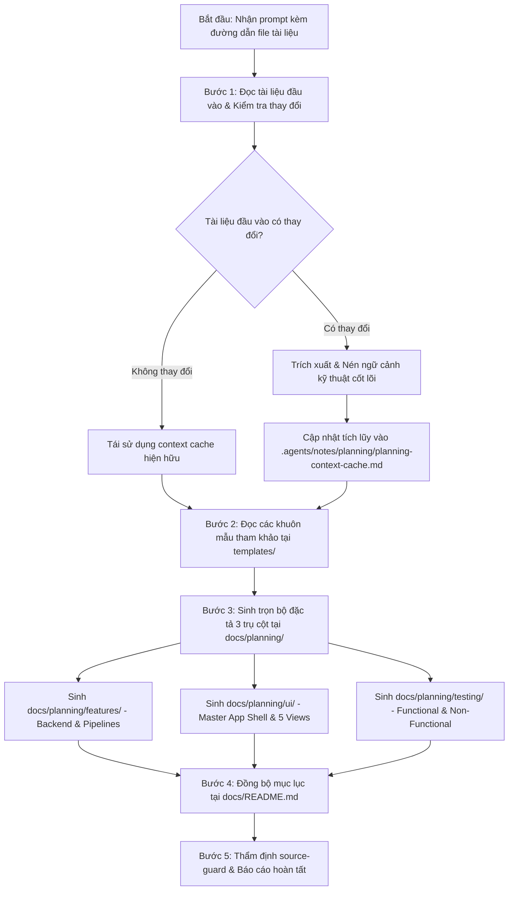

# Kỹ Năng Sinh Tài Liệu Quy Hoạch Hệ Thống (generate-planning)

Kỹ năng này trao quyền cho AI Agent **tự động hóa toàn diện quy trình quy hoạch hệ thống** từ các tài liệu nghiệp vụ, kiến trúc hoặc yêu cầu thô do người dùng cung cấp. Kỹ năng thực hiện trích xuất và nén ngữ cảnh lưu trữ cục bộ tại `.agents/notes/planning/planning-context-cache.md`, sau đó đối chiếu các khuôn mẫu tham chiếu chuẩn mực tại thư mục `templates/` để sinh ra trọn bộ 3 trụ cột quy hoạch kỹ thuật tại `docs/planning/` (gồm **features**, **ui** và **testing**).

> [!IMPORTANT]
> - **Chính sách Lưu trữ Cục bộ (.gitignore Guard):** Tệp bộ nhớ ngữ cảnh nén `.agents/notes/planning/planning-context-cache.md` được cấu hình **bỏ qua hoàn toàn trong `.gitignore`**, chỉ lưu trữ cục bộ trên máy phát triển nhằm tiết kiệm token và bảo mật context của agent.
> - **Nguyên Tắc Bảo Toàn Dữ Liệu Tích Lũy (Accumulative Preservation):** Khi người dùng cập nhật hoặc đưa thêm tài liệu mới, Agent **chỉ cập nhật hoặc bổ sung mới**, tuyệt đối **KHÔNG ĐƯỢC XÓA** các phân hệ, ghi chú hoặc tệp đặc tả đã được xây dựng trước đó.
> - **Kiểm Tra Độ Thay Đổi (Change Detection & Caching):** Nếu tài liệu đầu vào không có sự thay đổi, Agent giữ nguyên tệp cache hiện hữu, không tốn token phân tích lại.
> - **Khuôn Mẫu Tham Khảo Đứng Ngang Hàng:** Mọi tệp đặc tả sinh ra bắt buộc phải tuân thủ cấu trúc của các khuôn mẫu tại thư mục `templates/` nằm ngang hàng với file `SKILL.md` này (`templates/feature-template.md`, `templates/ui-template.md`, `templates/testing-template.md`).
> - **Nguyên Tắc Open-Closed (RULE-03) & Explicit Commit:** Chỉ thêm mới tài liệu trong `docs/planning/`, không sửa mã nguồn đang chạy ổn định. Giữ nguyên working tree và chỉ commit/push khi có yêu cầu bằng văn bản từ người dùng.

---

## 🧭 Quy Trình Thực Thi Dành Cho AI Agent



---

## 🛠️ Hướng Dẫn Từng Bước Thực Hiện Chi Tiết

### Bước 1: Tiếp nhận và phân tích tài liệu đầu vào từ Prompt
1. **Phân tích đường dẫn tệp trong prompt người dùng:**
   * Trích xuất danh sách đường dẫn các tệp tài liệu do người dùng chỉ định (ví dụ: `docs/yeucaubatbuoc.md`, `docs/tailieukientructuAI.md`, `docs/api/API.md`, `docs/architecture/SAD.md`, hoặc bất kỳ tệp nghiệp vụ nào).
2. **Đọc nội dung và kiểm tra độ thay đổi:**
   * Đọc nội dung các tệp tương ứng.
   * So sánh nội dung hiện tại với thông tin lưu trong tệp cache cục bộ `.agents/notes/planning/planning-context-cache.md`.
   * **Nếu không có thay đổi:** Thông báo cho người dùng rằng ngữ cảnh đã sẵn sàng trong cache và chuyển ngay sang Bước 3 để tiết kiệm token.
   * **Nếu có thay đổi hoặc lần đầu chạy:** Tiến hành Bước 2 để nén ngữ cảnh.

---

### Bước 2: Quản lý Bộ Nhớ Ngữ Cảnh Nén Cục Bộ (.agents/notes/planning/)
1. **Trích xuất thông tin cốt lõi (Compressing Context):**
   * Không sao chép nguyên văn hàng ngàn dòng tài liệu. Agent cô đọng các thông số kỹ thuật then chốt:
     - **Kiến trúc & Terminals:** Số lượng dịch vụ độc lập, cổng port, chu kỳ chạy (SLA).
     - **Mô hình Dữ liệu (Schemas):** Các bảng CSDL, khóa chính/ngoại, ràng buộc unique, kiểu tọa độ WGS84, múi giờ UTC.
     - **Yêu cầu Nghiệp vụ cốt lõi:** Các patterns toán học/ML (ví dụ: 6 Patterns chuỗi thời gian, DBSCAN clustering, dự báo $t+1$).
     - **Giao diện & Trải nghiệm:** Quy chuẩn Dark Mode, bảng màu Design Tokens, các views và khả năng tương tác (Zoom & Filter).
     - **Kịch bản Demo & Kiểm thử:** Các bước thực nghiệm của hội đồng (ví dụ: Demo xóa CSDL rỗng §4), tiêu chí phi chức năng (độ trễ SSE $< 100\text{ ms}$, inference $< 500\text{ ms}$).
2. **Ghi tệp Cache Cục Bộ:**
   * Lưu hoặc cập nhật tệp [`.agents/notes/planning/planning-context-cache.md`](GDMAS/.agents/notes/planning/planning-context-cache.md) với cấu trúc chuẩn:
     ```markdown
     # [PLANNING CONTEXT CACHE - BỘ NHỚ NGỮ CẢNH QUY HOẠCH CỤC BỘ]
     - **Cập nhật lần cuối:** <YYYY-MM-DD HH:mm:ss>
     - **Nguồn tài liệu tham chiếu:** <Danh sách các file đầu vào>
     
     ## 1. Bản Đồ Kiến Trúc & Dịch Vụ
     ## 2. Mô Hình Dữ Liệu & Hợp Đồng API
     ## 3. Danh Mục Tính Năng & Patterns Nghiệp Vụ
     ## 4. Quy Chuẩn Giao Diện & Bố Cục
     ## 5. Ràng Buộc Kiểm Thử & Kịch Bản Demo Hội Đồng
     ```
   * **Bảo tồn dữ liệu:** Giữ nguyên các ghi chú hoặc phân hệ đã trích xuất từ trước, chỉ cập nhật bổ sung các thông tin mới.

---

### Bước 3: Tham khảo Khuôn Mẫu (Reference Templates) Ngang Hàng
Trước khi sinh tài liệu, Agent đọc các khuôn mẫu chuẩn tại thư mục `templates/` đứng ngang hàng với file `SKILL.md`:
1. [**`templates/feature-template.md`**](GDMAS/.agents/skills/generate-planning/templates/feature-template.md): Khuôn mẫu chuẩn cho chức năng backend (Mục tiêu, Luồng dữ liệu, Hợp đồng Input/Output, Logic xử lý, Bất biến kiến trúc, Tiêu chí nghiệm thu).
2. [**`templates/ui-template.md`**](GDMAS/.agents/skills/generate-planning/templates/ui-template.md): Khuôn mẫu giao diện 2 tầng (Tầng 1: Master Layout Shell & Tokens; Tầng 2: View Content cắm vào Outlet, Wireframe ASCII, Tương tác Zoom & Filter, 4 Trạng thái giao diện).
3. [**`templates/testing-template.md`**](GDMAS/.agents/skills/generate-planning/templates/testing-template.md): Khuôn mẫu kế hoạch kiểm thử song hành (Functional & Non-Functional: Happy Path, CSDL rỗng Demo §4, Real-time SSE latency, Khung code Pytest & Vitest).

---

### Bước 4: Sinh Trọn Bộ 3 Trụ Cột Quy Hoạch Tại `docs/planning/`
Agent tạo lập hoặc cập nhật các tệp trong 3 thư mục con:

#### 1. Trụ Cột Chức Năng (`docs/planning/features/`):
- `README.md`: Danh mục chức năng, sơ đồ Mermaid tổng thể và ma trận trạng thái.
- `TEMPLATE.md`: Bản sao khuôn mẫu đặc tả chức năng.
- Các tệp đặc tả chi tiết `01-*.md`, `02-*.md`... tương ứng từng Terminal và phân hệ nghiệp vụ.

#### 2. Trụ Cột Giao Diện (`docs/planning/ui/`):
- `README.md`: Danh mục giao diện, sơ đồ Sitemap bố cục 2 tầng và bảng Design Tokens Dark Mode.
- `TEMPLATE.md`: Bản sao khuôn mẫu quy hoạch UI theo bố cục.
- `00-master-app-shell.md`: Đặc tả Tầng 1 (Khung bao ngoài, Sidebar, Header, SSE Pill, Toast).
- Các tệp đặc tả view `01-*-view.md`, `02-*-view.md`... cắm vào `<Outlet />`.

#### 3. Trụ Cột Kiểm Thử (`docs/planning/testing/`):
- `README.md`: Danh mục ca kiểm thử, sơ đồ Testing Triad và bảng ma trận phân hệ.
- `TEMPLATE.md`: Bản sao khuôn mẫu đặc tả kiểm thử dùng để sinh code test.
- Các tệp đặc tả kiểm thử `01-test-*.md`, `02-test-*.md`... bao phủ toàn diện cả kiểm thử chức năng (Functional) và phi chức năng (Non-Functional Resilience Demo §4, Performance, Latency).

#### 4. Cập nhật Mục lục Trung tâm:
- Cập nhật nhánh cây `planning/` và bảng tra cứu trong [`docs/README.md`](GDMAS/docs/README.md).

---

### Bước 5: Thẩm định An toàn Mã nguồn & Báo cáo
1. Chạy quy trình kiểm tra an toàn theo hiến chương [source-guard](GDMAS/.agents/skills/source-guard/SKILL.md):
   * Không có tệp mã nguồn ứng dụng nào bị xóa hay sửa đổi sai quy chuẩn.
   * Số dòng thêm mới vượt trội số dòng xóa.
2. Cập nhật `source-guard-report.md` và `context-memory.md`.
3. Báo cáo bảng tổng kết cho người dùng và **giữ nguyên working tree** (không tự động commit hay push).

---

## 🚫 Điều Kỹ Năng Này Tuyệt Đối Không Làm
- Không xóa các tệp quy hoạch hoặc dữ liệu cache đã được xây dựng trước đó.
- Không sửa đổi mã nguồn vận hành của Backend (`apps/api`) hoặc Frontend (`apps/web`).
- Không đưa tệp cache `.agents/notes/planning/planning-context-cache.md` lên Git repository.
- Không tự ý commit hoặc push mã nguồn khi chưa nhận được lệnh rõ ràng từ người dùng.

