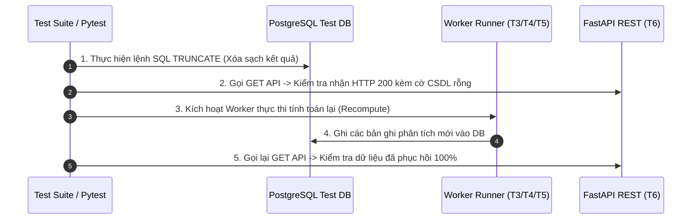

# [KHUÔN MẪU ĐẶC TẢ KẾ HOẠCH KIỂM THỬ (TEST SPECIFICATION TEMPLATE)]

```markdown
# [KẾ HOẠCH KIỂM THỬ: <MÃ TC> - <TÊN CA KIỂM THỬ TIẾNG VIỆT>]

- **Mã kiểm thử (Test ID):** `TC-<PHÂN_HỆ>-<0X>` (ví dụ: `TC-PAT-01`, `TC-UI-01`, `TC-RES-01`)
- **Tên ca kiểm thử:** `<Tên mô tả ngắn gọn>` (ví dụ: `Kiểm thử Phân tích Chuỗi thời gian Pattern 1`)
- **Phân hệ & Terminal:** `T<X> - <Tên Terminal>` (ví dụ: `T3 - Analysis Worker`)
- **Tầng kiểm thử (Level):** `Unit Test` | `Integration Test` | `Component UI Test` | `E2E Resilience Test`
- **Mức độ ưu tiên:** `P0 (Critical - Bắt buộc cho đồ án)` | `P1 (High)` | `P2 (Medium)`
- **Tệp mã nguồn kiểm thử mục tiêu:**
  * Backend: `apps/api/tests/<ten_file_test>.py`
  * Frontend: `apps/web/src/<duong_dan>/<TenComponent>.test.tsx`
  * E2E Script: `scripts/<ten_script>.ps1`
- **Tài liệu tham chiếu:**
  * `docs/yeucaubatbuoc.md` (§2. 6 Patterns, §4. Kịch bản Demo)
  * `docs/planning/features/<ma_feature>.md`
  * `docs/planning/ui/<ma_view>.md`
  * `docs/api/API.md`

---

## 1. Mục Tiêu Kiểm Thử & Truy Vết Nghiệp Vụ (Test Objectives & Traceability)
- **Mục tiêu cốt lõi:** Kiểm tra tính đúng đắn của logic tính toán / giao diện nào?
- **Khía cạnh Chức năng (Functional):** Hành vi mong đợi khi dữ liệu chuẩn.
- **Khía cạnh Phi chức năng (Non-Functional):**
  * Khả năng chịu lỗi khi CSDL rỗng (§4 Demo).
  * Độ trễ thời gian thực (SSE Latency $< 100\text{ ms}$).
  * Hiệu năng suy luận (Inference time $< 500\text{ ms}$) và tối ưu mạng (Debounce 300ms).

---

## 2. Điều Kiện Tiên Quyết & Dữ Liệu Mẫu (Prerequisites & Fixtures)
- **Trạng thái hệ thống trước test:** CSDL sẵn sàng, migration mới nhất.
- **Dữ liệu mẫu (Mock Fixtures):** Chuẩn WGS84, ISO 8601 UTC và USGS GeoJSON fixtures.

---

## 3. Ma Trận Kịch Bản Kiểm Thử Chi Tiết (Test Scenarios & Assertions)
| ID Kịch Bản | Mô Tả Kịch Bản | Dữ Liệu Đầu Vào | Các Bước Thực Hiện | Kết Quả Mong Đợi (Assertions) |
| :---: | :--- | :--- | :--- | :--- |
| **SC-01** | **Happy Path:** Dữ liệu chuẩn | Input hợp lệ | 1. Setup dữ liệu<br>2. Gọi hàm/API/render | • Trả về kết quả đầy đủ<br>• Mã HTTP 200 OK |
| **SC-02** | **Edge Case:** CSDL rỗng (Demo §4) | CSDL 0 bản ghi | 1. TRUNCATE DB<br>2. Kiểm tra phản hồi | • Không sập server 500<br>• Web hiển thị Empty State |
| **SC-03** | **Boundary Value:** Giá trị cực đại | $M = 9.5$, biên WGS84 | 1. Bắn sự kiện biên<br>2. Kiểm tra lưu trữ | • Không tràn số, lưu trữ chuẩn xác |
| **SC-04** | **Failure / Timeout:** Mất mạng | Mock lỗi mạng | 1. Bắn lỗi timeout<br>2. Kiểm tra log | • Ghi log `service_runs`, tự thử lại |

---

## 4. Kịch Bản Kiểm Thử Khả Năng Phục Hồi Dữ Liệu (Demo Resilience Test §4)


---

## 5. Khung Mã Nguồn Kiểm Thử Mẫu (Executable Code Scaffolds)
*(Cung cấp khung code Pytest Backend hoặc Vitest Frontend hoặc PowerShell Script)*

---

## 6. Tiêu Chuẩn Nghiệm Thu Đạt / Không Đạt (Pass / Fail Criteria & DoD)
- [ ] **100% Tests Pass:** Không có lỗi ngoại lệ chưa được xử lý.
- [ ] **Độ phủ mã nguồn (Coverage):** Module đạt tối thiểu $\ge 70 - 85\%$ coverage theo `TESTING.md`.
- [ ] **Thời gian thực thi:** Hoàn thành dưới 5 giây.
```

