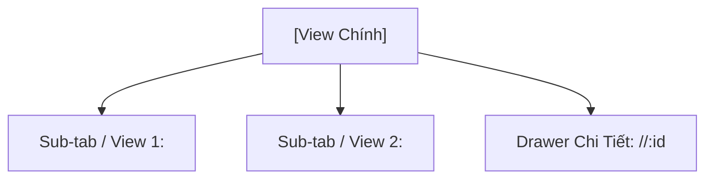

# [KHUÔN MẪU ĐẶC TẢ GIAO DIỆN THEO BỐ CỤC 2 TẦNG (UI SPECIFICATION TEMPLATE)]

> 💡 **Kiến trúc giao diện GDMAS (Two-Tier Layout-Centric):**
> 1. **Tầng 1 (Layout Shell):** Dùng để đặc tả Khung bố cục chung, Design System Tokens, Sidebar, Header, Breadcrumbs, Đèn báo SSE và Global Toast.
> 2. **Tầng 2 (View Content):** Dùng để đặc tả các trang nội dung con cắm vào `<Outlet />` của Layout Shell.

---

## 🏛️ DẠNG 1: KHUÔN MẪU ĐẶC TẢ TẦNG 1 — KHUNG LAYOUT CHUNG (MASTER LAYOUT SPEC)

```markdown
# [ĐẶC TẢ BỐ CỤC GIAO DIỆN: <TÊN BỐ CỤC>]

- **Mã bố cục:** LAYOUT-0X (ví dụ: `LAYOUT-01`)
- **Tên bố cục:** `<Tên bố cục>` (ví dụ: `Master App Shell Layout`)
- **Phạm vi áp dụng:** Dùng chung cho các trang (`/`, `/earthquakes`, `/analytics`, `/clusters`, `/system`)
- **Vị trí nhúng nội dung động:** Thẻ `<Outlet />` (React Router v6)
- **Chế độ hiển thị:** Dark Mode mặc định (`Slate 900` / `#0f172a`)

---

## 1. Mục Tiêu & Nguyên Tắc Thiết Kế Bố Cục (Layout Objectives)
- Đảm bảo tính nhất quán thị giác 100% giữa tất cả các màn hình con (Anti-UI Drift).
- Đóng gói toàn bộ thanh điều hướng, cơ chế thông báo Real-time SSE toàn cục và trạng thái kết nối mạng.

---

## 2. Bản Đặc Tả Design Tokens Chuẩn (Design Tokens Specification)

### 2.1. Bảng màu chuẩn Dark Mode (Color Palette)
- **Nền chính (Background Root):** `#0f172a` (`slate-900`)
- **Nền khung thẻ / Card Surface:** `#1e293b` (`slate-800`)
- **Đường viền ngăn cách (Borders):** `#334155` (`slate-700`)
- **Màu nhấn thương hiệu (Primary Accent):** `#38bdf8` (`sky-400` / `sky-500`)
- **Màu cảnh báo địa chấn mạnh (Danger):** `#f43f5e` (`rose-500`)
- **Màu cảnh báo trung bình (Warning):** `#f59e0b` (`amber-500`)
- **Màu an toàn / SSE Live (Success):** `#10b981` (`emerald-500`)
- **Chữ chính (Text Primary):** `#f8fafc` (`slate-50`)
- **Chữ phụ (Text Secondary):** `#94a3b8` (`slate-400`)

### 2.2. Quy chuẩn Typography & Spacing
- **Font chữ:** Inter hoặc Tailwind `font-sans`.
- **Bo góc:** `rounded-xl` (12px) cho Cards, `rounded-lg` (8px) cho Inputs/Buttons.
- **Lề & Đệm:** Padding nội dung trang `p-6` (24px), khoảng cách `gap-6`.

---

## 3. Sơ Đồ Phân Vùng Khung Bố Cục (Wireframe Layout Shell)

```text
┌────────────────────────────────────────────────────────────────────────────────────────┐
│ TOP HEADER: Logo GDMAS │ Breadcrumbs │ Live Clock UTC/Local │ [🟢 SSE: Live] │ Theme   │
├──────────────┬─────────────────────────────────────────────────────────────────────────┤
│ SIDEBAR      │ MAIN CONTENT REGION (<Outlet />)                                        │
│ (W: 260px)   │                                                                         │
│              │  [NỘI DUNG TỪNG TRANG SẼ ĐƯỢC CẮM VÀO KHU VỰC NÀY]                     │
│ ──────────── │                                                                         │
│ DB Status:   │                                                                         │
│ [🟢 Active]  │                                                                         │
├──────────────┴─────────────────────────────────────────────────────────────────────────┤
│ GLOBAL TOAST CONTAINER (Góc dưới phải): Pop-up thông báo khi có trận động đất mới (SSE)│
└────────────────────────────────────────────────────────────────────────────────────────┘
```

---

## 4. Tiêu Chí Nghiệm Thu Bố Cục (Layout Acceptance Criteria)
- [ ] **AC-LAYOUT-01:** Khung Master App Shell hiển thị chuẩn xác trên Desktop (1366px - 1920px+).
- [ ] **AC-LAYOUT-02:** Đồng bộ trạng thái menu Active chính xác khi chuyển đổi route.
- [ ] **AC-LAYOUT-03:** Đèn báo trạng thái SSE phản hồi chính xác khi backend bật/tắt.
- [ ] **AC-LAYOUT-04:** Toast thông báo Realtime nảy đều đặn và tự đóng sau 5s.
- [ ] **AC-LAYOUT-05:** 100% trang con thừa hưởng toàn bộ Design Tokens Dark Mode.
```

---

## 📄 DẠNG 2: KHUÔN MẪU ĐẶC TẢ TẦNG 2 — NỘI DUNG VIEW TỪNG TRANG (VIEW CONTENT SPEC)

```markdown
# [ĐẶC TẢ GIAO DIỆN VIEW: <TÊN VIEW>]

- **Mã view:** VIEW-0X (ví dụ: `VIEW-01`)
- **Tên view:** `<Tên trang tiếng Việt>` (ví dụ: `Dashboard Điều Hành Tổng Quan`)
- **Route URL chính:** `/<duong-dan>` (ví dụ: `/analytics`)
- **Khung bố cục kế thừa:** `LAYOUT-01 (Master App Shell)`
- **Chế độ hiển thị:** Dark Mode mặc định (`#0f172a`)

---

## 1. Mục Tiêu Nghiệp Vụ & Đối Tượng Sử Dụng (View Purpose & Persona)
- Màn hình này giải quyết bài toán gì và mang lại giá trị quan sát nào?
- Kịch bản quan sát của giảng viên, hội đồng chấm thi và nhà nghiên cứu.

---

## 2. Cây Cấu Trúc View & Các Thành Phần Con (Sub-Views, Tabs & Drawers)


---

## 3. Ma Trận Tổ Hợp Chức Năng Trên View (Features Composition Matrix)
| Vùng Hiển Thị Trên View | Chức Năng Được Tích Hợp | Dữ Liệu Hiển Thị | Nguồn API / SSE |
| :--- | :--- | :--- | :--- |
| **Thẻ KPI Đầu View** | `FEAT-02` & `FEAT-05` | Tổng sự kiện 24h, Huy hiệu rủi ro $t+1$ | `GET /api/v1/statistics/earthquakes` |
| **Khối Trực Quan Chính**| `FEAT-03` | Biểu đồ chuỗi thời gian Recharts kèm Zoom Brush | `GET /api/v1/analysis/patterns` |
| **Bảng Dữ Liệu** | `FEAT-02` | Bảng phân trang các sự kiện địa chấn | `GET /api/v1/earthquakes?page=1` |

---

## 4. Bố Cục Không Gian Nội Dung Trong `<Outlet />` (Internal View Layout)
```text
┌───────────────────────────────────────────────────────────────────────────────────┐
│ VIEW HEADER: Tiêu đề trang con, Bộ chọn dải ngày, Nút xuất báo cáo / Làm mới      │
├───────────────────────────────────────────────────────────────────────────────────┤
│ KHỐI 1 (TOP): 4 Thẻ KPI Tóm Tắt (Tổng số trận, Trận lớn nhất, Xu hướng, Rủi ro)   │
├────────────────────────────────────────┬──────────────────────────────────────────┤
│ KHỐI 2 (MAIN WORKSPACE - TRÁI 65%):    │ KHỐI 3 (CONTROL & LIST - PHẢI 35%):      │
│ • Trực quan hóa chính (Leaflet / Rechart)│ • Bộ lọc động (Magnitude, Depth slider)  │
│ • Thanh trượt phóng to Zoom Brush      │ • Danh sách sự kiện mới nhất             │
├────────────────────────────────────────┴──────────────────────────────────────────┤
│ KHỐI 4 (BOTTOM): Bảng số liệu thống kê phụ trợ / Biểu đồ chi tiết liên quan        │
└───────────────────────────────────────────────────────────────────────────────────┘
```

---

## 5. Khả Năng Tương Tác & Điểm Cộng Người Dùng (§5.2)
- **Bộ lọc động đa chiều:** Slider độ lớn Richter $0.0 - 9.0$ có Debounce 300ms, lọc độ sâu chấn tiêu.
- **Tương tác phóng to Zoom & Pan:** Thanh trượt `<Brush />` trong Recharts hoặc cuộn Zoom trên bản đồ Leaflet.

---

## 6. Xử Lý 4 Trạng Thái Giao Diện Bắt Buộc
1. **Loading State:** Skeleton Loader giả lập khung biểu đồ và bảng dữ liệu.
2. **Empty State (CSDL rỗng - Demo §4):** Thông báo CSDL trống kèm nút điều hướng sang chạy worker.
3. **Error State:** Khối lỗi màu đỏ cục bộ kèm nút "Tải lại dữ liệu".
4. **Live Update State:** Cập nhật mượt mà khi nhận sự kiện SSE mới.

---

## 7. Tiêu Chí Nghiệm Thu Giao Diện View (View Acceptance Criteria)
- [ ] **AC-VIEW-01 (Kế thừa chuẩn Shell):** Khớp 100% với layout của App Shell, không lệch màu Dark Mode.
- [ ] **AC-VIEW-02 (Dữ liệu động API thật):** 100% dữ liệu hiển thị nạp từ Backend API qua F12 tab Network.
- [ ] **AC-VIEW-03 (Tương tác Zoom & Filter):** Thao tác kéo Slider và Zoom Brush phản hồi mượt dưới 100ms.
- [ ] **AC-VIEW-04 (Khả năng chịu lỗi Demo §4):** Khi CSDL rỗng, hiển thị đúng Empty state, không sập màn hình trắng.
- [ ] **AC-VIEW-05 (Drawer & Chi tiết):** Mở xem chi tiết sự kiện mượt mà mà không làm tải lại toàn bộ trang.
```

