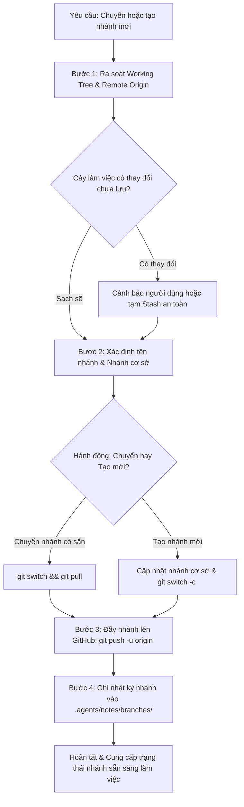

# Kỹ Năng Chuyển & Tạo Nhánh Git Kèm Đẩy Lên GitHub (git-branch-push)

Kỹ năng này chịu trách nhiệm **chuyển nhánh hoặc khởi tạo nhánh Git mới chuẩn hóa theo quy ước dự án GDMAS**, đồng thời **tự động đẩy (push) và thiết lập upstream tracking lên kho mã nguồn GitHub**. Kỹ năng đảm bảo an toàn tuyệt đối cho cây mã nguồn làm việc, tuân thủ nguyên tắc Open-Closed (RULE-03) và ghi vết cục bộ tại `.agents/notes/branches/`.

> [!IMPORTANT]
> - **Chuẩn đặt tên nhánh GDMAS:** `<type>/<scope>-<short-description>` (toàn bộ chữ thường, nối bằng dấu gạch ngang `-`).
> - **Bảo vệ nhánh chính (`main`):** Tuyệt đối không làm việc trực tiếp trên `main`. Mọi nhánh mới phải xuất phát từ `develop` (hoặc nhánh cơ sở chỉ định), trừ trường hợp `hotfix/` xuất phát từ `main`.
> - **Đồng bộ GitHub:** Tự động thực hiện `git push -u origin <branch>` để nhánh sẵn sàng cho Pull Request trên GitHub.
> - **Lưu trữ nhật ký cục bộ:** Ghi biên bản tạo/chuyển nhánh vào `.agents/notes/branches/` (thư mục được bảo vệ trong `.gitignore` để không làm ô nhiễm kho lưu trữ).

---

## 🧭 Quy Trình Hoạt Động (Workflow)



---

## 🛠️ Hướng Dẫn Từng Bước (Step-by-Step Instructions)

### Bước 1: Rà soát Cây Làm Việc (Pre-flight Inspection)
1. Kiểm tra trạng thái cây làm việc:
   ```bash
   git status -s
   ```
2. Nếu có thay đổi dở dang, đảm bảo không bị mất mã nguồn:
   - Lưu tạm bằng `git stash` trước khi chuyển nhánh, hoặc
   - Sử dụng cờ `-Force` nếu muốn giữ nguyên working tree sang nhánh mới.

### Bước 2: Chuẩn Hóa Tên Nhánh Theo Quy Ước GDMAS
- **Tạo nhánh mới:**
  - Cú pháp: `<type>/<scope>-<short-description>`
  - Ví dụ:
    - Tái cấu trúc khung dự án: `refactor/core-missing-scaffold`
    - Worker USGS: `feature/ingestion-usgs-worker`
    - Sửa lỗi CORS: `bugfix/api-sse-cors`
    - Viết tài liệu: `docs/api-specification`

### Bước 3: Đồng Bộ Nhánh Cơ Sở & Khởi Tạo Nhánh
1. Kiểm tra sự tồn tại của nhánh cơ sở (`develop` hoặc `main`):
   ```bash
   git fetch origin
   ```
2. Nếu nhánh đích đã tồn tại trên local hoặc remote:
   ```bash
   git switch <branch-name>
   git pull origin <branch-name>
   ```
3. Nếu tạo nhánh mới từ nhánh cơ sở:
   ```bash
   git switch <base-branch>
   git pull origin <base-branch>
   git switch -c <new-branch-name>
   ```

### Bước 4: Đẩy Nhánh Lên GitHub Remote
Thiết lập upstream tracking để lập trình viên và nhóm có thể cộng tác ngay trên GitHub:
```bash
git push -u origin <branch-name>
```

### Bước 5: Ghi Nhật Ký Cục Bộ
Lưu biên bản vào `.agents/notes/branches/<branch-name>.md` để lưu lại thời điểm tạo nhánh, mục đích, nhánh cơ sở và checklist công việc.

---

## ⚡ Cách Sử Dụng & Lệnh Mẫu

### 1. Kích hoạt bằng hội thoại tự nhiên
Người dùng có thể yêu cầu Agent bằng ngôn ngữ tự nhiên:
- *"Hãy tạo nhánh `refactor/core-missing-scaffold` từ nhánh hiện tại và đẩy lên GitHub"*
- *"Tạo nhánh mới để tái cấu trúc mã nguồn API và push lên repo"*
- *"Chuyển sang nhánh develop và đồng bộ về mới nhất"*

### 2. Sử dụng Kịch Bản Tự Động Bằng PowerShell

```powershell
# Cách 1: Chỉ định trực tiếp tên nhánh và đẩy lên GitHub ngay lập tức
.\.agents\skills\git-branch-push\scripts\branch-push.ps1 -BranchName "refactor/core-missing-scaffold" -Push

# Cách 2: Tự động ghép tên nhánh theo chuẩn GDMAS từ Type, Scope và Mô tả
.\.agents\skills\git-branch-push\scripts\branch-push.ps1 -Type "refactor" -Scope "core" -Description "tái cấu trúc khung mã nguồn thiếu" -Push

# Cách 3: Chỉ chuyển sang nhánh đã tồn tại (không tạo mới) và đồng bộ từ GitHub
.\.agents\skills\git-branch-push\scripts\branch-push.ps1 -BranchName "main" -SwitchOnly

# Cách 4: Tạo nhánh từ một nhánh cơ sở chỉ định (ví dụ: docs/core-project-initialization)
.\.agents\skills\git-branch-push\scripts\branch-push.ps1 -BranchName "refactor/core-missing-scaffold" -BaseBranch "docs/core-project-initialization" -Push
```

### 3. Sử dụng Kịch Bản Tự Động Bằng Bash

```bash
# Tạo nhánh mới và đẩy lên remote:
bash .agents/skills/git-branch-push/scripts/branch-push.sh -b "refactor/core-missing-scaffold" -p

# Tạo nhánh kèm mô tả tự sinh tên:
bash .agents/skills/git-branch-push/scripts/branch-push.sh -t "refactor" -s "core" -d "tai-cau-truc-khung-ma-nguon" -p
```

---

## 📋 Tham Số Kịch Bản PowerShell (`branch-push.ps1`)

| Tham số | Kiểu | Mặc định | Ý nghĩa |
| :--- | :--- | :--- | :--- |
| `-BranchName` | String | (Tùy chọn) | Tên nhánh đầy đủ (vd: `refactor/core-missing-scaffold`) |
| `-Type` | String | `feature` | Loại tác vụ: `feature`, `bugfix`, `hotfix`, `docs`, `refactor`, `chore`, `test` |
| `-Scope` | String | `core` | Phạm vi module: `core`, `ingestion`, `analysis`, `clustering`, `prediction`, `api`, `web`, `db` |
| `-Description`| String | `task` | Mô tả ngắn gọn của tác vụ để sinh slug |
| `-BaseBranch` | String | Tự phát hiện | Nhánh cơ sở để rẽ nhánh (mặc định ưu tiên `develop`, nếu chưa có sẽ dùng nhánh hiện tại hoặc `main`) |
| `-Push` | Switch | `$false` | Tự động thực hiện `git push -u origin <branch>` lên GitHub |
| `-SwitchOnly` | Switch | `$false` | Chỉ chuyển sang nhánh có sẵn, không tạo mới |
| `-Force` | Switch | `$false` | Tiếp tục thực hiện ngay cả khi working tree đang có thay đổi chưa commit |

---

## 📁 Nhật Ký Nhánh Cục Bộ
Mỗi lần khởi tạo thành công, kịch bản tự động lưu biên bản chi tiết tại:
- [`.agents/notes/branches/`](file:///D:/KHDLKPDL/GDMAS/.agents/notes/branches/)
Tệp nhật ký chứa thời gian khởi tạo, người tạo, lệnh git đã thực thi và checklist triển khai công việc.

