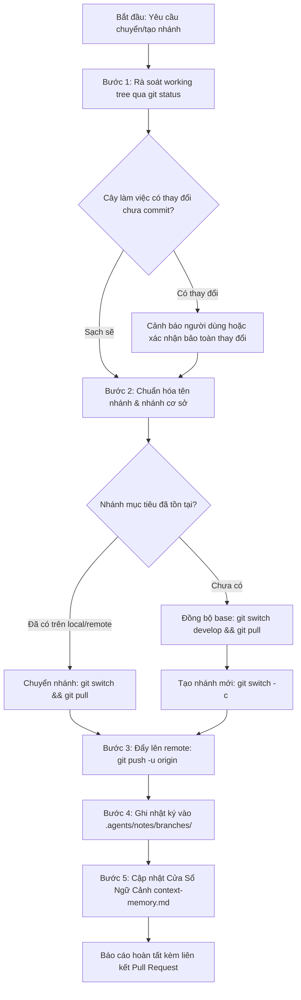

# Kỹ Năng Quản Lý Phân Nhánh & Xuất Bản GitHub (git-branch-push)

Kỹ năng này hướng dẫn AI Agent **chuyển nhánh hoặc khởi tạo nhánh Git mới chuẩn hóa theo quy ước dự án GDMAS**, đồng thời **tự động đẩy (push) và thiết lập upstream tracking lên GitHub**. Đảm bảo an toàn tuyệt đối cho cây làm việc, bảo vệ nhánh `main`, tuân thủ nguyên tắc Open-Closed (RULE-03) và ghi nhật ký cục bộ tại `.agents/notes/branches/`.

> [!IMPORTANT]
> - **Thực thi trực tiếp bằng Agent (No External Scripts):** Agent sử dụng các lệnh Git tiêu chuẩn và công cụ thao tác tệp, không phụ thuộc vào script `.ps1` hay `.sh` bên ngoài.
> - **Chuẩn đặt tên nhánh GDMAS:** `<type>/<scope>-<short-description>` (toàn bộ chữ thường, nối bằng dấu gạch ngang `-`, không dấu tiếng Việt).
> - **Bảo vệ nhánh chính (`main`):** Tuyệt đối không phát triển trực tiếp trên `main`. Mọi nhánh mới phải xuất phát từ `develop` (trừ `hotfix/` xuất phát từ `main`).
> - **Đồng bộ GitHub:** Luôn thực hiện `git push -u origin <branch-name>` để nhánh sẵn sàng cho Pull Request.
> - **Lưu vết cục bộ:** Ghi biên bản vào `.agents/notes/branches/<branch-slug>.md` (được bảo vệ trong `.gitignore`).

---

## 🧭 Quy Trình Thực Thi Dành Cho Agent (Agent Execution Workflow)



---

## 📋 Bảng Tra Cứu Quy Ước Nhánh GDMAS

### 1. Phân Loại Tiền Tố (`type`)
| Tiền tố | Mục đích sử dụng | Nhánh cơ sở (`base`) | Quy tắc kiểm soát |
| :--- | :--- | :--- | :--- |
| **`feature/`** | Phát triển tính năng mới | `develop` | Cấm commit trực tiếp lên main |
| **`bugfix/`** | Sửa lỗi trong giai đoạn phát triển | `develop` | Rebase trước khi mở Pull Request |
| **`hotfix/`** | Sửa lỗi khẩn cấp trực tiếp từ bản phát hành | `main` | Cần duyệt gấp & merge cả main và develop |
| **`docs/`** | Viết hoặc cập nhật tài liệu kỹ thuật | `develop` / `main` | Không can thiệp mã nguồn logic |
| **`refactor/`** | Tái cấu trúc, tối ưu mã nguồn | `develop` | Tuân thủ Open-Closed Principle |
| **`test/`** | Bổ sung kiểm thử chức năng / phi chức năng | `develop` | Đảm bảo test suite nội bộ xanh |
| **`chore/`** | Cấu hình công cụ, skills, dependencies, docker | `develop` | Cập nhật cấu hình môi trường |

### 2. Bảng Phạm Vi Phổ Biến (`scope`)
* `core`: Khung dự án, scaffolding, launcher `dev.ps1`, `dev.bat`.
* `ingestion`: Service cào nạp dữ liệu USGS 5 phút/lần.
* `analysis`: Phân tích 6 patterns chuỗi thời gian địa chấn.
* `clustering`: Giải thuật gom cụm không gian DBSCAN / KMeans.
* `prediction`: Mô hình dự báo định lượng và phân loại rủi ro $t+1$.
* `api`: Máy chủ FastAPI, routes, database models, kênh SSE.
* `web`: Frontend React, Dashboard, bản đồ Leaflet, biểu đồ Recharts.
* `db`: Cơ sở dữ liệu PostgreSQL, SQLAlchemy ORM, Alembic migrations.
* `docker`: Cấu hình Dockerfile, docker-compose môi trường.
* `docs`: Hệ thống tài liệu kỹ thuật, hướng dẫn cài đặt.
* `agents` / `skills`: Kỹ năng AI, agent automations.
* `scripts`: Kịch bản kiểm thử, demo và tự động hóa.

---

## 🛠️ Hướng Dẫn Từng Bước Cho Agent

### Bước 1: Rà soát cây làm việc (Working Tree Inspection)
Agent chạy:
```bash
git status --porcelain -uall
```
* Nếu có thay đổi chưa commit: Nhắc nhở người dùng rằng các thay đổi này sẽ được mang theo sang nhánh mới (hoặc hỏi người dùng có cần commit trước không).

### Bước 2: Chuẩn hóa tên nhánh và Nhánh cơ sở (Resolution)

1. **Chuẩn hóa chuỗi mô tả (Slug Generator Rules):**
   * Chuyển toàn bộ thành chữ thường (`lowercase`).
   * Loại bỏ toàn bộ dấu tiếng Việt:
     `á, à, ả, ã, ạ, â, ấ, ầ, ẩ, ẫ, ậ, ă, ắ, ằ, ẳ, ẵ, ặ -> a`
     `é, è, ẻ, ẽ, ẹ, ê, ế, ề, ể, ễ, ệ -> e`
     `í, ì, ỉ, ĩ, ị -> i`
     `ó, ò, ỏ, õ, ọ, ô, ố, ồ, ổ, ỗ, ộ, ơ, ớ, ờ, ở, ỡ, ợ -> o`
     `ú, ù, ủ, ũ, ụ, ư, ứ, ừ, ử, ữ, ự -> u`
     `ý, kỳ, ỷ, ỹ, ỵ -> y`
     `đ, Đ -> d`
   * Loại bỏ ký tự đặc biệt, chỉ giữ lại chữ số và chữ cái tiếng Anh `[a-z0-9]`.
   * Thay thế khoảng trắng bằng dấu gạch ngang `-`.
   * Lọc bỏ các từ dừng không mang nghĩa (Stop words): `la, va, cho, cua, tai, trong, tu, cac, nhung, mot, de, voi, the, a, an, for, to, in, on, of, and, khi, do`.
   * Rút gọn tối đa 3 - 4 từ khóa mang ý nghĩa chính.
2. **Ghép tên nhánh:**
   * Cú pháp: `<type>/<scope>-<slug>`
   * Ví dụ:
     * Người dùng: *"tạo nhánh để cập nhật lại toàn bộ skill"*
     * Slug: `cap-nhat-toan-bo-skill` $\rightarrow$ `update-skills`
     * Tên nhánh chuẩn: `chore/skills-update-system`
3. **Xác định nhánh cơ sở (`base`):**
   * Mặc định là `develop`.
   * Nếu `type` là `hotfix`, nhánh cơ sở là `main`.

### Bước 3: Thao tác Git chuyển hoặc tạo nhánh

1. **Kiểm tra nhánh đã có:**
   ```bash
   git branch --list <branch-name>
   git branch -r --list "origin/<branch-name>"
   ```
2. **Nếu nhánh đã tồn tại:**
   * Trên local: `git switch <branch-name> && git pull origin <branch-name>`
   * Trên remote: `git switch --track origin/<branch-name>`
3. **Nếu tạo nhánh mới từ nhánh cơ sở:**
   ```bash
   git switch <base-branch>
   git pull origin <base-branch>
   git switch -c <branch-name>
   ```

### Bước 4: Đẩy nhánh lên Remote GitHub
```bash
git push -u origin <branch-name>
```
* Xác lập liên kết upstream tracking giữa local branch và remote origin.

### Bước 5: Ghi nhật ký cục bộ vào `.agents/notes/branches/`
Tên tệp: `.agents/notes/branches/<ten-nhanh-thay-gach-cheo-bang-gach-ngang>.md`  
*(Ví dụ: `chore-skills-update-system.md`)*

Agent dùng công cụ `write_file` để lưu nội dung:
```markdown
# [BIÊN BẢN KHỞI TẠO & ĐỒNG BỘ NHÁNH GIT]

- **Thời điểm:** YYYY-MM-DD HH:mm:ss (UTC+07:00)
- **Tên nhánh:** `<branch-name>`
- **Nhánh cơ sở (Base):** `<base-branch>`
- **Trạng thái Push GitHub:** Đã đẩy lên origin với upstream tracking
- **Cây làm việc trước khi tạo:** Sạch sẽ (Clean)

---

## 1. Kế Hoạch Triển Khai Công Việc (Task Checklist)
- [ ] Nhiệm vụ 1: Triển khai mã nguồn tuân thủ Open-Closed Principle (RULE-03).
- [ ] Nhiệm vụ 2: Kiểm tra an toàn qua source-guard.
- [ ] Nhiệm vụ 3: Commit và push bằng kỹ năng git-commit-push.

---
*Biên bản này được sinh tự động bởi kỹ năng git-branch-push và được lưu trữ nội bộ tại .agents/notes/branches/.*
```

### Bước 6: Cập nhật Cửa Sổ Ngữ Cảnh context-memory.md
* Cập nhật Mục 5 của [`.agents/notes/memory/context-memory.md`](GDMAS/.agents/notes/memory/context-memory.md):
  `- **Nhánh hoạt động (Active Branch):** `<branch-name>``

### Bước 7: Báo cáo kết quả
* Thông báo đã tạo và chuyển nhánh thành công.
* Cung cấp đường dẫn mở Pull Request trên GitHub: `https://github.com/<owner>/<repo>/pull/new/<branch-name>`.
