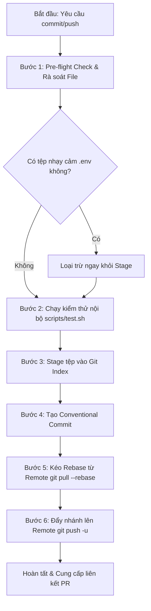

# Git Commit & Push Workflow Skill (GDMAS)

Kỹ năng này hướng dẫn và tự động hóa quy trình commit và đẩy nhánh lên remote repository cho dự án **GDMAS**, đảm bảo tuân thủ nghiêm ngặt **Conventional Commits**, kiểm thử nội bộ trước khi commit (**Local Test Suite**), và an toàn dữ liệu (không commit các tệp nhạy cảm).

---

## 🧭 Quy Trình 6 Bước Chuẩn (Standard Workflow)



---

## 🛠️ Hướng Dẫn Từng Bước (Step-by-Step Instructions)

### Bước 1: Pre-flight Check & Rà soát Tệp Thay Đổi
1. Kiểm tra nhánh hiện tại:
   ```bash
   git branch --show-current
   ```
   > [!IMPORTANT]
   > Tuyệt đối **không commit trực tiếp lên nhánh `main`**. Nếu đang ở `main`, yêu cầu chuyển sang nhánh tính năng theo cú pháp:
   > - `git switch -c feature/<scope>-<description>`
   > - `git switch -c bugfix/<scope>-<description>`
   > - `git switch -c docs/<description>`

2. Kiểm tra danh sách tệp thay đổi:
   ```bash
   git status -s
   ```
3. **Cảnh báo an toàn dữ liệu:** Tuyệt đối không stage các tệp:
   - `.env` (chứa mật khẩu DB và secret key)
   - `.venv/` hoặc `node_modules/`
   - Cache (`__pycache__`, `.pytest_cache`, `.vite`)

---

### Bước 2: Chạy Kiểm Thử Nội Bộ (Local Verification)
Trước khi commit, bắt buộc kiểm tra mã nguồn không có lỗi cú pháp hoặc vi phạm linting:

```bash
# Chạy bộ test suite nội bộ:
bash scripts/test.sh

# Hoặc kiểm tra nhanh Python linting:
cd apps/api && uv run ruff check . && cd ../..
```

---

### Bước 3: Stage Tệp Thay Đổi (Git Add)
Stage chính xác các tệp cần commit thay vì dùng lệnh bao quát:

```bash
# Stage các tệp tài liệu cụ thể:
git add docs/ setup.md tailieukientructuAI.md

# Hoặc stage toàn bộ thay đổi đã theo dõi (trừ tệp chưa untracked nhạy cảm):
git add -u
```

Kiểm tra lại trạng thái staged:
```bash
git status
```

---

### Bước 4: Tạo Commit Tuân Thủ Conventional Commits
Cú pháp thông điệp commit chuẩn:
```text
<type>(<scope>): <subject>
```

- **Types hợp lệ:**
  - `feat`: Tính năng mới (service runner, API endpoint, UI component)
  - `fix`: Sửa lỗi logic hoặc bug runtime
  - `docs`: Cập nhật hoặc bổ sung tài liệu
  - `style`: Định dạng code (whitespace, format, không đổi logic)
  - `refactor`: Tái cấu trúc mã nguồn
  - `test`: Bổ sung hoặc sửa đổi test cases
  - `chore`: Cập nhật cấu hình, dependency, scripts build
- **Scopes phổ biến:**
  - `api`, `web`, `ingestion`, `analysis`, `clustering`, `prediction`, `db`, `docker`, `docs`, `config`
- **Ví dụ mẫu chuẩn:**
  ```bash
  git commit -m "docs(setup): add local configuration requirements and setup commands"
  git commit -m "feat(ingestion): implement usgs earthquake polling runner"
  git commit -m "fix(db): handle upsert conflict on duplicate earthquake id"
  ```

---

### Bước 5: Đồng Bộ với Remote (Pull Rebase)
Trước khi push, kéo các commit mới nhất từ remote nhánh hiện tại (hoặc nhánh cơ sở `develop`) để tránh tạo commit merge thừa:

```bash
git pull --rebase origin $(git branch --show-current)
```

---

### Bước 6: Đẩy Nhánh Lên Remote (Git Push)
Đẩy nhánh lên remote repository và thiết lập tracking upstream:

```bash
git push -u origin $(git branch --show-current)
```

Nếu là lần đầu push nhánh mới, lệnh trên sẽ tự động tạo nhánh tương ứng trên GitHub.

---

## ⚡ Kịch Bản Chạy Nhanh & Chế Độ Tự Động (Auto Mode)

Skill hỗ trợ **chế độ tự động hoàn toàn (Auto Mode)**: Tự động phân tích các tệp thay đổi, tự xác định `type` và `scope`, tự đặt tên nhánh theo đúng quy ước `<type>/<scope>-updates`, tự sinh Conventional Commit message chuẩn xác, chuyển nhánh và push lên Remote:

- **Cách 1: Yêu cầu AI Agent tự động thực hiện:**
  Người dùng chỉ cần ra lệnh trong chat:
  > *"Hãy tự động tạo nhánh, sinh commit và push cho tôi"*
  
  Agent sẽ tự động phân tích `git status`, tạo nhánh và commit theo đúng chuẩn mà người dùng không cần gõ lệnh git thủ công.

- **Cách 2: Chạy script tự động trên Windows PowerShell:**
  ```powershell
  # Tự động phân tích, tự tạo nhánh và tự sinh commit:
  .\.agents\skills\git-commit-push\scripts\commit-push.ps1 -Auto
  ```

- **Cách 3: Chạy script tự động trên Bash / Linux / macOS:**
  ```bash
  # Tự động hoàn toàn trong 1 lệnh:
  bash .agents/skills/git-commit-push/scripts/commit-push.sh
  ```

---

## 📖 Tài Liệu Tham Khảo (References)
- Bảng quy chuẩn Conventional Commits & Branch naming: [conventions.md](./references/conventions.md)
- Sổ tay phân nhánh chi tiết: [branch-conventions.md](file:///D:/KHDLKPDL/GDMAS/docs/development/branch-conventions.md)
- Cheatsheet lệnh Git: [git/commands.md](file:///D:/KHDLKPDL/GDMAS/docs/guides/git/commands.md)

