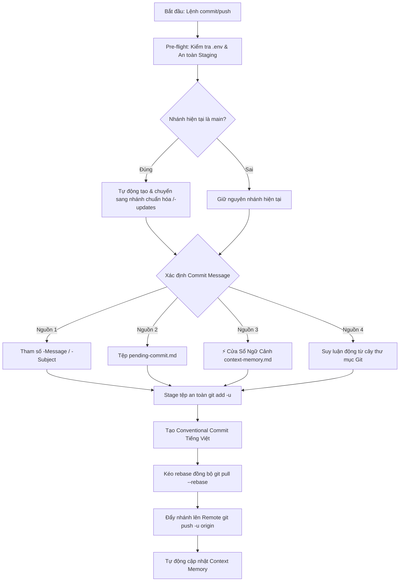

# Git Commit & Push Workflow Skill (GDMAS)

Kỹ năng này tự động hóa toàn bộ quy trình từ stage, tạo Conventional Commit tiếng Việt chuẩn hóa đến đẩy nhánh lên remote repository cho dự án **GDMAS**, đảm bảo tuân thủ nghiêm ngặt **Conventional Commits**, an toàn bảo mật (loại trừ `.env` và cache), và bảo vệ nhánh chính (`main`).

> [!IMPORTANT]
> - **Nguyên tắc Thiết Kế Bất Biến (Skill Stability):** Kỹ năng hoạt động theo cơ chế **Phân Định Đa Nguồn (Multi-Source Resolution)**. Script không bao giờ chứa chuỗi mô tả cứng của tác vụ. Nó nhận diện thông điệp linh hoạt theo thứ tự ưu tiên: Tham số trực tiếp > `pending-commit.md` > `context-memory.md` > Suy luận động từ Working Tree.
> - **An toàn nhánh `main`:** Tự động phát hiện khi đang ở `main` và tạo nhánh tính năng chuẩn thay vì commit trực tiếp lên `main`.
> - **An toàn dữ liệu:** Tự động loại trừ các tệp nhạy cảm `.env`, cache `node_modules`, `__pycache__` trước khi commit.

---

## 🧭 Quy Trình Tự Động Hóa Đa Nguồn (Workflow)



---

## 🛠️ Thứ Tự Phân Định Thông Điệp (Multi-Source Resolution)

1. **Nguồn 1 (Tham số trực tiếp):** Nếu người dùng hoặc AI Agent truyền cờ `-Message` hoặc `-Subject`.
2. **Nguồn 2 (`pending-commit.md`):** Đọc thông điệp đã được sinh trước đó bởi kỹ năng `generate-commit` (nếu khớp nhánh hiện tại).
3. **Nguồn 3 (`context-memory.md`):** Đọc phân loại `Type`, `Scope`, `Subject` đã được lưu tại Mục 5 của Cửa Sổ Ngữ Cảnh (nếu khớp nhánh hiện tại).
4. **Nguồn 4 (Suy luận động):** Tự động phân tích các thư mục thay đổi (`apps/web`, `apps/api`, `docs/`, `.agents/`, v.v.) theo cấu trúc kiến trúc chuẩn của GDMAS để sinh Conventional Commit tiếng Việt hợp lệ mà không cần người dùng nhập liệu.

---

## ⚡ Cách Kích Hoạt & Sử Dụng

### 1. Kích hoạt tự nhiên qua hội thoại
Chỉ cần yêu cầu Agent trong chat:
- *"Hãy commit và push các thay đổi hiện tại"*
- *"Commit và đẩy lên remote với thông điệp: hoàn thành module ingestion"*
- *"Tự động tạo commit và push cho tôi"*

### 2. Chạy kịch bản bằng PowerShell (Windows)
```powershell
# 1. Chế độ hoàn toàn tự động (Auto Mode):
.\.agents\skills\git-commit-push\scripts\commit-push.ps1 -Auto

# 2. Truyền thông điệp commit tùy chỉnh:
.\.agents\skills\git-commit-push\scripts\commit-push.ps1 -Message "feat(api): bổ sung bộ lọc địa chấn theo độ sâu"

# 3. Chỉ định nhánh cần tạo khi đang ở main:
.\.agents\skills\git-commit-push\scripts\commit-push.ps1 -BranchName "feature/web-chart-patterns"
```

### 3. Chạy kịch bản bằng Bash (Linux / macOS / Git Bash)
```bash
# Tự động hoàn toàn:
bash .agents/skills/git-commit-push/scripts/commit-push.sh

# Truyền thông điệp tùy chỉnh:
bash .agents/skills/git-commit-push/scripts/commit-push.sh --message "docs(setup): hướng dẫn thiết lập database"
```

---

## 📖 Tài Liệu Tham Khảo (References)
- Bảng quy chuẩn Conventional Commits & Branch naming: [conventions.md](./references/conventions.md)
- Sổ tay phân nhánh chi tiết: [branch-conventions.md](file:///D:/KHDLKPDL/GDMAS/docs/development/branch-conventions.md)
