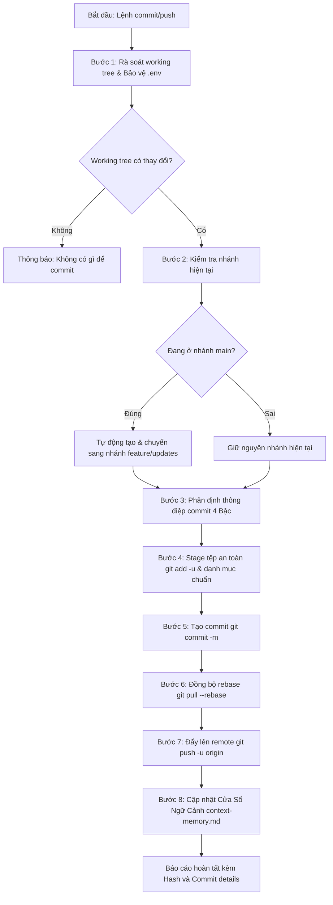

# Kỹ Năng Tự Động Hóa Staging, Commit & Push GitHub (git-commit-push)

Kỹ năng này hướng dẫn AI Agent **tự động hóa toàn bộ chu trình từ kiểm tra an toàn working tree, stage tệp, tạo Conventional Commit tiếng Việt chuẩn hóa, đồng bộ rebase đến đẩy nhánh lên GitHub remote repository**, đồng thời cập nhật Cửa Sổ Ngữ Cảnh [`.agents/notes/memory/context-memory.md`](file:///d:/KHDLKPDL/GDMAS/.agents/notes/memory/context-memory.md).

> [!IMPORTANT]
> - **Thực thi trực tiếp bằng Agent (No External Scripts):** Agent tự chạy các lệnh Git tiêu chuẩn qua công cụ `run_command`, không phụ thuộc vào script `.ps1` hay `.sh` bên ngoài.
> - **Bảo vệ nhánh chính (`main`):** Tuyệt đối không commit trực tiếp lên `main`. Nếu phát hiện đang ở `main`, Agent tự động chuyển sang nhánh tính năng chuẩn `<type>/<scope>-updates` trước khi commit.
> - **Bảo mật tuyệt đối (Secrets Safety):** Luôn kiểm tra và gỡ bỏ các tệp nhạy cảm (`.env`, `*.env` ngoại trừ `.env.example`) khỏi Staging trước khi thực hiện commit.
> - **Định dạng Conventional Commit tiếng Việt:** Mọi thông điệp commit phải tuân thủ chuẩn `<type>(<scope>): <tiêu đề tiếng Việt chữ thường>`, đi kèm danh sách gạch đầu dòng chi tiết công việc.

---

## 🧭 Quy Trình Thực Thi Dành Cho Agent (Agent Execution Workflow)



---

## 🛠️ Hướng Dẫn Từng Bước Cho Agent

### Bước 1: Rà soát working tree và loại trừ tệp nhạy cảm
Agent chạy:
```bash
git status --porcelain -uall
```
1. **Nếu không có thay đổi:** Thông báo `ℹ️ Không có thay đổi nào cần commit (Working tree clean)` và dừng lại.
2. **Bảo vệ tệp bí mật (.env Guard):**
   * Quét qua danh sách tệp nếu có tệp chứa `.env` (ngoại trừ `.env.example`):
     ```bash
     git restore --staged .env apps/web/.env apps/api/.env 2>$null
     ```

### Bước 2: Kiểm tra nhánh và bảo vệ nhánh `main`
Agent chạy:
```bash
git branch --show-current
```
* Nếu kết quả trả về là `main`:
  * Tự động rẽ nhánh mới: `git switch -c chore/project-updates` (hoặc đặt tên theo scope công việc sắp commit).
  * Thông báo: `⚠️ Bạn đang ở nhánh main. Agent đã tự động tạo và chuyển sang nhánh làm việc an toàn.`

### Bước 3: Cơ chế phân định thông điệp Commit 4 Bậc (Multi-Source Resolution)

Agent xác định nội dung commit theo thứ tự ưu tiên:
1. **Nguồn 1 (Người dùng truyền trực tiếp):**
   * Nếu người dùng yêu cầu: *"commit: sửa lỗi sse kết nối lại"* hoặc truyền nội dung cụ thể, sử dụng ngay nội dung này làm tiêu đề/nội dung commit.
2. **Nguồn 2 (`pending-commit.md`):**
   * Đọc tệp [`.agents/notes/changes/pending-commit.md`](file:///d:/KHDLKPDL/GDMAS/.agents/notes/changes/pending-commit.md).
   * Nếu nhánh ghi nhận khớp với nhánh hiện tại, trích xuất Header và Body bullets đã được sinh trước đó.
3. **Nguồn 3 (Cửa Sổ Ngữ Cảnh `context-memory.md`):**
   * Đọc Mục 5 của [`.agents/notes/memory/context-memory.md`](file:///d:/KHDLKPDL/GDMAS/.agents/notes/memory/context-memory.md).
   * Nếu nhánh khớp, lấy `Type/Scope` và `Tiêu đề commit đề xuất`.
4. **Nguồn 4 (Suy luận động từ cây thư mục Git):**
   * Ánh xạ danh sách tệp thay đổi theo bảng chuẩn:
     * `apps/web/src/components/charts/*` $\rightarrow$ `feat(web): trực quan hóa biểu đồ chuỗi thời gian địa chấn`
     * `apps/web/*` $\rightarrow$ `feat(web): cập nhật giao diện người dùng và tương tác frontend`
     * `apps/api/src/gdmas/services/ingestion/*` $\rightarrow$ `feat(ingestion): cập nhật tiến trình nạp dữ liệu USGS`
     * `apps/api/src/gdmas/services/analysis/*` $\rightarrow$ `feat(analysis): cập nhật thuật toán phân tích chuỗi thời gian`
     * `apps/api/src/gdmas/services/clustering/*` $\rightarrow$ `feat(clustering): cập nhật thuật toán gom cụm không gian`
     * `apps/api/src/gdmas/services/prediction/*` $\rightarrow$ `feat(prediction): cập nhật mô hình dự báo địa chấn`
     * `apps/api/src/gdmas/api/routes/stream.py` $\rightarrow$ `feat(realtime): cập nhật dịch vụ streaming dữ liệu SSE`
     * `apps/api/*` $\rightarrow$ `feat(api): cập nhật dịch vụ backend và endpoint REST/SSE`
     * `contracts/*` $\rightarrow$ `chore(contracts): chuẩn hóa hợp đồng dữ liệu dùng chung API-Web`
     * `docs/*` $\rightarrow$ `docs(core): cập nhật hệ thống tài liệu kỹ thuật dự án`
     * `.agents/*` hoặc `.claude/*` $\rightarrow$ `chore(agents): chuẩn hóa và tối ưu hóa các kỹ năng AI agent`
     * `scripts/*` $\rightarrow$ `chore(scripts): cập nhật kịch bản kiểm thử và tự động hóa`

### Bước 4: Stage tệp an toàn
Agent chạy:
```bash
git add -u
git add docs/ apps/ contracts/ scripts/ .agents/ .claude/ README.md .gitignore dev.ps1 dev.bat 2>$null
```
* Đảm bảo không sử dụng `git add .` bừa bãi để tránh nạp nhầm `node_modules`, cache Python hay file rác.

### Bước 5: Thực hiện Commit
Agent chạy lệnh commit với định dạng Conventional Commit tiếng Việt:
```bash
git commit -m "<header>

- <bullet-1>
- <bullet-2>
- <bullet-3>"
```

### Bước 6: Đồng bộ rebase từ Remote
```bash
git pull --rebase origin <current-branch>
```

### Bước 7: Đẩy nhánh lên Remote Repository
```bash
git push -u origin <current-branch>
```

### Bước 8: Đồng bộ Cửa Sổ Ngữ Cảnh context-memory.md
1. Lấy mã băm rút gọn của commit vừa tạo:
   ```bash
   git rev-parse --short HEAD
   ```
2. Cập nhật Mục 5 & Mục 6 trong [`.agents/notes/memory/context-memory.md`](file:///d:/KHDLKPDL/GDMAS/.agents/notes/memory/context-memory.md) ghi nhận commit hash, tiêu đề và tóm tắt công việc vào lịch sử tích lũy.

### Bước 9: Báo cáo kết quả
* Nhánh đã đẩy: `<current-branch>`
* Commit Hash: `<short-hash>`
* Thông điệp commit đầy đủ: `<commit-message>`
