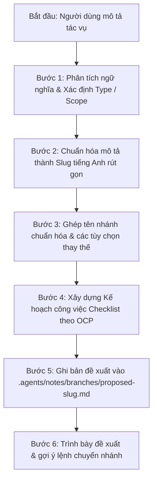

# Kỹ Năng Đề Xuất Phân Nhánh & Kế Hoạch Công Việc (propose-branch)

Kỹ năng này hướng dẫn AI Agent **phân tích mô tả tác vụ của người dùng, tự động suy luận tên nhánh Git chuẩn hóa theo quy ước dự án GDMAS**, xây dựng **kế hoạch triển khai công việc (Task Breakdown Checklist)** tuân thủ nguyên tắc Open-Closed (RULE-03) và lưu trữ bản đề xuất cục bộ tại `.agents/notes/branches/proposed-<slug>.md`.

> [!IMPORTANT]
> - **Thực thi trực tiếp bằng Agent (No External Scripts):** Agent tự động phân tích ngữ nghĩa ngôn ngữ tự nhiên, tính toán slug và ghi tệp bản ghi, không phụ thuộc vào script `.ps1` hay `.sh` bên ngoài.
> - **Chuẩn hóa nhánh GDMAS:** `<type>/<scope>-<short-description>` (toàn bộ chữ thường, nối bằng `-`, không chứa dấu tiếng Việt hay ký tự lạ).
> - **Nhánh cơ sở mặc định:** Luôn xuất phát từ `develop` (trừ trường hợp `hotfix/` xuất phát từ `main`).
> - **Lưu trữ cục bộ an toàn:** Tệp đề xuất được lưu tại `.agents/notes/branches/` (được bảo vệ trong `.gitignore`).

---

## 🧭 Quy Trình Thực Thi Dành Cho Agent (Agent Execution Workflow)



---

## 📋 Bảng Phân Định Type & Scope Dự Án GDMAS

### 1. Bảng Tiền Tố (`type`)
* **`feature/`**: Xây dựng chức năng mới, component mới, thuật toán mới.
* **`bugfix/`**: Sửa lỗi trong quá trình phát triển (xuất phát từ `develop`).
* **`hotfix/`**: Sửa lỗi khẩn cấp trực tiếp từ bản phát hành (xuất phát từ `main`).
* **`docs/`**: Viết, cập nhật tài liệu kỹ thuật, kiến trúc, kiểm thử.
* **`refactor/`**: Tái cấu trúc mã nguồn, tối ưu hiệu năng mà không đổi tính năng.
* **`test/`**: Bổ sung bộ kịch bản kiểm thử tự động, mock data.
* **`chore/`**: Cấu hình môi trường, dependencies, scripts, kỹ năng AI agent.

### 2. Bảng Phạm Vi (`scope`)
* `web`: Giao diện React, Dashboard, bản đồ Leaflet, biểu đồ Recharts.
* `api`: FastAPI backend, routes RESTful, kênh stream SSE.
* `ingestion`: Service cào và nạp dữ liệu USGS GeoJSON định kỳ 5 phút.
* `analysis`: Phân tích 6 patterns chuỗi thời gian địa chấn.
* `clustering`: Giải thuật gom cụm không gian DBSCAN / KMeans.
* `prediction`: Mô hình dự báo định lượng và phân loại rủi ro $t+1$.
* `db`: Cơ sở dữ liệu PostgreSQL, SQLAlchemy ORM, Alembic migrations.
* `docker`: Dockerfile, docker-compose môi trường.
* `docs`: Hệ thống tài liệu kỹ thuật trong thư mục `docs/`.
* `agents` / `skills`: Kỹ năng AI agent trong `.agents/skills/`.
* `core`: Khung scaffolding dự án, launcher `dev.ps1`, `dev.bat`.

---

## 🛠️ Hướng Dẫn Từng Bước Cho Agent

### Bước 1: Phân tích ngữ nghĩa yêu cầu của người dùng
Agent lắng nghe yêu cầu (ví dụ: *"tôi muốn làm tính năng xuất báo cáo PDF cho động đất"*):
* **Hành động cốt lõi:** Làm tính năng mới $\rightarrow$ `type = feature`.
* **Phạm vi tác động:** Báo cáo / Web frontend $\rightarrow$ `scope = web` hoặc `reports`.
* **Mô tả ngắn gọn:** `xuat-bao-cao-pdf` $\rightarrow$ `export-pdf-report`.

### Bước 2: Quy tắc chuẩn hóa Slug (Slug Engine)
1. Loại bỏ toàn bộ dấu tiếng Việt:
   `á, à, ả, ã, ạ... -> a`, `é, è, ẻ... -> e`, `í, ì... -> i`, `ó, ò... -> o`, `ú, ù... -> u`, `đ, Đ -> d`.
2. Chuyển thành chữ thường (`lowercase`), thay khoảng trắng bằng gạch ngang `-`.
3. Lọc bỏ các từ dừng (Stop words): `la, va, cho, cua, tai, trong, tu, cac, nhung, mot, de, voi, the, a, an, for, to, in, on, of, and, khi, do`.
4. Rút gọn thành 2 - 4 từ khóa mang ý nghĩa kỹ thuật:
   * *"sửa lỗi sse không tự động kết nối lại"* $\rightarrow$ `fix-sse-reconnect`
   * *"tối ưu hóa phân cụm dbscan"* $\rightarrow$ `optimize-dbscan-clustering`
   * *"bổ sung test case phi chức năng"* $\rightarrow$ `non-functional-test-cases`

### Bước 3: Ghép tên nhánh đề xuất
* **Tên nhánh chính (Khuyến nghị):** `<type>/<scope>-<slug>`
* **Các tùy chọn dự phòng:**
  * Dạng ngắn gọn (Compact): `<type>/<slug>`
  * Dạng gắn nhãn cụ thể: `<type>/<scope>-module-<slug>`

### Bước 4: Xây dựng Kế hoạch công việc (Task Checklist)
Kế hoạch công việc bắt buộc tuân thủ nguyên tắc **Open-Closed (RULE-03)**:
* Ưu tiên tạo tệp mới mở rộng, không sửa xóa tệp lõi ổn định.
* Xác định rõ: Tệp nào cần tạo mới, API/Component nào cần liên kết.
* Có bước kiểm tra qua `source-guard` trước khi commit.

### Bước 5: Ghi bản đề xuất vào `.agents/notes/branches/`
Tên tệp: `.agents/notes/branches/proposed-<slug>.md`

Agent dùng công cụ `write_file` để lưu nội dung:
```markdown
# [BẢN ĐỀ XUẤT PHÂN NHÁNH GIT - BRANCH PROPOSAL]

- **Thời gian lập:** YYYY-MM-DD HH:mm:ss (UTC+07:00)
- **Mô tả công việc (Task Description):** <mo-ta-nguoi-dung>
- **Phân loại tác vụ (Type):** `<type>`
- **Phạm vi tác động (Scope):** `<scope>`
- **Nhánh cơ sở (Base Branch):** `develop`

---

## 1. Tên Nhánh Đề Xuất (GDMAS Standard)

### 🌟 Nhánh Đề Xuất Chính Thức (Khuyến nghị):
```text
<type>/<scope>-<slug>
```

### 🔀 Các Tùy Chọn Đặt Tên Khác:
- **Dạng ngắn gọn:** `<type>/<slug>`
- **Dạng chi tiết:** `<type>/<scope>-task-<slug>`

---

## 2. Kế Hoạch Triển Khai Công Việc (Task Checklist)
- [ ] Bước 1: Khởi tạo nhánh từ `develop` và đẩy upstream lên GitHub.
- [ ] Bước 2: Phát triển tính năng mới tuân thủ nguyên tắc Open-Closed (RULE-03).
- [ ] Bước 3: Kiểm tra an toàn working tree qua `source-guard`.
- [ ] Bước 4: Tạo Conventional Commit tiếng Việt và đẩy lên GitHub qua `git-commit-push`.

---

## 3. Lệnh Git Khởi Tạo Nhanh
```bash
git switch develop
git pull origin develop
git switch -c <type>/<scope>-<slug>
git push -u origin <type>/<scope>-<slug>
```

---
*Bản đề xuất này được sinh tự động bởi kỹ năng propose-branch và chỉ lưu trữ cục bộ tại .agents/notes/branches/.*
```

### Bước 6: Trình bày cho người dùng
* Hiển thị bảng tóm tắt tên nhánh đề xuất và kế hoạch công việc.
* Cung cấp lệnh sẵn sàng sao chép: `git switch -c <branch-name>` hoặc hỏi người dùng: *"Bạn có muốn tôi tự động tạo và chuyển sang nhánh này ngay không?"*
