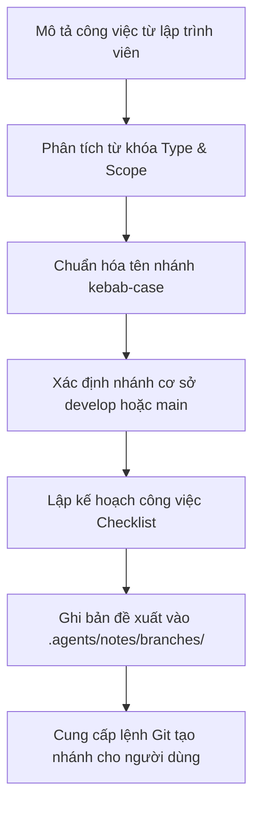

# Kỹ Năng Đề Xuất Nhánh Git Theo Mô Tả Công Việc (propose-branch)

Kỹ năng này chịu trách nhiệm **phân tích mô tả công việc (task description)** của lập trình viên, tự động suy luận loại tác vụ (`type`), phạm vi module (`scope`) và đề xuất **tên nhánh Git chuẩn hóa theo quy ước dự án GDMAS**, đồng thời tạo bản kế hoạch công việc và lưu trữ cục bộ tại `.agents/notes/branches/`.

> [!IMPORTANT]
> - **Lưu trữ cục bộ:** Mọi tệp đề xuất nhánh chỉ được lưu nội bộ tại `.agents/notes/branches/` (thư mục cấp cao nhất cho các bản ghi sinh ra bởi kỹ năng, đã được cấu hình trong `.gitignore` để không push lên repository).
> - **Nguyên tắc không lồng thư mục:** Tuyệt đối không tạo thư mục `.agents` lồng vào cây thư mục hiện tại.
> - **Chuẩn đặt tên nhánh GDMAS:** `<type>/<scope>-<short-description>` (toàn bộ chữ thường, nối bằng dấu gạch ngang `-`).

---

## 🧭 Quy Trình Hoạt Động (Workflow)



---

## 📋 Bảng Quy Chuẩn Suy Luận Phân Nhánh

| Từ khóa trong mô tả công việc | Loại tác vụ (`type`) | Nhánh cơ sở (`base`) | Quy ước tiền tố |
| :--- | :--- | :--- | :--- |
| Thêm tính năng, phát triển mới, service, endpoint, UI | `feature` | `develop` | `feature/<scope>-...` |
| Sửa lỗi, fix bug, issue, lỗi hiển thị, crash | `bugfix` | `develop` | `bugfix/<scope>-...` |
| Khẩn cấp, lỗi production, hotfix trên main | `hotfix` | `main` | `hotfix/<scope>-...` |
| Viết tài liệu, bổ sung SAD, ERD, API guide, setup | `docs` | `develop` / `main` | `docs/<scope>-...` |
| Tối ưu hóa, dọn dẹp mã nguồn, tái cấu trúc | `refactor` | `develop` | `refactor/<scope>-...` |
| Viết unit test, mock data, kiểm thử tự động | `test` | `develop` | `test/<scope>-...` |
| Cập nhật dependency, docker-compose, script | `chore` | `develop` | `chore/<scope>-...` |

### Bảng Phạm Vi Phổ Biến (`scope`):
- `ingestion`: Tiến trình quét và nạp dữ liệu địa chấn từ USGS.
- `analysis`: Module phân tích 6 patterns chuỗi thời gian địa chấn.
- `clustering`: Giải thuật gom cụm không gian DBSCAN / KMeans.
- `prediction`: Mô hình dự báo rủi ro thời gian thực.
- `api`: FastAPI backend, routes, database models, kênh SSE.
- `web`: Frontend React, Dashboard, bản đồ Leaflet, biểu đồ Recharts.
- `db`: Cơ sở dữ liệu PostgreSQL, SQLAlchemy ORM, Alembic migrations.
- `docker`: Cấu hình Dockerfile, docker-compose môi trường chạy.
- `docs`: Tài liệu kỹ thuật, hướng dẫn cài đặt.
- `agents`: Kỹ năng AI, agent automations.
- `scripts`: Bộ kịch bản tự động hóa, kiểm thử nội bộ.

---

## 💡 Ví Dụ Mẫu Đề Xuất

| Mô tả công việc đầu vào | Tên nhánh đề xuất (Chuẩn GDMAS) | Tùy chọn ngắn |
| :--- | :--- | :--- |
| "Xây dựng service nạp dữ liệu động đất từ USGS tự động 5 phút" | `feature/ingestion-usgs-worker` | `feat/ingestion-usgs-worker` |
| "Sửa lỗi CORS khi gọi Server-Sent Events từ React frontend" | `bugfix/api-sse-cors-origin` | `fix/api-sse-cors-origin` |
| "Hiển thị marker động đất trên bản đồ Leaflet có phân màu độ sâu" | `feature/web-leaflet-earthquake-markers` | `feat/web-leaflet-markers` |
| "Cập nhật yêu cầu cấu hình máy và lệnh chạy trong setup.md" | `docs/setup-hardware-requirements` | `docs/setup-requirements` |
| "Tối ưu hóa vòng lặp tính chuỗi thời gian của 6 patterns" | `refactor/analysis-temporal-loops` | `refactor/analysis-loops` |
| "Sửa lỗi xung đột port 5432 của PostgreSQL khi chạy docker" | `hotfix/docker-postgres-port` | `hotfix/postgres-port` |

---

## ⚡ Cách Kích Hoạt & Sử Dụng

### 1. Kích hoạt tự nhiên qua hội thoại
Người dùng chỉ cần miêu tả công việc muốn thực hiện:
- *"Tôi chuẩn bị làm tính năng vẽ bản đồ nhiệt tương quan trên frontend, hãy gợi ý tên branch"*
- *"Tôi cần sửa lỗi lưu trùng lặp dữ liệu động đất, hãy đề xuất nhánh cho tôi"*

Agent sẽ phản hồi:
1. Tên nhánh chuẩn theo quy ước GDMAS.
2. Nhánh cơ sở cần checkout (`develop` hoặc `main`).
3. Lệnh Git thao tác nhanh trong 1 dòng.
4. Ghi bản đề xuất chi tiết vào `.agents/notes/branches/`.

### 2. Chạy kịch bản tự động bằng PowerShell
```powershell
# Gợi ý tên nhánh và lưu bản ghi vào .agents/notes/branches/:
.\.agents\skills\propose-branch\scripts\propose-branch.ps1 -Description "Xây dựng service nạp dữ liệu USGS"

# Gợi ý VÀ tự động tạo nhánh rồi switch sang nhánh đó luôn:
.\.agents\skills\propose-branch\scripts\propose-branch.ps1 -Description "Xây dựng service nạp dữ liệu USGS" -Create
```

### 3. Chạy kịch bản bằng Bash
```bash
bash .agents/skills/propose-branch/scripts/propose-branch.sh "Xây dựng service nạp dữ liệu USGS"
```

---

## 📁 Bản Ghi Đề Xuất Cục Bộ
Các bản ghi được lưu độc quyền tại:
- [`.agents/notes/branches/`](file:///D:/KHDLKPDL/GDMAS/.agents/notes/branches/)

Tệp này được cấu hình trong `.gitignore` để không đẩy lên repository, giúp lập trình viên theo dõi kế hoạch làm việc mà không làm bẩn Git tree.

