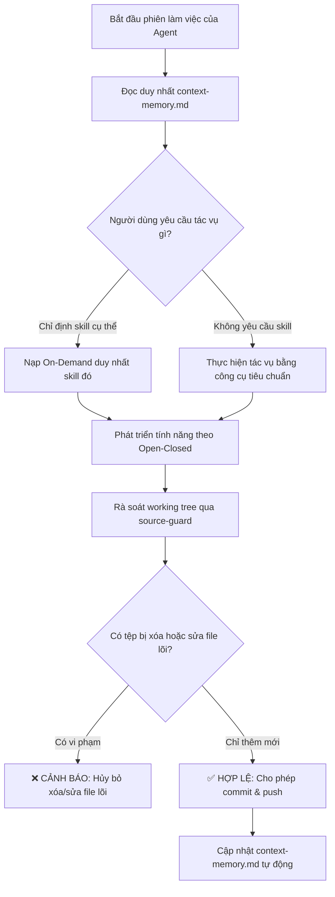

# Kỹ Năng Bảo Vệ Mã Nguồn & Tối Ưu Cửa Sổ Ngữ Cảnh (source-guard)

Kỹ năng này chịu trách nhiệm **bảo vệ tính toàn vẹn của mã nguồn gốc trong dự án GDMAS**, đồng thời **tối ưu hóa việc sử dụng token của AI Agent** thông qua cơ chế kích hoạt kỹ năng theo nhu cầu (On-Demand) và duy trì bộ nhớ ngữ cảnh tinh gọn (Context Window Memory).

> [!IMPORTANT]
> - **Nguyên tắc Thiết Kế Bất Biến (Skill Stability):** Kỹ năng được thiết kế động hoàn toàn (Generic & Dynamic), **tuyệt đối không hardcode tên nhánh hoặc nội dung tác vụ tạm thời vào mã nguồn script**. Kỹ năng tự động nhận diện cây thư mục thay đổi và chấp nhận tham số ghi đè linh hoạt.
> - **Nguyên tắc Open-Closed (RULE-03):** "Không sửa mã nguồn hiện tại – Chỉ bổ sung thêm mới" *(Closed for Modification, Open for Extension)*.
> - **Tiết kiệm Token (On-Demand Skills):** Agent **tuyệt đối không đọc toàn bộ các skill** trong `.agents/skills/` nếu không có yêu cầu, chỉ nạp kỹ năng khi được chỉ định rõ ràng.
> - **Bộ nhớ Cửa sổ Ngữ cảnh (Context Memory):** Sử dụng tệp [`.agents/notes/memory/context-memory.md`](file:///D:/KHDLKPDL/GDMAS/.agents/notes/memory/context-memory.md) để nắm toàn bộ bối cảnh dự án, không đọc lại toàn bộ tài liệu `docs/`.

---

## 🧭 Quy Trình Hoạt Động (Workflow)



---

## 🧠 1. Cơ Chế Bộ Nhớ Cửa Sổ Ngữ Cảnh Tích Lũy (Cumulative Context Memory)

Nhằm giải quyết vấn đề **Agent bị cạn kiệt context window hoặc phải tốn hàng nghìn tokens để đọc lại toàn bộ `git status` và 30+ tệp tài liệu trong `docs/`**:
- Kỹ năng thiết lập tệp bộ nhớ tinh gọn tại:
  - [`.agents/notes/memory/context-memory.md`](file:///D:/KHDLKPDL/GDMAS/.agents/notes/memory/context-memory.md)
- **Cơ chế bảo toàn và tích lũy:**
  1. *Phần cố định bất biến:* Bản đồ 7 Terminals, 6 Patterns chuỗi thời gian, Nguyên tắc Open-Closed (RULE-03) và Bảng tra cứu On-demand.
  2. *Mục 5 - Trạng Thái Hoạt Động Hiện Thời (Active Branch Snapshot):* Luôn cập nhật trạng thái của nhánh đang làm việc, đánh dấu rõ ràng tên nhánh (`Active Branch`), phân loại đề xuất (`Type/Scope`), tiêu đề commit tiếng Việt và các gạch đầu dòng tóm tắt.
  3. *Mục 6 - Sổ Nhật Ký Phát Triển Theo Nhánh (Cumulative Branch Milestones):* Lưu trữ lũy kế lịch sử các lần thay đổi chính trên **mọi nhánh**. Cơ chế tự động quét và lưu giữ toàn bộ các nhánh trong lịch sử mà không ghi đè mất thông tin của nhánh khác.
- **Tiết kiệm Token tối đa:** Kỹ năng `generate-commit` và `git-commit-push` được thiết kế để **ưu tiên đọc thẳng Mục 5 & Mục 6 của Context Memory** thay vì phải quét lại hàng chục/hàng trăm dòng `git status`, giảm lãng phí token đến 90%.

---

## 🛡️ 2. 4 Quy Tắc Vàng Bảo Vệ Mã Nguồn GDMAS

### 1. Tuyệt đối CẤM XÓA tệp (`git status: D`)
- Không xóa bất kỳ tệp mã nguồn, tài liệu, test script hay cấu hình nào đã tồn tại trong repository.
- Nếu hàm hoặc tệp cũ không còn dùng: **Đánh dấu `@deprecated` và bảo toàn nguyên vẹn**.

### 2. Bảo toàn Tệp Lõi Kiến Trúc (Core Protected Files)
Các tệp sau đây đóng vai trò xương sống, cấm tự ý can thiệp:
- `apps/api/src/gdmas/main.py`: Điểm khởi chạy FastAPI; **tuyệt đối không nhúng worker ngầm vào file này**.
- `apps/api/src/gdmas/db/connection.py` & `base.py`: Kết nối CSDL PostgreSQL tập trung.
- `contracts/`: Hợp đồng giao tiếp dữ liệu chuẩn giữa Backend và Frontend.
- `docs/quyuocchung.md`: Hiến chương quy ước kỹ thuật tối cao của dự án.

### 3. Phương thức Mở Rộng Hợp Lệ (Valid Extension Patterns)
Khi cần phát triển tính năng, bắt buộc tạo tệp mới:
- **Thêm Service Worker:** Tạo `gdmas/services/<service_name>/runner.py` riêng biệt để chạy trên terminal độc lập (đáp ứng 7 terminals).
- **Thêm API Endpoint:** Tạo file route mới trong `gdmas/api/routes/<new_resource>.py` và đăng ký vào router chính.
- **Thêm CSDL / Bảng mới:** Tạo schema Pydantic mới, ORM model mới và tạo migration qua Alembic.
- **Thêm Giao diện / Biểu đồ:** Tạo UI component mới trong `apps/web/src/components/charts/` cho 6 patterns mà không ghi đè component cũ.

### 4. Kiểm soát Tỷ lệ Dòng Thay Đổi (Churn Ratio)
Nếu một tệp có số dòng xóa (`deletions`) vượt trội so với số dòng thêm mới (`insertions`), cần tách phần logic mới ra file riêng thay vì viết đè mã nguồn cũ.

---

## ⚡ Cách Kích Hoạt & Sử Dụng

### 1. Kích hoạt tự nhiên qua hội thoại
Chỉ cần yêu cầu Agent trong chat:
- *"Hãy rà soát xem mã nguồn có vi phạm Open-Closed không"*
- *"Đọc memory ngữ cảnh để nắm tình hình dự án"*
- *"Cập nhật lại context-memory sau khi xong việc"*

### 2. Chạy kịch bản tự động bằng PowerShell
```powershell
# 1. Quét kiểm tra trạng thái an toàn mã nguồn:
.\.agents\skills\source-guard\scripts\source-guard.ps1

# 2. Quét ở chế độ nghiêm ngặt (Strict mode):
.\.agents\skills\source-guard\scripts\source-guard.ps1 -Strict

# 3. Đồng thời quét an toàn VÀ cập nhật lại tệp context-memory.md:
.\.agents\skills\source-guard\scripts\source-guard.ps1 -UpdateMemory

# 4. Cập nhật kèm ngữ cảnh cụ thể (tùy chọn override nếu muốn):
.\.agents\skills\source-guard\scripts\source-guard.ps1 -UpdateMemory -Type feat -Scope api -Desc "bổ sung route tìm kiếm động đất"
```

### 3. Chạy kịch bản bằng Bash
```bash
# Quét cơ bản
bash .agents/skills/source-guard/scripts/source-guard.sh

# Quét strict và cập nhật memory
bash .agents/skills/source-guard/scripts/source-guard.sh --strict --update-memory
```

---

## 📁 Tệp Bộ Nhớ & Nhật Ký Cục Bộ
- **Bộ nhớ ngữ cảnh tinh gọn:** [`.agents/notes/memory/context-memory.md`](file:///D:/KHDLKPDL/GDMAS/.agents/notes/memory/context-memory.md)
- **Biên bản thẩm định mã nguồn:** [`.agents/notes/changes/source-guard-report.md`](file:///D:/KHDLKPDL/GDMAS/.agents/notes/changes/source-guard-report.md)
