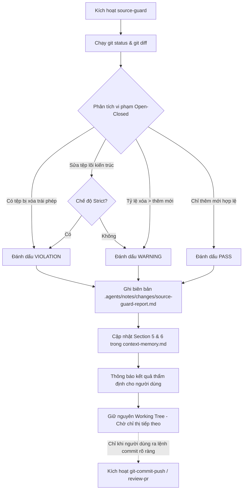

# Kỹ Năng Bảo Vệ Mã Nguồn & Bộ Nhớ Ngữ Cảnh Tích Lũy (source-guard)

Kỹ năng này trao quyền cho AI Agent trực tiếp **bảo vệ tính toàn vẹn của mã nguồn gốc trong dự án GDMAS**, đồng thời **tối ưu hóa cửa sổ ngữ cảnh (Context Window)** thông qua cơ chế kích hoạt kỹ năng theo nhu cầu (On-Demand) và duy trì bộ nhớ ngữ cảnh tinh gọn tích lũy đa nhánh tại `.agents/notes/memory/context-memory.md`.

> [!IMPORTANT]
> - **Nguyên Tắc Không Tự Ý Commit & Push (Strict Explicit Commit Policy):** Kỹ năng này (và mọi tác vụ chỉnh sửa mã nguồn nói chung) **tuyệt đối KHÔNG tự động thực hiện `git commit` hay `git push`** sau mỗi lần sửa xong code. Mã nguồn đã chỉnh sửa phải được giữ nguyên trên working tree để người dùng tiếp tục làm việc, thử nghiệm, chạy kiểm thử hoặc gom nhiều thay đổi. AI Agent **chỉ được phép commit và push khi người dùng trực tiếp ra lệnh cụ thể bằng văn bản** (ví dụ: gõ lệnh `/git-commit-push`, `/review-pr`, *"tạo commit và push"*, *"commit code cho tôi"*).
> - **Phân Định Vai Trò source-guard vs project-review:**
>   * `source-guard`: Thanh tra working tree **tức thời** (quét xóa file, sửa file lõi kiến trúc, tỷ lệ churn, cập nhật bộ nhớ tích lũy `context-memory.md`).
>   * `project-review`: Thẩm định **chuyên sâu** (kiểm tra 7 Bất biến kiến trúc I1-I7, đối chiếu proposal, kiểm tra drift tài liệu và lan phạm vi so với kế hoạch `plan.md`).
> - **Nguyên tắc Thực Thi Độc Lập (Self-Contained Agent Execution):** Agent tự động thực hiện toàn bộ quy trình kiểm định, tính toán churn và cập nhật Context Memory bằng các lệnh Git và công cụ thao tác tệp tin có sẵn, **hoàn toàn không phụ thuộc vào bất kỳ script ngoài (`.ps1`, `.sh`) nào**.
> - **Nguyên tắc Open-Closed (RULE-03):** *"Không sửa mã nguồn hiện tại – Chỉ bổ sung thêm mới"* (Closed for Modification, Open for Extension).
> - **Tiết kiệm Token (On-Demand Skills):** Agent chỉ nạp kỹ năng khi được yêu cầu, ưu tiên đọc Mục 5 & Mục 6 của `context-memory.md` để nắm bối cảnh dự án thay vì đọc lại toàn bộ thư mục `docs/` hay quét lại hàng trăm dòng `git status`.

---

## 🧭 Quy Trình Thực Thi Dành Cho AI Agent

Khi kỹ năng được kích hoạt (hoặc khi người dùng yêu cầu kiểm tra an toàn mã nguồn / cập nhật context memory):



---

## 🛡️ 1. Các Quy Tắc Vàng Bảo Vệ Mã Nguồn GDMAS

### Quy Tắc 1: CẤM XÓA tệp (`git status: D`)
- **Tuyệt đối không xóa** bất kỳ tệp mã nguồn, tài liệu hướng dẫn, test script hay tệp cấu hình nào đã tồn tại trong repository.
- **Ngoại lệ duy nhất:** Các tệp được người dùng chỉ định rõ ràng trong danh sách cho phép xóa (ví dụ `docker-compose.override.yml`, tệp nháp tạm thời).
- **Giải pháp OCP:** Nếu một module, lớp hoặc hàm không còn dùng, hãy đánh dấu `@deprecated` (hoặc comment cảnh báo không sử dụng) và bảo toàn nguyên vẹn tệp để không gây lỗi `ImportError` cho các module phụ thuộc.

### Quy Tắc 2: Bảo Toàn Tệp Lõi Kiến Trúc (Core Protected Files)
Danh sách các tệp lõi kiến trúc xương sống cần bảo vệ nghiêm ngặt:
- `apps/api/src/gdmas/main.py`: Điểm khởi chạy FastAPI; **tuyệt đối không nhúng worker ngầm vào file này** (Bảo vệ Terminal 6).
- `apps/api/src/gdmas/db/connection.py` & `base.py`: Kết nối CSDL PostgreSQL tập trung.
- `contracts/`: Hợp đồng giao tiếp dữ liệu chuẩn giữa Backend và Frontend.
- `docs/quyuocchung.md`: Hiến chương quy ước kỹ thuật tối cao của dự án GDMAS.

*Trong chế độ bình thường (Normal Mode): Sửa đổi tệp lõi sẽ bị gắn cờ `WARNING` (kiểm tra xem có phải chỉ là đăng ký router mới hay can thiệp phá vỡ kiến trúc cũ). Trong chế độ nghiêm ngặt (Strict Mode): Sửa tệp lõi bị tính là `VIOLATION`.*

### Quy Tắc 3: Phương Thức Mở Rộng Hợp Lệ (Extension Patterns)
Mọi chức năng mới phải được tổ chức thành các tệp độc lập:
- **Thêm Worker:** Tạo `apps/api/src/gdmas/services/<service_name>/runner.py` riêng biệt để chạy trên terminal độc lập (đáp ứng kiến trúc 7 terminals).
- **Thêm REST API Router:** Tạo file route mới `apps/api/src/gdmas/api/routes/<new_resource>.py` và đăng ký vào router chính qua `router.include_router(new_router)`.
- **Thêm CSDL / Bảng mới:** Tạo schema Pydantic mới trong `schemas/`, ORM model mới trong `models/` và tạo migration mới qua Alembic (`uv run alembic revision --autogenerate`).
- **Thêm Giao diện / Biểu đồ:** Tạo UI component mới trong `apps/web/src/components/charts/<ChartName>.tsx` cho 6 patterns chuỗi thời gian mà không ghi đè component cũ.
- **Thêm Test:** Viết test cases mới trong file test độc lập tại `tests/` hoặc `docs/testing/`.

### Quy Tắc 4: Kiểm Soát Tỷ Lệ Dòng Thay Đổi (Churn Ratio)
Nếu số dòng bị xóa (`deletions`) vượt trội so với số dòng thêm mới (`insertions`), Agent phải cảnh báo (`WARNING`) và đề xuất giải pháp bổ sung thêm mới thay vì ghi đè mã nguồn.

### Quy Tắc 5: Nguyên Tắc Tích Lũy Working Tree & Tuyệt Đối Không Tự Ý Commit/Push
- **Không tự động commit & push:** Sau khi sửa code xong một tính năng nhỏ, một tệp hay một hàm, phải giữ nguyên trạng thái working tree. Agent **tuyệt đối không tự ý** chạy `git commit` hay `git push`.
- **Lý do kỹ thuật cốt lõi:**
  * Cho phép người dùng kiểm thử trực tiếp trên local (chạy dev server, kiểm tra UI, chạy test) trước khi lưu vào lịch sử Git.
  * Tránh làm ô nhiễm lịch sử Git bằng hàng loạt micro-commit manh mún ("sửa 1 dòng", "sửa lỗi cú pháp nhỏ", "chỉnh css").
  * Cho phép gom nhiều thay đổi liên quan chặt chẽ thành một commit có ý nghĩa và giá trị kiến trúc hoàn chỉnh.
- **Thời điểm commit & push:** CHỈ thực hiện khi nhận được yêu cầu cụ thể từ người dùng (ví dụ: gõ lệnh `/git-commit-push`, `/review-pr` hoặc yêu cầu *"commit và push"*).

---

## 📋 2. Chi Tiết Các Bước Agent Tự Động Thực Hiện

### Bước 1: Quét Trạng Thái Working Tree
Agent chạy các lệnh Git sau:
```powershell
git status --porcelain -uall
git diff --shortstat
```
Phân loại danh sách tệp:
- `D ` -> Tệp bị xóa (`deletedFiles`).
- `M ` -> Tệp bị chỉnh sửa (`modifiedFiles`). Kiểm tra xem tệp có chứa đường dẫn của **Core Protected Files** hay không (`protectedModifications`).
- `A ` hoặc `??` -> Tệp thêm mới hoặc untracked (`addedFiles`).
- Trích xuất `insertions` và `deletions` từ output của `git diff --shortstat`.

### Bước 2: Thẩm Định Tuân Thủ Open-Closed
1. Nếu `deletedFiles` có phần tử:
   - Nếu tệp nằm trong danh sách cho phép (ví dụ người dùng yêu cầu xóa cụ thể): Gắn nhãn `[XÁC NHẬN CHO PHÉP XÓA]`.
   - Nếu không được cho phép: Đánh dấu vi phạm `[CẤM XÓA TỆP: Vi phạm nguyên tắc bảo toàn mã nguồn gốc (Closed for Modification)]`.
2. Nếu `protectedModifications` có phần tử:
   - Ở chế độ Strict: Đánh dấu vi phạm `[VI PHẠM TỆP LÕI: Tệp kiến trúc nhạy cảm bị sửa đổi]`.
   - Ở chế độ thường: Gắn cờ cảnh báo `[CẢNH BÁO TỆP LÕI: Cần đảm bảo chỉ bổ sung router/config mới mà không làm thay đổi logic cũ]`.
3. Nếu `deletions > insertions`:
   - Gắn cờ cảnh báo `[CẢNH BÁO TỶ LỆ DÒNG: Số dòng xóa vượt quá số dòng thêm mới]`.

### Bước 3: Ghi Biên Bản Kiểm Soát Mã Nguồn
Tạo hoặc ghi đè tệp `.agents/notes/changes/source-guard-report.md` với định dạng chuẩn:
```markdown
# [BIÊN BẢN KIỂM SOÁT BẢO VỆ MÃ NGUỒN - SOURCE GUARD REPORT]

- **Thời gian quét:** <YYYY-MM-DD HH:mm:ss>
- **Trạng thái:** <❌ KHÔNG ĐẠT (VI PHẠM) | ⚠️ CẢNH BÁO | ✅ ĐẠT CHUẨN (HOÀN HẢO)>
- **Số tệp thêm mới:** <count>
- **Số tệp chỉnh sửa:** <count>
- **Số tệp bị xóa:** <count>

---

## 1. Chi Tiết Các Tệp Thay Đổi
### Tệp Bổ Sung Mới (Được Khuyến Khích):
- `A <file_path>`

### Tệp Chỉnh Sửa:
- `M <file_path>`

### Tệp Bị Xóa:
- `D <file_path>`

---
*Báo cáo này được sinh tự động bởi kỹ năng source-guard và lưu trữ cục bộ tại .agents/notes/changes/.*
```

### Bước 4: Cập Nhật Context Memory Đa Nhánh Tích Lũy
Agent đọc và phân tích tệp `.agents/notes/memory/context-memory.md`:
1. **Bảo toàn nguyên vẹn Mục 1 đến Mục 4:** Bao gồm Bản đồ 7 Terminals, 6 Patterns, Nguyên tắc OCP, Bảng tra cứu On-demand.
2. **Kế thừa toàn bộ lịch sử các nhánh trong Mục 6:**
   - Đọc Mục 6 (`## 6. Sổ Nhật Ký Phát Triển & Thay Đổi Theo Nhánh (Cumulative Branch Milestones)`).
   - Tách và lưu giữ từng khối nhánh `### 🔖 [Nhánh: <branch-name>]` vào một từ điển (dictionary/map). Tuyệt đối **không làm mất** lịch sử của các nhánh cũ khác.
3. **Xác định thông tin nhánh hiện tại:**
   - Lấy tên nhánh hiện tại: `git branch --show-current`.
   - Lấy commit hash gần nhất: `git rev-parse --short HEAD`.
   - Suy luận `type`, `scope`, `description` dựa trên tên nhánh và cây tệp thay đổi (theo Bảng Phân Loại Kiến Trúc GDMAS).
   - Tạo danh sách gạch đầu dòng tóm tắt các tệp thay đổi chính.
4. **Cập nhật Mục 5 (Active Branch Snapshot):**
   - Cập nhật nhánh hiện tại, trạng thái working tree (clean hoặc số tệp thay đổi), `type(scope)`, subject commit đề xuất, tóm tắt thay đổi và kết quả đánh giá an toàn mã nguồn.
5. **Cập nhật Mục 6 (Cumulative Branch Milestones):**
   - Tạo hoặc cập nhật khối thông tin cho nhánh hiện tại:
     ```markdown
     ### 🔖 [Nhánh: <branch_name>] - Cập nhật: <YYYY-MM-DD HH:mm:ss>
     - **Trạng thái:** <Đang phát triển (Có X tệp thay đổi) / Đã đồng bộ sạch sẽ>
     - **Đánh dấu phân loại:** `<type>(<scope>)`
     - **Tiêu đề thay đổi chính:** <tiêu đề tóm tắt tiếng Việt>
       * <gạch đầu dòng tóm tắt 1>
       * <gạch đầu dòng tóm tắt 2>
     ```
   - Đặt khối của nhánh hiện tại lên đầu tiên trong Mục 6, sau đó ghi tiếp toàn bộ khối của các nhánh khác đã lưu giữ.
6. **Ghi lại tệp `.agents/notes/memory/context-memory.md`** với mã hóa UTF-8.

### Bước 5: Phản Hồi Cho Người Dùng
Agent trình bày báo cáo tóm tắt rõ ràng:
- Bảng trạng thái thẩm định: Thêm mới, Chỉnh sửa, Bị xóa, Churn (+/-).
- Kết luận an toàn: `✅ ĐẠT CHUẨN`, `⚠️ CẢNH BÁO`, hoặc `❌ VI PHẠM`.
- Nếu có vi phạm xóa tệp: Hướng dẫn người dùng lệnh khôi phục (`git restore <file>`) hoặc giải thích lý do nếu là xóa có chủ đích.
- Xác nhận đã cập nhật `.agents/notes/memory/context-memory.md` và `.agents/notes/changes/source-guard-report.md`.
- **Nhắc nhở quan trọng:** Thông báo rõ rằng **các thay đổi vẫn được giữ nguyên an toàn trên working tree**. Agent **KHÔNG tự động commit hay push**. Khi người dùng đã sẵn sàng và muốn lưu lại mốc làm việc, hãy kích hoạt `/git-commit-push`, `/review-pr` hoặc yêu cầu *"tạo commit và push"*.

---

## 🗺️ Bảng Phân Loại Kiến Trúc GDMAS (Tra Cứu Nhanh Cho Agent)

| Mẫu Đường Dẫn Tệp / Cấu Trúc | Type | Scope Đề Xuất | Mô Tả Ý Nghĩa Tiếng Việt |
| :--- | :--- | :--- | :--- |
| `apps/web/src/components/charts/` | `feat` | `web` | trực quan hóa biểu đồ chuỗi thời gian địa chấn |
| `apps/web/src/layouts/` | `feat` | `web` | cập nhật cấu trúc layout giao diện frontend |
| `apps/web/` | `feat` | `web` | cập nhật giao diện người dùng và tương tác frontend |
| `apps/api/src/gdmas/services/ingestion/` | `feat` | `ingestion` | cập nhật tiến trình nạp dữ liệu USGS |
| `apps/api/src/gdmas/services/analysis/` | `feat` | `analysis` | cập nhật thuật toán phân tích chuỗi thời gian |
| `apps/api/src/gdmas/services/clustering/` | `feat` | `clustering` | cập nhật thuật toán gom cụm không gian |
| `apps/api/src/gdmas/services/prediction/` | `feat` | `prediction` | cập nhật mô hình dự báo địa chấn |
| `apps/api/src/gdmas/realtime/` | `feat` | `realtime` | cập nhật dịch vụ streaming dữ liệu SSE |
| `apps/api/src/gdmas/db/` hoặc `alembic/` | `feat` | `db` | cập nhật cấu trúc cơ sở dữ liệu và migrations |
| `apps/api/` | `feat` | `api` | cập nhật dịch vụ backend và endpoint xử lý dữ liệu |
| `contracts/` | `chore` | `contracts` | chuẩn hóa hợp đồng dữ liệu dùng chung API-Web |
| `docs/testing/` hoặc `tests/` | `test` | `testing` | bổ sung kịch bản và ca kiểm thử hệ thống |
| `docs/setup/` | `docs` | `setup` | cập nhật hướng dẫn cài đặt và cấu hình môi trường |
| `docs/architecture/` | `docs` | `architecture`| cập nhật tài liệu kiến trúc hệ thống và luồng dữ liệu |
| `docs/` | `docs` | `core` | cập nhật hệ thống tài liệu kỹ thuật dự án |
| `.agents/skills/` | `chore` | `skills` | chuẩn hóa và tối ưu hóa các kỹ năng AI agent |
| `.agents/` | `chore` | `agents` | cập nhật ghi chú và cấu hình AI agent |
| `scripts/` | `chore` | `scripts` | cập nhật kịch bản kiểm thử và tự động hóa |

---

## 📁 Tệp Bộ Nhớ & Nhật Ký Cục Bộ
- **Bộ nhớ ngữ cảnh tinh gọn:** [`.agents/notes/memory/context-memory.md`](GDMAS/.agents/notes/memory/context-memory.md)
- **Biên bản thẩm định mã nguồn:** [`.agents/notes/changes/source-guard-report.md`](GDMAS/.agents/notes/changes/source-guard-report.md)
