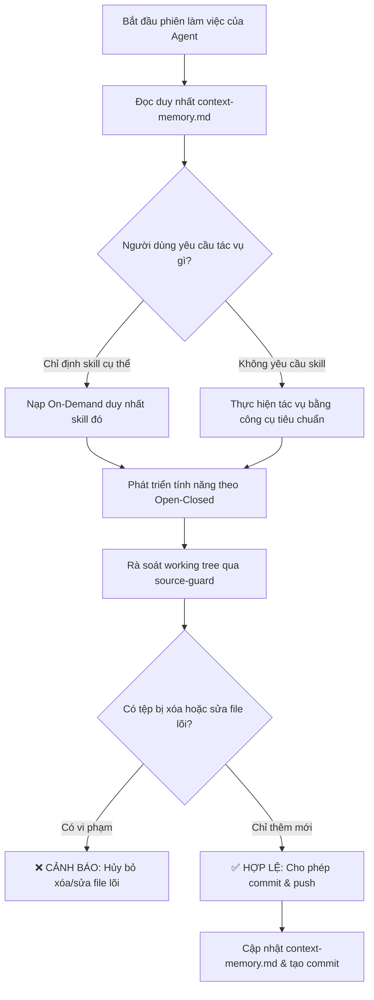

# Kỹ Năng Bảo Vệ Mã Nguồn & Tối Ưu Cửa Sổ Ngữ Cảnh (source-guard)

Kỹ năng này chịu trách nhiệm **bảo vệ tính toàn vẹn của mã nguồn gốc trong dự án GDMAS**, đồng thời **tối ưu hóa việc sử dụng token của AI Agent** thông qua cơ chế kích hoạt kỹ năng theo nhu cầu (On-Demand) và duy trì bộ nhớ ngữ cảnh tinh gọn (Context Window Memory).

> [!IMPORTANT]
> - **Nguyên tắc Open-Closed (RULE-03):** "Không sửa mã nguồn hiện tại – Chỉ bổ sung thêm mới" *(Closed for Modification, Open for Extension)*.
> - **Tiết kiệm Token (On-Demand Skills):** Agent **tuyệt đối không đọc toàn bộ các skill** trong `.agents/skills/` nếu không có yêu cầu, chỉ nạp kỹ năng khi được chỉ định rõ ràng.
> - **Bộ nhớ Cửa sổ Ngữ cảnh (Context Memory):** Sử dụng tệp [`.agents/notes/memory/context-memory.md`](file:///D:/KHDLKPDL/GDMAS/.agents/notes/memory/context-memory.md) để nắm toàn bộ bối cảnh dự án trong 60 dòng, không đọc lại toàn bộ tài liệu `docs/`.

---

## 🧭 Quy Trình Hoạt Động (Workflow)



---

## 🧠 1. Cơ Chế Bộ Nhớ Cửa Sổ Ngữ Cảnh (Context Window Memory)

Nhằm giải quyết vấn đề **Agent bị cạn kiệt context window hoặc phải tốn hàng nghìn tokens để đọc lại 30+ tệp tài liệu trong `docs/`**:
- Kỹ năng thiết lập tệp bộ nhớ tinh gọn tại:
  - [`.agents/notes/memory/context-memory.md`](file:///D:/KHDLKPDL/GDMAS/.agents/notes/memory/context-memory.md)
- **Nội dung gói gọn trong ~60 dòng:**
  1. *Bản đồ 7 Terminals:* Port, chu kỳ chạy (5p/1d) và lệnh chạy độc lập của 7 khối service.
  2. *6 Patterns Chuỗi Thời Gian:* Đặc tả bắt buộc cho backend và biểu đồ frontend.
  3. *Quy tắc bất biến (RULE-03):* Danh mục tệp lõi cấm sửa đổi, cách mở rộng đúng chuẩn.
  4. *Chỉ mục Kỹ năng On-Demand:* Bảng tra cứu 1 dòng cho mỗi skill.
  5. *Trạng thái không gian làm việc:* Nhánh hiện thời và tiến độ gần nhất.
- **Quy tắc cho Agent:** Khi bắt đầu phiên làm việc hoặc sau khi context bị nén, **chỉ cần đọc duy nhất `context-memory.md`** để phục hồi toàn bộ bối cảnh hệ thống.

---

## 🚫 2. Quy Tắc Tải Kỹ Năng Theo Nhu Cầu (On-Demand Skill Loading)

Để **không tiêu tốn token vô ích** vào việc đọc các hướng dẫn skill không liên quan:
1. **CẤM đọc đồng loạt:** Agent **tuyệt đối không được chủ động duyệt hoặc đọc các file `SKILL.md`** trong `.agents/skills/` một cách tự động khi mở phiên làm việc.
2. **Chỉ đọc khi được CHỈ ĐỊNH:** Chỉ mở và đọc nội dung của một kỹ năng cụ thể khi:
   - Người dùng gọi tên kỹ năng trong câu lệnh (ví dụ: *"hãy chạy source-guard"*, *"dùng propose-branch"*, *"soạn commit qua generate-commit"*).
   - Tác vụ hiện tại khớp trực tiếp và duy nhất với mục tiêu của kỹ năng đó (ví dụ: người dùng yêu cầu tạo commit -> chỉ nạp `generate-commit`).
3. **Bảng Tra Cứu Nhanh (Không cần đọc nội dung skill):**

| Tên Kỹ Năng | Khi Nào Mới Được Đọc & Kích Hoạt | Thư Mục Chứa |
| :--- | :--- | :--- |
| **`source-guard`** | Khi kiểm tra vi phạm xóa/sửa file lõi, tối ưu ngữ cảnh, làm mới memory | `.agents/skills/source-guard/` |
| **`generate-commit`**| Khi người dùng yêu cầu sinh thông điệp commit tiếng Việt | `.agents/skills/generate-commit/` |
| **`git-commit-push`** | Khi người dùng yêu cầu commit và đẩy thẳng lên remote | `.agents/skills/git-commit-push/` |
| **`git-branch-push`** | Khi người dùng yêu cầu chuyển, tạo nhánh mới và đẩy lên GitHub | `.agents/skills/git-branch-push/` |
| **`propose-branch`** | Khi bắt đầu tính năng mới hoặc hỏi nên đặt tên branch thế nào | `.agents/skills/propose-branch/` |

---

## 🛡️ 3. 4 Quy Tắc Vàng Bảo Vệ Mã Nguồn GDMAS

### 1. Tuyệt đối CẤM XÓA tệp (`git status: D`)
- Không xóa bất kỳ tệp mã nguồn, tài liệu, test script hay cấu hình nào đã tồn tại trong repository.
- Nếu hàm hoặc tệp cũ không còn dùng: **Đánh dấu `@deprecated` và bảo toàn nguyên vẹn**.

### 2. Bảo toàn Tệp Lõi Kiến Trúc (Core Protected Files)
Các tệp sau đây đóng vai trò xương sống, cấm tự ý can thiệp:
- `apps/api/src/gdmas/main.py`: Điểm khởi chạy FastAPI; **tuyệt đối không nhúng worker ngầm vào file này**.
- `apps/api/src/gdmas/db/connection.py` & `base.py`: Kết nối CSDL PostgreSQL tập trung.
- `contracts/`: Hợp đồng giao tiếp dữ liệu chuẩn giữa Backend và Frontend.
- `docs/quyuocchung.md`: Hiến chương quy ước kỹ thuật tối cao của dự án.

### 3. Phương thức Mở Rộng Hợp Lệ (Valid Extension Patterns)
Khi cần phát triển tính năng, bắt buộc tạo tệp mới:
- **Thêm Service Worker:** Tạo `gdmas/services/<service_name>/runner.py` riêng biệt để chạy trên terminal độc lập (đáp ứng 7 terminals).
- **Thêm API Endpoint:** Tạo file route mới trong `gdmas/api/routes/<new_resource>.py` và đăng ký vào router chính.
- **Thêm CSDL / Bảng mới:** Tạo schema Pydantic mới, ORM model mới và tạo migration qua Alembic.
- **Thêm Giao diện / Biểu đồ:** Tạo UI component mới trong `apps/web/src/components/charts/` cho 6 patterns mà không ghi đè component cũ.

### 4. Kiểm soát Tỷ lệ Dòng Thay Đổi (Churn Ratio)
Nếu một tệp có số dòng xóa (`deletions`) vượt trội so với số dòng thêm mới (`insertions`), cần tách phần logic mới ra file riêng thay vì viết đè mã nguồn cũ.

---

## ⚡ Cách Kích Hoạt & Sử Dụng

### 1. Kích hoạt tự nhiên qua hội thoại
Chỉ cần yêu cầu Agent trong chat:
- *"Hãy rà soát xem mã nguồn có vi phạm Open-Closed không"*
- *"Đọc memory ngữ cảnh để nắm tình hình dự án"*
- *"Cập nhật lại context-memory sau khi xong việc"*

### 2. Chạy kịch bản tự động bằng PowerShell
```powershell
# 1. Quét kiểm tra trạng thái an toàn mã nguồn:
.\.agents\skills\source-guard\scripts\source-guard.ps1

# 2. Quét ở chế độ nghiêm ngặt (Strict mode):
.\.agents\skills\source-guard\scripts\source-guard.ps1 -Strict

# 3. Đồng thời quét an toàn VÀ cập nhật lại tệp context-memory.md:
.\.agents\skills\source-guard\scripts\source-guard.ps1 -UpdateMemory
```

### 3. Chạy kịch bản bằng Bash
```bash
bash .agents/skills/source-guard/scripts/source-guard.sh
```

---

## 📁 Tệp Bộ Nhớ & Nhật Ký Cục Bộ
- **Bộ nhớ ngữ cảnh tinh gọn:** [`.agents/notes/memory/context-memory.md`](file:///D:/KHDLKPDL/GDMAS/.agents/notes/memory/context-memory.md)
- **Biên bản thẩm định mã nguồn:** [`.agents/notes/changes/source-guard-report.md`](file:///D:/KHDLKPDL/GDMAS/.agents/notes/changes/source-guard-report.md)

Cả hai tệp đều được bảo vệ trong `.gitignore` để không làm ô nhiễm Git tree từ xa.
