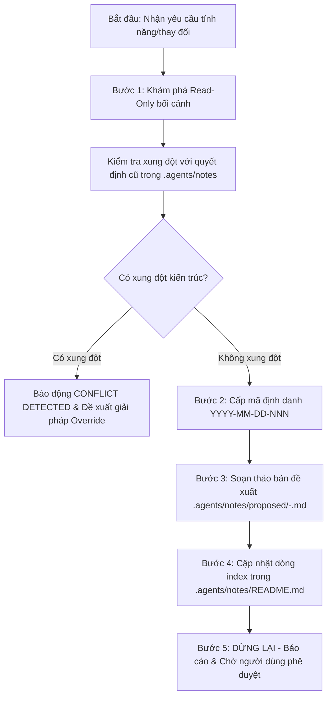

# Kỹ Năng Khám Phá & Soạn Thảo Đề Xuất (write-proposal)

Kỹ năng này chịu trách nhiệm thực thi **Pha 1 (Discovery - Khám phá)** và **Pha 2 (Proposal - Soạn thảo đề xuất)** trong quy trình phát triển phần mềm định hướng đặc tả của dự án **GDMAS**.

> [!IMPORTANT]
> - **Chế Độ Read-Only Tuyệt Đối:** Trong pha này, AI Agent chỉ được phép đọc tài liệu và mã nguồn. Tuyệt đối **không chỉnh sửa bất kỳ tệp code, cấu hình hay cơ sở dữ liệu nào**.
> - **Nguyên Tắc Không Tự Ý Lập Trình (No Premature Coding):** Không nhảy thẳng vào viết code khi chưa có đề xuất được người dùng phê duyệt rõ ràng.
> - **Dừng Cứng (Hard Stop):** Sau khi soạn thảo xong bản đề xuất, Agent **dừng lại ngay lập tức** và trình bày để người dùng xem xét. Chỉ khi người dùng điền hoặc chỉ định `Decision: Approved` tại Mục 9 thì pha lập trình (`build-implementation`) mới được phép bắt đầu.

---

## 🧭 Quy Trình Thực Thi Dành Cho AI Agent



---

## 🛠️ Hướng Dẫn Chi Tiết Từng Bước

### Bước 1: Khám Phá Bối Cảnh (Read-Only)
Agent thực hiện đọc và tra cứu theo thứ tự:
1. **Yêu cầu của người dùng:** Phân tích kỹ nội dung người dùng vừa yêu cầu trong phiên hội thoại.
2. **Bộ nhớ ngữ cảnh tinh gọn:** Đọc [`.agents/notes/memory/context-memory.md`](GDMAS/.agents/notes/memory/context-memory.md) để nắm bản đồ 7 Terminals, 6 Patterns chuỗi thời gian và trạng thái nhánh hiện thời.
3. **Hiến chương & Kiến trúc:**
   - [`docs/quyuocchung.md`](GDMAS/docs/quyuocchung.md): Hiến chương quy ước kỹ thuật tối cao.
   - [`docs/architecture/`](GDMAS/docs/architecture/): Tài liệu kiến trúc luồng dữ liệu và 7 Terminals.
   - [`contracts/`](GDMAS/contracts/): Hợp đồng dữ liệu Backend - Frontend.
4. **Kiểm tra quyết định cũ (Conflict Detection):**
   - Quét tìm trong thư mục `.agents/notes/proposed/` và `.agents/notes/implemented/` xem tính năng này hoặc các phương án tương tự đã từng được đề xuất, được duyệt, hoặc **bị bác bỏ (Rejected)** trước đây hay chưa.
   - **Xử lý xung đột (Conflict Handling):**
     * Nếu tính năng mâu thuẫn với một quyết định đã chốt hoặc phương án đã bị bác bỏ trước đây: Agent **dừng lại và báo động**:
       ```text
       ⚠️ PHÁT HIỆN XUNG ĐỘT QUYẾT ĐỊNH (CONFLICT DETECTED)
       Quyết định hiện hữu: .agents/notes/proposed/<tệp-cũ>.md — "<tóm tắt>" (Trạng thái: Approved / Rejected)
       Yêu cầu hiện tại: <nội dung yêu cầu mới>
       Giải pháp: Cần tạo proposal mới với trường 'Overrides: <id-cũ>' và giải thích lý do thay đổi.
       ```

### Bước 2: Cấp Mã Định Danh (Proposal ID)
- Cấp ID theo định dạng: `YYYY-MM-DD-NNN`
  * `YYYY-MM-DD`: Ngày hiện tại (theo giờ địa phương máy người dùng).
  * `NNN`: Số thứ tự 3 chữ số bắt đầu từ `001` (tăng dần nếu trong ngày đã có proposal trước).
- Tạo slug định danh bằng tiếng Anh hoặc tiếng Việt không dấu viết thường, nối bằng dấu gạch ngang (ví dụ: `2026-11-08-001-earthquake-clustering-service.md`).

### Bước 3: Soạn Thảo Bản Đề Xuất (Tạo Tệp Proposed)
Tạo tệp `.agents/notes/proposed/<id>-<slug>.md` dựa theo cấu trúc chuẩn sau:

```markdown
# [ĐỀ XUẤT KIẾN TRÚC & TÍNH NĂNG - PROPOSAL]

- **Proposal ID:** <YYYY-MM-DD-NNN>
- **Tiêu đề:** <Tên tính năng hoặc thay đổi kỹ thuật>
- **Trạng thái:** Proposed
- **Người đề xuất:** AI Agent (theo yêu cầu của Người dùng)
- **Ngày tạo:** <YYYY-MM-DD>
- **Nhánh dự kiến:** <type>/<slug> (tách từ develop)
- **Thay thế (Overrides):** <ID cũ nếu có, hoặc None>

---

## 1. Mục Tiêu & Bối Cảnh Nghiệp Vụ
- Mô tả rõ bài toán cần giải quyết và giá trị mang lại cho hệ thống GDMAS.

## 2. Đánh Giá Khả Thi Theo Kiến Trúc GDMAS
- **Kiến trúc 7 Terminals:** Tác vụ này thuộc Terminal nào (T1..T7)? Có vi phạm việc chạy độc lập không?
- **Nguyên tắc Open-Closed (RULE-03):** Xác nhận giải pháp hoàn toàn là **bổ sung thêm mới**, không sửa đổi phá vỡ mã nguồn cũ đang chạy ổn định.
- **6 Patterns Chuỗi Thời Gian:** Có liên quan đến trực quan hóa hay tính toán 6 patterns không?

## 3. Phạm Vi Triển Khai (Scope)
- **Trong phạm vi (In Scope):**
  * Danh sách các tệp dự kiến tạo mới.
  * Danh sách các hàm/route/component mới cần bổ sung.
- **Ngoài phạm vi (Out of Scope):**
  * Những gì không làm trong đợt triển khai này để tránh lan man (Scope creep).

## 4. Phương Án Kỹ Thuật Chi Tiết
- **Backend (apps/api):** Mô tả schema Pydantic, model SQLAlchemy, route FastAPI hoặc runner worker.
- **Frontend (apps/web):** Mô tả component React, hook lấy dữ liệu, biểu đồ Recharts hoặc bản đồ Leaflet.
- **Hợp đồng dữ liệu (contracts/):** Các trường dữ liệu trao đổi (ISO 8601 UTC, WGS84).

## 5. Các Phương Án Đã Cân Nhắc & Lý Do Chọn
- Trình bày ít nhất 2 phương án và lý do chọn phương án tối ưu theo chuẩn GDMAS.

## 6. Tác Động Kiến Trúc (Architecture Impact)
- Liệt kê các tài liệu kỹ thuật hoặc hợp đồng cần cập nhật tương ứng để tránh độ lệch tài liệu (Drift).

## 7. Tiêu Chí Nghiệm Thu (Validation Criteria)
- Các ca kiểm thử cần thực hiện (`uv run pytest`, `pnpm build`, kiểm tra giao diện).

## 8. Kế Hoạch Hoàn Tác (Rollback Plan)
- Hướng dẫn cách khôi phục trạng thái cũ nếu tính năng mới gặp lỗi nghiêm trọng.

## 9. Phê Duyệt Của Con Người (Human Review)
- **Reviewer:** (Để trống - chờ người dùng điền)
- **Ngày duyệt:** (Để trống)
- **Quyết định:** Pending
- **Ý kiến nhận xét (Comments):** (Chờ ý kiến của người dùng)

## 10. Lịch Sử Tu Chỉnh (Revisions)
- <YYYY-MM-DD>: Khởi tạo bản đề xuất ban đầu.
```

### Bước 4: Cập Nhật Dòng Index Trong `.agents/notes/README.md`
Thêm một dòng vào bảng theo dõi proposal trong `.agents/notes/README.md` với trạng thái `Decision: Pending` và `Implementation: —`.

### Bước 5: Báo Cáo Người Dùng & Dừng Lại (Stop)
- Trình bày tóm tắt nội dung đề xuất cho người dùng.
- Nhắc nhở người dùng:
  > *"Bản đề xuất đã được lưu tại `.agents/notes/proposed/<id>-<slug>.md`. Tôi đã DỪNG LẠI và không tự ý chỉnh sửa mã nguồn. Xin vui lòng xem xét và duyệt (`Decision: Approved`) trước khi chúng ta bắt đầu lập trình."*

---

## 🚫 Điều Kỹ Năng Này Tuyệt Đối Không Làm
- Không viết mã nguồn code dự án.
- Không tự ý điền `Decision: Approved` thay người dùng.
- Không tạo thư mục `implemented/`.
- Không tạo commit, không push hay chuyển nhánh Git.

