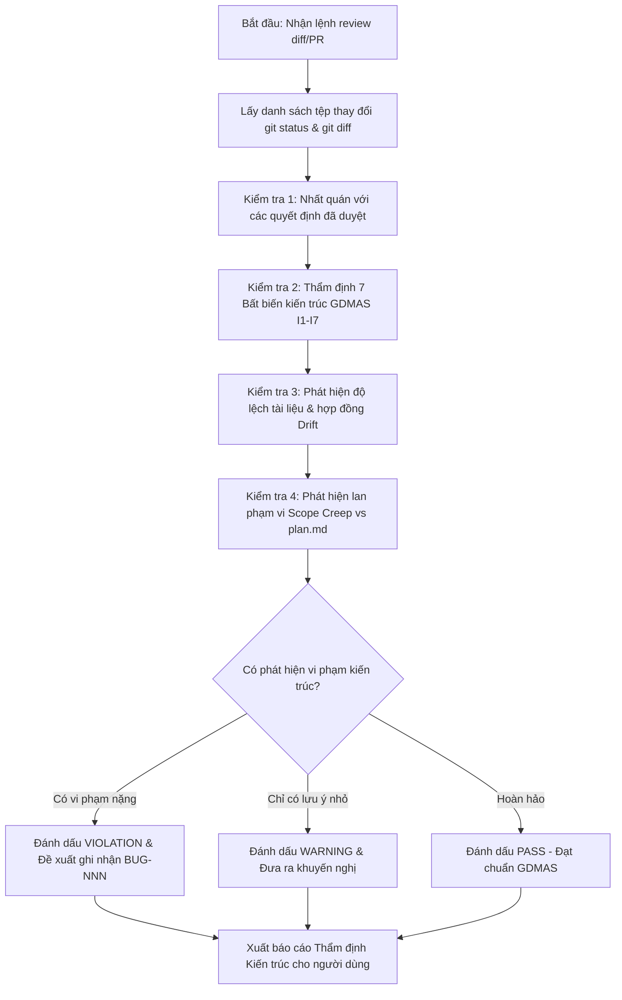

# Kỹ Năng Thẩm Định Kiến Trúc & Chất Lượng Mã Nguồn (project-review)

Kỹ năng này hoạt động như một **lớp kiểm định kiến trúc độc lập (Architecture & Quality Gate)** dành riêng cho dự án **GDMAS**, đảm bảo mã nguồn trước khi lưu trữ hoặc tích hợp luôn tuân thủ các quy ước thiết kế tối cao.

> [!IMPORTANT]
> - **Chế Độ Thẩm Định Độc Lập:** Kỹ năng này chỉ đóng vai trò phân tích, rà soát và đưa ra báo cáo thẩm định (Findings). Agent **không tự ý sửa đổi code** nếu không được người dùng yêu cầu riêng.
> - **Không Tự Ý Commit/Push:** Kỹ năng không thực hiện bất kỳ thao tác commit hay push nào lên Git.
> - **Nguồn Chân Lý Đối Chiếu:** So sánh trực tiếp giữa `git diff` hiện tại với bản đề xuất `.agents/notes/proposed/<id>-<slug>.md` và bản kế hoạch `.agents/notes/implemented/<id>-<slug>/plan.md`.

---

## 🧭 Quy Trình Thực Thi Dành Cho AI Agent



---

## 🛡️ 7 Bất Biến Kiến Trúc Bắt Buộc Của GDMAS (Invariants I1 - I7)

Khi thực hiện review, Agent bắt buộc phải rà soát mã nguồn qua 7 bất biến sau:

### ⚡ I1 - Tách Biệt 7 Terminals (7 Terminals Separation)
- `apps/api/src/gdmas/main.py` chỉ là điểm khởi chạy REST API và SSE (Terminal 6).
- **Tuyệt đối cấm** nhúng các tác vụ chạy nền, vòng lặp cron hay worker ngầm vào `main.py`.
- Mọi worker (Ingestion, Analysis, Clustering, Prediction) phải có tệp `runner.py` độc lập trong thư mục `services/<service_name>/` để chạy tại các cửa sổ terminal riêng biệt.
- *Vi phạm I1 được xếp vào mức độ nghiêm trọng: `CRITICAL BUG`.*

### ⚡ I2 - Nguyên Tắc Open-Closed (RULE-03)
- Tuyệt đối cấm xóa tệp (`git status: D`) đã tồn tại trong repository.
- Cấm sửa đổi signature của các hàm tiện ích hoặc module đang hoạt động ổn định.
- Khi cần chức năng mới: Viết thêm hàm mới (ví dụ `_v2`), tạo component mới hoặc dùng default parameters.

### ⚡ I3 - Chuẩn Hóa Hợp Đồng & Múi Giờ (Data Contracts & Timezone)
- Dữ liệu trao đổi giữa Backend và Frontend phải đúng schema trong `contracts/`.
- Mọi trường thời gian trong cơ sở dữ liệu và API bắt buộc phải là múi giờ **UTC** (`TIMESTAMPTZ` trong PostgreSQL, chuỗi ISO 8601 định dạng `YYYY-MM-DDTHH:mm:ssZ`).
- Hệ tọa độ không gian bắt buộc là **WGS84** (`latitude`, `longitude`).

### ⚡ I4 - Bất Biến Migration Cơ Sở Dữ Liệu (Alembic Migrations)
- Tuyệt đối cấm sửa đổi các tệp migration đã tồn tại trong `alembic/versions/` (gây lỗi mất đồng bộ lịch sử migration trên môi trường production).
- Mọi thay đổi bảng hoặc cột mới bắt buộc phải tạo tệp migration mới (`alembic revision --autogenerate`).

### ⚡ I5 - 6 Patterns Chuỗi Thời Gian Địa Chấn
- Các component trực quan hóa mới phải nằm trong `apps/web/src/components/charts/` phục vụ đúng 6 patterns:
  1. Biểu diễn thời gian (Line, Scatter, Histogram).
  2. Phân tích xu hướng (Trend sau resample).
  3. Phân tích mùa vụ (Seasonality sau resample).
  4. Ma trận tương quan (Heatmap đa biến định lượng).
  5. Dự báo định lượng sự kiện ngày kế tiếp kèm khoảng tin cậy (`t+1`).
  6. Phân loại mức độ hoạt động địa chấn ngày kế tiếp (`t+1`).
- Component mới không được ghi đè hoặc làm hỏng layout chung của giao diện Dark Mode.

### ⚡ I6 - Bảo Mật & Thông Tin Nhạy Cảm (Secrets & Environment)
- Tuyệt đối không stage các tệp cấu hình chứa secret thật (`.env`, `apps/web/.env`, `apps/api/.env`).
- Không hardcode mật khẩu, API key hoặc chuỗi kết nối Database vào mã nguồn. Chỉ sử dụng tệp `.env.example` làm mẫu cấu hình rỗng.
- *Lộ secret được xếp vào mức độ: `CRITICAL BUG`.*

### ⚡ I7 - Tính Toàn Vẹn Của Bộ Kiểm Thử (Test Suite Integrity)
- Không được xóa hoặc sửa đổi các test cases cũ đang pass nhằm che giấu lỗi hồi quy (regression bugs).
- Mọi kịch bản kiểm thử mới phải được viết bổ sung độc lập trong `docs/testing/` hoặc `tests/`.

---

## 📋 4 Bước Kiểm Tra Chi Tiết Của Agent

### 1. Kiểm Tra Nhất Quán Quyết Định
- Đọc các tệp trong `.agents/notes/proposed/` và `.agents/notes/implemented/`.
- Xác định xem mã nguồn hiện tại có đi ngược lại những quyết định kiến trúc đã được chốt (hoặc áp dụng lại phương án đã từng bị bác bỏ trong mục `Scope of Rejection` của proposal cũ) hay không.

### 2. Kiểm Tra 7 Bất Biến Kiến Trúc (Invariants I1 - I7)
- Quét qua toàn bộ danh sách tệp và diff của mã nguồn, đối chiếu với danh mục 7 Invariants ở trên.

### 3. Kiểm Tra Độ Lệch Tài Liệu & Hợp Đồng (Drift Detection)
- Đọc mục `Architecture Impact` trong proposal tương ứng.
- Nếu code có thay đổi endpoint API, cấu trúc bảng CSDL, biến môi trường hay component UI mà tài liệu trong `docs/` hoặc hợp đồng trong `contracts/` chưa được cập nhật tương ứng: Báo động **Tài liệu bị lệch (Documentation Drift)**.

### 4. Kiểm Tra Hiện Tượng Lan Phạm Vi (Scope Creep Check)
- Đọc mục `1. Phạm Vi Thực Hiện (Scope)` trong `.agents/notes/implemented/<id>-<slug>/plan.md`.
- So sánh danh sách tệp thực tế bị thay đổi (`git diff --name-only`) với danh sách `In Scope` trong kế hoạch:
  * Nếu phát hiện có tệp bị sửa đổi nằm ngoài phạm vi đã cam kết trong plan: Báo động **Lan phạm vi (Scope Mismatch)**.

---

## 📊 Mẫu Báo Cáo Thẩm Định Kiến Trúc

Agent xuất kết quả ra màn hình hội thoại theo định dạng chuẩn:

```markdown
# [BIÊN BẢN THẨM ĐỊNH KIẾN TRÚC GDMAS - PROJECT REVIEW REPORT]

- **Nhánh kiểm tra:** <branch_name>
- **Thời gian thực hiện:** <YYYY-MM-DD HH:mm:ss>
- **Kết luận chung:** <✅ ĐẠT CHUẨN | ⚠️ CẦN LƯU Ý | ❌ VI PHẠM KIẾN TRÚC>

---

### 1. Bảng Đánh Giá 7 Bất Biến Kiến Trúc (Invariants)
| Bất biến | Mô tả quy chuẩn | Kết quả | Ghi chú chi tiết |
| :--- | :--- | :---: | :--- |
| **I1** | Tách biệt 7 Terminals (Không nhúng worker vào main.py) | ✅ PASS | Độc lập hoàn toàn |
| **I2** | Open-Closed Principle (Cấm xóa file & bảo vệ hàm cũ) | ✅ PASS | Chỉ bổ sung file mới |
| **I3** | Chuẩn hóa hợp đồng & Múi giờ UTC / WGS84 | ✅ PASS | Đúng chuẩn ISO 8601 |
| **I4** | Bất biến Alembic Migrations (Không sửa migration cũ) | ✅ PASS | Tạo revision mới |
| **I5** | Đáp ứng đúng 6 Patterns chuỗi thời gian địa chấn | ✅ PASS | Component độc lập |
| **I6** | An toàn thông tin (Không stage .env hay secret) | ✅ PASS | Sạch sẽ |
| **I7** | Bảo toàn bộ test cases cũ đang pass | ✅ PASS | Bổ sung test mới |

---

### 2. Kiểm Tra Phạm Vi (Scope Check vs plan.md)
- **Trạng thái:** <Hợp lệ / Phát hiện lan phạm vi>
- **Các tệp nằm ngoài In-Scope:** <(Không có) hoặc Liệt kê tệp phát sinh>

### 3. Kiểm Tra Độ Lệch Tài Liệu (Drift Check)
- **Trạng thái:** <Đồng bộ hoàn hảo / Cần cập nhật docs>

### 4. Khuyến Nghị & Hành Động Tiếp Theo
- <Các bước khuyến nghị cụ thể cho người dùng hoặc chuyển sang review-pr nếu đã sẵn sàng>
```

---

## 🚫 Ranh Giới Kỹ Năng
- Không tự ý commit hoặc push mã nguồn.
- Không tự ý merge nhánh hay phê duyệt thay con người.
- Chỉ đưa ra khuyến nghị kỹ thuật, quyền quyết định kiến trúc thuộc về người dùng.
