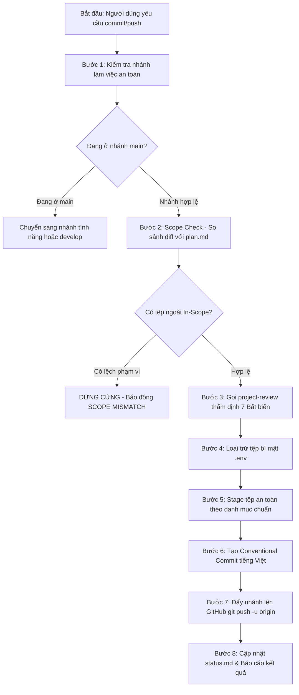

# Kỹ Năng Đóng Gói, Thẩm Định & Đẩy Nhánh GitHub (review-pr)

Kỹ năng này chịu trách nhiệm thực hiện toàn bộ các thao tác Git từ khâu kiểm tra phạm vi (Scope Check), thẩm định kiến trúc qua `project-review`, đóng gói tệp an toàn, tạo Conventional Commit tiếng Việt đến đẩy nhánh lên GitHub remote repository của dự án **GDMAS**.

> [!IMPORTANT]
> - **Chỉ Chạy Khi Được Chỉ Định Riêng (Explicit Trigger Only):** Kỹ năng này **CHỈ ĐƯỢC PHÉP CHẠY khi người dùng trực tiếp yêu cầu** (ví dụ: gõ lệnh `/review-pr`, *"hãy commit và push việc này"*, *"tạo commit cho tôi"*). Agent **tuyệt đối không bao giờ được tự động nối tiếp chạy kỹ năng này ngay sau khi lập trình xong**.
> - **Quy Chuẩn Nhánh Cơ Sở (Branching Flow):** Mọi nhánh tính năng đều phải được tách và đồng bộ với nhánh cơ sở `develop`. **Tuyệt đối cấm commit hoặc push trực tiếp lên nhánh `main`**.
> - **Bảo Vệ Bí Mật (.env Guard):** Luôn kiểm tra và gỡ bỏ các tệp cấu hình chứa secret thật (`.env`, `apps/web/.env`, `apps/api/.env`) trước khi stage.
> - **Conventional Commit Tiếng Việt Chuẩn GDMAS:** Mọi thông điệp commit phải tuân thủ chuẩn `<type>(<scope>): <tiêu đề tiếng Việt chữ thường>`, đi kèm danh sách gạch đầu dòng chi tiết các công việc đã làm.

---

## 🧭 Quy Trình Thực Thi Dành Cho AI Agent



---

## 🛠️ Hướng Dẫn Chi Tiết Từng Bước

### Bước 1: Kiểm Tra Nhánh Làm Việc
Agent chạy lệnh kiểm tra nhánh hiện tại:
```powershell
git branch --show-current
```
- Nếu đang ở `main`: **Dừng lại ngay**, không commit lên `main`. Chuyển sang nhánh tính năng tương ứng hoặc `develop`.
- Đảm bảo đang ở đúng nhánh tính năng (`feature/<slug>`, `bugfix/<slug>`, `chore/<slug>`).

### Bước 2: Kiểm Tra Phạm Vi Tệp Thay Đổi (Scope Check)
Agent chạy:
```powershell
git status --porcelain -uall
git diff --name-only develop...HEAD
```
1. Đọc tệp `.agents/notes/implemented/<id>-<slug>/plan.md` (nếu có note kế hoạch).
2. So sánh danh sách tệp đang thay đổi với mục `In Scope` trong `plan.md`:
   - Nếu phát hiện có tệp bị sửa đổi nằm ngoài phạm vi đã khai báo: **DỪNG CỨNG (Hard Stop)** và báo động:
     ```text
     ❌ CẢNH BÁO LỆCH PHẠM VI (SCOPE MISMATCH)
     Tệp nằm ngoài kế hoạch đã duyệt: <đường_dẫn_tệp>
     Phạm vi In-Scope đã cam kết: <danh_sách_in_scope>
     Yêu cầu: Xin vui lòng xác nhận mở rộng phạm vi kế hoạch hay hoàn tác tệp này trước khi commit.
     ```
   - Nếu là tác vụ sửa nhỏ không có proposal từ trước: Agent phải liệt kê rõ toàn bộ các tệp sẽ được đưa vào commit để người dùng nắm rõ.

### Bước 3: Tự Thẩm Định Bằng `project-review`
- Tự động gọi quy trình kiểm tra của kỹ năng `project-review` để rà soát 7 Bất biến kiến trúc GDMAS (I1-I7).
- Nếu phát hiện vi phạm mức `CRITICAL` (như lộ secret `.env`, nhúng worker vào `main.py`, xóa file mã nguồn cũ): **DỪNG LẠI** và sửa chữa dứt điểm nguyên nhân gốc trước khi tiếp tục.

### Bước 4: Bảo Vệ Tệp Bí Mật (.env Guard)
Đảm bảo các tệp cấu hình cục bộ không bị stage nhầm:
```powershell
git restore --staged .env apps/web/.env apps/api/.env 2>$null
```

### Bước 5: Stage Tệp An Toàn
Thực hiện stage có chọn lọc theo danh mục cụ thể, **tuyệt đối không dùng `git add .` mù quáng**:
```powershell
git add -u
git add apps/ contracts/ docs/ .agents/ README.md .gitignore 2>$null
```

### Bước 6: Soạn Thảo & Tạo Conventional Commit Tiếng Việt
Soạn thông điệp commit theo chuẩn:
```text
<type>(<scope>): <tiêu đề tiếng Việt chữ thường súc tích>

- <Gạch đầu dòng chi tiết công việc 1>
- <Gạch đầu dòng chi tiết công việc 2>
- <Gạch đầu dòng chi tiết công việc 3>
```
*Bảng quy chiếu Type & Scope:*
- `feat(web)`: Chức năng giao diện người dùng, biểu đồ chuỗi thời gian, bản đồ.
- `feat(api)`: Chức năng backend REST API, SSE streaming endpoint.
- `feat(ingestion)` / `feat(analysis)` / `feat(clustering)` / `feat(prediction)`: Các service runner.
- `feat(db)`: Thay đổi model hoặc migration CSDL Alembic.
- `chore(contracts)`: Đồng bộ hợp đồng dữ liệu giữa API và Web.
- `docs(core)` / `docs(setup)` / `docs(architecture)`: Cập nhật hệ thống tài liệu.
- `chore(agents)` / `chore(skills)`: Chuẩn hóa kỹ năng và ghi chú của Agent.

Chạy lệnh commit:
```powershell
git commit -m "<header>" -m "<bullet_1>" -m "<bullet_2>" ...
```

### Bước 7: Đẩy Nhánh Lên GitHub Remote Repository
Agent đẩy nhánh lên remote repository:
```powershell
git push -u origin <tên_nhánh>
```

### Bước 8: Cập Nhật Trạng Thái & Báo Cáo
1. Cập nhật tệp `.agents/notes/implemented/<id>-<slug>/status.md`:
   - Ghi lại mã commit SHA vừa tạo (`git rev-parse --short HEAD`).
   - Đặt trạng thái sẵn sàng để merge: `- **Trạng thái:** ready_for_merge` (hoặc `completed` nếu làm theo luồng đơn).
2. Cập nhật Mục 5 & Mục 6 trong `.agents/notes/memory/context-memory.md` để ghi nhận commit mới nhất.
3. Báo cáo hoàn tất cho người dùng:
   - Tên nhánh đã push lên GitHub.
   - Mã commit SHA và toàn bộ nội dung commit message.
   - Hướng dẫn mở Pull Request vào nhánh `develop` trên GitHub.

---

## 🚫 Những Điều Tuyệt Đối Không Làm
- Không tự ý commit hoặc push khi người dùng chưa ra lệnh.
- Không bao giờ commit thẳng lên nhánh `main`.
- Không sử dụng cờ `--no-verify` để bỏ qua git hooks.
- Không sử dụng `git push --force` lên các nhánh dùng chung (`main`, `develop`).
- Không xóa hay di chuyển các tệp ghi chú trong `.agents/notes/`.
