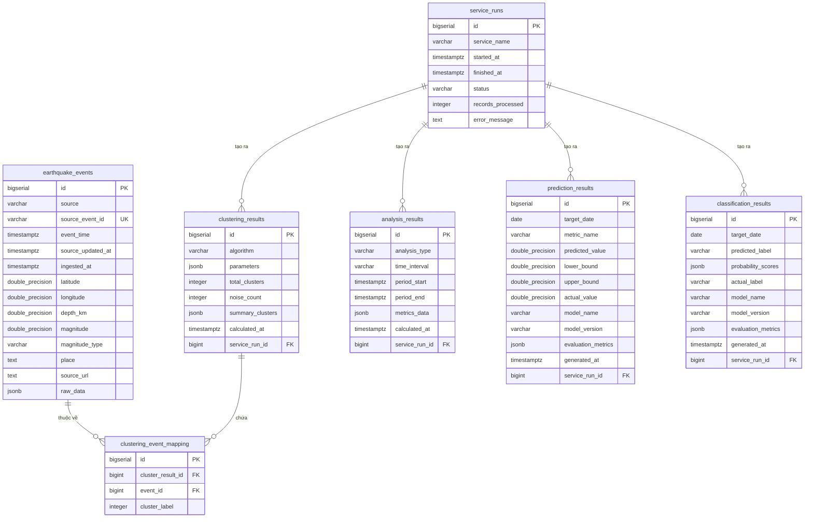

# THIẾT KẾ CƠ SỞ DỮ LIỆU & SƠ ĐỒ THỰC THỂ MỐI QUAN HỆ (ERD)

# HỆ THỐNG GIÁM SÁT VÀ PHÂN TÍCH THIÊN TAI TOÀN CẦU (GDMAS)

- **Hệ quản trị CSDL:** PostgreSQL 16 (triển khai container qua Docker)
- **Múi giờ lưu trữ:** UTC (`TIMESTAMPTZ`)
- **Hệ quy chiếu tọa độ:** WGS84 (`EPSG:4326`)
- **Nguyên tắc giao tiếp:** Các service xử lý dữ liệu trao đổi tập trung qua PostgreSQL (không dùng message broker trong MVP).

---

## Mục lục
1. [Sơ đồ Thực thể Mối quan hệ (Mermaid ERD)](#1-sơ-đồ-thực-thể-mối-quan-hệ-mermaid-erd)
2. [Chi tiết Cấu trúc các Bảng dữ liệu](#2-chi-tiết-cấu-trúc-các-bảng-dữ-liệu)
   - [2.1. Bảng `earthquake_events` (Dữ liệu sự kiện gốc)](#21-bảng-earthquake_events-dữ-liệu-sự-kiện-gốc)
   - [2.2. Bảng `analysis_results` (Kết quả phân tích chuỗi thời gian)](#22-bảng-analysis_results-kết-quả-phân-tích-chuỗi-thời-gian)
   - [2.3. Bảng `clustering_results` & `clustering_event_mapping` (Kết quả phân cụm)](#23-bảng-clustering_results--clustering_event_mapping-kết-quả-phân-cụm)
   - [2.4. Bảng `prediction_results` (Kết quả dự báo định lượng $t + 1$)](#24-bảng-prediction_results-kết-quả-dự-báo-định-lượng-t--1)
   - [2.5. Bảng `classification_results` (Kết quả phân loại $t + 1$)](#25-bảng-classification_results-kết-quả-phân-loại-t--1)
   - [2.6. Bảng `service_runs` (Giám sát chu kỳ thực thi service)](#26-bảng-service_runs-giám-sát-chu-kỳ-thực-thi-service)
3. [Chiến lược Đánh chỉ mục (Indexing Strategy)](#3-chiến-lược-đánh-chỉ-mục-indexing-strategy)
4. [Cơ chế Khử trùng lặp (Upsert Strategy)](#4-cơ-chế-khử-trùng-lặp-upsert-strategy)
5. [Quy định Di chuyển dữ liệu (Alembic Migration)](#5-quy-định-di-chuyển-dữ-liệu-alembic-migration)

---

## 1. Sơ đồ Thực thể Mối quan hệ (Mermaid ERD)



---

## 2. Chi tiết Cấu trúc các Bảng dữ liệu

### 2.1. Bảng `earthquake_events` (Dữ liệu sự kiện gốc)
Lưu trữ toàn bộ các trận động đất thu thập từ USGS.

| Tên cột | Kiểu dữ liệu | Ràng buộc | Mặc định | Mô tả |
| :--- | :--- | :--- | :--- | :--- |
| `id` | `BIGSERIAL` | `PRIMARY KEY` | Auto | Định danh duy nhất nội bộ |
| `source` | `VARCHAR(32)` | `NOT NULL` | `'USGS'` | Tên nguồn cung cấp |
| `source_event_id` | `VARCHAR(64)` | `NOT NULL` | - | Mã định danh sự kiện của USGS (ví dụ `us7000m123`) |
| `event_time` | `TIMESTAMPTZ` | `NOT NULL` | - | Thời điểm xảy ra động đất (UTC) |
| `source_updated_at`| `TIMESTAMPTZ` | `NULL` | - | Thời điểm USGS cập nhật bản ghi |
| `ingested_at` | `TIMESTAMPTZ` | `NOT NULL` | `NOW()` | Thời điểm hệ thống GDMAS cào dữ liệu về |
| `latitude` | `DOUBLE PRECISION`| `NOT NULL` | - | Vĩ độ ($-90.0 \le \text{lat} \le 90.0$) |
| `longitude` | `DOUBLE PRECISION`| `NOT NULL` | - | Kinh độ ($-180.0 \le \text{lon} \le 180.0$) |
| `depth_km` | `DOUBLE PRECISION`| `NOT NULL` | - | Độ sâu chấn tiêu (km) |
| `magnitude` | `DOUBLE PRECISION`| `NOT NULL` | - | Độ lớn địa chấn |
| `magnitude_type` | `VARCHAR(16)` | `NULL` | - | Thang đo độ lớn (`ml`, `mww`, `mb`...) |
| `place` | `TEXT` | `NULL` | - | Mô tả vị trí địa lý |
| `source_url` | `TEXT` | `NULL` | - | Đường dẫn chi tiết trên trang USGS |
| `raw_data` | `JSONB` | `NULL` | - | Toàn bộ GeoJSON Feature gốc |

- **Ràng buộc duy nhất:** `UNIQUE (source, source_event_id)` nhằm phục vụ Upsert khử trùng lặp.

---

### 2.2. Bảng `analysis_results` (Kết quả phân tích chuỗi thời gian)
Lưu trữ kết quả tiền tính toán của 4 pattern đầu tiên (Temporal, Trend, Seasonality, Correlation) do `Data Analysis Service` tạo ra mỗi 5 phút.

| Tên cột | Kiểu dữ liệu | Ràng buộc | Mô tả |
| :--- | :--- | :--- | :--- |
| `id` | `BIGSERIAL` | `PRIMARY KEY` | Khóa chính |
| `analysis_type` | `VARCHAR(32)` | `NOT NULL` | Kiểu phân tích: `temporal`, `trend`, `seasonality`, `correlation` |
| `time_interval` | `VARCHAR(16)` | `NOT NULL` | Đơn vị chu kỳ: `day`, `week`, `month` |
| `period_start` | `TIMESTAMPTZ` | `NOT NULL` | Thời điểm bắt đầu khoảng dữ liệu |
| `period_end` | `TIMESTAMPTZ` | `NOT NULL` | Thời điểm kết thúc khoảng dữ liệu |
| `metrics_data` | `JSONB` | `NOT NULL` | Payload kết quả (chuỗi số liệu, đường xu hướng, ma trận tương quan) |
| `calculated_at` | `TIMESTAMPTZ` | `DEFAULT NOW()`| Thời điểm chạy thuật toán |
| `service_run_id` | `BIGINT` | `REFERENCES service_runs(id)` | Liên kết tới lần chạy của service |

---

### 2.3. Bảng `clustering_results` & `clustering_event_mapping` (Kết quả phân cụm)
Lưu kết quả thuật toán phân cụm không gian/mật độ (DBSCAN / K-Means) chạy định kỳ 1 ngày/lần.

#### Bảng `clustering_results`
| Tên cột | Kiểu dữ liệu | Mô tả |
| :--- | :--- | :--- |
| `id` | `BIGSERIAL PK` | Mã kết quả phân cụm |
| `algorithm` | `VARCHAR(32)` | Tên thuật toán (`DBSCAN`, `K-Means`) |
| `parameters` | `JSONB` | Tham số cấu hình (`eps`, `min_samples`) |
| `total_clusters`| `INTEGER` | Tổng số cụm phát hiện |
| `noise_count` | `INTEGER` | Số điểm nhiễu (outliers) |
| `summary_clusters`| `JSONB` | Thông tin tóm tắt từng cụm (tâm, bán kính, số sự kiện) |
| `calculated_at` | `TIMESTAMPTZ` | Thời điểm phân cụm |
| `service_run_id`| `BIGINT FK` | Khóa ngoại tới `service_runs` |

#### Bảng `clustering_event_mapping`
Bảng liên kết chỉ định từng sự kiện động đất thuộc về cụm nào:
| Tên cột | Kiểu dữ liệu | Mô tả |
| :--- | :--- | :--- |
| `id` | `BIGSERIAL PK` | Khóa chính |
| `cluster_result_id`| `BIGINT FK` | Tham chiếu tới `clustering_results(id)` |
| `event_id` | `BIGINT FK` | Tham chiếu tới `earthquake_events(id)` |
| `cluster_label` | `INTEGER` | Nhãn cụm ($-1$ là điểm nhiễu) |

---

### 2.4. Bảng `prediction_results` (Kết quả dự báo định lượng $t + 1$)
Lưu giá trị dự báo cho ngày tiếp theo (Pattern 5) cập nhật định kỳ 5 phút/lần.

| Tên cột | Kiểu dữ liệu | Mô tả |
| :--- | :--- | :--- |
| `id` | `BIGSERIAL PK` | Khóa chính |
| `target_date` | `DATE NOT NULL` | Ngày dự báo ($t + 1$) |
| `metric_name` | `VARCHAR(32)` | Chỉ số dự báo: `event_count`, `max_magnitude` |
| `predicted_value`| `DOUBLE PRECISION`| Giá trị dự báo |
| `lower_bound` | `DOUBLE PRECISION`| Cận dưới khoảng tin cậy 95% |
| `upper_bound` | `DOUBLE PRECISION`| Cận trên khoảng tin cậy 95% |
| `actual_value` | `DOUBLE PRECISION`| Giá trị thực tế quan sát được (cập nhật sau khi qua ngày) |
| `model_name` | `VARCHAR(64)` | Tên mô hình (ví dụ `RidgeRegression`, `ARIMA`) |
| `model_version` | `VARCHAR(16)` | Phiên bản mô hình |
| `evaluation_metrics`| `JSONB` | Điểm đánh giá (MAE, RMSE, baseline error) |
| `generated_at` | `TIMESTAMPTZ` | Thời điểm tạo kết quả |
| `service_run_id`| `BIGINT FK` | Khóa ngoại tới `service_runs` |

---

### 2.5. Bảng `classification_results` (Kết quả phân loại $t + 1$)
Lưu nhãn phân loại mức độ hoạt động địa chấn cho ngày tiếp theo (Pattern 6).

| Tên cột | Kiểu dữ liệu | Mô tả |
| :--- | :--- | :--- |
| `id` | `BIGSERIAL PK` | Khóa chính |
| `target_date` | `DATE NOT NULL` | Ngày phân loại ($t + 1$) |
| `predicted_label`| `VARCHAR(32)` | Nhãn dự đoán (`Low Activity`, `Normal Activity`, `High Activity`) |
| `probability_scores`| `JSONB` | Phân phối xác suất các nhãn |
| `actual_label` | `VARCHAR(32)` | Nhãn thực tế (đối chiếu sau) |
| `model_name` | `VARCHAR(64)` | Thuật toán (`RandomForest`, `LogisticRegression`) |
| `model_version` | `VARCHAR(16)` | Phiên bản mô hình |
| `evaluation_metrics`| `JSONB` | Đánh giá (Accuracy, F1-Score) |
| `generated_at` | `TIMESTAMPTZ` | Thời điểm tạo |
| `service_run_id`| `BIGINT FK` | Khóa ngoại tới `service_runs` |

---

### 2.6. Bảng `service_runs` (Giám sát chu kỳ thực thi service)
Ghi nhận lịch sử chạy của cả 4 service công nhân (Worker) để phục vụ endpoint `/api/v1/system/status`.

| Tên cột | Kiểu dữ liệu | Mô tả |
| :--- | :--- | :--- |
| `id` | `BIGSERIAL PK` | Khóa chính |
| `service_name` | `VARCHAR(32)` | Tên service: `ingestion`, `analysis`, `clustering`, `prediction` |
| `started_at` | `TIMESTAMPTZ` | Thời điểm bắt đầu chạy |
| `finished_at` | `TIMESTAMPTZ` | Thời điểm kết thúc |
| `status` | `VARCHAR(16)` | Trạng thái: `SUCCESS`, `FAILED`, `RUNNING` |
| `records_processed`| `INTEGER` | Số bản ghi nạp hoặc xử lý |
| `error_message` | `TEXT` | Thông báo lỗi nếu thất bại |

---

## 3. Chiến lược Đánh chỉ mục (Indexing Strategy)

Để tối ưu hóa tốc độ truy vấn cho các API chuỗi thời gian và lọc theo vị trí địa lý:

```sql
-- 1. Index thời gian phục vụ lọc chuỗi thời gian và sắp xếp
CREATE INDEX idx_earthquake_events_event_time ON earthquake_events (event_time DESC);

-- 2. Index độ lớn phục vụ lọc mức độ chấn động
CREATE INDEX idx_earthquake_events_magnitude ON earthquake_events (magnitude);

-- 3. Composite Index phục vụ lọc kết hợp thời gian và độ lớn
CREATE INDEX idx_earthquake_events_time_mag ON earthquake_events (event_time DESC, magnitude);

-- 4. B-Tree Index cho tọa độ địa lý bounding box
CREATE INDEX idx_earthquake_events_coordinates ON earthquake_events (latitude, longitude);

-- 5. Index tìm kiếm nhanh theo mã sự kiện nguồn
CREATE UNIQUE INDEX idx_earthquake_events_source_unique ON earthquake_events (source, source_event_id);

-- 6. Index truy vấn kết quả phân tích theo loại và thời gian
CREATE INDEX idx_analysis_results_type_period ON analysis_results (analysis_type, period_end DESC);
CREATE INDEX idx_prediction_results_target_date ON prediction_results (target_date DESC);
CREATE INDEX idx_classification_results_target_date ON classification_results (target_date DESC);
```

---

## 4. Cơ chế Khử trùng lặp (Upsert Strategy)

Trong quá trình thu thập định kỳ 5 phút/lần từ USGS, nhiều sự kiện có thể được gửi lại hoặc được cập nhật độ lớn/độ sâu chính xác hơn sau khi đo đạc lại.

Cú pháp SQL Upsert chuẩn được áp dụng trong `Data Ingestion Service`:

```sql
INSERT INTO earthquake_events (
    source, source_event_id, event_time, source_updated_at,
    latitude, longitude, depth_km, magnitude, magnitude_type,
    place, source_url, raw_data, ingested_at
) VALUES (
    'USGS', :source_event_id, :event_time, :source_updated_at,
    :latitude, :longitude, :depth_km, :magnitude, :magnitude_type,
    :place, :source_url, :raw_data, NOW()
)
ON CONFLICT (source, source_event_id) DO UPDATE SET
    source_updated_at = EXCLUDED.source_updated_at,
    latitude          = EXCLUDED.latitude,
    longitude         = EXCLUDED.longitude,
    depth_km          = EXCLUDED.depth_km,
    magnitude         = EXCLUDED.magnitude,
    magnitude_type    = EXCLUDED.magnitude_type,
    place             = EXCLUDED.place,
    source_url        = EXCLUDED.source_url,
    raw_data          = EXCLUDED.raw_data,
    ingested_at       = NOW()
WHERE earthquake_events.source_updated_at IS NULL 
   OR EXCLUDED.source_updated_at > earthquake_events.source_updated_at;
```

---

## 5. Quy định Di chuyển dữ liệu (Alembic Migration)

Tuân thủ nguyên tắc **Không sửa mã nguồn hiện tại – Chỉ bổ sung thêm mới**:

1. Không chỉnh sửa các file migration đã commit trong `apps/api/alembic/versions/`.
2. Mọi thay đổi về cột, bảng hoặc chỉ mục mới phải được tạo thông qua revision mới:
   ```bash
   cd apps/api
   uv run alembic revision -m "add_spatial_gist_indexes"
   ```
3. Luôn viết đầy đủ hai hàm `upgrade()` và `downgrade()` trong từng file migration để hỗ trợ rollback an toàn khi cần thiết.

