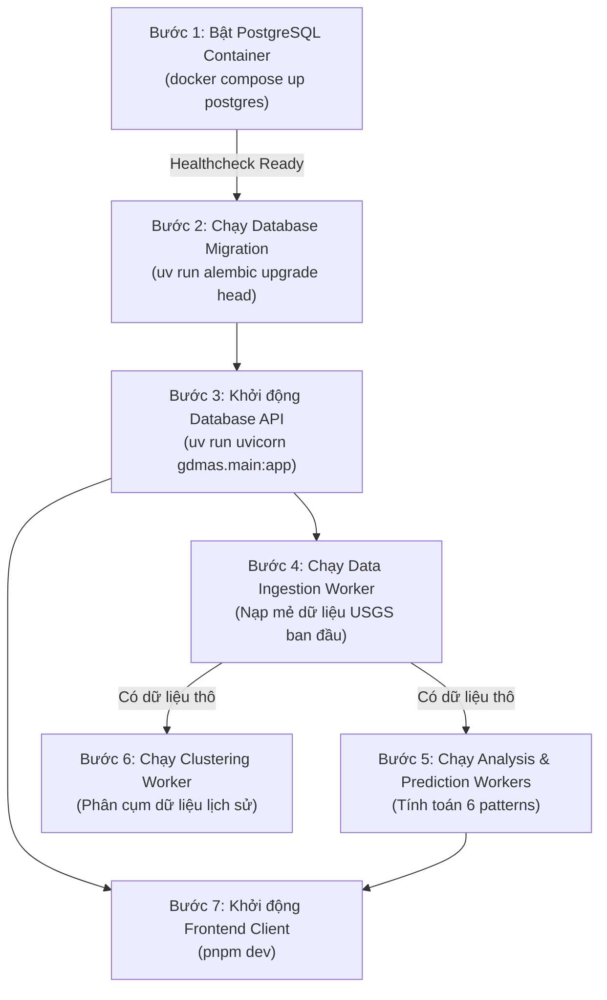
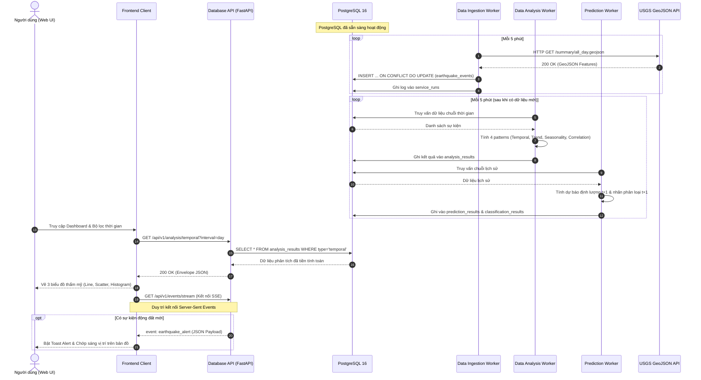

# QUY TRÌNH VẬN HÀNH VÀ ĐIỀU PHỐI HỆ THỐNG (SYSTEM OPERATIONAL WORKFLOW)

# HỆ THỐNG GIÁM SÁT VÀ PHÂN TÍCH THIÊN TAI TOÀN CẦU (GDMAS)

- **Tài liệu:** Sổ tay Vận hành & Điều phối Hệ thống (Operational Runbook & Workflow Guide)
- **Phiên bản:** 1.0
- **Ngày ban hành:** 06/11/2026
- **Trạng thái:** Approved / Official Standard

---

## Mục lục
1. [Tổng quan Kiến trúc Vận hành](#1-tổng-quan-kiến-trúc-vận-hành)
2. [Trình tự Khởi động Hệ thống Chuẩn (Startup Sequence)](#2-trình-tự-khởi-động-hệ-thống-chuẩn-startup-sequence)
3. [Quy trình Vận hành 5 Luồng Dữ liệu Cốt lõi](#3-quy-trình-vận-hành-5-luồng-dữ-liệu-cốt-lõi)
   - [3.1. Luồng Thu thập Dữ liệu (Ingestion Pipeline – 5 phút/lần)](#31-luồng-thu-thập-dữ-liệu-ingestion-pipeline--5-phútlần)
   - [3.2. Luồng Phân tích Chuỗi Thời gian (Analysis Pipeline – 5 phút/lần)](#32-luồng-phân-tích-chuỗi-thời-gian-analysis-pipeline--5-phútlần)
   - [3.3. Luồng Phân cụm Địa chấn (Clustering Pipeline – 1 ngày/lần)](#33-luồng-phân-cụm-địa-chấn-clustering-pipeline--1-ngàylần)
   - [3.4. Luồng Dự báo & Phân loại $t + 1$ (Prediction Pipeline – 5 phút/lần)](#34-luồng-dự-báo--phân-loại-t--1-prediction-pipeline--5-phútlần)
   - [3.5. Luồng Cung cấp API & Real-time SSE (Serving Pipeline)](#35-luồng-cung-cấp-api--real-time-sse-serving-pipeline)
4. [Sơ đồ Trình tự Điều phối Toàn diện (System Sequence Diagram)](#4-sơ-đồ-trình-tự-điều-phối-toàn-diện-system-sequence-diagram)
5. [Quy trình Giám sát & Kiểm tra Sức khỏe Hệ thống (Healthcheck)](#5-quy-trình-giám-sát--kiểm-tra-sức-khỏe-hệ-thống-healthcheck)
6. [Quy trình Dừng & Bảo trì Hệ thống (Shutdown & Maintenance)](#6-quy-trình-dừng--bảo-trì-hệ-thống-shutdown--maintenance)
7. [Xử lý Sự cố Vận hành Thường gặp (Operational Runbook)](#7-xử-lý-sự-cố-vận-hành-thường-gặp-operational-runbook)

---

## 1. Tổng quan Kiến trúc Vận hành

Hệ thống GDMAS hoạt động theo mô hình **Microservices/Modular độc lập** với 7 khối dịch vụ tương tác thông qua kho dữ liệu tập trung **PostgreSQL 16**:

| Khối Dịch Vụ | Vai trò Vận hành | Tần suất / Chu kỳ | Phương thức Vận hành |
| :--- | :--- | :---: | :--- |
| **1. PostgreSQL** | Lưu trữ tập trung dữ liệu sự kiện & kết quả phân tích | Liên tục | Chạy nền qua Docker (`postgres:16-alpine`) |
| **2. Data Ingestion** | Thu thập dữ liệu USGS, kiểm tra hợp lệ, khử trùng lặp | **5 phút / lần** | Python Worker độc lập (`ingestion/runner.py`) |
| **3. Data Analysis** | Tính toán 4 patterns: Temporal, Trend, Seasonality, Correlation | **5 phút / lần** | Python Worker độc lập (`analysis/runner.py`) |
| **4. Clustering** | Phân cụm địa chấn theo không gian/mật độ (DBSCAN / K-Means) | **1 ngày / lần** | Python Worker độc lập (`clustering/runner.py`) |
| **5. Prediction** | Dự báo định lượng ($t + 1$) và phân loại mức hoạt động ($t + 1$) | **5 phút / lần** | Python Worker độc lập (`prediction/runner.py`) |
| **6. Database API** | Cung cấp REST API Envelope chuẩn & Luồng SSE thời gian thực | Liên tục | FastAPI Server trên cổng `8000` |
| **7. Frontend Client**| Giao diện trực quan hóa thẩm mỹ cao, bản đồ tương tác, 6 biểu đồ | Theo truy cập | React 18 + Vite SPA trên cổng `3000` |

> ⚠️ **Quy tắc vàng trong vận hành:** Toàn bộ 4 worker (`ingestion`, `analysis`, `clustering`, `prediction`) hoạt động hoàn toàn bất đồng bộ và độc lập. Một worker gặp sự cố mạng hoặc dữ liệu không bao giờ được phép làm gián đoạn API Server hay Frontend.

---

## 2. Trình tự Khởi động Hệ thống Chuẩn (Startup Sequence)

Để đảm bảo tính toàn vẹn dữ liệu và tránh lỗi phụ thuộc kết nối (race conditions), hệ thống **bắt buộc phải được khởi động tuần tự theo 7 bước** dưới đây:



### Các lệnh thực thi theo 7 Terminals:

#### Terminal 1 – Cơ sở dữ liệu:
```bash
docker compose up postgres
```
*Đợi log hiển thị: `database system is ready to accept connections`.*

#### Terminal 2 – Đồng bộ Schema Database:
*(Chạy một lần tại thư mục `apps/api`)*
```bash
cd apps/api
uv run alembic upgrade head
```

#### Terminal 3 – Database API Server:
```bash
cd apps/api
uv run uvicorn gdmas.main:app --reload --port 8000
```
*Kiểm tra healthcheck tại trình duyệt: `http://localhost:8000/api/v1/health`.*

#### Terminal 4 – Data Ingestion Worker (Chu kỳ 5 phút):
```bash
python -m gdmas.services.ingestion.runner
```

#### Terminal 5 – Data Analysis Worker (Chu kỳ 5 phút):
```bash
python -m gdmas.services.analysis.runner
```

#### Terminal 6 – Prediction Worker (Chu kỳ 5 phút):
```bash
python -m gdmas.services.prediction.runner
```

#### Terminal 7 – Clustering Worker (Chu kỳ 1 ngày):
```bash
python -m gdmas.services.clustering.runner
```

#### Terminal 8 – Frontend Web Dashboard:
```bash
cd apps/web
pnpm dev --port 3000
```
*Truy cập giao diện tại: `http://localhost:3000`.*

---

## 3. Quy trình Vận hành 5 Luồng Dữ liệu Cốt lõi

### 3.1. Luồng Thu thập Dữ liệu (Ingestion Pipeline – 5 phút/lần)

1. **Kích hoạt chu kỳ:** Bộ định thời nội bộ (Interval Loop / APScheduler) kích hoạt tác vụ mỗi 300 giây (5 phút).
2. **Gửi Request:** Gửi yêu cầu HTTP GET tới USGS API (`https://earthquake.usgs.gov/earthquakes/feed/v1.0/summary/all_day.geojson`).
3. **Kiểm tra & Chuẩn hóa:**
   - Kiểm tra mã phản hồi HTTP 200 và tính hợp lệ của GeoJSON FeatureCollection.
   - Bóc tách thuộc tính: `id` (source_event_id), `time` (chuyển đổi UTC), `coordinates` (kinh độ, vĩ độ, độ sâu), `mag`, `place`, `url`.
   - Lọc bỏ các bản ghi thiếu tọa độ hoặc độ lớn không hợp lệ.
4. **Thực thi Upsert vào PostgreSQL:**
   - Thực thi câu lệnh `INSERT INTO earthquake_events ... ON CONFLICT (source, source_event_id) DO UPDATE`.
   - Nếu sự kiện đã tồn tại nhưng có `source_updated_at` mới hơn, tiến hành ghi đè dữ liệu hiệu chỉnh mới nhất.
5. **Ghi nhật ký vận hành:** Lưu thông tin số bản ghi nạp thành công vào bảng `service_runs`.

---

### 3.2. Luồng Phân tích Chuỗi Thời gian (Analysis Pipeline – 5 phút/lần)

1. **Truy xuất dữ liệu:** Đọc toàn bộ các sự kiện động đất trong khoảng thời gian phân tích từ bảng `earthquake_events`.
2. **Xử lý Pattern 1 (Temporal Visualization):**
   - Tổng hợp số lượng sự kiện, magnitude trung bình và độ sâu theo ngày, tuần, tháng (Line chart).
   - Trích xuất danh sách điểm tọa độ độ sâu vs độ lớn (Scatter plot).
   - Gom nhóm tần suất độ lớn theo các khoảng $0-2$, $2-3$, $3-4$, $4-5$, $>5$ (Histogram).
3. **Xử lý Pattern 2 (Trend Analysis):**
   - Thực hiện **Re-sampling** chuỗi dữ liệu theo tuần/tháng (`freq='W'` hoặc `freq='M'`).
   - Áp dụng thuật toán Moving Average hoặc phân rã chuỗi để bóc tách thành phần xu hướng (Trend component).
4. **Xử lý Pattern 3 (Seasonality Analysis):**
   - Phân tích tính chu kỳ / mùa vụ (**Seasonal line**) sau khi Re-sampling.
   - Nếu dữ liệu không thể hiện mùa vụ rõ rệt, ghi nhận kết luận khách quan "Chu kỳ yếu/không có mùa vụ".
5. **Xử lý Pattern 4 (Correlation Analysis):**
   - Lập ma trận tương quan Pearson giữa 5 biến: `magnitude`, `depth_km`, `latitude`, `longitude`, `daily_count`.
6. **Lưu trữ kết quả:** Đóng gói toàn bộ kết quả vào định dạng JSONB và ghi vào bảng `analysis_results`.

---

### 3.3. Luồng Phân cụm Địa chấn (Clustering Pipeline – 1 ngày/lần)

1. **Chu kỳ vận hành:** Tự động kích hoạt lúc `00:00:00 UTC` mỗi ngày (hoặc chu kỳ 24 giờ).
2. **Chuẩn bị dữ liệu:** Lấy tập dữ liệu lịch sử (30 - 90 ngày gần nhất) gồm tọa độ địa lý (`latitude`, `longitude`) và độ sâu (`depth_km`).
3. **Thực thi thuật toán:**
   - **DBSCAN (Chính):** Chuyển đổi tọa độ sang hệ radian / khoảng cách Haversine (bán kính $\varepsilon \approx 150\text{ km}$, `min_samples` $= 5$). Nhận diện các cụm địa chấn mật độ cao và loại bỏ điểm nhiễu ngoại lai.
   - **K-Means (Đối chiếu):** Phân chia thành $K$ cụm địa lý định trước.
4. **Lưu trữ kết quả:**
   - Ghi thông tin tổng quan các cụm vào `clustering_results`.
   - Ghi nhãn cụm của từng sự kiện vào bảng liên kết `clustering_event_mapping`.

---

### 3.4. Luồng Dự báo & Phân loại $t + 1$ (Prediction Pipeline – 5 phút/lần)

1. **Chuẩn bị Feature:** Trích xuất chuỗi thời gian số lượng sự kiện và chỉ số địa chấn các ngày trong quá khứ ($t-7$ đến $t$).
2. **Pattern 5 (Dự báo định lượng $t + 1$):**
   - Áp dụng mô hình hồi quy (ví dụ: Ridge Regression / AutoRegressive Time-Series) để dự báo số lượng sự kiện xảy ra vào ngày kế tiếp ($t + 1$).
   - Tính toán cận trên và cận dưới của khoảng tin cậy 95%.
   - Đánh giá sai số MAE và RMSE so với mô hình baseline đơn giản (Naive Moving Average).
   - Lưu kết quả vào `prediction_results`.
3. **Pattern 6 (Phân loại mức hoạt động địa chấn $t + 1$):**
   - Áp dụng mô hình phân loại (Random Forest / Logistic Regression) để gắn nhãn mức độ hoạt động ngày tiếp theo: `Low Activity`, `Normal Activity`, hoặc `High Activity`.
   - Tính toán phân phối xác suất dự đoán của từng nhãn.
   - Lưu kết quả vào `classification_results`.

---

### 3.5. Luồng Cung cấp API & Real-time SSE (Serving Pipeline)

1. **Phục vụ yêu cầu REST thông thường:**
   - Khi Frontend gửi request truy vấn biểu đồ hoặc danh sách sự kiện, `Database API` đọc trực tiếp kết quả đã tính toán sẵn trong PostgreSQL.
   - Thời gian đáp ứng cực nhanh ($< 50\text{ ms}$) do không phải tính toán nặng theo thời gian thực.
2. **Luồng Server-Sent Events (SSE):**
   - Client Frontend mở kết nối luồng tới endpoint `/api/v1/events/stream`.
   - Khi `Data Ingestion Service` phát hiện sự kiện động đất mới ($M \ge 4.5$) vừa được lưu vào CSDL, API phát ngay một event JSON tới toàn bộ client đang kết nối.
   - Giao diện Frontend nhận event, tự động cập nhật bản đồ và hiển thị Toast Alert mà người dùng **không cần tải lại trang (F5)**.

---

## 4. Sơ đồ Trình tự Điều phối Toàn diện (System Sequence Diagram)



---

## 5. Quy trình Giám sát & Kiểm tra Sức khỏe Hệ thống (Healthcheck)

Trong quá trình vận hành, người quản trị hoặc nhóm phát triển kiểm tra hệ thống thông qua các bước:

### 1. Kiểm tra trạng thái API và kết nối CSDL:
```bash
curl -s http://localhost:8000/api/v1/health | jq .
```
*Kết quả kỳ vọng:* `"status": "healthy"`, `"database": "connected"`.

### 2. Kiểm tra tiến độ chạy của 4 Worker Services:
```bash
curl -s http://localhost:8000/api/v1/system/status | jq .
```
*Kiểm tra trường `last_run` của từng service đảm bảo không có service nào bị treo quá chu kỳ quy định (quá 5 phút).*

### 3. Kiểm tra nhật ký lỗi trong Database:
```sql
SELECT service_name, started_at, finished_at, status, records_processed, error_message
FROM service_runs
ORDER BY started_at DESC
LIMIT 10;
```

---

## 6. Quy trình Dừng & Bảo trì Hệ thống (Shutdown & Maintenance)

### Thứ tự dừng hệ thống an toàn:
1. **Dừng Frontend Web:** Nhấn `Ctrl + C` tại Terminal 8.
2. **Dừng các Worker Services:** Nhấn `Ctrl + C` tại Terminal 4, 5, 6, 7 (các worker sẽ hoàn thành nốt bản ghi đang dở trước khi thoát an toàn nhờ tín hiệu SIGINT).
3. **Dừng Database API:** Nhấn `Ctrl + C` tại Terminal 3.
4. **Dừng Database PostgreSQL:**
   ```bash
   docker compose down
   ```
   *(Không dùng cờ `-v` để bảo toàn dữ liệu trong named volume `gdmas_pgdata`).*

### Quy trình Sao lưu Dữ liệu (Backup):
Trước khi cập nhật tính năng mới hoặc bảo trì, chạy lệnh sao lưu CSDL:
```bash
docker exec -t gdmas-postgres pg_dump -U postgres gdmas_db > backups/gdmas_backup_$(date +%Y%m%d).sql
```

---

## 7. Xử lý Sự cố Vận hành Thường gặp (Operational Runbook)

| Sự cố | Dấu hiệu nhận biết | Nguyên nhân gốc | Hướng xử lý nhanh |
| :--- | :--- | :--- | :--- |
| **Mất mạng nguồn USGS** | Log Ingestion báo `HTTPTimeout` hoặc `ConnectionRefused` | USGS tạm thời bảo trì hoặc đường truyền quốc tế chập chờn | Worker tự động ghi nhận lỗi, bỏ qua mẻ này và thử lại sau 5 phút. CSDL giữ nguyên dữ liệu cũ, API vẫn phục vụ bình thường. |
| **Trùng cổng 5432 / 8000** | Lỗi `port is already allocated` hoặc `Address already in use` | PostgreSQL trên máy host hoặc tiến trình cũ chưa thoát hẳn | Kiểm tra PID bằng `netstat -ano \| findstr :5432` trên Windows (hoặc `lsof -i :5432` trên Linux) và dừng tiến trình chiếm cổng. |
| **Worker Ingestion bị Crash** | Terminal Ingestion thoát ra dấu nhắc lệnh shell | Ngoại lệ chưa bắt (Unhandled exception) do GeoJSON dị biệt | Kiểm tra log lỗi, chạy lại `python -m gdmas.services.ingestion.runner`. Do có cơ chế Upsert, khi chạy lại worker sẽ tự bù đắp dữ liệu thiếu. |
| **Chưa đủ dữ liệu Re-sampling** | Log Analysis báo `ValueError: Not enough data points for resampling` | Hệ thống mới khởi động, bảng `earthquake_events` có ít hơn 7 ngày dữ liệu | Worker tự động chuyển chế độ Re-sampling sang đơn vị tuần (`freq='W'`) thay vì tháng (`freq='M'`) để bảo đảm biểu đồ luôn hiển thị được. |

