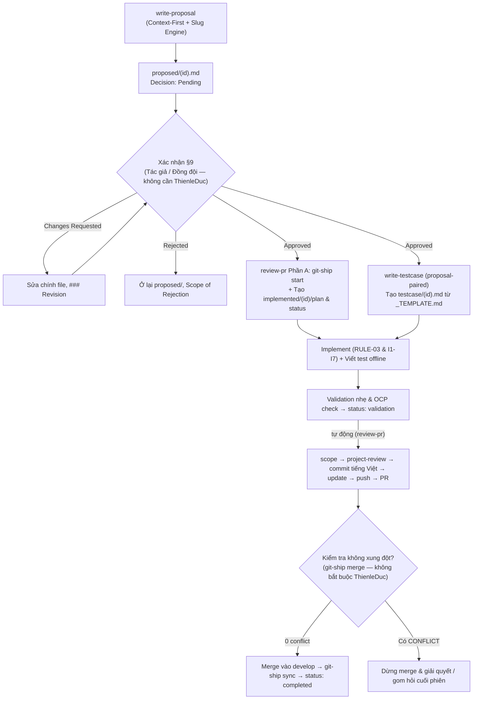
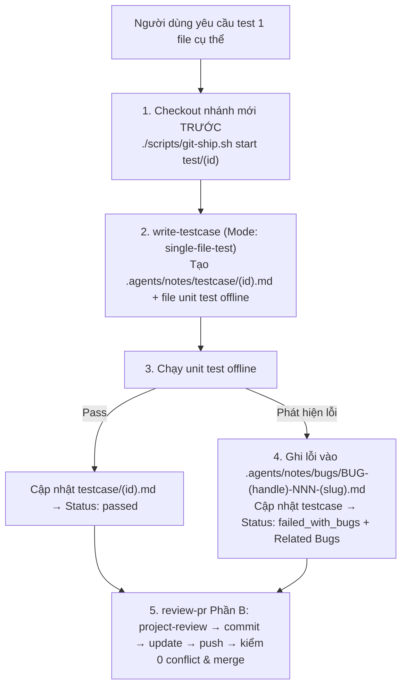

# Agent Workflow (GDMAS)

Quy trình làm việc người + AI Agent tối giản hóa với **5 skill cốt lõi** tại `.agents/skills/`, bộ nhớ quyết định tại [.agents/notes/](../.agents/notes/README.md) (gồm 4 thư mục con: `proposed/`, `implemented/`, `testcase/`, `bugs/`) và quy chuẩn kiểm thử từ [`.agents/notes/testcase/_TEMPLATE.md`](../.agents/notes/testcase/_TEMPLATE.md).
[AGENTS.md](../AGENTS.md) chỉ tóm tắt và trỏ tới đây.
*(Lưu ý: Sổ tay vận hành 7 Terminals runtime của hệ thống vẫn nằm riêng tại [docs/workflow.md](workflow.md).)*

## Vai trò

- **Thành viên phát triển (`thien`, `son`, `van`, `tai` trong [.agents/team.md](../.agents/team.md)):** chủ động duyệt proposal (§9) — **bất kỳ thành viên nào (kể cả tác giả tự duyệt hoặc đồng đội) đều có thể ký `Approved` tại §9 mà không cần chờ `ThienleDuc`**; đồng thời **bất kỳ thành viên nào cũng có thể merge PR** khi đã kiểm tra không có xung đột.
- **Techlead (`ThienleDuc` / `thien`):** hỗ trợ review kiến trúc tổng thể và hạ tầng lõi (không giữ độc quyền merge PR).
- **AI Agent:** đọc bối cảnh qua `notes_index.py` & `docs/`, kiểm xung đột quyết định cũ, soạn proposal, **sinh đồng thời `implemented/<id>/` + `testcase/<id>.md`** khi §9 `Approved`, thực thi **luồng kiểm thử 1 file (`test/<id>` → `.agents/notes/bugs/`)**, tự kiểm OCP & I1–I7 (`project-review`), và tự lo toàn bộ Git từ rẽ nhánh, đẩy PR tới **kiểm tra không xung đột & merge** (`review-pr`).

---

## 1. Sáu nguyên tắc nền

1. **Plan ≠ Implement (nhưng tiêu chí duyệt proposal được thả lỏng):** Mọi thay đổi lớn hơn 1 dòng / 1 file vẫn có proposal tại `.agents/notes/proposed/` trước khi code, nhưng **không cần `ThienleDuc` phải đồng ý ở bước proposal** — tác giả hoặc đồng đội bất kỳ duyệt §9 là hợp lệ. Sửa nhỏ ≤ 1 file đi qua luôn bằng `review-pr` (Fast-Track) không cần tạo proposal.
2. **Proposal được duyệt → Sinh đồng thời Implement + Testcase (Workflow 1, I7):** Ngay khi §9 của proposal chuyển sang `Approved`, agent bắt buộc tạo **đồng thời**:
   - Thư mục triển khai `.agents/notes/implemented/<id>/{plan.md,status.md}`, **và**
   - Tài liệu testcase `.agents/notes/testcase/<id>.md` (tạo từ [`.agents/notes/testcase/_TEMPLATE.md`](../.agents/notes/testcase/_TEMPLATE.md), `Mode: proposal-paired`) kèm file test tự động chạy **offline 100%** (`apps/api/tests/.../test_*.py`, `scripts/tests/test_*.py` hoặc FE test).
3. **Kiểm thử riêng 1 file cụ thể (`test/<id>` → `.agents/notes/bugs/`, Workflow 2):** Khi người dùng chỉ định kiểm thử 1 file cụ thể:
   - **Trước tiên phải checkout sang nhánh mới** `./scripts/git-ship.sh start test/<id>`,
   - Gọi `write-testcase` viết unit test offline + `.agents/notes/testcase/<id>.md` (`Mode: single-file-test`),
   - Chạy test: **nếu phát hiện lỗi, ghi nhận ngay vào `.agents/notes/bugs/BUG-<handle>-NNN-<slug>.md`** rồi đẩy PR qua `review-pr`.
4. **Implement / Test xong thì agent tự đẩy tới push, kiểm tra xung đột & sẵn sàng merge:** `review-pr` tự chạy từ lúc nhận việc (`start` nhánh) tới sau validation (`scope` → `project-review` → commit tiếng Việt → `update` → `push` → `./scripts/git-ship.sh merge --dry-run` / `merge`). **Không bắt buộc phải là `ThienleDuc`** mới được merge PR — điều kiện bắt buộc duy nhất để merge là **kiểm tra không có xung đột (`0 conflicts`), `notes_index.py --check` và validation đạt chuẩn**.
5. **Tự động với thao tác an toàn — Gom câu hỏi nguy hiểm cuối phiên (Anti-Interrupt):**
   - Agent **tự động bỏ qua hỏi xác nhận** đối với mọi thao tác **thêm mới hoặc sửa đổi** file/folder an toàn theo đúng scope.
   - Với thao tác nguy hiểm (**xóa file, xóa thư mục, xung đột `CONFLICT DETECTED` hoặc Git conflict, đụng vùng khóa**): **KHÔNG dừng ngang giữa phiên**; bỏ qua phần nguy hiểm, hoàn thành hết công việc an toàn rồi **gom toàn bộ câu hỏi thành 1 danh sách duy nhất ở cuối phiên** để người dùng xác nhận 1 lần.
6. **Agent không tự sửa luật chơi:** Agent chỉ đề xuất sửa `AGENTS.md`, `contracts/`, `docs/quyuocchung.md` (đưa vào danh sách câu hỏi cuối phiên nếu ngoài scope); không tự sửa như tác dụng phụ.

## 2. Cây file quy trình (chỉ 1 thư mục skill duy nhất)

```text
AGENTS.md                                  # luật chung cho mọi agent (Antigravity, Claude Code qua CLAUDE.md, Codex…)
CLAUDE.md                                  # import @AGENTS.md và gọi lại 5 skill tại .agents/skills/
.agents/
├── team.md                                # bảng thành viên & handle (`thien`, `son`, `van`, `tai`)
├── skills/                                # CHỈ 5 skill cốt lõi (không trùng ở .claude/skills/)
│   ├── write-proposal/SKILL.md            # Pha 1+2 + Slug Engine + Context-First
│   ├── build-implementation/SKILL.md      # Pha 4 + Sinh đồng thời implemented/ & testcase/ + Validation + Giao review-pr
│   ├── write-testcase/SKILL.md            # Luồng 1 (proposal-paired) & Luồng 2 (single-file-test trên test/<id> → bugs/)
│   ├── project-review/SKILL.md            # OCP/Churn audit + 7 Invariants I1-I7 + Kiểm testcase & bug + Drift + Scope
│   └── review-pr/SKILL.md                 # Tự động Git (start/scope/commit tiếng Việt/update/push PR) cho Spec, Fast-Track & test/<id>
└── notes/                                 # CHỈ giữ 4 thư mục quyết định + README.md
    ├── README.md                          # công thức grep + lệnh notes_index.py (--testcases, --bugs, --check)
    ├── proposed/{_TEMPLATE.md, yyyy-mm-dd-<slug>-<handle>.md}
    ├── implemented/{_TEMPLATE/{plan,status}.md, yyyy-mm-dd-<slug>-<handle>/}
    ├── testcase/{README.md, _TEMPLATE.md, yyyy-mm-dd-<slug>-<handle>.md}
    └── bugs/{README.md, INDEX.md, _TEMPLATE.md, BUG-<handle>-NNN-<slug>.md}
.claude/
├── notes/README.md                        # 1 file duy nhất tham chiếu sang .agents/skills/ & .agents/notes/
└── settings.json                          # SessionStart chạy git-setup.sh; allow Edit/Write; ask rm; deny force-push, push main/develop
.githooks/{pre-commit,commit-msg,pre-push} # chặn commit/push develop|main, secret, format commit, notes_index --check
.github/{pull_request_template.md,CODEOWNERS}
scripts/{git-ship.sh,git-setup.sh,notes_index.py}
docs/
├── agent-workflow.md                      # file này
├── git-workflow.md                        # tự động hóa Git, bảng Type/Scope, Slug Engine, kiểm tra 0 conflict trước khi merge
└── coding-rules.md                        # 7 Bất biến cứng I1–I7 kèm dấu hiệu vi phạm
```

## 3. Bốn tầng note & Khuôn mẫu testcase

| File | Trả lời | Người tạo | Người sửa |
|---|---|---|---|
| `proposed/<id>.md` §1–§8, §10 | Có nên làm không, tệp test dự kiến là gì? | Agent / thành viên | Tác giả |
| `proposed/<id>.md` §9 | Quyết định thế nào? | — | **Bất kỳ thành viên nào** trong `.agents/team.md` (kể cả tác giả), hoặc agent khi xác nhận rõ trong chat |
| `implemented/<id>/plan.md` | Phạm vi `In Scope` (gồm cả tệp test), các bước, validation? | Agent | Agent + thành viên |
| `implemented/<id>/status.md` | Đang ở đâu (`planned → in_progress ⇄ blocked → validation → completed`)? | Agent | Agent |
| `testcase/<id>.md` + file unit test (`apps/api/tests/...`, `scripts/tests/...`, FE) | Kiểm chứng bằng kịch bản nào (`proposal-paired` hay `single-file-test`), kết quả pass/fail ra sao? | Agent (`write-testcase`) | Agent + thành viên |
| `bugs/BUG-<handle>-NNN-<slug>.md` | Unit test phát hiện lỗi gì, tái lập và mức độ ra sao? | Agent / thành viên | Agent + thành viên |
| Bảng index (`python3 scripts/notes_index.py`) | Tổng quan & trạng thái (`--testcases`, `--bugs`, `--check`)? | Script tự sinh | Không ai |

**Trạng thái proposal (§9):** `Pending` (`proposed`) · `Changes Requested` (`changes_requested`) · `Approved` (`approved` — bất kỳ thành viên nào ký đều hợp lệ, **không cần `ThienleDuc`**) · `Rejected` (`rejected`, bắt buộc `Scope of Rejection:`).
**Trạng thái testcase (`testcase/<id>.md`):** `draft` · `ready` · `passed` · `failed_with_bugs`.
Thay quyết định cũ ghi `- Overrides: <id>` trong proposal mới; script `notes_index.py` tự gắn `superseded`.

**Quy chuẩn ID & Slug Engine tự động:**
- ID chuẩn: `yyyy-mm-dd-<slug>-<handle>` (`<handle>` từ `./scripts/git-ship.sh me`).
- `<slug>` tự chuẩn hóa: bỏ dấu tiếng Việt (`áàả...đ` → `a...d`), viết thường, bỏ từ dừng (`la, va, cho, cua, tai, trong, tu, cac, nhung, mot, de, voi, the, a, an, for, to, in, on, of, and`), giữ 2–4 từ khóa nối bằng `-`.
- Bug ID: `BUG-<handle>-NNN` đếm tăng dần riêng từng người.

**Copy `_TEMPLATE`, không viết khuôn note hay file testcase theo trí nhớ.**

## 4. Hai quy trình tự động hóa

### Luồng 1: Spec-Driven (Proposal được duyệt → Sinh đồng thời Implement + Testcase)

```text
Pha 1 — Discovery       đọc yêu cầu, docs kiến trúc, notes_index.py + grep quyết định cũ trong proposed/ & implemented/, bugs/
Pha 2 — Proposal        write-proposal → proposed/<id>.md (kèm tệp test dự kiến ở §8) → DỪNG chờ xác nhận §9
Pha 3 — Proposal Review Bất kỳ thành viên nào (tác giả hoặc đồng đội) ký §9 Approved (hoặc xác nhận chat) — KHÔNG cần ThienleDuc
Pha 4 — Implementation  build-implementation + write-testcase:
                          1. review-pr (Phần A): ./scripts/git-ship.sh start <type>/<id>
                          2. SINH ĐỒNG THỜI: implemented/<id>/{plan.md,status.md} VÀ .agents/notes/testcase/<id>.md (proposal-paired)
                          3. code theo RULE-03 & I1-I7 + viết file unit/integration test offline (test_*.py / FE test)
                          4. chạy validation nhẹ + cập nhật testcase Status: passed → đặt Status: validation
                        → tự động chuyển giao review-pr (Phần B):
                          scope → project-review → commit tiếng Việt → update (merge-forward) → push → PR
                        → kiểm tra 0 xung đột (./scripts/git-ship.sh merge) → merge vào develop (ai cũng merge được) → sync → completed
Pha 5 — Learning        Deviations / Decisions trong status.md, bugs/, cập nhật docs (gom câu hỏi nguy hiểm cuối phiên nếu có)
```



### Luồng 2: Kiểm thử chuyên sâu 1 file cụ thể (`single-file-test`)

Áp dụng khi người dùng chỉ định kiểm thử một tệp mã nguồn cụ thể (không cần proposal):



## 5. Cơ chế dừng cứng & Gom câu hỏi nguy hiểm

- **`SCOPE MISMATCH`**: diff đụng file ngoài `In Scope` của `plan.md` → dừng, báo rõ file lệch phạm vi.
- **`CRITICAL BUG: BUG-<handle>-NNN — <tiêu đề>`**: dòng đầu câu trả lời; ghi rõ vào `.agents/notes/bugs/` và báo nổi bật ngay.
- **Thiếu `testcase/<id>.md` hoặc mã test**: task có code/logic hoặc `test/<id>` nhưng thiếu biên bản trong `.agents/notes/testcase/` hoặc thiếu unit test offline → `project-review` đánh dấu `VIOLATION`, chặn đẩy/merge PR.
- **Im lặng không phải duyệt §9:** cần xác nhận rõ từ thành viên (`thien`/`son`/`van`/`tai`), không tự bịa §9.
- **Chốt chặn Conflict trước Merge:** Bắt buộc kiểm tra không xung đột (`0 conflicts` qua `git-ship.sh merge` / `git merge-tree` / PR mergeability) trước khi merge — **không bắt buộc riêng `ThienleDuc`**, nhưng **tuyệt đối cấm merge khi còn `CONFLICT`**.
- **Quy tắc gom câu hỏi cuối phiên (thay cho dừng ngang với xóa/conflict):**
  - Không bao giờ hỏi xin phép khi **thêm mới / sửa** file an toàn theo scope.
  - Khi gặp **xóa file/thư mục**, **`CONFLICT DETECTED`** với quyết định cũ, hoặc **Git conflict**, agent **tạm giữ không thao tác phần nguy hiểm**, hoàn thành toàn bộ phần an toàn trước, rồi tổng hợp mọi câu hỏi vào **1 danh sách đánh số duy nhất cuối phiên**.

## 6. Agent Output Contract (cuối Pha 4 và mô tả PR)

```markdown
## Implementation Report

- **Proposal / Plan:** `.agents/notes/implemented/<id>/plan.md` *(hoặc Fast-Track / Single-File Test `test/<id>`)*
- **Changed:** <danh sách tệp>
- **Scope:** khớp In Scope | <ngoại lệ>
- **Behavior:** <thay đổi gì hoặc phạm vi kiểm thử file mục tiêu>
- **Tests:** <lệnh đã chạy thật, kết quả>
- **Test Files Created:** <file unit test offline + `.agents/notes/testcase/<id>.md` | N/A (docs-only)>
- **Contracts:** không drift | <doc>: đã cập nhật | <doc>: drift, chưa sửa, cần người xem
- **Bugs:** <BUG-<handle>-NNN trong `.agents/notes/bugs/`> | none
- **Risks:** <phần chưa kiểm đủ>
- **Decision:** Theo `.agents/notes/implemented/<id>/plan.md` | Theo `.agents/notes/testcase/<id>.md`
- **Not changed:** <thành phần liền kề cố ý không đụng>
- **Status:** READY_FOR_REVIEW
```

## 7. Validation nhẹ cho GDMAS

- **Backend (`apps/api/`):** chạy `cd apps/api && uv run pytest <test_liên_quan_và_mới_tạo>` + `uv run ruff check . && uv run ruff format --check .`. Chạy toàn bộ `uv run pytest` nếu diff rộng (`contracts/**`, `apps/api/alembic/**`, `core/**`, `db/**`, `main.py`, `docker-compose.yml`, `.env.example`).
- **Frontend (`apps/web/`):** `cd apps/web && pnpm build` (`tsc -b && vite build`).
- **Scripts / Notes:** `python3 -m unittest discover -s scripts/tests -v` và `python3 scripts/notes_index.py --check` (`python3 scripts/notes_index.py --testcases` để kiểm bảng testcase).
- **Kiểm tra OCP & Testcase:** không tự ý xóa file cũ (`D`), không sửa trái phép tệp lõi, có đủ `.agents/notes/testcase/<id>.md` + file unit test offline, và ghi bug vào `.agents/notes/bugs/` nếu phát hiện lỗi.

## 8. Năm skill cốt lõi (`.agents/skills/`)

| Skill | Vai trò (đã tối ưu tự động hóa cho GDMAS) |
|---|---|
| `write-proposal` | Pha 1+2: đọc bối cảnh (`docs/`, `notes_index.py`), kiểm conflict (nếu có thì gom hỏi cuối phiên), sinh ID bằng Slug Engine, viết proposal kèm tệp test dự kiến, dừng chờ thành viên xác nhận §9 (không cần `ThienleDuc`) |
| `build-implementation` | Pha 4: kiểm §9 `Approved`, gọi `review-pr` Phần A rẽ nhánh, tạo **đồng thời** `implemented/<id>/` và gọi `write-testcase` tạo `testcase/<id>.md`, implement RULE-03 & I1–I7, validation nhẹ, đặt `validation` và chuyển giao `review-pr` |
| `write-testcase` | Tạo `.agents/notes/testcase/<id>.md` (từ `_TEMPLATE.md`) + viết unit test offline cho **2 luồng**: (1) `proposal-paired` song song với `implemented/<id>/`, và (2) `single-file-test` checkout nhánh `test/<id>` trước, chạy test và ghi lỗi vào `.agents/notes/bugs/` |
| `project-review` | Thẩm định & bảo vệ mã nguồn: kiểm quyết định cũ, OCP/Churn/Core-files audit, 7 Invariants I1–I7 (gồm kiểm `testcase/<id>.md`, mã test offline & bug log), drift, scope creep |
| `review-pr` | Tự động hóa Git toàn phần (cho Spec-Driven, Fast-Track ≤ 1 file & nhánh `test/<id>`): `start`, `scope`, secret guard, gọi `project-review`, tổng hợp Conventional Commit tiếng Việt qua bảng Type/Scope, `update` merge-forward, `push`, kiểm tra 0 conflict & `merge` (không bắt buộc riêng `ThienleDuc`), `sync` sau merge |
