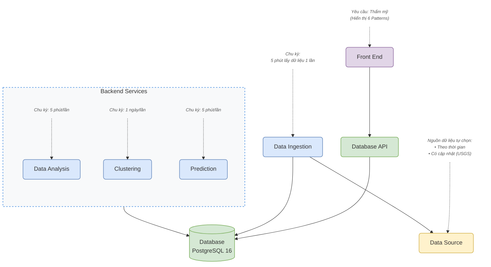
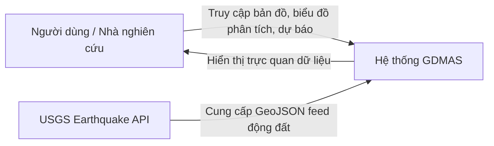

# TÀI LIỆU THIẾT KẾ KIẾN TRÚC PHẦN MỀM (SYSTEM ARCHITECTURE DOCUMENT - SAD)

# HỆ THỐNG GIÁM SÁT VÀ PHÂN TÍCH THIÊN TAI TOÀN CẦU (GDMAS)

- **Tên viết tắt:** GDMAS (Global Disaster Monitoring & Analysis System)
- **Phiên bản kiến trúc:** 1.0
- **Ngày ban hành:** 06/11/2026
- **Trạng thái:** Approved / Official Standard

---

## Mục lục

1. [Giới thiệu & Mục tiêu Hệ thống](#1-giới-thiệu--mục-tiêu-hệ-thống)
2. [Nguyên tắc kiến trúc cốt lõi](#2-nguyên-tắc-kiến-trúc-cốt-lõi)
3. [Sơ đồ Kiến trúc C4 & Luồng Vận hành](#3-sơ-đồ-kiến-trúc-c4--luồng-vận-hành)
   - [3.1. Sơ đồ Kiến trúc Bắt buộc (System Architecture Flowchart)](#31-sơ-đồ-kiến-trúc-bắt-buộc-system-architecture-flowchart)
   - [3.2. C4 Level 1: System Context](#32-c4-level-1-system-context)
   - [3.3. C4 Level 2: Container & Phân bổ 7 Terminals](#33-c4-level-2-container--phân-bổ-7-terminals)
4. [Đặc tả 7 Khối Dịch vụ Độc lập](#4-đặc-tả-7-khối-dịch-vụ-độc-lập)
5. [Đặc tả Kiến trúc 6 Patterns Phân Tích Chuỗi Thời Gian](#5-đặc-tả-kiến-trúc-6-patterns-phân-tích-chuỗi-thời-gian)
6. [Luồng Dữ liệu (Data Pipeline Flow)](#6-luồng-dữ-liệu-data-pipeline-flow)
7. [Yêu cầu Phi chức năng & Độ tin cậy](#7-yêu-cầu-phi-chức-năng--độ-tin-cậy)
8. [Mô hình Đóng gói & Triển khai Docker](#8-mô-hình-đóng-gói--triển-khai-docker)
9. [Cấu trúc Mã nguồn Tinh gọn](#9-cấu-trúc-mã-nguồn-tinh-gọn)

---

## 1. Giới thiệu & Mục tiêu Hệ thống

GDMAS là giải pháp phần mềm hướng dịch vụ độc lập (Microservices/Modular) phục vụ việc thu thập, lưu trữ, giám sát theo thời gian thực và phân tích dữ liệu chuỗi thời gian (Time-Series) thiên tai trên toàn cầu, với trọng tâm giai đoạn MVP là dữ liệu động đất từ Cục Khảo sát Địa chất Hoa Kỳ (USGS).

### 3 Năng lực cốt lõi:

1. **Real-time Monitoring:** Tự động thu thập dữ liệu GeoJSON động đất mỗi 5 phút, lưu trữ tập trung vào PostgreSQL và trực quan hóa tức thì trên bản đồ thế giới với giao diện thẩm mỹ cao.
2. **Time-Series Analysis:** Phân tích dữ liệu lịch sử và dữ liệu mới nạp theo 6 patterns bắt buộc (Phân bố thời gian, Xu hướng sau Resampling, Mùa vụ chu kỳ, Ma trận tương quan đa biến).
3. **Forecasting & Classification:** Dự báo định lượng số lượng sự kiện ($t + 1$) và phân loại mức độ hoạt động địa chấn ($t + 1$) phục vụ cảnh báo sớm.

---

## 2. Nguyên tắc kiến trúc cốt lõi

- **Mô hình Microservices/Modular:** Toàn bộ hệ thống được chia làm **7 khối dịch vụ độc lập**. Trong môi trường phát triển, mỗi khối bắt buộc phải có khả năng chạy trên **một terminal riêng biệt**.
- **Lưu trữ tập trung (Centralized Storage):** Các service xử lý dữ liệu giao tiếp và trao đổi thông tin thông qua kho dữ liệu chung PostgreSQL 16; không phụ thuộc vào Message Broker phức tạp trong phạm vi MVP.
- **Phân tách giao tiếp (Decoupled Interface):** Frontend hoàn toàn độc lập với các worker nội bộ và chỉ giao tiếp với Backend thông qua Database API (`gdmas-api`).
- **Nguyên tắc bảo toàn mã nguồn (Open-Closed Principle):** Đóng với việc sửa đổi mã nguồn sẵn có, mở với việc bổ sung thêm file, service runner, endpoint và component mới.

---

## 3. Sơ đồ Kiến trúc C4 & Luồng Vận hành

### 3.1. Sơ đồ Kiến trúc Bắt buộc (System Architecture Flowchart)



### 3.2. C4 Level 1: System Context



### 3.3. C4 Level 2: Container & Phân bổ 7 Terminals

|    Terminal    | Khối Dịch Vụ               | Công nghệ                 | Tần suất / Vận hành   | Lệnh khởi chạy                               |
| :------------: | :------------------------- | :------------------------ | :-------------------- | :------------------------------------------- |
| **Terminal 1** | **Database Server**        | PostgreSQL 16 (Docker)    | Luôn chạy             | `docker compose up postgres`                 |
| **Terminal 2** | **Data Ingestion Service** | Python Worker             | **5 phút / lần**      | `python -m gdmas.services.ingestion.runner`  |
| **Terminal 3** | **Data Analysis Service**  | Python Worker             | **5 phút / lần**      | `python -m gdmas.services.analysis.runner`   |
| **Terminal 4** | **Clustering Service**     | Python Worker             | **1 ngày / lần**      | `python -m gdmas.services.clustering.runner` |
| **Terminal 5** | **Prediction Service**     | Python Worker             | **5 phút / lần**      | `python -m gdmas.services.prediction.runner` |
| **Terminal 6** | **Database API Server**    | FastAPI (`apps/api`)      | Luôn chạy (Port 8000) | `uv run uvicorn gdmas.main:app --port 8000`  |
| **Terminal 7** | **Frontend Client**        | React + Vite (`apps/web`) | Luôn chạy (Port 3000) | `pnpm dev --port 3000`                       |

---

## 4. Đặc tả 7 Khối Dịch vụ Độc lập

### 1. PostgreSQL Database

- **Nhiệm vụ:** Lưu trữ toàn bộ dữ liệu sự kiện động đất, bảng kết quả phân tích chuỗi thời gian, kết quả phân cụm, dự báo và lịch sử chạy của service.
- **Dữ liệu bền vững:** Sử dụng Docker Named Volume (`gdmas_pgdata`).

### 2. Data Ingestion Service

- **Nhiệm vụ:** Kết nối định kỳ 5 phút/lần tới USGS GeoJSON Feed, kiểm tra tính hợp lệ của dữ liệu, chuẩn hóa trường và thực thi Upsert vào bảng `earthquake_events`.
- **Độ tin cậy:** Khử trùng lặp qua ràng buộc `UNIQUE (source, source_event_id)` và cập nhật lại thông số nếu USGS có hiệu chỉnh sau đó.

### 3. Data Analysis Service

- **Nhiệm vụ:** Định kỳ 5 phút/lần tổng hợp dữ liệu chuỗi thời gian, tính toán các chỉ số thống kê (Pattern 1), thực hiện Re-sampling theo tuần/tháng để trích xuất đường xu hướng (Trend - Pattern 2), phân tích chu kỳ mùa vụ (Seasonality - Pattern 3), và tính ma trận tương quan Pearson đa biến (Pattern 4).
- **Đầu ra:** Ghi nhận vào bảng `analysis_results`.

### 4. Clustering Service

- **Nhiệm vụ:** Định kỳ 1 ngày/lần áp dụng thuật toán phân cụm mật độ không gian DBSCAN và K-Means trên tập dữ liệu lịch sử để phát hiện các ổ địa chấn và chùm động đất tập trung.
- **Đầu ra:** Ghi nhận vào bảng `clustering_results` và `clustering_event_mapping`.

### 5. Prediction Service

- **Nhiệm vụ:** Định kỳ 5 phút/lần chạy mô hình hồi quy dự báo số lượng sự kiện ngày tiếp theo ($t + 1$ - Pattern 5) và phân loại mức độ hoạt động địa chấn ($t + 1$ - Pattern 6: Thấp / Bình thường / Cao).
- **Đánh giá:** Tính toán sai số MAE, RMSE so với baseline và ghi nhận vào bảng `prediction_results` & `classification_results`.

### 6. Database API

- **Nhiệm vụ:** Cung cấp cổng giao tiếp REST API duy nhất cho Frontend. Xác thực tham số đầu vào, truy vấn dữ liệu từ PostgreSQL, định dạng theo Envelope chuẩn và phát luồng Server-Sent Events (SSE).

### 7. Frontend Client

- **Nhiệm vụ:** Giao diện Single Page Application (SPA) xây dựng bằng React, TypeScript và Vite.
- **Tiêu chuẩn chất lượng:** Bắt buộc đạt tính **Thẩm mỹ cao**, trực quan hóa trọn vẹn bản đồ toàn cầu tương tác cùng đầy đủ 6 patterns phân tích time-series, hỗ trợ người dùng lọc linh hoạt theo thời gian.

---

## 5. Đặc tả Kiến trúc 6 Patterns Phân Tích Chuỗi Thời Gian

|  STT  | Tên Pattern                    | Yêu cầu Kỹ thuật & Biểu đồ                                                                                                                                                             |   Phạm vi thời gian    |            Khối đảm nhiệm            |
| :---: | :----------------------------- | :------------------------------------------------------------------------------------------------------------------------------------------------------------------------------------- | :--------------------: | :----------------------------------: |
| **1** | **Biểu diễn theo thời gian**   | **3 biểu đồ bắt buộc:**<br>• `Line chart`: Xu hướng số lượng/magnitude theo ngày.<br>• `Scatter plot`: Phân tán điểm độ sâu vs magnitude.<br>• `Histogram`: Phân phối tần suất độ lớn. |  Ngày / Tuần / Tháng   | Data Analysis $\rightarrow$ Frontend |
| **2** | **Trend Analysis**             | Biểu diễn xu hướng của dữ liệu sau khi **Re-sampling** (Moving Average / Decomposition)                                                                                                |  Tháng _(hoặc Tuần)_   | Data Analysis $\rightarrow$ Frontend |
| **3** | **Seasonality**                | Biểu diễn tính chu kỳ / mùa vụ (**Seasonal line**) sau khi **Re-sampling**                                                                                                             |  Tháng _(hoặc Tuần)_   | Data Analysis $\rightarrow$ Frontend |
| **4** | **Tương quan (Correlation)**   | Ma trận tương quan (**Correlation Matrix / Heatmap**) giữa 5 biến: magnitude, depth, lat, lon, count                                                                                   |        Đa biến         | Data Analysis $\rightarrow$ Frontend |
| **5** | **Hồi quy & Dự báo**           | Hiển thị giá trị dự báo định lượng cho ngày tiếp theo ($t + 1$) kèm khoảng tin cậy                                                                                                     | Ngày kế tiếp ($t + 1$) |  Prediction $\rightarrow$ Frontend   |
| **6** | **Phân loại (Classification)** | Hiển thị nhãn phân loại dự đoán cho ngày tiếp theo ($t + 1$) (Low / Normal / High)                                                                                                     | Ngày kế tiếp ($t + 1$) |  Prediction $\rightarrow$ Frontend   |

---

## 6. Luồng Dữ liệu (Data Pipeline Flow)

```text
[USGS GeoJSON Feed]
        │
        ▼ (Mỗi 5 phút)
[Data Ingestion Worker]
        │
        ▼ (Upsert / Deduplicate)
[(PostgreSQL Database)] ◄──────────────────────────────────────────────┐
   │         │                                                        │
   │ (Đọc)   │ (Đọc mỗi 5 phút)                                       │
   │         ├───────────► [Data Analysis Worker] ────(Ghi kết quả)───┤
   │         │                                                        │
   │         │ (Đọc mỗi 5 phút)                                       │
   │         ├───────────► [Prediction Worker]    ────(Ghi kết quả)───┤
   │         │                                                        │
   │         │ (Đọc mỗi 1 ngày)                                       │
   │         └───────────► [Clustering Worker]    ────(Ghi kết quả)───┘
   │
   ▼ (Truy vấn)
[Database API (FastAPI)]
   │
   ▼ (REST JSON / SSE Stream)
[Frontend Client (React/Vite)] ───► [Người dùng hiển thị bản đồ & 6 biểu đồ]
```

---

## 7. Yêu cầu Phi chức năng & Độ tin cậy

1. **Tính chịu lỗi (Resilience):**
   - Khi nguồn USGS gặp sự cố mạng, `Data Ingestion` tự động ghi log lỗi, tạm dừng và thử lại ở chu kỳ tiếp theo mà không làm gián đoạn API hay Frontend.
   - Khi một service worker dừng lại, các service khác trên các terminal còn lại vẫn duy trì hoạt động bình thường.
2. **Hiệu năng & Tối ưu hóa:**
   - Dữ liệu biểu đồ phân tích 6 patterns được tính toán trước (pre-computed) bởi worker và lưu trong DB, giúp API phản hồi tức thì ($< 100\text{ ms}$).
   - Bảng `earthquake_events` được đánh chỉ mục B-Tree trên `event_time DESC` và `magnitude`.
3. **Bảo mật:**
   - Cấu hình thông tin nhạy cảm (`DATABASE_URL`, port, secret keys) qua biến môi trường `.env`, tuyệt đối không commit file cấu hình bí mật lên Git.

---

## 8. Mô hình Đóng gói & Triển khai Docker

Hệ thống được đóng gói hoàn chỉnh bằng Docker Compose:

```yaml
services:
  postgres:
    image: postgres:16-alpine
    volumes:
      - pgdata:/var/lib/postgresql/data
    ports:
      - "5432:5432"

  api:
    build: ./apps/api
    ports:
      - "8000:8000"
    depends_on:
      postgres:
        condition: service_healthy

  web:
    build: ./apps/web
    ports:
      - "3000:3000"
    depends_on:
      - api

  ingestion:
    build: ./apps/api
    command: python -m gdmas.services.ingestion.runner
    depends_on:
      - postgres

  analysis:
    build: ./apps/api
    command: python -m gdmas.services.analysis.runner
    depends_on:
      - postgres

  prediction:
    build: ./apps/api
    command: python -m gdmas.services.prediction.runner
    depends_on:
      - postgres

  clustering:
    build: ./apps/api
    command: python -m gdmas.services.clustering.runner
    depends_on:
      - postgres
```

---

## 9. Cấu trúc Mã nguồn Tinh gọn

Cấu trúc dự án được tinh gọn tối đa, tập trung vào kiến trúc Microservices/Modular độc lập, loại bỏ hoàn toàn các thành phần dư thừa:

```text
GDMAS/
│
├── .agents/                              # Ngữ cảnh và nhật ký phát triển của AI Agent
│   ├── notes/                            # Bộ nhớ quyết định duy nhất (.agents/notes/)
│   │   ├── bugs/                         # Nhật ký theo dõi lỗi và rủi ro kỹ thuật
│   │   ├── implemented/                  # Kế hoạch triển khai & trạng thái sống
│   │   ├── proposed/                     # Đề xuất tính năng và quyết định kiến trúc
│   │   └── testcase/                     # Biên bản kiểm thử (proposal-paired & single-file-test)
│   └── skills/                           # Bộ 5 kỹ năng cốt lõi (.agents/skills/)
│       ├── write-proposal/               # Khám phá read-only & soạn proposal (Pha 1+2)
│       ├── build-implementation/         # Lập plan/status đồng thời testcase & implement (Pha 4)
│       ├── write-testcase/               # Tạo testcase & unit test offline (đồng thời & test/<id>)
│       ├── project-review/               # Thẩm định OCP/Churn & 7 Bất biến I1–I7
│       └── review-pr/                    # Tự động hóa Git, đẩy PR & merge khi 0 conflict
│
├── apps/                                 # Mã nguồn các ứng dụng chính
│   ├── api/                              # Backend FastAPI & 4 Worker Services độc lập (Python)
│   │   ├── alembic/                      # Quản lý Database Migrations
│   │   ├── src/gdmas/                    # Mã nguồn lõi hệ thống GDMAS
│   │   │   ├── api/                      # REST API Endpoints & Routes (/earthquakes, /statistics, /events)
│   │   │   ├── core/                     # Cấu hình (config), logging, exceptions
│   │   │   ├── db/                       # Kết nối PostgreSQL (connection, base model)
│   │   │   ├── models/                   # SQLAlchemy ORM Models
│   │   │   ├── schemas/                  # Pydantic Schemas xác thực dữ liệu
│   │   │   ├── services/                 # 4 Services xử lý nghiệp vụ độc lập (chạy trên từng terminal riêng):
│   │   │   │   ├── ingestion/            # Thu thập dữ liệu USGS (Chu kỳ 5 phút/lần)
│   │   │   │   ├── analysis/             # Phân tích chuỗi thời gian: 6 patterns (Chu kỳ 5 phút/lần)
│   │   │   │   ├── clustering/           # Phân cụm địa chấn DBSCAN/K-Means (Chu kỳ 1 ngày/lần)
│   │   │   │   └── prediction/           # Dự báo định lượng & Phân loại ngày kế tiếp t+1 (Chu kỳ 5 phút/lần)
│   │   │   ├── realtime/                 # Luồng Server-Sent Events (SSE) đẩy dữ liệu thời gian thực
│   │   │   ├── scheduler/                # Quản lý tác vụ định kỳ độc lập
│   │   │   └── main.py                   # Điểm khởi chạy Database API Server
│   │   ├── tests/                        # Kiểm thử tự động (unit, integration)
│   │   ├── pyproject.toml                # Quản lý gói và môi trường bằng uv
│   │   └── Dockerfile                    # Containerization cho Backend API & Workers
│   │
│   └── web/                              # Frontend Client Dashboard (React 18 + TypeScript + Vite)
│       ├── src/
│       │   ├── components/               # UI Components thẩm mỹ (map, charts 6 patterns, dashboard)
│       │   ├── features/                 # Mô đun chức năng (earthquakes, monitoring, statistics)
│       │   ├── contracts/ & types/       # TypeScript API Data Contracts
│       │   ├── hooks/ & lib/             # Custom React Hooks & API Client, SSE EventSource
│       │   └── app/                      # Cấu hình định tuyến và khởi tạo ứng dụng
│       ├── package.json                  # Dependencies quản lý qua pnpm / npm
│       └── Dockerfile                    # Containerization cho Frontend Web
│
├── contracts/                            # Hợp đồng dữ liệu & JSON Schemas giữa Backend và Frontend
│
├── infra/                                # Cấu hình hạ tầng
│   └── postgres/                         # Dữ liệu khởi tạo và cấu hình PostgreSQL 16
│
├── docs/                                 # Hệ thống tài liệu kỹ thuật hoàn chỉnh
│   ├── architecture/                     # Thiết kế kiến trúc (SAD.md, ERD.md)
│   ├── api/                              # Đặc tả REST API & SSE (API.md)
│   ├── development/                      # Quy ước phát triển (branch-conventions, coding-conventions, team-workflow)
│   ├── guides/                           # Sổ tay hướng dẫn (git, docker, python, database)
│   ├── setup.md                          # Hướng dẫn thiết lập môi trường phát triển
│   ├── quyuocchung.md                    # Quy ước phát triển chung (Nguyên tắc Open-Closed)
│   └── yeucaubatbuoc.md                  # Yêu cầu bắt buộc của đồ án
│
├── scripts/                              # Kịch bản tự động hóa phục vụ phát triển
│   ├── dev.sh                            # Khởi động môi trường phát triển
│   └── test.sh                           # Chạy kiểm thử tự động toàn bộ
│
├── docker-compose.yml                    # Điều phối toàn bộ các container dịch vụ
triển cục bộ
├── .env.example                          # Danh mục biến môi trường mẫu
├── .editorconfig                         # Quy chuẩn định dạng mã nguồn
├── .gitignore                            # Danh sách loại trừ theo dõi Git
└── README.md                             # Tài liệu tổng quan dự án
```
