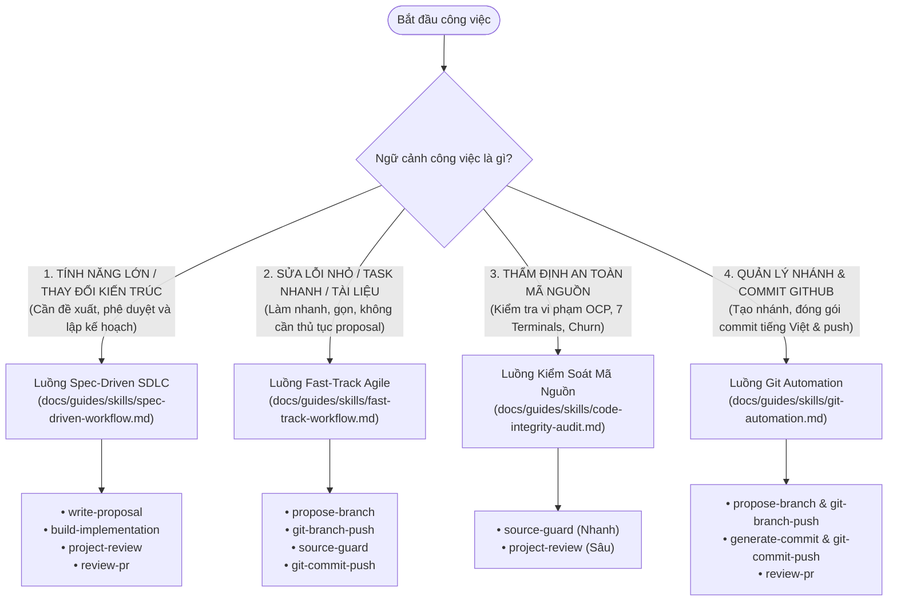

# Sổ Tay Hướng Dẫn Hệ Sinh Thái Kỹ Năng AI Agent (GDMAS Skills Guide)

Tài liệu này định nghĩa toàn diện **hệ sinh thái 9 kỹ năng (Skills)** của AI Agent trong dự án **GDMAS** (Global Disaster Monitoring & Analysis System), phân loại và hướng dẫn sử dụng chi tiết theo từng **ngữ cảnh công việc thực tế**.

---

## 🧭 1. Bản Đồ Điều Hướng Theo Ngữ Cảnh (Context Decision Tree)

Để đạt hiệu quả công việc cao nhất và tiết kiệm token, lập trình viên và AI Agent lựa chọn luồng kỹ năng dựa trên **quy mô và tính chất tác vụ**:

---

## 📊 2. Ma Trận Tra Cứu 9 Kỹ Năng Theo Ngữ Cảnh

| Tên Kỹ Năng | Ngữ Cảnh Sử Dụng Chính | Mục Tiêu Cốt Lõi | Cơ Chế Kiểm Soát (Hard Stop) |
| :--- | :--- | :--- | :--- |
| [**`write-proposal`**](spec-driven-workflow.md#1-write-proposal) | Bắt đầu tính năng lớn, đổi kiến trúc, sửa bug phức tạp | Khảo sát Read-only, kiểm tra xung đột quyết định, soạn proposal | **DỪNG LẠI** chờ người dùng ký duyệt (`Approved`) |
| [**`build-implementation`**](spec-driven-workflow.md#2-build-implementation) | Triển khai proposal đã được duyệt | Lập `plan.md` & `status.md`, code tuân thủ RULE-03, chạy test | **DỪNG Ở VALIDATION** trên Working Tree (Cấm auto-commit) |
| [**`project-review`**](code-integrity-audit.md#2-project-review) | Thẩm định kiến trúc sâu trước khi commit/merge | Kiểm tra 7 Bất biến (I1-I7), kiểm tra drift tài liệu và lan phạm vi | Xuất báo cáo thẩm định, không tự ý sửa code |
| [**`review-pr`**](git-automation.md#3-review-pr) | Chốt hoàn tất tính năng lớn, commit & push | Scope check, tự gọi project-review, commit tiếng Việt, push remote | **CHỈ CHẠY KHI CÓ LỆNH RIÊNG** từ người dùng |
| [**`source-guard`**](code-integrity-audit.md#1-source-guard) | Thanh tra an toàn working tree & cập nhật memory | Phát hiện xóa file, sửa file lõi, tính churn, cập nhật `context-memory` | Không auto-commit, giữ nguyên working tree |
| [**`generate-commit`**](git-automation.md#1-generate-commit) | Chuẩn bị nội dung commit tiếng Việt | Đọc nhanh Section 5 & 6 Context Memory, sinh Conventional Commit | Ghi dự thảo vào `pending-commit.md`, không tự commit |
| [**`git-commit-push`**](git-automation.md#2-git-commit-push) | Commit và push nhanh cho tác vụ thường nhật | Stage an toàn, loại bỏ `.env`, commit tiếng Việt và push GitHub | **CHỈ CHẠY KHI ĐƯỢC CHỈ ĐỊNH RÕ RÀNG** |
| [**`propose-branch`**](git-automation.md#4-propose-branch) | Khởi đầu tác vụ mới, cần đặt tên nhánh chuẩn | Phân tích ngữ nghĩa yêu cầu, sinh nhánh `<type>/<slug>` & checklist | Lưu bản ghi vào `.agents/notes/branches/`, không tự chuyển nhánh |
| [**`git-branch-push`**](git-automation.md#5-git-branch-push) | Cần chuyển sang nhánh mới và đẩy lên GitHub | Kiểm tra an toàn working tree, rẽ nhánh từ `develop`, push remote | Không xóa code dở dang, audit log minh bạch |

---

## 📑 3. Mục Lục Các Tài Liệu Hướng Dẫn Chi Tiết

1. [**`spec-driven-workflow.md`**](file:///D:/KHDLKPDL/GDMAS/docs/guides/skills/spec-driven-workflow.md):
   * *Ngữ cảnh:* Xây dựng tính năng lớn, bổ sung microservices trong 7 Terminals, sửa đổi cấu trúc CSDL hoặc hợp đồng dữ liệu dùng chung.
   * *Bộ kỹ năng:* `write-proposal`, `build-implementation`, `project-review`, `review-pr`.

2. [**`fast-track-workflow.md`**](file:///D:/KHDLKPDL/GDMAS/docs/guides/skills/fast-track-workflow.md):
   * *Ngữ cảnh:* Sửa lỗi nhanh (hotfix/bugfix), cập nhật giao diện nhỏ, bổ sung test cases, chỉnh sửa tài liệu kỹ thuật hằng ngày.
   * *Bộ kỹ năng:* `propose-branch`, `git-branch-push`, `source-guard`, `generate-commit`, `git-commit-push`.

3. [**`code-integrity-audit.md`**](file:///D:/KHDLKPDL/GDMAS/docs/guides/skills/code-integrity-audit.md):
   * *Ngữ cảnh:* Kiểm tra an toàn mã nguồn, bảo vệ nguyên tắc Open-Closed (RULE-03), xác thực 7 Bất biến kiến trúc (I1-I7), phòng ngừa lộ bí mật.
   * *Bộ kỹ năng:* `source-guard` (thanh tra nhanh tức thời) vs `project-review` (thẩm định chuyên sâu đa tầng).

4. [**`git-automation.md`**](file:///D:/KHDLKPDL/GDMAS/docs/guides/skills/git-automation.md):
   * *Ngữ cảnh:* Quản lý vòng đời Git, bảo vệ nhánh `main`, đồng bộ với `develop`, chuẩn hóa Conventional Commit tiếng Việt có dấu và đẩy lên GitHub an toàn.
   * *Bộ kỹ năng:* `propose-branch`, `git-branch-push`, `generate-commit`, `git-commit-push`, `review-pr`.

---

## 🔒 4. Hai Bất Biến Vận Hành Tối Cao Cho Mọi Kỹ Năng

> [!IMPORTANT]
> 1. **Nguyên Tắc Không Tự Ý Commit & Push (Strict Explicit Commit Policy):**
>    - Sau khi Agent sửa xong một đoạn code, một tệp hay một hàm, mã nguồn **luôn luôn được giữ nguyên trên Working Tree**.
>    - Tuyệt đối không tự động commit/push sau khi chạy kiểm thử hoặc quét an toàn. Commit & push chỉ được thực hiện khi người dùng ra lệnh rõ ràng bằng văn bản.
> 2. **Nguyên Tắc Đơn Tệp & Thực Thi Độc Lập (Single File & Self-Contained):**
>    - Mỗi kỹ năng trong `.agents/skills/<name>/` chỉ có đúng **1 file duy nhất là `SKILL.md`**.
>    - Không phụ thuộc vào script `.ps1` hay `.sh` bên ngoài. Agent thực thi trực tiếp bằng các công cụ native và lệnh Git.

