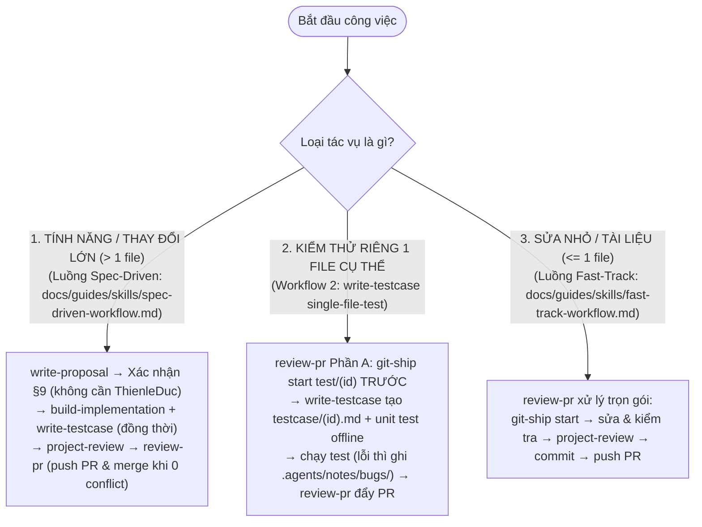

# Sổ Tay Hệ Sinh Thái 5 Kỹ Năng Cốt Lõi (GDMAS Skills Guide)

Tài liệu này định nghĩa bộ **5 kỹ năng cốt lõi (`.agents/skills/`)** của AI Agent trong dự án **GDMAS** (Global Disaster Monitoring & Analysis System). Toàn bộ năng lực từ các kỹ năng phụ trợ trước đây (`source-guard`, `propose-branch`, `git-branch-push`, `generate-commit`, `git-commit-push`, `generate-planning`) đã được **hợp nhất và tự động hóa trực tiếp** vào 5 kỹ năng cốt lõi này và hai tài liệu quy trình [agent-workflow.md](../../agent-workflow.md), [git-workflow.md](../../git-workflow.md).

> **Vị trí lưu trữ duy nhất:** Chỉ đặt tại **`.agents/skills/`** (không nhân bản ở `.claude/skills/`). Mọi agent (Antigravity, Claude Code qua [CLAUDE.md](../../../CLAUDE.md), Codex, Cursor…) đều đọc và gọi từ `.agents/skills/`.

---

## 🧭 1. Bản Đồ Điều Hướng Theo Ngữ Cảnh

---

## 📊 2. Ma Trận 5 Kỹ Năng Cốt Lõi (`.agents/skills/`)

| Tên Kỹ Năng | Vai Trò Cốt Lõi | Quy Ước Tự Động Hóa Đã Hợp Nhất | Cơ Chế Kiểm Soát |
|---|---|---|---|
| [**`write-proposal`**](spec-driven-workflow.md#1-write-proposal) | Khám phá read-only, kiểm conflict, soạn proposal vào `.agents/notes/proposed/` | Đọc nhanh `notes_index.py` & `docs/`, Slug Engine tạo ID `yyyy-mm-dd-<slug>-<handle>`, khai báo trước tệp test ở §8 | **DỪNG** chờ xác nhận §9 (**thả lỏng**: tác giả hoặc đồng đội duyệt, không cần `ThienleDuc`) |
| [**`build-implementation`**](spec-driven-workflow.md#2-build-implementation) | Kiểm §9 `Approved`, tạo **đồng thời** `implemented/<id>/` & gọi `write-testcase` tạo `testcase/<id>.md`, code theo RULE-03 & I1–I7 | Gọi `review-pr` Phần A tạo nhánh trước khi sửa file; validation nhẹ + OCP check | Đặt `Status: validation`, **tự chuyển giao `review-pr`** |
| [**`write-testcase`**](spec-driven-workflow.md#3-write-testcase) | Sinh biên bản `.agents/notes/testcase/<id>.md` (từ `_TEMPLATE.md`) + viết file unit test offline | Hỗ trợ **2 chế độ**: (1) `proposal-paired` song song với `implemented/<id>/`; (2) `single-file-test` checkout nhánh `test/<id>` trước, test fail thì ghi bug vào `.agents/notes/bugs/` | Test bắt buộc chạy **offline 100%** (I7); đồng bộ `notes_index.py --testcases` |
| [**`project-review`**](code-integrity-audit.md) | Thẩm định kiến trúc & bảo vệ mã nguồn trước khi commit/PR | Hợp nhất **OCP/Churn/Core-files guard**, **7 Bất biến I1–I7** (kèm kiểm `testcase/<id>.md`, mã test offline & `.agents/notes/bugs/`), Drift, Scope Creep | Xuất báo cáo finding; không tự merge PR |
| [**`review-pr`**](git-automation.md) | Tự động hóa Git toàn phần từ lúc nhận việc tới push PR, kiểm tra conflict & merge | Hợp nhất Slug Engine, bảng `type(scope)` tiếng Việt, bảo vệ `.env`, `git-ship.sh`, `.githooks/`, merge-forward `develop`, phục vụ Spec-Driven, Fast-Track & `test/<id>` | **Kiểm tra 0 conflict trước khi merge** (không bắt buộc riêng `ThienleDuc`) |

---

## 📑 3. Tài Liệu Chi Tiết Theo Chuyên Đề

1. [**`spec-driven-workflow.md`**](spec-driven-workflow.md): Luồng chuẩn 5 kỹ năng cho tính năng mới (Proposal duyệt → sinh đồng thời Implement & Testcase) và luồng kiểm thử riêng 1 file (`test/<id>`).
2. [**`fast-track-workflow.md`**](fast-track-workflow.md): Xử lý sửa nhỏ ≤ 1 file trực tiếp qua `review-pr` (không cần proposal) vẫn đảm bảo nhánh, hook và kiểm tra không xung đột trước khi merge.
3. [**`code-integrity-audit.md`**](code-integrity-audit.md): Chi tiết lớp thẩm định `project-review` (OCP, Churn, Core Files, 7 Bất biến I1–I7, kiểm tra `.agents/notes/testcase/<id>.md` & `.agents/notes/bugs/`).
4. [**`git-automation.md`**](git-automation.md): Chi tiết cơ chế tự động hóa Git trong `review-pr`, bảng Type/Scope tiếng Việt, `scripts/git-ship.sh` (`merge` kiểm tra conflict) và `.githooks/`.

---

## 🔒 4. Bất Biến Vận Hành, Phân Quyền & Tương Tác

> [!IMPORTANT]
> 1. **Proposal thả lỏng — Merge theo điều kiện Không Xung Đột (Conflict-Free Gate):** Bất kỳ thành viên nào trong `.agents/team.md` (`thien`, `son`, `van`, `tai`), kể cả tác giả, đều duyệt được §9 proposal. Khi merge PR vào `develop`, **không bắt buộc phải là `ThienleDuc`** — chỉ cần **kiểm tra không có xung đột (`0 conflicts`)** và `notes_index.py --check` / test đạt chuẩn là cho phép merge.
> 2. **Proposal được duyệt → Sinh đồng thời Implement + Testcase (`write-testcase`):** Mọi proposal `Approved` phải tạo song song `implemented/<id>/` và `.agents/notes/testcase/<id>.md` (từ [`.agents/notes/testcase/_TEMPLATE.md`](../../../.agents/notes/testcase/_TEMPLATE.md)) kèm mã unit test chạy offline trước khi đẩy PR.
> 3. **Kiểm thử 1 file → Checkout nhánh `test/<id>` trước & Log bug vào `.agents/notes/bugs/`:** Khi người dùng yêu cầu kiểm thử 1 file cụ thể, bắt buộc rẽ nhánh `test/<id>` trước rồi mới viết unit test; nếu ra lỗi, ghi `BUG-<handle>-NNN-<slug>.md` vào `.agents/notes/bugs/`.
> 4. **Không hỏi xin phép thao tác thêm/sửa an toàn — Gom câu hỏi nguy hiểm cuối phiên:** Agent tự động thêm mới/sửa file an toàn; với **xóa file/thư mục** hoặc **conflict**, agent bỏ qua phần nguy hiểm và gom thành **1 danh sách câu hỏi duy nhất cuối phiên**.
> 5. **Bảng index notes tự sinh:** Chạy `python3 scripts/notes_index.py` (`--testcases`, `--bugs`, `--check`).
