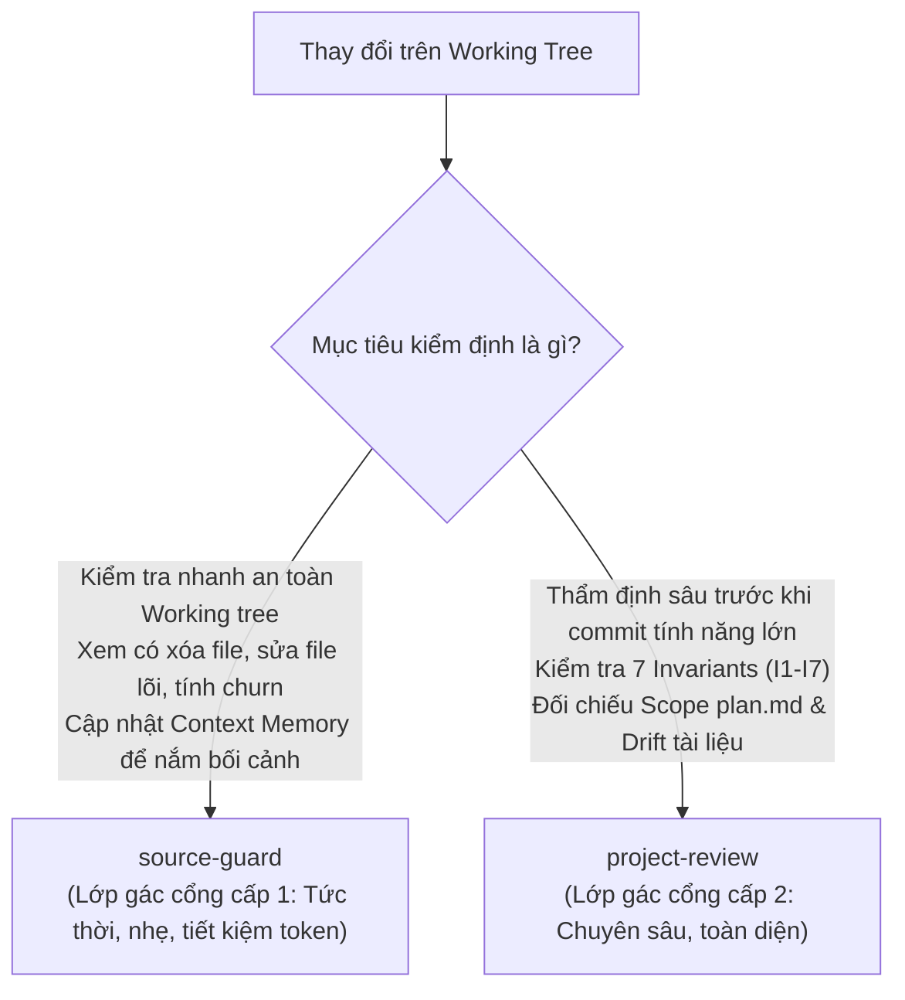

# Hướng Dẫn Thẩm Định An Toàn Mã Nguồn & Kiểm Soát Kiến Trúc (Code Integrity Audit Guide)

Tài liệu này hướng dẫn cách sử dụng hai lớp gác cổng chất lượng mã nguồn trong hệ thống **GDMAS**: **`source-guard`** (Thanh tra nhanh tức thời) và **`project-review`** (Thẩm định kiến trúc chuyên sâu).

---

## ⚖️ 1. So Sánh Hai Lớp Kiểm Định: Khi Nào Dùng Kỹ Năng Nào?



| Tiêu chí | `source-guard` (Lớp 1 - Thanh Tra Nhanh) | `project-review` (Lớp 2 - Thẩm Định Sâu) |
| :--- | :--- | :--- |
| **Bản chất** | Thanh tra an toàn working tree tức thời & cập nhật bộ nhớ | Thẩm định đặc tả kiến trúc, hợp đồng và phạm vi kế hoạch |
| **Thời điểm chạy** | Bất cứ lúc nào trong phiên làm việc, sau khi gõ vài dòng code | Trước khi commit một tính năng lớn hoặc trước khi mở PR |
| **Nguồn đối chiếu** | Trạng thái Git cục bộ (`git status`, `git diff`) | Note hệ thống (`proposed/`, `implemented/plan.md`, `contracts/`) |
| **Trọng tâm kiểm tra** | Cấm xóa tệp (`D`), cấm sửa tệp lõi, tỷ lệ churn (+/-) | 7 Bất biến kiến trúc (I1-I7), lan phạm vi, độ lệch tài liệu (Drift) |
| **Tác vụ đi kèm** | Cập nhật Section 5 & 6 trong `context-memory.md` | Xuất bảng đánh giá chi tiết 7 Invariants và đề xuất ghi Bug log |
| **Tiêu tốn Token** | **Rất thấp** (~vài trăm token) | **Trung bình** (đối chiếu tài liệu và diff) |

---

## 🛡️ 2. `source-guard` (Thanh Tra An Toàn & Bộ Nhớ Tích Lũy)

### Nhiệm Vụ Cốt Lõi
1. **Bảo vệ nguyên tắc Open-Closed (RULE-03):** "Không sửa mã nguồn hiện tại – Chỉ bổ sung thêm mới" *(Closed for Modification, Open for Extension)*.
2. **Cảnh báo xóa tệp (`git status: D`):** Không cho phép xóa bất kỳ tệp nào đã tồn tại trong repository (ngoại trừ tệp cấu hình được cấp phép như `docker-compose.override.yml`).
3. **Cảnh báo can thiệp tệp lõi kiến trúc:**
   - `apps/api/src/gdmas/main.py`: Điểm khởi chạy FastAPI; cấm nhúng worker ngầm.
   - `apps/api/src/gdmas/db/connection.py` & `base.py`: Kết nối CSDL tập trung.
   - `contracts/`: Hợp đồng trao đổi dữ liệu API - Web.
   - `docs/quyuocchung.md`: Hiến chương quy ước tối cao.
4. **Kiểm soát tỷ lệ dòng thay đổi (Churn Ratio):** Cảnh báo nếu số dòng xóa vượt quá số dòng thêm mới.
5. **Cập nhật Context Memory:** Cập nhật tự động Section 5 & 6 trong [`.agents/notes/memory/context-memory.md`](GDMAS/.agents/notes/memory/context-memory.md) mà không làm mất lịch sử các nhánh khác.

### Cách Kích Hoạt
```text
/source-guard
```
*(Hoặc trong chat: "Hãy quét xem mã nguồn có vi phạm Open-Closed không", "Cập nhật lại context-memory").*

### Kết Quả Đầu Ra
- Biên bản thẩm định cục bộ: [`.agents/notes/changes/source-guard-report.md`](GDMAS/.agents/notes/changes/source-guard-report.md).
- Trạng thái đánh giá: `✅ ĐẠT CHUẨN`, `⚠️ CẢNH BÁO`, hoặc `❌ VI PHẠM`.
- **Nhắc nhở bất biến:** Giữ nguyên toàn bộ working tree, không tự ý commit.

---

## 🏛️ 3. `project-review` (Thẩm Định Chuyên Sâu 7 Bất Biến GDMAS)

### 7 Bất Biến Kiến Trúc Bắt Buộc (Invariants I1 - I7)

Khi chạy `project-review`, Agent quét toàn bộ diff để xác thực 7 bất biến sau:

```text
┌────────────────────────────────────────────────────────────────────────┐
│                   7 BẤT BIẾN KIẾN TRÚC GDMAS                           │
├───────┬────────────────────────────┬───────────────────────────────────┤
│ Mã    │ Tên Bất Biến               │ Quy Chuẩn Kiểm Tra                │
├───────┼────────────────────────────┼───────────────────────────────────┤
│ I1    │ Tách biệt 7 Terminals      │ Cấm nhúng worker ngầm vào main.py │
│ I2    │ Open-Closed (RULE-03)      │ Cấm xóa file, cấm đổi hàm cũ      │
│ I3    │ Chuẩn Hợp Đồng & Múi Giờ   │ Schema contracts/, UTC & WGS84    │
│ I4    │ Bất Biến Alembic Migration │ Cấm sửa migration cũ trong CSDL   │
│ I5    │ 6 Patterns Chuỗi Thời Gian │ Component mới trong charts/       │
│ I6    │ An Toàn Bí Mật (Secrets)   │ Cấm stage .env, không lộ secrets  │
│ I7    │ Bảo Toàn Test Cases Cũ     │ Test cũ phải pass, thêm test mới  │
└───────┴────────────────────────────┴───────────────────────────────────┘
```

### Các Bước Kiểm Tra Nâng Cao
1. **Kiểm tra nhất quán quyết định:** Quét `.agents/notes/proposed/` để phát hiện nếu diff đi ngược lại các quyết định đã duyệt hoặc làm lại phương án đã từng bị bác bỏ.
2. **Kiểm tra lan phạm vi (Scope Mismatch):** Đối chiếu danh sách tệp thay đổi thực tế với mục `In Scope` trong `plan.md`. Báo động nếu sửa file ngoài kế hoạch.
3. **Kiểm tra độ lệch tài liệu (Drift Detection):** Cảnh báo nếu code có thay đổi route, body, bảng DB hay component mà tài liệu trong `docs/` hoặc `contracts/` chưa cập nhật.

### Cách Kích Hoạt
```text
/project-review
```
*(Hoặc trong chat: "Review diff hiện tại theo chuẩn kiến trúc", "Kiểm tra xem có vi phạm 7 invariants không").*

---

## 💡 Tóm Tắt Nguyên Tắc Phối Hợp

- Trong lúc đang code hằng ngày: Gọi `/source-guard` thường xuyên để tự tin mã nguồn luôn tuân thủ Open-Closed và Context Memory luôn được cập nhật.
- Trước khi đóng gói commit tính năng lớn: Gọi `/project-review` để rà soát toàn diện 7 Invariants và ngăn chặn lan phạm vi.

