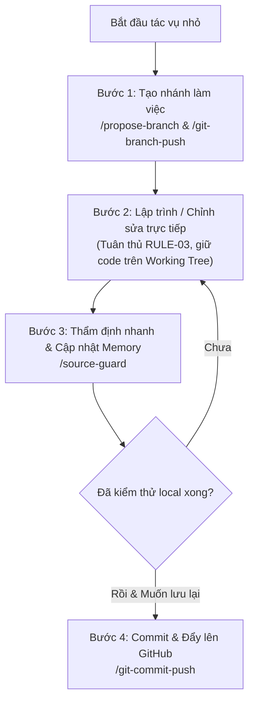

# Hướng Dẫn Luồng Phát Triển Nhanh (Fast-Track Agile Workflow)

Tài liệu này hướng dẫn quy trình phát triển nhanh, linh hoạt cho các tác vụ thường ngày, sửa lỗi nhỏ, cập nhật giao diện hoặc hoàn thiện tài liệu trong dự án **GDMAS**, sử dụng bộ 5 kỹ năng gọn nhẹ: **`propose-branch`**, **`git-branch-push`**, **`source-guard`**, **`generate-commit`**, và **`git-commit-push`**.

---

## 🎯 Khi Nào Sử Dụng Luồng Này?

Áp dụng cho các công việc có **quy mô nhỏ hoặc vừa**, không làm thay đổi kiến trúc tổng thể của hệ thống:
- Sửa lỗi nhỏ (bugfix / hotfix) như sửa lỗi hiển thị ngày tháng, chỉnh layout Dark Mode, sửa responsive CSS.
- Bổ sung hoặc chỉnh sửa tài liệu kỹ thuật trong thư mục `docs/`.
- Viết thêm test cases mới trong `docs/testing/` hoặc `apps/api/tests/`.
- Cập nhật kịch bản chạy tự động hóa hoặc cấu hình công cụ phát triển (`scripts/`, cấu hình linter/formatter).
- Thêm một tiện ích helper nhỏ hoặc bổ sung kiểu dữ liệu phụ trợ.

> [!TIP]
> Luồng này **không yêu cầu viết proposal hay plan** trong `.agents/notes/`, giúp tiết kiệm thời gian và tối ưu hóa token tối đa cho các công việc diễn ra hằng ngày.

---

## 🧭 Vòng Đời 4 Bước Của Fast-Track



---

## 🛠️ Hướng Dẫn Thao Tác Chi Tiết Từng Kỹ Năng

### 1. `propose-branch` (Đề Xuất Tên Nhánh Chuẩn Hóa)
* **Mục tiêu:** Tự động phân tích yêu cầu công việc, sinh tên nhánh Git chuẩn hóa theo quy ước GDMAS (`<type>/<slug>`) và tạo checklist công việc.
* **Cách kích hoạt:**
  ```text
  /propose-branch sửa lỗi hiển thị múi giờ UTC trên bảng danh sách sự kiện địa chấn
  ```
* **Kết quả:**
  - Tự động sinh tên nhánh: `bugfix/web-utc-timezone-display`.
  - Phân tích nhánh cơ sở (`develop`).
  - Lập checklist công việc tuân thủ nguyên tắc Open-Closed.
  - Lưu bản ghi đề xuất vào `.agents/notes/branches/`.

---

### 2. `git-branch-push` (Tạo, Chuyển Nhánh & Đẩy Lên Remote)
* **Mục tiêu:** Thực hiện tạo nhánh mới từ nhánh cơ sở `develop`, chuyển sang nhánh đó một cách an toàn (bảo vệ các tệp đang sửa dở) và thiết lập upstream với GitHub.
* **Cách kích hoạt:**
  ```text
  /git-branch-push bugfix/web-utc-timezone-display
  ```
  *(Hoặc chỉ cần nói: "Hãy chuyển sang nhánh này và đẩy lên GitHub").*
* **Đặc tính:** Kiểm tra an toàn working tree, kéo code mới nhất từ `develop`, rẽ nhánh và push nhánh mới lên remote repository.

---

### 3. `source-guard` (Thanh Tra An Toàn & Cập Nhật Context Memory)
* **Mục tiêu:** Thanh tra nhanh xem những thay đổi bạn vừa gõ trên Working Tree có vô tình vi phạm nguyên tắc Open-Closed (RULE-03) hay không, đồng thời ghi lại snapshot nhánh vào bộ nhớ ngữ cảnh tích lũy.
* **Cách kích hoạt:**
  ```text
  /source-guard
  ```
  *(Hoặc: "Kiểm tra an toàn mã nguồn", "Đọc bối cảnh memory").*
* **Nội dung kiểm tra:**
  1. Có tệp nào bị xóa (`D `) không? $\rightarrow$ Cảnh báo vi phạm.
  2. Có tệp lõi (`main.py`, `connection.py`, `contracts/`, `quyuocchung.md`) bị sửa không? $\rightarrow$ Gắn cờ WARNING.
  3. Tỷ lệ xóa vs thêm mới (Churn Ratio): Số dòng xóa có vượt trội số dòng thêm mới không?
  4. Tự động cập nhật Section 5 (`Active Branch Snapshot`) và Section 6 (`Cumulative Branch Milestones`) trong [`.agents/notes/memory/context-memory.md`](GDMAS/.agents/notes/memory/context-memory.md).
* **Quy tắc bất biến:** **Không tự ý commit hay push.** Giữ nguyên working tree để bạn tiếp tục thử nghiệm.

---

### 4. `generate-commit` (Sinh Dự Thảo Commit Tiếng Việt)
* **Mục tiêu:** Đọc nhanh Section 5 & 6 của Context Memory để tự động soạn thảo thông điệp commit chuẩn Conventional Commit bằng tiếng Việt, giúp bạn xem trước nội dung mà không cần commit ngay.
* **Cách kích hoạt:**
  ```text
  /generate-commit
  ```
  *(Hoặc: "Soạn nội dung commit cho tôi").*
* **Kết quả:**
  - Trích xuất Type, Scope, Header chữ thường và Body dạng gạch đầu dòng chi tiết.
  - Ghi bản dự thảo vào tệp cục bộ [`.agents/notes/changes/pending-commit.md`](GDMAS/.agents/notes/changes/pending-commit.md).
  - Không chạm vào lệnh `git commit`.

---

### 5. `git-commit-push` (Commit Nguyên Tử & Đẩy Lên GitHub)
* **Mục tiêu:** Đóng gói Staging an toàn, loại trừ secrets, tạo commit tiếng Việt và đẩy lên GitHub remote repository.
* **Đặc tính:** **Chỉ chạy khi có lệnh trực tiếp từ bạn**.
* **Cách kích hoạt:**
  ```text
  /git-commit-push
  ```
  *(Hoặc: "Commit chi tiết công việc và push", "Lưu lại commit này").*
* **Các bước tự động:**
  1. Kiểm tra an toàn working tree và kiểm tra nhánh (bảo vệ tuyệt đối nhánh `main`).
  2. Loại bỏ các file `.env` chứa secret khỏi Staging.
  3. Lấy nội dung commit từ `pending-commit.md` hoặc Mục 5 của `context-memory.md`.
  4. Thực hiện `git commit -m ...` và `git push -u origin <branch_name>`.
  5. Cập nhật trạng thái clean vào Context Memory.

