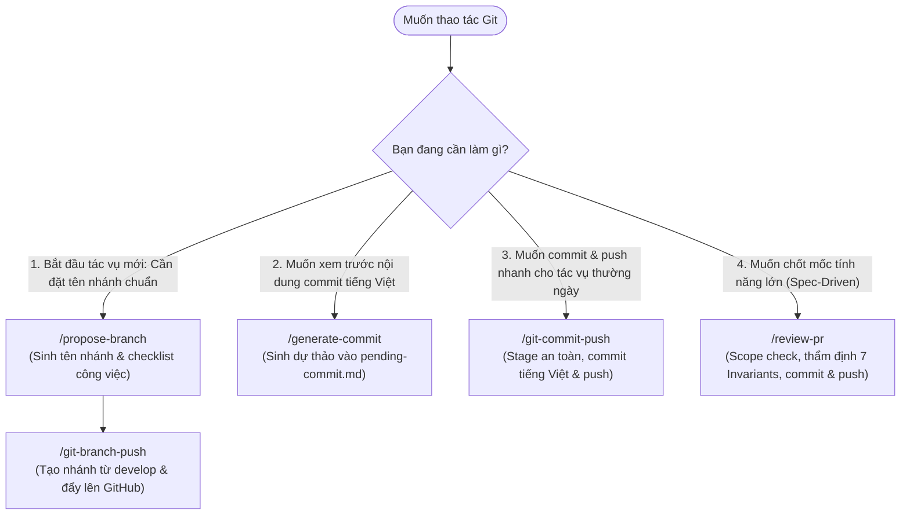

# Hướng Dẫn Tự Động Hóa Git & Quy Chuẩn Commit GDMAS (Git Automation Guide)

Tài liệu này hướng dẫn cách sử dụng bộ 5 kỹ năng quản lý Git trong hệ thống **GDMAS**: **`propose-branch`**, **`git-branch-push`**, **`generate-commit`**, **`git-commit-push`**, và **`review-pr`**.

---

## 🧭 1. Bản Đồ Lựa Chọn Kỹ Năng Git Theo Tình Huống



---

## 🌿 2. Quy Chuẩn Đặt Tên Nhánh (Branch Naming Conventions)

Mọi nhánh trong dự án GDMAS bắt buộc phải tuân theo cấu trúc:
$$\text{<type>}/\text{<slug-mo-ta>}$$

* **Nhánh cơ sở (Base Branch):** Luôn là `develop`. **Tuyệt đối không rẽ nhánh hoặc push thẳng lên `main`**.
* **Bảng phân loại tiền tố (Prefixes):**
  - `feature/` hoặc `feat/`: Tính năng mới (ví dụ: `feature/ingestion-usgs-api-test`, `feature/earthquake-clustering-service`).
  - `bugfix/` hoặc `fix/`: Sửa lỗi chức năng (ví dụ: `bugfix/web-utc-timezone-display`).
  - `hotfix/`: Sửa lỗi khẩn cấp trực tiếp.
  - `chore/`: Cập nhật cấu hình, chuẩn hóa kỹ năng, thư mục (ví dụ: `chore/skills-update-system`).
  - `docs/`: Thêm hoặc chỉnh sửa tài liệu kỹ thuật (ví dụ: `docs/guides-skills-documentation`).
  - `refactor/`: Tái cấu trúc mã nguồn mà không làm thay đổi hành vi bên ngoài.

---

## 📝 3. Quy Chuẩn Conventional Commit Tiếng Việt Chuẩn GDMAS

Mọi commit trong dự án GDMAS bắt buộc phải sử dụng **tiếng Việt có dấu, chữ thường ở tiêu đề, không chấm câu ở cuối tiêu đề**, tuân thủ định dạng:

```text
<type>(<scope>): <tiêu đề chữ thường súc tích bằng tiếng Việt>

- <Gạch đầu dòng chi tiết công việc 1>
- <Gạch đầu dòng chi tiết công việc 2>
- <Gạch đầu dòng chi tiết công việc 3>
```

### Bảng Tra Cứu Type & Scope Chuẩn

| Phạm Vi (Scope) | Ý Nghĩa Kỹ Thuật Trong GDMAS | Ví Dụ Commit Chuẩn |
| :--- | :--- | :--- |
| `feat(web)` | Giao diện React, component UI, biểu đồ 6 patterns, bản đồ | `feat(web): trực quan hóa biểu đồ chuỗi thời gian địa chấn` |
| `feat(api)` | FastAPI endpoint, SSE streaming route | `feat(api): bổ sung route streaming sự kiện địa chấn qua sse` |
| `feat(ingestion)` | Worker nạp dữ liệu USGS tại Terminal 2 | `feat(ingestion): nâng cấp chu kỳ nạp dữ liệu định kỳ 5 phút` |
| `feat(analysis)` | Worker phân tích Time-Series tại Terminal 3 | `feat(analysis): hoàn thiện thuật toán phân tích trend và mùa vụ` |
| `feat(clustering)` | Worker gom cụm DBSCAN tại Terminal 4 | `feat(clustering): bổ sung tiến trình gom cụm không gian` |
| `feat(prediction)` | Worker dự báo t+1 tại Terminal 5 | `feat(prediction): hoàn thiện mô hình dự báo tần suất địa chấn` |
| `feat(db)` | Cấu trúc CSDL, SQLAlchemy model, Alembic migration | `feat(db): bổ sung bảng lưu trữ cụm địa chấn và migration` |
| `chore(contracts)` | Đồng bộ hợp đồng dữ liệu giữa Backend và Frontend | `chore(contracts): chuẩn hóa hợp đồng dữ liệu dùng chung api-web` |
| `docs(core)` | Tài liệu quy ước chung, kiến trúc, luồng hệ thống | `docs(core): cập nhật hiến chương quy ước kỹ thuật dự án` |
| `chore(skills)` | Bộ kỹ năng AI Agent trong `.agents/skills` | `chore(skills): tái cấu trúc toàn bộ kỹ năng sang tài liệu đơn tệp` |

---

## ⚖️ 4. So Sánh `git-commit-push` vs `review-pr`: Khi Nào Dùng Cái Nào?

| Đặc tính | `git-commit-push` (Nhanh & Tinh Gọn) | `review-pr` (Chặt Chẽ & Toàn Diện) |
| :--- | :--- | :--- |
| **Ngữ cảnh sử dụng** | Tác vụ hằng ngày, sửa lỗi nhỏ, cập nhật docs | Hoàn tất tính năng lớn trong luồng Spec-Driven |
| **Cơ chế kiểm tra** | Rà soát an toàn cơ bản, loại trừ file `.env` | Scope Check so với `plan.md` + Chạy `project-review` |
| **Yêu cầu Proposal?** | **Không** yêu cầu | **Có** (kiểm tra note trong `implemented/`) |
| **Cập nhật trạng thái** | Ghi nhận commit vào Section 5 & 6 `context-memory` | Cập nhật `status.md` thành `ready_for_merge` |
| **Thời điểm chạy** | Khi người dùng yêu cầu commit nhanh | Khi người dùng muốn chốt tính năng và chuẩn bị mở PR |

---

## 🔒 5. Các Hàng Rào An Toàn Bắt Buộc (Safety Gates)

1. **Bảo vệ nhánh `main`:** Cả hai kỹ năng commit đều từ chối commit trực tiếp lên `main`. Nếu phát hiện đang ở `main`, Agent sẽ tự động tạo nhánh làm việc an toàn hoặc cảnh báo dừng lại.
2. **Loại trừ tệp bí mật (.env Guard):** Luôn tự động chạy `git restore --staged .env apps/web/.env apps/api/.env` trước khi commit để ngăn chặn lộ API key hay database password.
3. **Stage có chọn lọc:** Tuyệt đối không dùng `git add .` bừa bãi. Chỉ stage các thư mục mã nguồn và tài liệu chính thức (`apps/`, `contracts/`, `docs/`, `scripts/`, `.agents/`).
4. **Không bao giờ dùng `--no-verify`:** Nếu có pre-commit hook báo lỗi, Agent phải sửa tận gốc nguyên nhân chứ không bao giờ bỏ qua kiểm tra an toàn.

