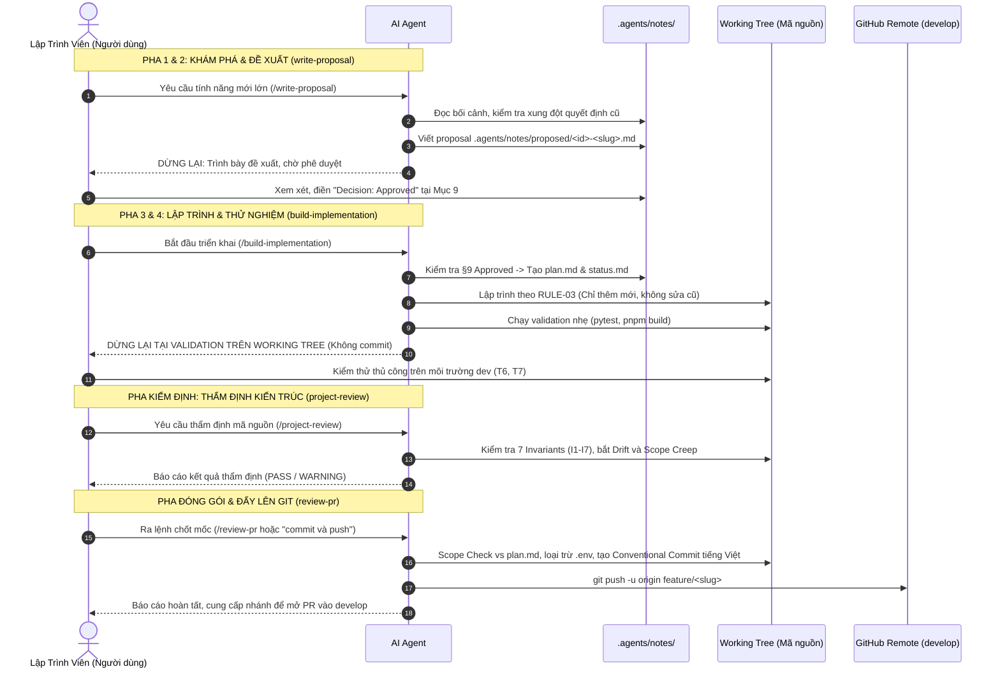

# Hướng Dẫn Luồng Phát Triển Định Hướng Đặc Tả (Spec-Driven SDLC Workflow)

Tài liệu này hướng dẫn chi tiết quy trình phát triển tính năng lớn, thay đổi kiến trúc hoặc sửa lỗi phức tạp trong hệ thống **GDMAS**, sử dụng bộ 4 kỹ năng: **`write-proposal`**, **`build-implementation`**, **`project-review`**, và **`review-pr`**.

---

## 🎯 Khi Nào Sử Dụng Luồng Này?

Áp dụng cho các công việc có **quy mô vừa đến lớn**, đòi hỏi tính kỷ luật và kiểm soát kiến trúc chặt chẽ:
- Bổ sung một Microservice Worker mới trong kiến trúc 7 Terminals (ví dụ: Clustering DBSCAN, Prediction LSTM/ARIMA).
- Thêm hoặc sửa đổi cấu trúc bảng CSDL PostgreSQL (yêu cầu tạo Alembic migration).
- Thay đổi hoặc mở rộng hợp đồng dữ liệu chuẩn giữa Backend và Frontend trong `contracts/`.
- Thêm một luồng giao diện người dùng lớn hoặc trang phân tích biểu đồ mới cho 6 patterns chuỗi thời gian.
- Tái cấu trúc (refactoring) mã nguồn có ảnh hưởng liên mô-đun.

---

## 🧭 Vòng Đời 4 Pha Phát Triển (The 4-Phase Lifecycle)



---

## 🛠️ Hướng Dẫn Thao Tác Chi Tiết Từng Kỹ Năng

### 1. `write-proposal` (Pha 1 & 2: Soạn Thảo Đề Xuất)
* **Mục tiêu:** Khảo sát toàn diện, ngăn chặn xung đột kiến trúc và đưa ra bản thiết kế chi tiết trước khi viết bất kỳ dòng code nào.
* **Đặc tính:** **Read-Only tuyệt đối**. Không chạm vào code.
* **Cách kích hoạt:**
  ```text
  /write-proposal xây dựng tiến trình gom cụm không gian địa chấn bằng thuật toán DBSCAN tại Terminal 4
  ```
* **Kết quả đầu ra:**
  - Tệp đề xuất mới: [`.agents/notes/proposed/<id>-<slug>.md`](file:///d:/KHDLKPDL/GDMAS/.agents/notes/proposed/)
  - Cập nhật dòng index trong [`.agents/notes/README.md`](file:///d:/KHDLKPDL/GDMAS/.agents/notes/README.md).
* **Điểm dừng cứng (Hard Stop):**
  - Agent **dừng lại ngay sau khi viết xong proposal**.
  - Bạn mở tệp proposal lên, xem xét các mục: Mục tiêu, Kiến trúc 7 Terminals, 6 Patterns, In-Scope / Out-of-Scope.
  - Nếu đồng ý, chỉnh sửa Mục 9 thành:
    ```markdown
    ## 9. Human Review
    - **Reviewer:** <Tên của bạn>
    - **Ngày duyệt:** <YYYY-MM-DD>
    - **Quyết định:** Approved
    ```

---

### 2. `build-implementation` (Pha 3 & 4: Kế Hoạch & Lập Trình)
* **Mục tiêu:** Chuyển đổi bản đề xuất đã duyệt thành code thực tế theo đúng phạm vi.
* **Đặc tính:** Tuân thủ nguyên tắc Open-Closed (RULE-03), duy trì nhật ký tiến độ sống.
* **Cách kích hoạt:**
  ```text
  /build-implementation triển khai proposal 2026-11-08-001-dbscan-clustering
  ```
* **Các bước Agent tự động thực hiện:**
  1. Kiểm tra Mục 9 trong proposal có đúng là `Approved` hay không (nếu chưa duyệt sẽ dừng lại và nhắc nhở).
  2. Tạo thư mục [`.agents/notes/implemented/<id>-<slug>/`](file:///d:/KHDLKPDL/GDMAS/.agents/notes/implemented/) chứa `plan.md` và `status.md`.
  3. Tạo nhánh tính năng an toàn `feature/<slug>` từ `develop`.
  4. Lập trình theo 4 mô hình mở rộng GDMAS (tạo file `runner.py` riêng, route mới, migration mới, component mới).
  5. Chạy validation nhẹ: `uv run pytest` và `pnpm build`.
* **Điểm dừng cứng (Hard Stop):**
  - **DỪNG LẠI Ở TRẠNG THÁI `validation` TRÊN WORKING TREE.**
  - **Tuyệt đối không commit hay push.** Toàn bộ mã nguồn nằm nguyên trên máy để bạn mở trình duyệt hoặc bật terminal kiểm tra trực tiếp.

---

### 3. `project-review` (Thẩm Định Chuyên Sâu Đa Tầng)
* **Mục tiêu:** Đóng vai trò lớp kiểm định kiến trúc độc lập trước khi mã nguồn được đưa vào lịch sử Git.
* **Cách kích hoạt:**
  ```text
  /project-review thẩm định các thay đổi vừa code trên nhánh hiện tại
  ```
* **Nội dung kiểm tra:**
  - **7 Bất biến kiến trúc GDMAS (I1 - I7):**
    * *I1:* Có lỡ nhúng worker vào `main.py` không?
    * *I2:* Có xóa file cũ hay phá vỡ hàm tiện ích cũ không?
    * *I3:* Hợp đồng dữ liệu có chuẩn không, thời gian có đúng UTC và tọa độ WGS84 không?
    * *I4:* Có sửa file migration Alembic cũ không?
    * *I5:* Component mới có đáp ứng đúng 6 Patterns chuỗi thời gian không?
    * *I6:* Có để lộ bí mật hay stage file `.env` không?
    * *I7:* Test cases cũ có được bảo toàn không?
  - **Kiểm tra lan phạm vi (Scope Mismatch):** So sánh tệp đã sửa với danh mục `In Scope` trong `plan.md`.
  - **Kiểm tra độ lệch tài liệu (Drift Detection):** Bắt lỗi khi code đã đổi mà tài liệu trong `docs/` chưa cập nhật.

---

### 4. `review-pr` (Đóng Gói Git, Scope Check & Đẩy Lên GitHub)
* **Mục tiêu:** Chốt mốc hoàn thành công việc sau khi bạn đã kiểm thử thực tế và hài lòng.
* **Đặc tính:** **Chỉ chạy khi có lệnh chỉ định riêng biệt**. Không bao giờ tự động nối tiếp sau khi code.
* **Cách kích hoạt:**
  ```text
  /review-pr tôi đã test xong, hãy đóng gói và đẩy nhánh này lên GitHub
  ```
* **Các bước Agent tự động thực hiện:**
  1. Chạy Scope Check cuối cùng và tự động gọi `project-review`.
  2. Gỡ bỏ mọi tệp cấu hình `.env` khỏi Staging để bảo vệ bí mật.
  3. Tạo Conventional Commit tiếng Việt có dấu chuẩn GDMAS (Header chuẩn `feat(...)`, Body gạch đầu dòng rõ ràng).
  4. Đẩy nhánh lên GitHub: `git push -u origin feature/<slug>`.
  5. Cập nhật `status.md` thành `ready_for_merge` và báo cáo hoàn tất.

