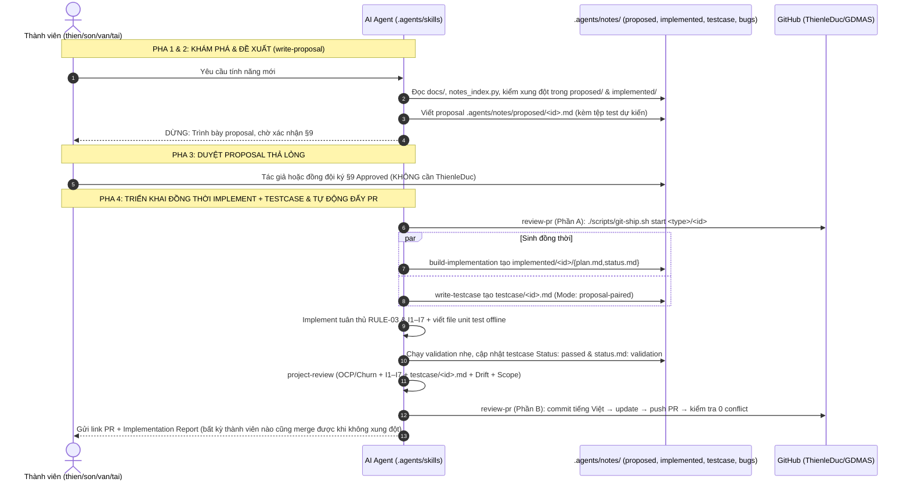
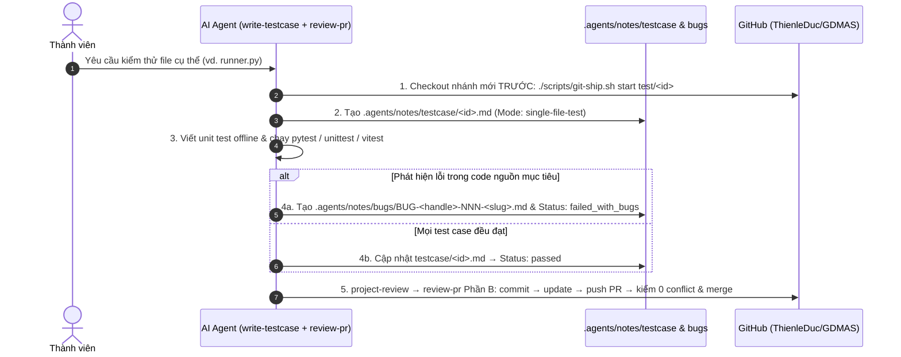

# Luồng Phát Triển Định Hướng Đặc Tả & Kiểm Thử (Spec-Driven & Single-File Test)

Tài liệu này hướng dẫn quy trình phát triển tính năng (> 1 file), sửa bug phức tạp và kiểm thử chuyên sâu trong **GDMAS**, sử dụng bộ **5 kỹ năng cốt lõi** tại `.agents/skills/`: **`write-proposal`**, **`build-implementation`**, **`write-testcase`**, **`project-review`**, và **`review-pr`**.

---

## 🎯 Khi Nào Sử Dụng Luồng Này?

1. **Luồng Spec-Driven (Proposal `Approved` → Sinh đồng thời Implement + Testcase):** Áp dụng cho mọi công việc **lớn hơn sửa 1 dòng / 1 file**:
   - Bổ sung hoặc nâng cấp Worker trong mô hình 7 Terminals (`ingestion`, `analysis`, `clustering`, `prediction`).
   - Thêm bảng CSDL PostgreSQL / tạo Alembic migration mới.
   - Mở rộng hợp đồng dữ liệu (`contracts/`) hoặc endpoint REST/SSE mới.
   - Thêm view / biểu đồ thuộc 6 Patterns chuỗi thời gian.
   - Sửa bug phức tạp ảnh hưởng nhiều module.
2. **Luồng Kiểm thử riêng 1 file (`Mode: single-file-test`):** Áp dụng khi người dùng yêu cầu viết unit test cho **1 file cụ thể** → rẽ nhánh `test/<id>` trước, chạy test offline, ghi lỗi (nếu có) vào `.agents/notes/bugs/` rồi đẩy PR.

---

## 🧭 Vòng Đời Tự Động Hóa 5 Pha (Spec-Driven)

---

## 🧪 Vòng Đời Kiểm Thử Riêng 1 File (`single-file-test`)

---

## 🛠️ Chi Tiết 5 Kỹ Năng Cốt Lõi

### 1. `write-proposal` (`.agents/skills/write-proposal/SKILL.md`)
- Đọc nhanh `AGENTS.md`, `docs/coding-rules.md`, `docs/quyuocchung.md`.
- Chạy `python3 scripts/notes_index.py` & `grep` trong `.agents/notes/proposed/` + `implemented/` để kiểm xung đột (kể cả `Scope of Rejection`). Nếu gặp `CONFLICT DETECTED`, ghi nhận để **gom hỏi cuối phiên** thay vì cắt ngang thao tác an toàn khác.
- Tự động sinh ID `yyyy-mm-dd-<slug>-<handle>` bằng Slug Engine (`<handle>` từ `./scripts/git-ship.sh me`).
- Viết `.agents/notes/proposed/<id>.md` từ `_TEMPLATE.md` (khai báo rõ `Architecture Impact` và tệp test dự kiến ở §8).
- **Dừng chờ xác nhận §9 (thả lỏng):** bất kỳ thành viên nào trong `.agents/team.md`, kể cả tác giả tự duyệt hay xác nhận rõ trong chat, đều mở khóa bước tiếp theo — **không cần chờ `ThienleDuc`**.

### 2. `build-implementation` (`.agents/skills/build-implementation/SKILL.md`)
- Kiểm tra `§9` đã có `Decision: Approved` + `Reviewer` hợp lệ từ `.agents/team.md`.
- Tự động gọi `review-pr` Phần A (`./scripts/git-ship.sh start <type>/<id>`) trước khi sửa code.
- **Khởi tạo đồng thời** `.agents/notes/implemented/<id>/{plan.md,status.md}` (khai báo cả tệp code và tệp test trong `In Scope`) **VÀ** gọi `write-testcase` tạo `.agents/notes/testcase/<id>.md` từ [`.agents/notes/testcase/_TEMPLATE.md`](../../../.agents/notes/testcase/_TEMPLATE.md) (`Mode: proposal-paired`).
- Lập trình theo RULE-03 & I1–I7, giữ `status.md` sống; không hỏi xin phép cho mỗi thao tác thêm/sửa file an toàn.
- Chạy validation nhẹ (`uv run pytest`, `uv run ruff check .`, `pnpm build`, `notes_index.py --check`), cập nhật `testcase/<id>.md`, đặt `Status: validation` rồi **tự chuyển sang `review-pr` Phần B**.

### 3. `write-testcase` (`.agents/skills/write-testcase/SKILL.md`)
- Chế độ 1 (`proposal-paired`): Sinh đồng thời với `implemented/<id>/`, lập kịch bản kiểm thử từ `proposal` + code triển khai, tạo unit/integration test chạy **offline 100%** (mock USGS/DB ngoài) và điền kết quả chạy thật vào `.agents/notes/testcase/<id>.md`.
- Chế độ 2 (`single-file-test`): Khi kiểm thử riêng 1 file cụ thể: **rẽ nhánh `test/<id>` trước**, viết unit test offline cho file đó, chạy kiểm thử; nếu phát hiện lỗi, tạo bug report trong `.agents/notes/bugs/BUG-<handle>-NNN-<slug>.md`, gắn `Status: failed_with_bugs` và `Related Bugs:` rồi bàn giao `review-pr` Phần B.

### 4. `project-review` (`.agents/skills/project-review/SKILL.md`)
- Kiểm tra 5 lớp trước khi commit/push: (1) Nhất quán quyết định cũ; (2) OCP / Không xóa file trái phép / Bảo vệ tệp lõi / Churn; (3) 7 Bất biến I1–I7 (bao gồm kiểm chứng đã tạo đủ `.agents/notes/testcase/<id>.md`, mã test offline & log `.agents/notes/bugs/` nếu test fail); (4) Drift tài liệu; (5) Scope Creep so với `plan.md`.

### 5. `review-pr` (`.agents/skills/review-pr/SKILL.md`)
- Chạy `git-ship.sh scope`, bảo vệ `.env`/secret, gọi `project-review`, tổng hợp Conventional Commit tiếng Việt qua bảng Type/Scope, chạy `./scripts/git-ship.sh update` (merge-forward `develop`) và `./scripts/git-ship.sh push`.
- Chạy `./scripts/git-ship.sh merge --dry-run` (hoặc `merge`): **bắt buộc kiểm tra không xung đột (`0 conflicts`)**, không bắt buộc riêng `ThienleDuc` — nếu `CONFLICT` thì chặn merge; nếu **0 conflict** thì cho phép merge và chạy `./scripts/git-ship.sh sync`.
- **Gom câu hỏi nguy hiểm cuối phiên:** Mọi thao tác xóa file/folder hoặc conflict (nếu xuất hiện) được giữ nguyên và gom thành 1 danh sách câu hỏi cuối phiên.
