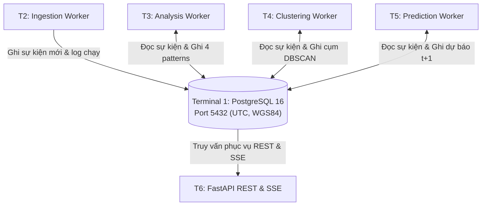

# [ĐẶC TẢ CHỨC NĂNG: CƠ SỞ DỮ LIỆU & LƯU TRỮ TẬP TRUNG]

- **Mã chức năng:** FEAT-01
- **Mã định danh (Slug):** `01-database-storage`
- **Terminal đảm nhiệm:** Terminal 1 - Database Service (PostgreSQL 16 Alpine)
- **Trạng thái:** `In-Progress`
- **Mức độ ưu tiên:** `P0 (Bắt buộc - Xương sống hệ thống)`
- **Tài liệu tham chiếu:**
  * `docs/yeucaubatbuoc.md` (§1. Sơ đồ kiến trúc, §4. Buổi demo)
  * `docs/architecture/ERD.md` (Toàn bộ thiết kế 7 bảng dữ liệu)
  * `docs/architecture/SAD.md` (§4.2. Database Layer)

---

## 1. Mục Tiêu & Bối Cảnh Nghiệp Vụ (Objectives & Scope)

### 1.1. Bài toán giải quyết
Hệ thống GDMAS hoạt động theo mô hình Microservices/Modular phân tán độc lập trên 7 Terminals nhưng **chia sẻ dữ liệu tập trung qua một Cơ sở Dữ liệu Quan hệ duy nhất**. Chức năng này cung cấp:
- Hệ quản trị CSDL PostgreSQL 16 Alpine container hóa qua Docker.
- Cấu trúc 7 bảng dữ liệu chuẩn hóa, quan hệ toàn vẹn khóa ngoại (FK) và đánh chỉ mục (Index) tối ưu.
- Cơ chế quản lý lược đồ tự động qua Alembic Migrations.
- Tập dữ liệu mồi (Seed Data) ban đầu phục vụ phát triển cục bộ và kịch bản demo hội đồng.

### 1.2. Phạm vi chức năng (Scope Boundaries)
- **Trong phạm vi (In-Scope):**
  * Khởi tạo và vận hành PostgreSQL 16 trên Port `5432` qua `docker-compose.yml`.
  * Khởi tạo 7 bảng dữ liệu: `earthquake_events`, `analysis_results`, `clustering_results`, `clustering_event_mapping`, `prediction_results`, `classification_results`, `service_runs`.
  * Đảm bảo mọi cột thời gian lưu trữ kiểu `TIMESTAMPTZ` (UTC).
  * Đảm bảo tọa độ không gian lưu trữ hệ chuẩn WGS84 (`latitude`, `longitude`, `depth_km`).
  * Cơ chế Upsert (khử trùng lặp sự kiện dựa trên `source_event_id`).
- **Ngoài phạm vi (Out-of-Scope):**
  * Không chứa logic thu thập dữ liệu (thuộc T2).
  * Không chứa logic tính toán phân tích, dự báo (thuộc T3, T4, T5).
  * Không mở cổng truy cập public ra ngoài Internet (chỉ giao tiếp trong mạng nội bộ docker/local).

---

## 2. Vị Trí Kiến Trúc & Quan Hệ Phụ Thuộc (System Context & Dependencies)

### 2.1. Sơ đồ tương tác (Context Flow)


### 2.2. Quan hệ phụ thuộc (Dependencies)
- **Dịch vụ phụ thuộc (Upstream):** Docker Daemon / Docker Desktop của máy chủ lưu trữ.
- **Dịch vụ tiêu thụ (Downstream):** Tất cả các Terminals còn lại (T2, T3, T4, T5, T6) đều phụ thuộc trực tiếp vào CSDL T1.

---

## 3. Hợp Đồng Dữ Liệu & Giao Thức (Data Contracts & Schemas)

### 3.1. Danh mục 7 Bảng Dữ Liệu (PostgreSQL Schemas)

1. **`earthquake_events` (Sự kiện địa chấn gốc):**
   * `id`: `BIGSERIAL PRIMARY KEY`
   * `source`: `VARCHAR(50)` (mặc định `'usgs'`)
   * `source_event_id`: `VARCHAR(100) UNIQUE NOT NULL` (Khóa định danh USGS, ví dụ: `us7000abcd`)
   * `event_time`: `TIMESTAMPTZ NOT NULL` (Thời điểm xảy ra địa chấn theo giờ UTC)
   * `latitude`: `DOUBLE PRECISION NOT NULL` ([-90.0, 90.0])
   * `longitude`: `DOUBLE PRECISION NOT NULL` ([-180.0, 180.0])
   * `depth_km`: `DOUBLE PRECISION NOT NULL` (Độ sâu chấn tiêu tính bằng km)
   * `magnitude`: `DOUBLE PRECISION NOT NULL` (Độ lớn Richter)
   * `magnitude_type`: `VARCHAR(20)` (mww, mb, ml, v.v.)
   * `place`: `TEXT` (Mô tả vị trí địa lý)
   * `source_url`: `TEXT` (Link chi tiết sự kiện trên USGS)
   * `raw_data`: `JSONB` (GeoJSON gốc phục vụ kiểm tra/mở rộng)
   * `ingested_at`: `TIMESTAMPTZ DEFAULT CURRENT_TIMESTAMP`

2. **`analysis_results` (Kết quả phân tích 4 Patterns T3):**
   * `id`: `BIGSERIAL PRIMARY KEY`
   * `analysis_type`: `VARCHAR(50) NOT NULL` (`daily_aggregate`, `weekly_aggregate`, `trend_analysis`, `seasonality`, `correlation_matrix`)
   * `time_interval`: `VARCHAR(20)` (`day`, `week`, `month`)
   * `period_start`: `TIMESTAMPTZ NOT NULL`
   * `period_end`: `TIMESTAMPTZ NOT NULL`
   * `metrics_data`: `JSONB NOT NULL` (Chứa chuỗi số liệu tính toán)
   * `calculated_at`: `TIMESTAMPTZ NOT NULL`
   * `service_run_id`: `BIGINT REFERENCES service_runs(id)`

3. **`clustering_results` (Kết quả gom cụm không gian T4):**
   * `id`: `BIGSERIAL PRIMARY KEY`
   * `algorithm`: `VARCHAR(50) NOT NULL` (`dbscan`, `kmeans`)
   * `parameters`: `JSONB NOT NULL` (ví dụ: `{"eps": 1.5, "min_samples": 5}`)
   * `total_clusters`: `INTEGER NOT NULL`
   * `noise_count`: `INTEGER NOT NULL`
   * `summary_clusters`: `JSONB NOT NULL` (Tọa độ tâm cụm, bán kính, số sự kiện)
   * `calculated_at`: `TIMESTAMPTZ NOT NULL`
   * `service_run_id`: `BIGINT REFERENCES service_runs(id)`

4. **`clustering_event_mapping` (Liên kết Sự kiện - Cụm):**
   * `id`: `BIGSERIAL PRIMARY KEY`
   * `cluster_result_id`: `BIGINT NOT NULL REFERENCES clustering_results(id) ON DELETE CASCADE`
   * `event_id`: `BIGINT NOT NULL REFERENCES earthquake_events(id) ON DELETE CASCADE`
   * `cluster_label`: `INTEGER NOT NULL` (-1: nhiễu/noise, >=0: số thứ tự cụm)

5. **`prediction_results` (Kết quả dự báo định lượng $t+1$):**
   * `id`: `BIGSERIAL PRIMARY KEY`
   * `target_date`: `DATE NOT NULL` (Ngày mục tiêu $t+1$)
   * `metric_name`: `VARCHAR(50) NOT NULL` (ví dụ: `daily_earthquake_count`)
   * `predicted_value`: `DOUBLE PRECISION NOT NULL`
   * `lower_bound`: `DOUBLE PRECISION NOT NULL` (Khoảng tin cậy dưới 95%)
   * `upper_bound`: `DOUBLE PRECISION NOT NULL` (Khoảng tin cậy trên 95%)
   * `actual_value`: `DOUBLE PRECISION` (Giá trị thực tế cập nhật sau khi qua ngày)
   * `model_name`: `VARCHAR(100) NOT NULL` (`arima`, `linear_regression`, `lstm`)
   * `evaluation_metrics`: `JSONB` (MAE, RMSE, MAPE)
   * `generated_at`: `TIMESTAMPTZ NOT NULL`

6. **`classification_results` (Kết quả phân loại mức độ rủi ro $t+1$):**
   * `id`: `BIGSERIAL PRIMARY KEY`
   * `target_date`: `DATE NOT NULL`
   * `risk_level`: `VARCHAR(20) NOT NULL` (`low`, `moderate`, `high`, `extreme`)
   * `confidence_score`: `DOUBLE PRECISION NOT NULL` ([0.0, 1.0])
   * `features_used`: `JSONB` (Các đặc trưng đầu vào phục vụ phân loại)
   * `model_name`: `VARCHAR(100) NOT NULL` (`random_forest`, `gradient_boosting`)
   * `generated_at`: `TIMESTAMPTZ NOT NULL`

7. **`service_runs` (Sổ nhật ký thực thi các Services):**
   * `id`: `BIGSERIAL PRIMARY KEY`
   * `service_name`: `VARCHAR(50) NOT NULL` (`ingestion`, `analysis`, `clustering`, `prediction`)
   * `started_at`: `TIMESTAMPTZ NOT NULL`
   * `completed_at`: `TIMESTAMPTZ`
   * `status`: `VARCHAR(20) NOT NULL` (`running`, `success`, `failed`)
   * `records_processed`: `INTEGER DEFAULT 0`
   * `error_message`: `TEXT`

---

## 4. Logic Xử Lý Cốt Lõi & Bất Biến Dữ Liệu

### 4.1. Cơ chế Upsert Khử Trùng Lặp (Deduplication)
```sql
INSERT INTO earthquake_events (source, source_event_id, event_time, latitude, longitude, depth_km, magnitude, place, raw_data, ingested_at)
VALUES (...)
ON CONFLICT (source_event_id) DO UPDATE SET
    magnitude = EXCLUDED.magnitude,
    depth_km = EXCLUDED.depth_km,
    latitude = EXCLUDED.latitude,
    longitude = EXCLUDED.longitude,
    place = EXCLUDED.place,
    raw_data = EXCLUDED.raw_data,
    ingested_at = CURRENT_TIMESTAMP;
```

### 4.2. Chiến lược Đánh Chỉ Mục (Indexing Strategy)
- `idx_earthquake_events_time`: B-Tree trên `event_time DESC` (Tối ưu truy vấn chuỗi thời gian).
- `idx_earthquake_events_mag`: B-Tree trên `magnitude` (Tối ưu bộ lọc độ lớn).
- `idx_earthquake_events_coords`: B-Tree trên `(latitude, longitude)` (Tối ưu truy vấn bản đồ).
- `idx_analysis_results_lookup`: B-Tree trên `(analysis_type, period_start, period_end)`.
- `idx_prediction_target_date`: B-Tree trên `target_date DESC`.

---

## 5. Bất Biến Kiến Trúc & Ràng Buộc Kỹ Thuật (Architecture Invariants)

- **I3 & I4 - Chuẩn Hóa Múi Giờ & Migration:**
  * Toàn bộ thời gian lưu trữ dạng UTC.
  * Mọi thay đổi bảng phải sinh file migration mới bằng Alembic (`alembic revision --autogenerate`), **cấm sửa đổi các migration cũ**.
- **Kết nối tập trung:** Cung cấp connection pool qua `apps/api/src/gdmas/db/connection.py` và khai báo ORM declarative base qua `base.py`.
- **Khởi chạy container:** `docker compose up -d postgres`.

---

## 6. Tiêu Chí Nghiệm Thu & Kiểm Thử (Acceptance Criteria)

- [ ] **AC-1:** Container PostgreSQL 16 Alpine khởi động thành công trên port `5432`, pass healthcheck trong `docker-compose.yml`.
- [ ] **AC-2:** Lệnh `uv run alembic upgrade head` áp dụng thành công toàn bộ 7 bảng dữ liệu và chỉ mục.
- [ ] **AC-3:** Chèn thử sự kiện trùng `source_event_id` không gây lỗi `UniqueViolation` mà kích hoạt Upsert cập nhật dữ liệu.
- [ ] **AC-4:** Truy vấn trả về thời gian có đúng định dạng múi giờ UTC (`+00:00` hoặc `Z`).

---

## 7. Kế Hoạch Phân Rã Nhiệm Vụ (Task Breakdown Checklist)

### Pha 1: Cấu hình Container & Môi trường
- [x] Tạo file `docker-compose.yml` định nghĩa service `postgres` (PostgreSQL 16 Alpine, volume mount).
- [x] Thiết lập biến môi trường kết nối trong `.env.example`.

### Pha 2: Khai báo ORM Models & Migrations
- [ ] Khai báo 7 SQLAlchemy Models trong `apps/api/src/gdmas/models/`.
- [ ] Cấu hình Alembic `env.py` trỏ đúng vào `Base.metadata`.
- [ ] Khởi tạo bản migration đầu tiên và kiểm tra tính toàn vẹn `alembic upgrade head`.

### Pha 3: Dữ Liệu Seed & Kịch Bản Demo
- [ ] Viết script nạp dữ liệu mẫu ban đầu (`scripts/seed-data.py` hoặc SQL dump).
- [ ] Kiểm thử kịch bản TRUNCATE và phục hồi dữ liệu phục vụ buổi demo giảng viên.

