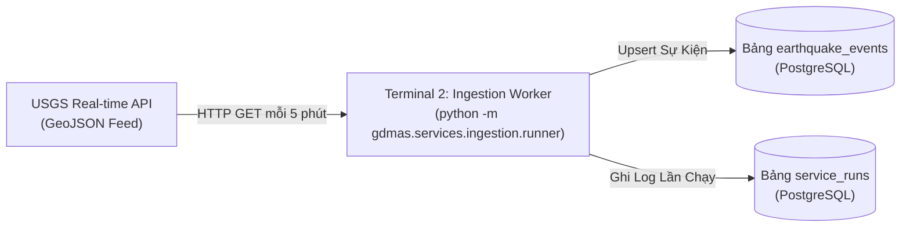

# [ĐẶC TẢ CHỨC NĂNG: THU THẬP & NẠP DỮ LIỆU USGS]

- **Mã chức năng:** FEAT-02
- **Mã định danh (Slug):** `02-usgs-ingestion`
- **Terminal đảm nhiệm:** Terminal 2 - Ingestion Worker Service (`gdmas.services.ingestion.runner`)
- **Trạng thái:** `In-Progress`
- **Mức độ ưu tiên:** `P0 (Bắt buộc - Dòng chảy dữ liệu đầu nguồn)`
- **Tài liệu tham chiếu:**
  * `docs/yeucaubatbuoc.md` (§1. Sơ đồ kiến trúc, chu kỳ 5 phút)
  * `docs/architecture/SAD.md` (§3. Data Ingestion Service)
  * `docs/architecture/ERD.md` (§2.1. `earthquake_events`, §2.6. `service_runs`)

---

## 1. Mục Tiêu & Bối Cảnh Nghiệp Vụ (Objectives & Scope)

### 1.1. Bài toán giải quyết
Hệ thống GDMAS yêu cầu nguồn dữ liệu **theo chuỗi thời gian liên tục và có cập nhật tự động**. Chức năng này đóng vai trò là "máy bơm dữ liệu" (Data Pump):
- Kết nối tới API chính thức của Cục Khảo sát Địa chất Hoa Kỳ (USGS - United States Geological Survey).
- Chạy định kỳ chính xác **5 phút một lần** để thu thập dữ liệu các trận động đất vừa xảy ra trên phạm vi toàn cầu.
- Phân tích bóc tách định dạng GeoJSON chuẩn, chuẩn hóa múi giờ UTC và hệ tọa độ WGS84.
- Khử trùng lặp (Deduplication) để tránh chèn lặp các sự kiện đã lưu, đồng thời cập nhật các sự kiện có hiệu chỉnh độ lớn.
- Ghi nhật ký thực thi vào bảng `service_runs` để phục vụ giám sát vận hành.

### 1.2. Phạm vi chức năng (Scope Boundaries)
- **Trong phạm vi (In-Scope):**
  * HTTP Client gọi API USGS endpoint: `https://earthquake.usgs.gov/earthquakes/feed/v1.0/summary/all_hour.geojson` (hoặc `all_day.geojson`).
  * Bộ lập lịch (Scheduler) kích hoạt chu kỳ 5 phút/lần.
  * Parser chuyển đổi GeoJSON Feature thành đối tượng Pydantic `EarthquakeEventCreate`.
  * Thực hiện ghi dữ liệu an toàn vào bảng `earthquake_events` qua SQLAlchemy session.
  * Ghi nhận lịch sử chạy (thành công/thất bại, số bản ghi xử lý) vào `service_runs`.
- **Ngoài phạm vi (Out-of-Scope):**
  * Không thực hiện phân tích thống kê hay tính toán xu hướng (thuộc T3).
  * Không phân cụm hay dự báo (thuộc T4, T5).
  * Không phục vụ trực tiếp request của người dùng (thuộc T6).

---

## 2. Vị Trí Kiến Trúc & Quan Hệ Phụ Thuộc (System Context & Dependencies)

### 2.1. Sơ đồ tương tác (Context Flow)


### 2.2. Quan hệ phụ thuộc (Dependencies)
- **Dịch vụ phụ thuộc (Upstream):** 
  * USGS GeoJSON Feed (Cần kết nối Internet).
  * CSDL PostgreSQL T1 (Cần bảng `earthquake_events` và `service_runs` sẵn sàng).
- **Dịch vụ tiêu thụ (Downstream):** 
  * T3 (Analysis), T4 (Clustering), T5 (Prediction) đều đọc trực tiếp từ bảng `earthquake_events` do T2 nạp vào.

---

## 3. Hợp Đồng Dữ Liệu & Giao Thức (Data Contracts & Schemas)

### 3.1. Dữ liệu đầu vào (Inputs - Từ USGS API)
- **URL Endpoint:** `https://earthquake.usgs.gov/earthquakes/feed/v1.0/summary/all_hour.geojson`
- **Cấu trúc GeoJSON Feature tiêu biểu:**
  ```json
  {
    "type": "Feature",
    "properties": {
      "mag": 4.5,
      "place": "12km SSW of Guayanilla, Puerto Rico",
      "time": 1700000000000,
      "updated": 1700000500000,
      "url": "https://earthquake.usgs.gov/earthquakes/event/pr2023...",
      "magType": "md"
    },
    "geometry": {
      "type": "Point",
      "coordinates": [-66.83, 17.96, 12.5]
    },
    "id": "pr2023321001"
  }
  ```

### 3.2. Dữ liệu đầu ra (Outputs - Lưu vào PostgreSQL)
- **Bảng `earthquake_events`:**
  * `source_event_id` = `feature["id"]`
  * `event_time` = chuyển đổi `properties["time"]` (epoch ms) sang `datetime UTC`
  * `latitude` = `geometry["coordinates"][1]`
  * `longitude` = `geometry["coordinates"][0]`
  * `depth_km` = `geometry["coordinates"][2]`
  * `magnitude` = `properties["mag"]`
  * `place` = `properties["place"]`
  * `raw_data` = toàn bộ GeoJSON feature

---

## 4. Logic Xử Lý Cốt Lõi & Thuật Toán (Core Processing Logic)

### 4.1. Quy trình xử lý từng bước (Step-by-Step Pipeline)
1. **Khởi động chu kỳ:** Worker thức dậy mỗi 300 giây (5 phút). Tạo bản ghi `service_runs` trạng thái `running`.
2. **Gọi HTTP Request:** Sử dụng thư viện `httpx` hoặc `requests` với timeout 10 giây.
3. **Phân tích cú pháp:** Duyệt qua mảng `features[]`. Với mỗi phần tử:
   - Kiểm tra tính hợp lệ: `magnitude` không null, tọa độ nằm trong dải hợp lệ (lat: [-90, 90], lon: [-180, 180]).
   - Chuyển đổi timestamp ms sang `datetime` với múi giờ `timezone.utc`.
4. **Ghi vào Cơ sở dữ liệu:** Thực hiện bulk upsert vào `earthquake_events` dựa trên khóa duy nhất `source_event_id`.
5. **Hoàn tất chu kỳ:** Cập nhật bản ghi `service_runs` sang `status = 'success'`, đếm tổng số bản ghi đã nạp (`records_processed`), và chuyển sang trạng thái ngủ (sleep) 300 giây.

### 4.2. Xử lý lỗi & Tự phục hồi (Resilience)
- **Mất mạng Internet:** Bắt ngoại lệ `httpx.RequestError`, ghi log lỗi, cập nhật `service_runs` thành `status = 'failed'`, ngủ 30 giây rồi thử lại thay vì làm sập toàn bộ tiến trình.
- **CSDL tạm thời mất kết nối:** Tự động retry tối đa 3 lần với cơ chế exponential backoff (1s, 2s, 4s).

---

## 5. Bất Biến Kiến Trúc & Ràng Buộc Kỹ Thuật (Architecture Invariants)

- **Độc lập Terminal (I1):** Tiến trình phải được chạy độc lập trên Terminal 2 bằng lệnh:
  ```powershell
  python -m gdmas.services.ingestion.runner
  ```
  *(Tuyệt đối không nhúng worker chạy ngầm bên trong `apps/api/src/gdmas/main.py`).*
- **Chu kỳ thực thi:** Cố định **5 phút / lần**, không phụ thuộc vào request của người dùng từ Web.
- **Công nghệ sử dụng:** Python 3.12, `httpx`, SQLAlchemy 2.0, Pydantic v2.

---

## 6. Tiêu Chí Nghiệm Thu & Kiểm Thử (Acceptance Criteria)

- [ ] **AC-1:** Lệnh `python -m gdmas.services.ingestion.runner` khởi động bình thường trên Terminal 2, cào được dữ liệu thực tế từ USGS API.
- [ ] **AC-2:** Chạy 2 chu kỳ liên tiếp không gây lỗi trùng lặp khóa chính `source_event_id` (cơ chế Upsert hoạt động chính xác).
- [ ] **AC-3:** Toàn bộ bản ghi lưu vào `earthquake_events` có `event_time` mang múi giờ UTC chính xác.
- [ ] **AC-4:** Mỗi lần chạy đều tạo một dòng nhật ký tương ứng trong bảng `service_runs`.

---

## 7. Kế Hoạch Phân Rã Nhiệm Vụ (Task Breakdown Checklist)

### Pha 1: Xây Dựng USGS Client & Parser
- [x] Tạo file client gọi API USGS (`services/ingestion/client.py`).
- [x] Khai báo Pydantic Schema cho USGS GeoJSON payload.

### Pha 2: Xây Dựng Pipeline & Runner
- [x] Tạo logic nạp và upsert vào CSDL (`services/ingestion/pipeline.py`).
- [x] Tạo file khởi chạy vòng lặp 5 phút (`services/ingestion/runner.py`).

### Pha 3: Tối Ưu Hóa & Kiểm Thử
- [ ] Viết test mock API USGS cho trường hợp rỗng, lỗi mạng và dữ liệu bất thường.
- [ ] Thẩm định qua `/source-guard` bảo đảm tuân thủ RULE-03.
- [ ] Kiểm thử tích hợp chạy thử liên tục 15 phút (3 chu kỳ) trên Terminal 2.

