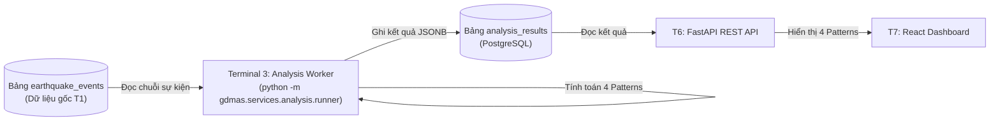

# [ĐẶC TẢ CHỨC NĂNG: PHÂN TÍCH CHUỖI THỜI GIAN (PATTERNS 1 - 4)]

- **Mã chức năng:** FEAT-03
- **Mã định danh (Slug):** `03-timeseries-analysis`
- **Terminal đảm nhiệm:** Terminal 3 - Analysis Worker Service (`gdmas.services.analysis.runner`)
- **Trạng thái:** `Planning`
- **Mức độ ưu tiên:** `P0 (Bắt buộc đồ án - Đạt 3.0 điểm độ bao phủ patterns)`
- **Tài liệu tham chiếu:**
  * `docs/yeucaubatbuoc.md` (§2. Các patterns phân tích bắt buộc, STT 1, 2, 3, 4)
  * `docs/architecture/SAD.md` (§4.4. Time-Series Analysis Service)
  * `docs/architecture/ERD.md` (§2.2. Bảng `analysis_results`)

---

## 1. Mục Tiêu & Bối Cảnh Nghiệp Vụ (Objectives & Scope)

### 1.1. Bài toán giải quyết
Hệ thống GDMAS yêu cầu các phân tích chuyên sâu về dữ liệu chuỗi thời gian địa chấn để giúp nhà nghiên cứu và người dùng nắm bắt quy luật biến thiên của các trận động đất. Chức năng này chịu trách nhiệm:
- Đọc dữ liệu sự kiện lịch sử từ bảng `earthquake_events`.
- Thực thi định kỳ **5 phút một lần** để tính toán **4 Patterns phân tích cốt lõi**:
  1. **Pattern 1 (Biểu diễn theo thời gian):** Tổng hợp số liệu theo Ngày, Tuần, Tháng phục vụ vẽ 3 loại biểu đồ (Line chart, Scatter plot, Histogram).
  2. **Pattern 2 (Trend Analysis):** Trích xuất đường xu hướng dài hạn của số lượng và năng lượng địa chấn sau khi thực hiện **Re-sampling** theo Tháng (hoặc Tuần).
  3. **Pattern 3 (Seasonality Analysis):** Phân tích chu kỳ mùa vụ / tuần hoàn địa chấn sau khi thực hiện Re-sampling.
  4. **Pattern 4 (Tương quan đa biến - Correlation):** Tính toán ma trận hệ số tương quan Pearson giữa các biến định lượng: Độ lớn (`magnitude`), Độ sâu (`depth_km`), Tần suất sự kiện (`event_count`), và Năng lượng giải phóng ước tính ($E = 10^{4.8 + 1.5M}$).
- Lưu trữ kết quả có cấu trúc vào bảng `analysis_results` (PostgreSQL) dưới định dạng JSONB để Frontend có thể lấy ra vẽ ngay lập tức mà không cần tính toán lại.

### 1.2. Phạm vi chức năng (Scope Boundaries)
- **Trong phạm vi (In-Scope):**
  * Đọc dữ liệu từ bảng `earthquake_events` trong phạm vi thời gian chỉ định (30 ngày, 90 ngày, hoặc toàn bộ lịch sử).
  * Thuật toán Re-sampling (Pandas `resample('W')`, `resample('M')`).
  * Phân rã chuỗi thời gian (Time-series decomposition: Trend + Seasonal + Residual) bằng mô hình cộng (Additive) hoặc nhân (Multiplicative) thông qua thư viện `statsmodels`.
  * Tính ma trận tương quan đa biến (Correlation Matrix).
  * Ghi kết quả vào bảng `analysis_results` kèm thời điểm tính toán `calculated_at` (UTC).
- **Ngoài phạm vi (Out-of-Scope):**
  * Không thực hiện dự báo $t+1$ hay phân loại rủi ro (thuộc T5 - FEAT-05).
  * Không gom cụm không gian (thuộc T4 - FEAT-04).
  * Không trực tiếp vẽ biểu đồ HTML/Canvas (thuộc T7 - FEAT-07).

---

## 2. Vị Trí Kiến Trúc & Quan Hệ Phụ Thuộc (System Context & Dependencies)

### 2.1. Sơ đồ tương tác (Context Flow)


### 2.2. Quan hệ phụ thuộc (Dependencies)
- **Dịch vụ phụ thuộc (Upstream):** 
  * CSDL T1 và Ingestion T2: Cần có dữ liệu sự kiện thực tế trong bảng `earthquake_events`.
- **Dịch vụ tiêu thụ (Downstream):** 
  * T6 (FastAPI Router `/api/analysis/*`) đọc dữ liệu phục vụ các components biểu đồ tại T7 (Web Client).

---

## 3. Hợp Đồng Dữ Liệu & Giao Thức (Data Contracts & Schemas)

### 3.1. Dữ liệu đầu vào (Inputs - Truy vấn từ DB)
- **Truy vấn SQL:** `SELECT event_time, magnitude, depth_km, latitude, longitude FROM earthquake_events ORDER BY event_time ASC;`
- **Dữ liệu chuẩn hóa:** Cột `event_time` chuyển thành Pandas `DatetimeIndex` với múi giờ UTC.

### 3.2. Dữ liệu đầu ra (Outputs - Ghi vào bảng `analysis_results`)
Cấu trúc các bản ghi trong `analysis_results`:

1. **Bản ghi Pattern 1 (`analysis_type = 'time_distribution'`):**
   * `metrics_data`:
     ```json
     {
       "daily": [{"date": "2026-11-01", "count": 142, "avg_magnitude": 3.4, "max_magnitude": 6.1}],
       "histogram": {"bins": [0, 1, 2, 3, 4, 5, 6, 7, 8], "counts": [12, 45, 120, 80, 25, 5, 1, 0]},
       "scatter": [{"time": "2026-11-01T12:00:00Z", "magnitude": 4.5, "depth": 10.2}]
     }
     ```

2. **Bản ghi Pattern 2 & 3 (`analysis_type = 'decomposition'`):**
   * `metrics_data`:
     ```json
     {
       "resample_interval": "1W",
       "timestamps": ["2026-10-04", "2026-10-11", "2026-10-18", ...],
       "observed": [120, 145, 110, ...],
       "trend": [118.5, 125.2, 130.1, ...],
       "seasonal": [5.2, -3.1, 4.8, ...],
       "residual": [-3.7, 22.9, -24.9, ...]
     }
     ```

3. **Bản ghi Pattern 4 (`analysis_type = 'correlation_matrix'`):**
   * `metrics_data`:
     ```json
     {
       "variables": ["magnitude", "depth_km", "daily_frequency", "energy_joules"],
       "matrix": [
         [1.0, -0.15, 0.42, 0.88],
         [-0.15, 1.0, -0.08, -0.12],
         [0.42, -0.08, 1.0, 0.35],
         [0.88, -0.12, 0.35, 1.0]
       ]
     }
     ```

---

## 4. Logic Xử Lý Cốt Lõi & Thuật Toán (Core Processing Logic)

### 4.1. Quy trình xử lý từng bước (Pipeline)
1. **Trích xuất dữ liệu (Data Extraction):** Đọc toàn bộ sự kiện từ CSDL vào `pandas.DataFrame`.
2. **Re-sampling & Aggregation:**
   - Tạo chuỗi thời gian resample theo tuần/tháng: `df.set_index('event_time').resample('W').agg({'magnitude': ['count', 'mean', 'max'], 'depth_km': 'mean'})`.
3. **Phân rã chuỗi thời gian (Decomposition - Trend & Seasonality):**
   - Sử dụng `statsmodels.tsa.seasonal.seasonal_decompose(series, model='additive', period=4)`.
   - Bóc tách 3 thành phần: Trend line, Seasonal wave và Residual noise.
4. **Tính ma trận tương quan đa biến (Correlation Heatmap):**
   - Tính toán `df[['magnitude', 'depth_km', 'energy']].corr(method='pearson')`.
5. **Ghi nhận vào CSDL:** Lưu các kết quả vào `analysis_results` (xóa hoặc ghi đè kết quả cũ cùng loại bằng bản ghi mới nhất).

---

## 5. Bất Biến Kiến Trúc & Ràng Buộc Kỹ Thuật (Architecture Invariants)

- **Độc lập Terminal (I1):** Chạy trên Terminal 3 qua file runner riêng biệt:
  ```powershell
  python -m gdmas.services.analysis.runner
  ```
  *(Cấm nhúng vào `main.py`).*
- **Tần suất chạy:** Định kỳ **5 phút một lần**, đồng bộ với chu kỳ nạp dữ liệu của T2.
- **Thư viện chuyên dụng:** `pandas`, `numpy`, `statsmodels`, `scipy`.

---

## 6. Tiêu Chí Nghiệm Thu & Kiểm Thử (Acceptance Criteria)

- [ ] **AC-1:** Lệnh `python -m gdmas.services.analysis.runner` chạy thành công, không báo lỗi thiếu thư viện hay lỗi dữ liệu rỗng.
- [ ] **AC-2:** Bản ghi kết quả trong `analysis_results` có đầy đủ 4 patterns và trường `metrics_data` tuân thủ đúng cấu trúc JSONB.
- [ ] **AC-3:** Khi dữ liệu DB bị xóa và nạp lại, worker chạy lại sẽ tái tạo đầy đủ các số liệu phân tích hợp lệ.

---

## 7. Kế Hoạch Phân Rã Nhiệm Vụ (Task Breakdown Checklist)

### Pha 1: Xây Dựng Thuật Toán & Transformation
- [ ] Tạo module tính toán thống kê cơ bản và 3 biểu đồ Pattern 1 (`services/analysis/statistical.py`).
- [ ] Tạo module phân rã Trend & Seasonality bằng `statsmodels` (`services/analysis/decomposition.py`).
- [ ] Tạo module tính toán Correlation Matrix Pattern 4 (`services/analysis/correlation.py`).

### Pha 2: Xây Dựng Pipeline & Runner
- [ ] Xây dựng pipeline tích hợp và ghi vào DB (`services/analysis/pipeline.py`).
- [ ] Tạo file thực thi vòng lặp 5 phút (`services/analysis/runner.py`).

### Pha 3: Tích Hợp API & Kiểm Thử
- [ ] Bổ sung các routes `/api/analysis/patterns` trong FastAPI để xuất dữ liệu cho Frontend.
- [ ] Viết unit tests kiểm tra thuật toán phân rã chuỗi thời gian khi số lượng sự kiện ít/nhiều.

