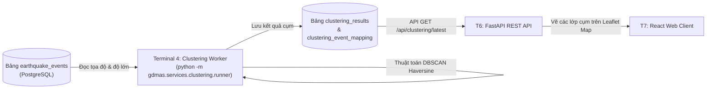

# [ĐẶC TẢ CHỨC NĂNG: GOM CỤM KHÔNG GIAN ĐỊA CHẤN]

- **Mã chức năng:** FEAT-04
- **Mã định danh (Slug):** `04-spatial-clustering`
- **Terminal đảm nhiệm:** Terminal 4 - Clustering Worker Service (`gdmas.services.clustering.runner`)
- **Trạng thái:** `Planning`
- **Mức độ ưu tiên:** `P0 (Bắt buộc đồ án - Microservice độc lập Terminal 4)`
- **Tài liệu tham chiếu:**
  * `docs/yeucaubatbuoc.md` (§1. Sơ đồ kiến trúc, chu kỳ 1 ngày/lần)
  * `docs/architecture/SAD.md` (§4.5. Spatial Clustering Service)
  * `docs/architecture/ERD.md` (§2.3. Bảng `clustering_results` & `clustering_event_mapping`)

---

## 1. Mục Tiêu & Bối Cảnh Nghiệp Vụ (Objectives & Scope)

### 1.1. Bài toán giải quyết
Động đất không phân bố ngẫu nhiên mà thường tập trung dày đặc dọc theo các đường đứt gãy kiến tạo mảng (fault lines) và các "vành đai lửa" (Ring of Fire). Chức năng này chịu trách nhiệm:
- Nhận diện tự động các **điểm nóng địa chấn (Seismic Hotspots)** trên bản đồ thế giới thông qua thuật toán học không giám sát (Unsupervised Learning).
- Thuật toán chủ đạo: **DBSCAN (Density-Based Spatial Clustering of Applications with Noise)** kết hợp công thức khoảng cách mặt cầu Haversine (tính bằng radian) để nhóm các trận động đất gần nhau về mặt không gian địa lý.
- Phân loại rõ ràng giữa các sự kiện thuộc cụm kiến tạo tập trung và các sự kiện nhiễu lẻ tẻ (Noise - label `-1`).
- Tính toán tâm cụm (Centroid), số lượng trận động đất, độ lớn trung bình/cực đại, và diện tích ảnh hưởng của từng cụm.
- Thực thi định kỳ **1 ngày một lần** (theo yêu cầu bắt buộc của giảng viên tại `docs/yeucaubatbuoc.md`).

### 1.2. Phạm vi chức năng (Scope Boundaries)
- **Trong phạm vi (In-Scope):**
  * Đọc tọa độ (`latitude`, `longitude`), độ sâu (`depth_km`) và độ lớn (`magnitude`) từ bảng `earthquake_events`.
  * Thuật toán DBSCAN với metric Haversine:
    $$\text{distance} = \text{haversine}(\text{point}_1, \text{point}_2) \times R_{\text{earth}} \quad (R \approx 6371 \text{ km})$$
  * Tham số chuẩn: Bán kính lân cận $\epsilon$ (ví dụ: $250\text{ km} \approx 250 / 6371\text{ rad}$) và số điểm tối thiểu $MinPts = 5$.
  * Lưu trữ thông tin cụm vào bảng `clustering_results`.
  * Lưu ánh xạ từng sự kiện vào cụm tương ứng trong bảng `clustering_event_mapping`.
- **Ngoài phạm vi (Out-of-Scope):**
  * Không dự báo thời gian xảy ra trận động đất tiếp theo (thuộc T5 - FEAT-05).
  * Không render bản đồ trực quan (thuộc T7 - FEAT-07).

---

## 2. Vị Trí Kiến Trúc & Quan Hệ Phụ Thuộc (System Context & Dependencies)

### 2.1. Sơ đồ tương tác (Context Flow)


### 2.2. Quan hệ phụ thuộc (Dependencies)
- **Dịch vụ phụ thuộc (Upstream):** CSDL T1 và Ingestion T2 (cần có dữ liệu sự kiện đủ dày để gom cụm có ý nghĩa).
- **Dịch vụ tiêu thụ (Downstream):** 
  * T6 (FastAPI Router `/api/clustering/*`) cung cấp dữ liệu cho bản đồ Leaflet tại T7.

---

## 3. Hợp Đồng Dữ Liệu & Giao Thức (Data Contracts & Schemas)

### 3.1. Dữ liệu đầu vào (Inputs)
- Mảng các tọa độ địa lý được chuyển đổi sang Radian:
  $$\text{coords\_rad} = \text{np.radians}(df[['latitude', 'longitude']])$$

### 3.2. Dữ liệu đầu ra (Outputs - Ghi vào 2 bảng CSDL)

1. **Bảng `clustering_results`:**
   * `algorithm`: `'dbscan'`
   * `parameters`: `{"eps_km": 250, "min_samples": 5, "metric": "haversine"}`
   * `total_clusters`: Số lượng cụm tìm thấy (loại trừ nhiễu)
   * `noise_count`: Số lượng sự kiện bị coi là ngoại lai (noise)
   * `summary_clusters`: JSONB chứa chi tiết từng cụm:
     ```json
     [
       {
         "cluster_id": 0,
         "centroid": {"latitude": 36.5, "longitude": 139.8},
         "region_name": "Japan Trench & Honshu Region",
         "event_count": 87,
         "max_magnitude": 6.8,
         "avg_depth_km": 28.4
       }
     ]
     ```

2. **Bảng `clustering_event_mapping`:**
   * Ghi nhận từng dòng: `cluster_result_id`, `event_id`, `cluster_label` (`-1` nếu là noise, `0, 1, 2...` nếu thuộc cụm).

---

## 4. Logic Xử Lý Cốt Lõi & Thuật Toán (Core Processing Logic)

### 4.1. Quy trình xử lý từng bước (Pipeline)
1. **Lập lịch kích hoạt (Daily Trigger):** Worker thức dậy mỗi 86400 giây (24 giờ), hoặc khi được kích hoạt thủ công qua script demo.
2. **Tiền xử lý dữ liệu:**
   - Lọc các trận động đất trong 30 ngày gần nhất (độ lớn $M \ge 2.5$).
   - Chuyển đổi tọa độ độ thập phân sang Radian.
3. **Thực thi mô hình DBSCAN:**
   ```python
   kms_per_radian = 6371.0088
   epsilon = 250.0 / kms_per_radian
   db = DBSCAN(eps=epsilon, min_samples=5, metric='haversine', algorithm='ball_tree')
   labels = db.fit_predict(coords_rad)
   ```
4. **Hậu xử lý & Tổng hợp cụm (Cluster Summarization):**
   - Với mỗi nhãn cụm $k \ge 0$:
     * Tính tọa độ trung bình (Centroid).
     * Tìm độ lớn cực đại và độ sâu trung bình.
   - Định danh khu vực địa lý cho cụm.
5. **Ghi nhận vào CSDL:** Sử dụng transaction để lưu bản ghi vào `clustering_results` và chèn hàng loạt vào `clustering_event_mapping`.

---

## 5. Bất Biến Kiến Trúc & Ràng Buộc Kỹ Thuật (Architecture Invariants)

- **Độc lập Terminal (I1):** Chạy trên Terminal 4 độc lập thông qua lệnh:
  ```powershell
  python -m gdmas.services.clustering.runner
  ```
- **Tần suất chạy:** Định kỳ **1 ngày một lần** (24 giờ), có hỗ trợ cờ `--run-once` để phục vụ kịch bản chấm demo của giảng viên.
- **Thư viện chuyên dụng:** `scikit-learn`, `numpy`, `pandas`.

---

## 6. Tiêu Chí Nghiệm Thu & Kiểm Thử (Acceptance Criteria)

- [ ] **AC-1:** Lệnh `python -m gdmas.services.clustering.runner` chạy hoàn tất mà không gặp lỗi tính toán không gian.
- [ ] **AC-2:** Nhận diện chính xác các cụm địa chấn lớn trên thế giới (như Vành đai lửa Thái Bình Dương, đới đứt gãy San Andreas, Nhật Bản).
- [ ] **AC-3:** Số lượng bản ghi trong `clustering_event_mapping` khớp chính xác với số lượng sự kiện đưa vào huấn luyện.

---

## 7. Kế Hoạch Phân Rã Nhiệm Vụ (Task Breakdown Checklist)

### Pha 1: Thuật Toán & Xử Lý Không Gian
- [ ] Tạo module tính toán khoảng cách Haversine và bọc DBSCAN (`services/clustering/dbscan_model.py`).
- [ ] Xây dựng thuật toán tính toán tâm cụm và thống kê thuộc tính cụm.

### Pha 2: Pipeline Lưu Trữ & Runner
- [ ] Tạo pipeline ghi nhận kết quả vào 2 bảng CSDL (`services/clustering/pipeline.py`).
- [ ] Tạo file thực thi Terminal 4 với scheduler 1 ngày (`services/clustering/runner.py`).

### Pha 3: Tích Hợp API & Kiểm Thử
- [ ] Bổ sung route `/api/clustering/latest` và `/api/clustering/{cluster_id}/events`.
- [ ] Viết unit test cho giải thuật DBSCAN với dữ liệu tọa độ mock.

