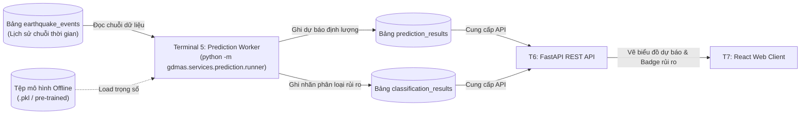

# [ĐẶC TẢ CHỨC NĂNG: MÔ HÌNH DỰ BÁO & PHÂN LOẠI (t+1)]

- **Mã chức năng:** FEAT-05
- **Mã định danh (Slug):** `05-seismic-prediction`
- **Terminal đảm nhiệm:** Terminal 5 - Prediction Worker Service (`gdmas.services.prediction.runner`)
- **Trạng thái:** `Planning`
- **Mức độ ưu tiên:** `P0 (Bắt buộc đồ án - Đạt trọn vẹn điểm Pattern 5 & 6)`
- **Tài liệu tham chiếu:**
  * `docs/yeucaubatbuoc.md` (§2. Bảng Patterns bắt buộc STT 5 & 6, §4. Buổi demo)
  * `docs/architecture/SAD.md` (§4.6. Seismic Prediction & Classification Service)
  * `docs/architecture/ERD.md` (§2.4. `prediction_results`, §2.5. `classification_results`)

---

## 1. Mục Tiêu & Bối Cảnh Nghiệp Vụ (Objectives & Scope)

### 1.1. Bài toán giải quyết
Dự báo tương lai là yêu cầu trọng tâm trong bài toán chuỗi thời gian. Chức năng này chịu trách nhiệm triển khai **2 Patterns phân tích bắt buộc cuối cùng**:
1. **Pattern 5 - Hồi quy & Dự báo Định lượng ($t+1$):**
   - Dự báo chính xác giá trị số lượng sự kiện địa chấn (hoặc tổng năng lượng giải phóng) cho ngày kế tiếp ($t + 1$).
   - Bắt buộc đi kèm **khoảng tin cậy 95% (Confidence Interval)**: Cận dưới (`lower_bound`) và Cận trên (`upper_bound`).
   - Sử dụng các mô hình chuỗi thời gian đã được huấn luyện sẵn (Pre-trained models như ARIMA, Exponential Smoothing hoặc Ridge Regression).
2. **Pattern 6 - Dự đoán Phân loại Nhãn Rủi ro ($t+1$):**
   - Dự đoán nhãn phân loại mức độ hoạt động địa chấn cho ngày kế tiếp ($t + 1$) theo 4 cấp độ: `Low` (Thấp), `Moderate` (Trung bình), `High` (Cao), `Extreme` (Cực đoan).
   - Đi kèm điểm số độ tin cậy của mô hình (`confidence_score` từ 0.0 đến 1.0).
   - Sử dụng mô hình phân loại (Random Forest Classifier, Logistic Regression hoặc Gradient Boosting).
- Thực thi định kỳ **5 phút một lần** để cập nhật kết quả dự báo mới nhất dựa trên các sự kiện vừa được nạp vào DB.

### 1.2. Phạm vi chức năng (Scope Boundaries)
- **Trong phạm vi (In-Scope):**
  * Tải các trọng số mô hình đã được build/huấn luyện sẵn (không huấn luyện lại từ đầu trong lúc chạy service, tuân thủ đúng §4 kịch bản demo giảng viên).
  * Chuẩn bị vector đặc trưng (Feature vector) từ dữ liệu lịch sử 30 ngày gần nhất trong `earthquake_events`.
  * Thực hiện suy luận (Inference) ra giá trị định lượng $t+1$ và nhãn phân loại $t+1$.
  * Lưu kết quả vào 2 bảng CSDL tương ứng: `prediction_results` và `classification_results`.
- **Ngoài phạm vi (Out-of-Scope):**
  * Không huấn luyện lại mô hình tốn thời gian (Model Retraining diễn ra offline).
  * Không hiển thị biểu đồ trực tiếp (thuộc T7).

---

## 2. Vị Trí Kiến Trúc & Quan Hệ Phụ Thuộc (System Context & Dependencies)

### 2.1. Sơ đồ tương tác (Context Flow)


### 2.2. Quan hệ phụ thuộc (Dependencies)
- **Dịch vụ phụ thuộc (Upstream):** CSDL T1 và Ingestion T2.
- **Dịch vụ tiêu thụ (Downstream):** T6 (FastAPI REST endpoints `/api/prediction/latest` và `/api/classification/latest`) và T7 (Web Client).

---

## 3. Hợp Đồng Dữ Liệu & Giao Thức (Data Contracts & Schemas)

### 3.1. Dữ liệu đầu vào (Features Input)
Vector đặc trưng được tạo từ dữ liệu lịch sử $N$ ngày:
- `daily_counts_lags`: Số lượng trận động đất của các ngày $t, t-1, t-2, t-7$.
- `daily_avg_mag`: Độ lớn trung bình trong 7 ngày gần nhất.
- `daily_max_mag`: Trận động đất lớn nhất trong 7 ngày gần nhất.
- `total_energy_joules`: Tổng năng lượng giải phóng 7 ngày gần nhất.

### 3.2. Dữ liệu đầu ra (Outputs - Ghi vào CSDL)

1. **Bảng `prediction_results` (Pattern 5):**
   * `target_date`: Ngày kế tiếp (theo giờ UTC).
   * `metric_name`: `'daily_earthquake_count'`
   * `predicted_value`: Số lượng trận động đất dự báo (ví dụ: `158.4`).
   * `lower_bound`: Cận dưới tin cậy (ví dụ: `132.0`).
   * `upper_bound`: Cận trên tin cậy (ví dụ: `184.8`).
   * `model_name`: `'ARIMA(2,1,2)'` (hoặc `'RidgeRegression'`).
   * `evaluation_metrics`: `{"mae": 12.4, "rmse": 16.8, "mape": "8.5%"}`

2. **Bảng `classification_results` (Pattern 6):**
   * `target_date`: Ngày kế tiếp (UTC).
   * `risk_level`: `'moderate'` (Thấp / Trung bình / Cao / Cực đoan).
   * `confidence_score`: `0.87` (Độ tin cậy 87%).
   * `features_used`: JSONB đặc trưng đầu vào.
   * `model_name`: `'RandomForestClassifier'`

---

## 4. Logic Xử Lý Cốt Lõi & Thuật Toán (Core Processing Logic)

### 4.1. Quy trình xử lý từng bước (Pipeline)
1. **Khởi động chu kỳ 5 phút:** Worker thức dậy, kết nối DB.
2. **Xác định ngày mục tiêu ($t+1$):**
   $$\text{target\_date} = \text{datetime.now}(\text{timezone.utc}).\text{date}() + \text{timedelta}(\text{days}=1)$$
3. **Thực thi Mô hình Dự báo Định lượng (Pattern 5):**
   - Sử dụng mô hình ARIMA / Exponential Smoothing fit trên chuỗi số lượng sự kiện mỗi ngày.
   - Xuất kết quả `forecast` kèm khoảng tin cậy `conf_int(alpha=0.05)`.
4. **Thực thi Mô hình Phân loại Rủi ro (Pattern 6):**
   - Tính toán nhãn thực tế dựa trên ngưỡng:
     * `Low`: < 100 sự kiện/ngày và không có trận $M \ge 5.5$.
     * `Moderate`: 100 - 200 sự kiện/ngày hoặc có trận $5.5 \le M < 6.5$.
     * `High`: 200 - 350 sự kiện/ngày hoặc có trận $6.5 \le M < 7.5$.
     * `Extreme`: > 350 sự kiện/ngày hoặc có trận $M \ge 7.5$.
   - Mô hình phân loại dự đoán xác suất `predict_proba()` cho 4 lớp.
5. **Lưu trữ CSDL:** Ghi kết quả vào `prediction_results` và `classification_results`.

---

## 5. Bất Biến Kiến Trúc & Ràng Buộc Kỹ Thuật (Architecture Invariants)

- **Độc lập Terminal (I1):** Chạy trên Terminal 5 độc lập qua lệnh:
  ```powershell
  python -m gdmas.services.prediction.runner
  ```
  *(Cấm nhúng vào `main.py`).*
- **Quy tắc Demo (§4):** Model bắt buộc phải build sẵn / tải sẵn trọng số, **tuyệt đối không train lại từ đầu trong phiên demo**.
- **Tần suất chạy:** Cập nhật **5 phút một lần**.
- **Thư viện chuyên dụng:** `statsmodels`, `scikit-learn`, `joblib`, `numpy`.

---

## 6. Tiêu Chí Nghiệm Thu & Kiểm Thử (Acceptance Criteria)

- [ ] **AC-1:** Lệnh `python -m gdmas.services.prediction.runner` chạy mượt mà trên Terminal 5, sinh ra giá trị dự báo có nghĩa ($>0$).
- [ ] **AC-2:** Kết quả dự báo định lượng luôn có $lower\_bound \le predicted\_value \le upper\_bound$.
- [ ] **AC-3:** Nhãn phân loại rủi ro thuộc 1 trong 4 nhãn chuẩn (`low`, `moderate`, `high`, `extreme`) và điểm tin cậy nằm trong khoảng $[0.0, 1.0]$.
- [ ] **AC-4:** Khi xóa DB và kích hoạt lại, worker tái sinh đầy đủ các bản ghi dự báo cho ngày $t+1$.

---

## 7. Kế Hoạch Phân Rã Nhiệm Vụ (Task Breakdown Checklist)

### Pha 1: Huấn Luyện & Lưu Trọng Số Model
- [ ] Xây dựng script huấn luyện offline mô hình ARIMA/Regression (`services/prediction/train_forecast.py`).
- [ ] Xây dựng script huấn luyện offline mô hình Classification (`services/prediction/train_classifier.py`).
- [ ] Lưu các tệp trọng số pre-trained (`.pkl` hoặc `.joblib`) vào thư mục `apps/api/src/gdmas/services/prediction/models/`.

### Pha 2: Pipeline Inference & Runner
- [ ] Xây dựng module suy luận nhanh (`services/prediction/inference.py`).
- [ ] Tạo file thực thi Terminal 5 với chu kỳ 5 phút (`services/prediction/runner.py`).

### Pha 3: API & Kiểm Thử
- [ ] Bổ sung các routes `/api/prediction/latest` và `/api/classification/latest` trong FastAPI.
- [ ] Viết test cases kiểm tra tính hợp lệ của khoảng tin cậy và nhãn rủi ro.

