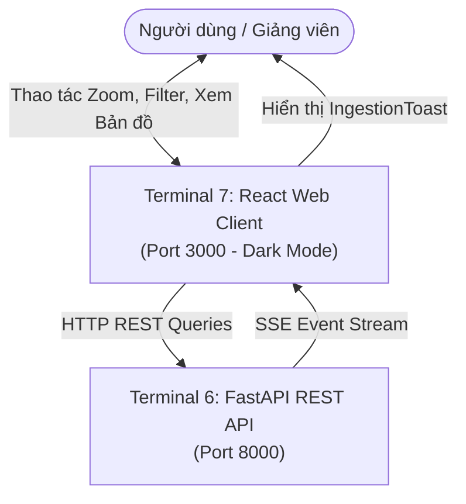

# [ĐẶC TẢ CHỨC NĂNG: GIAO DIỆN WEB DASHBOARD TƯƠNG TÁC]

- **Mã chức năng:** FEAT-07
- **Mã định danh (Slug):** `07-interactive-web-client`
- **Terminal đảm nhiệm:** Terminal 7 - Frontend Web Client (React + Vite, Port `3000`)
- **Trạng thái:** `In-Progress`
- **Mức độ ưu tiên:** `P0 (Bắt buộc đồ án - Mặt tiền hiển thị sản phẩm)`
- **Tài liệu tham chiếu:**
  * `docs/yeucaubatbuoc.md` (§2. Patterns bắt buộc, §3.1. Giao diện người dùng, §5.2. Điểm cộng)
  * `docs/architecture/SAD.md` (§4.1. Web Layer)
  * `docs/api/API.md` (Hợp đồng gọi API từ Frontend)

---

## 1. Mục Tiêu & Bối Cảnh Nghiệp Vụ (Objectives & Scope)

### 1.1. Bài toán giải quyết
Giao diện Web là nơi trực quan hóa toàn bộ thành quả phân tích của 6 Terminals phía sau. Chức năng này chịu trách nhiệm:
- Xây dựng bảng điều khiển Dashboard hiện đại, thẩm mỹ cao với giao diện **Dark Mode mặc định**.
- Tích hợp **Bản đồ địa chấn tương tác toàn cầu (Interactive Leaflet Map)**: Hiển thị các chấm sự kiện theo cấp độ màu Richter, xem chi tiết sự kiện và hiển thị các lớp cụm không gian (Clusters).
- Trực quan hóa trọn vẹn **toàn bộ 6 Patterns chuỗi thời gian**:
  1. *Pattern 1:* 3 biểu đồ (Line chart xu hướng, Scatter plot phân tán, Histogram phân phối tần suất) theo Ngày/Tuần/Tháng.
  2. *Pattern 2:* Biểu đồ đường xu hướng (Trend line) sau Re-sampling.
  3. *Pattern 3:* Biểu đồ chu kỳ mùa vụ (Seasonal wave) sau Re-sampling.
  4. *Pattern 4:* Ma trận nhiệt tương quan đa biến (Correlation Heatmap).
  5. *Pattern 5:* Biểu đồ dự báo số lượng sự kiện ngày kế tiếp ($t+1$) kèm dải khoảng tin cậy 95% (Confidence Band).
  6. *Pattern 6:* Badge và biểu đồ phân loại nhãn rủi ro địa chấn ngày kế tiếp ($t+1$).
- Tích hợp tính năng tương tác cao nhận điểm cộng: **Zoom** (phóng to/thu nhỏ thời gian) và **Filter** (lọc động theo độ lớn $M$, độ sâu, khu vực).
- Tích hợp kết nối thời gian thực **Server-Sent Events (SSE)** qua custom hook `useSSE`: Tự động hiển thị Toast thông báo khi có trận động đất mới phát sinh trên thế giới.

### 1.2. Phạm vi chức năng (Scope Boundaries)
- **Trong phạm vi (In-Scope):**
  * Ứng dụng React 18 + Vite + Tailwind CSS + TypeScript tại `apps/web/`.
  * Bộ components trực quan hóa tại `apps/web/src/components/charts/`.
  * Bản đồ tương tác tại `apps/web/src/components/map/EarthquakeMap.tsx`.
  * Custom hook lắng nghe SSE tại `apps/web/src/hooks/useSSE.ts`.
  * Gọi API Backend trên port `8000`, xử lý hiển thị trạng thái Loading, Empty state và Error boundary.
- **Ngoài phạm vi (Out-of-Scope):**
  * Không tính toán thuật toán nặng tại Frontend (toàn bộ số liệu do T3, T4, T5 tính sẵn và T6 trả về).
  * Không hardcode dữ liệu tĩnh (vi phạm yêu cầu bắt buộc của giảng viên).

---

## 2. Vị Trí Kiến Trúc & Quan Hệ Phụ Thuộc (System Context & Dependencies)

### 2.1. Sơ đồ tương tác (Context Flow)


### 2.2. Quan hệ phụ thuộc (Dependencies)
- **Dịch vụ phụ thuộc (Upstream):** Terminal 6 (FastAPI REST & SSE) phải hoạt động tại `http://localhost:8000`.
- **Dịch vụ tiêu thụ (Downstream):** Người dùng cuối, hội đồng chấm thi và giảng viên.

---

## 3. Danh Mục Trang & Components Trực Quan Hóa 6 Patterns

### 3.1. Danh mục các trang chính (Pages Layout)
- **`/` (Dashboard Overview):** Thống kê nhanh toàn cầu (KPI Cards), Bản đồ địa chấn Leaflet thời gian thực và Bảng danh sách sự kiện gần nhất.
- **`/earthquakes` (Danh sách & Bộ lọc):** Danh sách đầy đủ các trận động đất có bộ lọc đa tiêu chí (độ lớn, độ sâu, dải thời gian).
- **`/analytics` (6 Patterns Analysis):** Khu vực trực quan hóa toàn diện 6 patterns chuỗi thời gian:
  * `TimeDistributionCharts.tsx` (Pattern 1: Line, Scatter, Histogram).
  * `TrendDecompositionChart.tsx` (Pattern 2: Trend line sau Resample).
  * `SeasonalityChart.tsx` (Pattern 3: Chu kỳ mùa vụ).
  * `CorrelationHeatmap.tsx` (Pattern 4: Ma trận tương quan).
  * `PredictionForecastChart.tsx` (Pattern 5: Dự báo $t+1$ kèm khoảng tin cậy).
  * `RiskClassificationCard.tsx` (Pattern 6: Nhãn rủi ro $t+1$ và điểm tin cậy).
- **`/clusters` (Bản đồ Cụm Không gian):** Xem các điểm nóng địa chấn do DBSCAN tìm ra.

### 3.2. Tiêu chuẩn Thẩm mỹ & Trải nghiệm (UI/UX Standards)
- **Theme:** Dark Mode mặc định (nền `#0f172a` Slate 900, điểm nhấn `#38bdf8` Sky Blue và cảnh báo `#f43f5e` Rose).
- **Xử lý bất đồng bộ:** Có skeleton loader khi đang tải dữ liệu.
- **Xử lý khi DB rỗng (§4 Demo):** Hiển thị màn hình rỗng thân thiện (Empty State) với thông điệp: *"Chưa có dữ liệu phân tích. Vui lòng kích hoạt các worker tại Backend."*

---

## 4. Logic Xử Lý Cốt Lõi & Thời Gian Thực (Real-time & Interactivity)

### 4.1. Cơ chế Lắng nghe Thời gian thực (SSE Hook)
```typescript
// useSSE.ts
const eventSource = new EventSource("http://localhost:8000/api/stream");
eventSource.addEventListener("earthquake_new", (e) => {
  const event = JSON.parse(e.data);
  showToast(`Phát hiện động đất mới: M${event.magnitude} tại ${event.place}`);
  triggerRefresh();
});
```

### 4.2. Bộ lọc & Phóng to (Zoom & Filter Interactivity)
- Component bộ lọc: Cho phép chọn khoảng thời gian (7 ngày, 30 ngày, 90 ngày), thanh trượt (slider) độ lớn Richter ($M \ge 2.5$).
- Biểu đồ Recharts: Hỗ trợ brush slider bên dưới để phóng to / thu nhỏ dải thời gian hiển thị.

---

## 5. Bất Biến Kiến Trúc & Ràng Buộc Kỹ Thuật (Architecture Invariants)

- **Độc lập Terminal (I1):** Chạy trên Terminal 7 độc lập bằng lệnh:
  ```powershell
  pnpm dev --port 3000
  ```
- **Kiểm tra Network F12 (§4 Demo):** Mọi biểu đồ bắt buộc phải gọi API thật qua Fetch/Axios. **Tuyệt đối cấm dùng mock tĩnh trong component**.
- **Công nghệ sử dụng:** React 18, Vite, Tailwind CSS, Recharts, Leaflet / React-Leaflet, Lucide Icons.

---

## 6. Tiêu Chí Nghiệm Thu & Kiểm Thử (Acceptance Criteria)

- [ ] **AC-1:** Giao diện Web chạy mượt mà trên `http://localhost:3000`, hỗ trợ responsive và Dark Mode chuẩn.
- [ ] **AC-2:** Toàn bộ 6 patterns chuỗi thời gian đều hiển thị đầy đủ biểu đồ với dữ liệu động nạp từ Backend API.
- [ ] **AC-3:** Bản đồ Leaflet hiển thị các điểm động đất với màu sắc trực quan (xanh: nhẹ, cam: vừa, đỏ: mạnh) và popup chi tiết khi click vào marker.
- [ ] **AC-4:** Khi Terminal 2 nạp sự kiện mới, Web tự động nhận event SSE và hiển thị Toast thông báo mà không cần F5 trình duyệt.
- [ ] **AC-5:** Đóng gói production build thành công: `pnpm build` không có lỗi TypeScript hay cú pháp.

---

## 7. Kế Hoạch Phân Rã Nhiệm Vụ (Task Breakdown Checklist)

### Pha 1: Khung Layout & Theme
- [x] Thiết lập Vite + React + Tailwind Dark Mode.
- [x] Tạo thanh điều hướng Sidebar và Header chung.

### Pha 2: Tích Hợp Bản Đồ & Thời Gian Thực
- [x] Xây dựng component bản đồ tương tác Leaflet.
- [x] Tích hợp custom hook `useSSE` và component thông báo `IngestionToast.tsx`.

### Pha 3: Xây Dựng 6 Patterns Components
- [ ] Hoàn thiện 3 biểu đồ Pattern 1 (Line, Scatter, Histogram).
- [ ] Hoàn thiện biểu đồ Trend (Pattern 2) và Seasonality (Pattern 3).
- [ ] Hoàn thiện ma trận nhiệt Heatmap (Pattern 4).
- [ ] Hoàn thiện biểu đồ dự báo $t+1$ (Pattern 5) và Badge rủi ro $t+1$ (Pattern 6).
- [ ] Kiểm thử kịch bản demo: Xóa DB -> Web báo rỗng -> Chạy worker -> Web tự động phục hồi dữ liệu.

