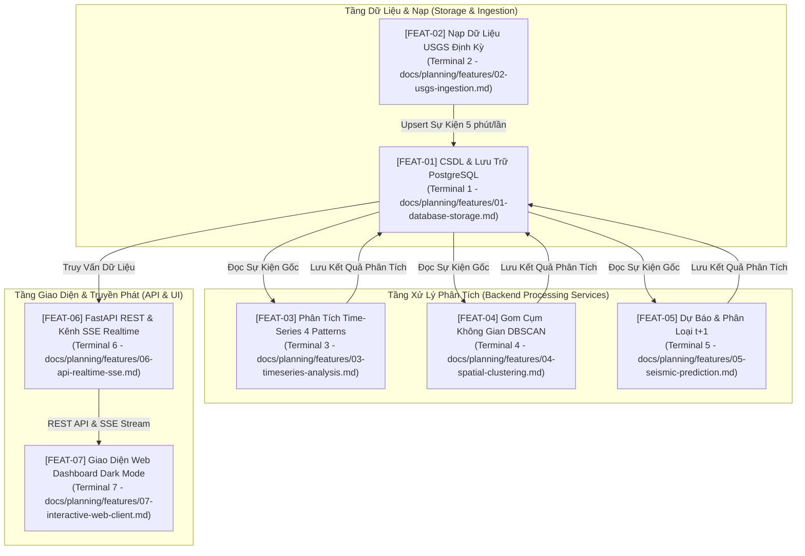

# Danh Mục Đặc Tả Chức Năng Hệ Thống (Feature Catalog)

Thư mục này chứa toàn bộ các bản **Đặc tả Chức năng Chi tiết (Functional Specifications)** của hệ thống **GDMAS**. Mỗi tệp đại diện cho một khối chức năng độc lập, tương ứng với kiến trúc **7 Terminals** và **6 Patterns Chuỗi Thời Gian**.

> [!IMPORTANT]
> - **Nguồn chân lý nghiệp vụ (Single Source of Truth):** Các tài liệu này đóng vai trò là quy chuẩn kỹ thuật gốc (What & Why). Trước khi phát triển hoặc sửa đổi chức năng, Agent và Lập trình viên bắt buộc phải tham chiếu tệp tương ứng.
> - **Đầu vào cho `write-proposal`:** Khi cần triển khai một tính năng, sử dụng tài liệu đặc tả này làm căn cứ bối cảnh để soạn thảo proposal nhanh chóng, chính xác và tiết kiệm token.
> - **Khuôn mẫu chuẩn:** Mọi tài liệu chức năng mới phải tuân thủ khuôn mẫu tại [TEMPLATE.md](TEMPLATE.md).

---

## 🗺️ Bản Đồ 7 Chức Năng Tương Ứng 7 Terminals

---

## 📋 Bảng Danh Mục 7 Chức Năng Chi Tiết

| Mã | Tên Chức Năng | Terminal Đảm Nhiệm | Chu Kỳ / Tần Suất | Tài Liệu Chi Tiết | Trạng Thái |
| :---: | :--- | :--- | :---: | :--- | :---: |
| **FEAT-01** | Cơ Sở Dữ Liệu & Lưu Trữ Tập Trung | **T1 - Database** (PostgreSQL 16) | Liên tục (Always-on) | [`01-database-storage.md`](01-database-storage.md) | `In-Progress` |
| **FEAT-02** | Thu Thập & Nạp Dữ Liệu USGS | **T2 - Ingestion Worker** | 5 phút / lần | [`02-usgs-ingestion.md`](02-usgs-ingestion.md) | `In-Progress` |
| **FEAT-03** | Phân Tích Chuỗi Thời Gian (Patterns 1 - 4) | **T3 - Analysis Worker** | 5 phút / lần | [`03-timeseries-analysis.md`](03-timeseries-analysis.md) | `Planning` |
| **FEAT-04** | Gom Cụm Không Gian Địa Chấn | **T4 - Clustering Worker** (DBSCAN) | 1 ngày / lần | [`04-spatial-clustering.md`](04-spatial-clustering.md) | `Planning` |
| **FEAT-05** | Mô Hình Dự Báo & Phân Loại ($t+1$) | **T5 - Prediction Worker** (Patterns 5 & 6) | 5 phút / lần | [`05-seismic-prediction.md`](05-seismic-prediction.md) | `Planning` |
| **FEAT-06** | Máy Chủ REST API & Kênh SSE Realtime | **T6 - API Service** (FastAPI) | Liên tục (Port 8000) | [`06-api-realtime-sse.md`](06-api-realtime-sse.md) | `In-Progress` |
| **FEAT-07** | Giao Diện Web Dashboard Tương Tác | **T7 - Web Client** (React + Vite) | Liên tục (Port 3000) | [`07-interactive-web-client.md`](07-interactive-web-client.md) | `In-Progress` |

---

## 🔗 Liên Kết & Tài Liệu Phụ Trợ
- [**Khuôn Mẫu Đặc Tả (TEMPLATE.md)**](TEMPLATE.md)
- [**Yêu Cầu Bắt Buộc Đồ Án**](../../yeucaubatbuoc.md)
- [**Thiết Kế Cơ Sở Dữ Liệu (ERD)**](../../architecture/ERD.md)
- [**Tài Liệu Kiến Trúc Hệ Thống (SAD)**](../../architecture/SAD.md)
- [**Đặc Tả Hợp Đồng REST API**](../../api/API.md)
- [**Quy Trình Phát Triển Kỹ Năng**](../skills/spec-driven-workflow.md)

