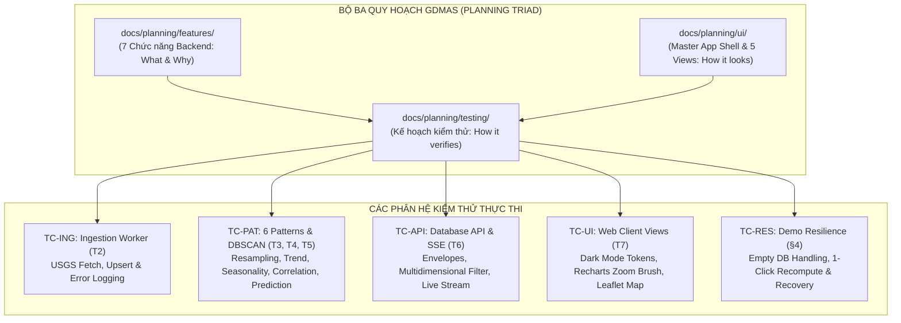

# Danh Mục Kế Hoạch & Đặc Tả Kiểm Thử (Testing Planning Catalog)

Thư mục này chứa toàn bộ các bản **Kế Hoạch & Đặc Tả Kiểm Thử Chi Tiết (Test Specifications)** của hệ thống **GDMAS**, đóng vai trò là "nguồn chân lý kiểm định" (Verification Single Source of Truth) kết nối trực tiếp giữa **Đặc tả Chức năng (`docs/planning/features/`)**, **Đặc tả Giao diện (`docs/planning/ui/`)** và **Mã nguồn kiểm thử thực thi (`apps/api/tests/`, `apps/web/src/**/*.test.tsx`, `scripts/`)**.

> [!IMPORTANT]
> - **Nguyên tắc Kiểm thử Định hướng Đặc tả (Spec-Driven Testing):** Mọi ca kiểm thử phải được lập kế hoạch và đặc tả rõ ràng trước khi viết code test thực thi, đảm bảo độ bao phủ 100% cho 7 Terminals và 6 Patterns chuỗi thời gian.
> - **Khuôn mẫu chuẩn:** Mọi kế hoạch kiểm thử mới phải tuân thủ khuôn mẫu tại [TEMPLATE.md](TEMPLATE.md).
> - **Bảo chứng Kịch bản Demo Hội đồng (§4):** Mọi module trọng yếu bắt buộc phải có ca kiểm thử kiểm tra ứng xử khi CSDL bị xóa rỗng (Empty State) và khả năng phục hồi dữ liệu tự động.

---

## 🗺️ Bản Đồ Phân Hệ Kiểm Thử (Testing Matrix)

---

## 📋 Danh Mục 12 Bản Kế Hoạch Đặc Tả Kiểm Thử Chi Tiết

### Nhóm 1: Kiểm Thử Chức Năng Backend & Pipeline (Features Testing)

| Tệp Đặc Tả Kiểm Thử | Mã TC | Phân Hệ & Terminal | Tầng Kiểm Thử | Tệp Code Kiểm Thử Mục Tiêu |
| :--- | :---: | :---: | :---: | :--- |
| [`01-test-database-storage.md`](01-test-database-storage.md) | `TC-DB-01` | `T1 Database` (PostgreSQL) | Integration | `apps/api/tests/test_db_models.py` |
| [`02-test-usgs-ingestion.md`](02-test-usgs-ingestion.md) | `TC-ING-01` | `T2 Ingestion` (5m/lần) | Unit / Integration | `apps/api/tests/test_ingestion_service.py` |
| [`03-test-timeseries-analysis.md`](03-test-timeseries-analysis.md) | `TC-PAT-01` | `T3 Analysis` (Patterns 1-4)| Unit / Integration | `apps/api/tests/test_timeseries_analysis.py` |
| [`04-test-spatial-clustering.md`](04-test-spatial-clustering.md) | `TC-PAT-04` | `T4 Clustering` (DBSCAN 1d) | Unit / Integration | `apps/api/tests/test_clustering.py` |
| [`05-test-seismic-prediction.md`](05-test-seismic-prediction.md) | `TC-PAT-05` | `T5 Prediction` (Patterns 5-6)| Unit / Integration | `apps/api/tests/test_prediction.py` |
| [`06-test-api-realtime-sse.md`](06-test-api-realtime-sse.md) | `TC-API-01` | `T6 API` (FastAPI REST & SSE)| Integration | `apps/api/tests/test_api_endpoints.py` `apps/api/tests/test_realtime_sse.py` |

### Nhóm 2: Kiểm Thử Giao Diện Bố Cục & Tương Tác (UI & Layout Testing)

| Tệp Đặc Tả Kiểm Thử | Mã TC | Giao Diện Kế Thừa | Tầng Kiểm Thử | Tệp Code Kiểm Thử Mục Tiêu |
| :--- | :---: | :---: | :---: | :--- |
| [`07-test-master-app-shell.md`](07-test-master-app-shell.md) | `TC-UI-01` | `LAYOUT-01 (App Shell)` | Component UI | `apps/web/src/layouts/DashboardLayout.test.tsx` |
| [`08-test-dashboard-view.md`](08-test-dashboard-view.md) | `TC-UI-02` | `VIEW-01 (Dashboard /)` | Component UI | `apps/web/src/features/dashboard/DashboardOverviewPage.test.tsx` |
| [`09-test-earthquakes-view.md`](09-test-earthquakes-view.md) | `TC-UI-03` | `VIEW-02 (/earthquakes)` | Interaction UI | `apps/web/src/features/earthquakes/EarthquakesPage.test.tsx` |
| [`10-test-analytics-view.md`](10-test-analytics-view.md) | `TC-UI-04` | `VIEW-03 (/analytics)` | Recharts & Zoom | `apps/web/src/features/analytics/AnalyticsView.test.tsx` |
| [`11-test-clusters-view.md`](11-test-clusters-view.md) | `TC-UI-05` | `VIEW-04 (/clusters)` | Leaflet GIS UI | `apps/web/src/features/clusters/ClustersView.test.tsx` |
| [`12-test-system-demo-view.md`](12-test-system-demo-view.md) | `TC-UI-06` `TC-RES-01` | `VIEW-05 (/system)` | E2E Resilience | `apps/web/src/features/system/SystemOperationsPage.test.tsx` `scripts/test-demo-resilience.ps1` |

---

## 🔗 Tài Liệu Tham Chiếu
- [**Khuôn Mẫu Đặc Tả Kiểm Thử (TEMPLATE.md)**](TEMPLATE.md)
- [**Chiến Lược Kiểm Thử Toàn Diện (docs/testing/TESTING.md)**](../../testing/TESTING.md)
- [**Quy Chuẩn Yêu Cầu Bắt Buộc Của Giảng Viên (docs/yeucaubatbuoc.md)**](../../yeucaubatbuoc.md)
- [**Danh Mục Chức Năng (docs/planning/features/)**](../features/README.md)
- [**Danh Mục Giao Diện (docs/planning/ui/)**](../ui/README.md)

