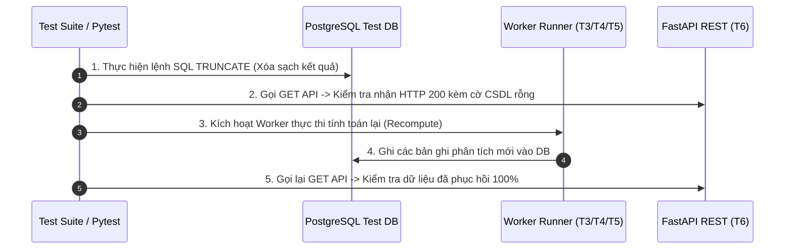

# [KHUÔN MẪU ĐẶC TẢ KẾ HOẠCH KIỂM THỬ (TEST SPECIFICATION TEMPLATE)]

> 💡 **Triết lý kiểm thử định hướng chất lượng GDMAS (Spec-Driven Testing Philosophy):**
> 
> 1. **Dựa trên Hợp đồng & Bất biến (Contract-Driven & Invariant-Centric):** Mọi ca kiểm thử phải truy vết trực tiếp từ Hợp đồng API ([docs/api/API.md](../../api/API.md)), Bất biến kiến trúc 7 Terminals, 6 Patterns chuỗi thời gian ([docs/yeucaubatbuoc.md](../../yeucaubatbuoc.md)) và Bố cục giao diện ([docs/planning/ui/](GDMAS/docs/planning/ui/)).
> 2. **Chống giả định dữ liệu ngầm (No Blind Mocking):** Dữ liệu giả lập (Mock Fixtures) phải tuân thủ nghiêm ngặt chuẩn WGS84, múi giờ ISO 8601 UTC và định dạng GeoJSON chuẩn USGS.
> 3. **Kiểm định khả năng chịu lỗi thực tế (Resilience Testing §4):** Bắt buộc phải có kịch bản kiểm tra ứng xử khi CSDL bị xóa trống (Empty State) và kịch bản phục hồi dữ liệu tự động phục vụ kịch bản demo hội đồng TS. Phạm Tuấn.
> 4. **Mục đích của Khuôn mẫu:** Dùng làm khung chuẩn mực để Agent và Lập trình viên soạn thảo các bản kế hoạch kiểm thử chi tiết (`docs/planning/testing/TC-*.md`), đồng thời cung cấp đầy đủ thông số để tự động sinh ra các file mã nguồn kiểm thử thực thi (`test_*.py`, `*.test.tsx`, `*.ps1`).

---

## 🧭 PHẦN A: CẤU TRÚC PHÂN LOẠI & MÃ ĐỊNH DANH KIỂM THỬ (TEST TAXONOMY)

Mỗi kế hoạch kiểm thử sinh ra từ khuôn mẫu này bắt buộc phải mang mã định danh theo quy ước:

$$\text{TC-}[\text{PHÂN\_HỆ}]-[\text{SỐ\_THỨ\_TỰ}]$$

| Tiền Tố Phân Hệ | Phạm Vi Kiểm Thử | Tầng Kim Tự Tháp | Tệp Mã Nguồn Kiểm Thử Mục Tiêu |
| :--- | :--- | :---: | :--- |
| **`TC-ING`** | Dịch vụ Nạp dữ liệu USGS (`T2 Ingestion Worker`) | Unit / Integration | `apps/api/tests/test_ingestion_service.py` |
| **`TC-DB`** | Tầng CSDL PostgreSQL, Upsert & Migrations (`T1 DB`) | Integration | `apps/api/tests/test_db_models.py` |
| **`TC-PAT`** | 6 Patterns chuỗi thời gian & DBSCAN (`T3, T4, T5 Workers`)| Unit / Integration | `apps/api/tests/test_timeseries_analysis.py`<br>`apps/api/tests/test_clustering.py`<br>`apps/api/tests/test_prediction.py` |
| **`TC-API`** | Database API REST Endpoints & Luồng SSE (`T6 API`) | Integration | `apps/api/tests/test_api_routes.py`<br>`apps/api/tests/test_sse_stream.py` |
| **`TC-UI`** | Giao diện Web Client & Components (`T7 Web Client`) | Component / UI | `apps/web/src/features/**/*.test.tsx`<br>`apps/web/src/components/charts/*.test.tsx` |
| **`TC-RES`** | Khả năng chịu lỗi, Demo CSDL rỗng & Phục hồi (§4 Demo)| E2E / Resilience | `tests/e2e/test_demo_resilience.py`<br>`scripts/demo-step2-truncate-db.ps1` |

---

## 📋 PHẦN B: KHUÔN MẪU ĐẶC TẢ CHI TIẾT (SPECIFICATION TEMPLATE)

*Sao chép khối markdown dưới đây khi tạo tệp đặc tả kiểm thử mới (ví dụ: `docs/planning/testing/TC-PAT-01-temporal-distribution.md`).*

```markdown
# [KẾ HOẠCH KIỂM THỬ: <MÃ TC> - <TÊN CA KIỂM THỬ TIẾNG VIỆT>]

- **Mã kiểm thử (Test ID):** `TC-<PHÂN_HỆ>-<0X>` (ví dụ: `TC-PAT-01`)
- **Tên ca kiểm thử:** `<Tên mô tả ngắn gọn>` (ví dụ: `Kiểm thử Phân tích Chuỗi thời gian Pattern 1 (Line, Scatter, Histogram)`)
- **Phân hệ & Terminal:** `T<X> - <Tên Terminal>` (ví dụ: `T3 - Analysis Worker`)
- **Tầng kiểm thử (Level):** `Unit Test` | `Integration Test` | `Component UI Test` | `E2E Resilience Test`
- **Mức độ ưu tiên:** `P0 (Critical - Bắt buộc cho đồ án)` | `P1 (High)` | `P2 (Medium)`
- **Tệp mã nguồn kiểm thử dự kiến sinh:**
  * Backend: `apps/api/tests/<ten_file_test>.py`
  * Frontend: `apps/web/src/<duong_dan>/<TenComponent>.test.tsx`
  * E2E Script: `scripts/<ten_script>.ps1`
- **Tài liệu tham chiếu:**
  * [docs/yeucaubatbuoc.md](../../yeucaubatbuoc.md) (§2. 6 Patterns, §4. Kịch bản Demo)
  * [docs/planning/features/<ma_feature>.md](../features/<ma_feature>.md)
  * [docs/planning/ui/<ma_view>.md](../ui/<ma_view>.md)
  * [docs/api/API.md](../../api/API.md)

---

## 1. Mục Tiêu Kiểm Thử & Truy Vết Nghiệp Vụ (Test Objectives & Traceability)

### 1.1. Mục tiêu cốt lõi
- Kiểm tra tính đúng đắn của logic tính toán / giao diện nào?
- Đảm bảo hệ thống phản hồi chính xác trong điều kiện bình thường và khi gặp dữ liệu biên (Edge cases).

### 1.2. Yêu cầu đồ án được bảo chứng (Traceability Matrix)
- [ ] Chứng minh yêu cầu bắt buộc: <Nêu rõ pattern hoặc chức năng trong `yeucaubatbuoc.md`>
- [ ] Chứng minh không vi phạm nguyên tắc Open-Closed (RULE-03).
- [ ] Bảo chứng tính toàn vẹn của kịch bản chấm thi của hội đồng (§4).

---

## 2. Điều Kiện Tiên Quyết & Môi Trường Kiểm Thử (Prerequisites & Fixtures)

### 2.1. Trạng thái hệ thống trước kiểm thử (Pre-conditions)
- CSDL PostgreSQL: `Đang có dữ liệu sẵn` | `CSDL rỗng (0 bản ghi)` | `Đang chạy migration mới nhất`
- Dịch vụ phụ thuộc: Backend API đang chạy tại Port 8000, Vite Dev Server tại Port 3000.

### 2.2. Dữ liệu mẫu & Mock Fixtures (Test Data & Mocking)
```json
{
  "mock_input_events": [
    {
      "source_event_id": "us_test_001",
      "event_time": "2026-11-06T10:00:00Z",
      "latitude": 38.29,
      "longitude": 142.38,
      "magnitude": 5.8,
      "depth_km": 24.5,
      "place": "Near East Coast of Honshu, Japan"
    }
  ]
}
```

---

## 3. Ma Trận Kịch Bản Kiểm Thử Chi Tiết (Test Scenarios & Assertions)

| ID Kịch Bản | Mô Tả Kịch Bản | Dữ Liệu Đầu Vào (Input) | Các Bước Thực Hiện (Execution Steps) | Kết Quả Mong Đợi (Expected Outcome / Assertions) |
| :---: | :--- | :--- | :--- | :--- |
| **SC-01** | **Happy Path:** Dữ liệu chuẩn, tính toán thành công | Chuỗi 30 ngày động đất hợp lệ | 1. Nạp fixture vào DB Test<br>2. Kích hoạt runner tính toán<br>3. Truy vấn kết quả | • Status trả về `COMPUTED`<br>• Đủ 3 mảng `line_chart`, `scatter_plot`, `histogram`<br>• Mã HTTP `200 OK` |
| **SC-02** | **Edge Case:** CSDL rỗng (Kịch bản Demo §4) | CSDL có 0 bản ghi (vừa TRUNCATE) | 1. Xóa sạch DB<br>2. Gọi API hoặc kích hoạt runner<br>3. Kiểm tra phản hồi | • Không văng lỗi 500 / Crash<br>• Trả về mảng rỗng `[]` hoặc cờ `has_data: false`<br>• Web hiển thị Empty State |
| **SC-03** | **Boundary Value:** Độ lớn cực đại / Tọa độ biên | Động đất $M = 9.5$, kinh độ $\pm 180^\circ$ | 1. Bắn sự kiện tọa độ cực biên<br>2. Kiểm tra chuẩn hóa WGS84 | • Hệ thống lưu trữ chuẩn xác, không bị tràn số<br>• Biểu đồ hiển thị điểm ngoại lai chính xác |
| **SC-04** | **Failure / Timeout:** Mất kết nối USGS / DB | Giả lập timeout HTTP 503 | 1. Mock HTTP client ném lỗi timeout<br>2. Chạy chu kỳ Ingestion | • Ghi log lỗi vào bảng `service_runs`<br>• Không sập worker, tự động thử lại ở chu kỳ kế tiếp |

---

## 4. Kịch Bản Kiểm Thử Khả Năng Phục Hồi Dữ Liệu (Demo Resilience Test §4)

> ⚠️ Bắt buộc cho các ca kiểm thử thuộc phân hệ `TC-RES`, `TC-PAT` và `TC-API`.



---

## 5. Khung Mã Nguồn Kiểm Thử Mẫu (Executable Code Scaffolds)

*Khung mã dưới đây là chỉ dẫn cụ thể để sinh ra mã nguồn kiểm thử thực thi.*

### 5.1. Khung Pytest Backend (Python)
```python
import pytest
from datetime import datetime, timezone
from fastapi.testclient import TestClient
from sqlalchemy.orm import Session

from gdmas.main import app
from gdmas.db.connection import get_db

client = TestClient(app)

class TestFeatureScenario:
    def test_happy_path_returns_expected_data(self, db_session: Session):
        """Kiểm tra trường hợp chuẩn: Trả về kết quả đầy đủ và chính xác."""
        # 1. Arrange: Chuẩn bị dữ liệu mẫu
        # ...
        
        # 2. Act: Gọi API hoặc thực thi hàm
        response = client.get("/api/v1/resource/endpoint")
        
        # 3. Assert: Kiểm định kết quả
        assert response.status_code == 200
        data = response.json()
        assert data["success"] is True
        assert len(data["data"]) > 0

    def test_empty_database_resilience_scenario(self, empty_db_session: Session):
        """Kiểm tra kịch bản CSDL rỗng: Không sập server, phản hồi trạng thái rỗng an toàn."""
        response = client.get("/api/v1/resource/endpoint")
        assert response.status_code == 200
        data = response.json()
        assert data["success"] is True or data["has_data"] is False
```

### 5.2. Khung Component Test Frontend (React Testing Library & Vitest)
```typescript
import { render, screen, waitFor } from "@testing-library/react";
import { describe, it, expect, vi } from "vitest";
import { FeatureComponent } from "./FeatureComponent";

describe("FeatureComponent UI Tests", () => {
  it("hiển thị Loading Skeleton khi đang nạp dữ liệu", () => {
    render(<FeatureComponent isLoading={true} data={null} />);
    expect(screen.getByTestId("skeleton-loader")).toBeInTheDocument();
  });

  it("hiển thị Empty State rõ ràng khi CSDL rỗng (Demo Bước 2)", () => {
    render(<FeatureComponent isLoading={false} data={[]} isEmpty={true} />);
    expect(screen.getByText(/Chưa có dữ liệu trong CSDL/i)).toBeInTheDocument();
  });

  it("render biểu đồ và dữ liệu chuẩn khi nạp thành công", async () => {
    const mockData = [{ date: "2026-11-06", event_count: 42 }];
    render(<FeatureComponent isLoading={false} data={mockData} />);
    await waitFor(() => {
      expect(screen.getByTestId("timeseries-chart")).toBeInTheDocument();
    });
  });
});
```

---

## 6. Tiêu Chuẩn Nghiệm Thu Đạt / Không Đạt (Pass / Fail Criteria & DoD)

- [ ] **100% Tests Pass:** Mọi test cases trong file thực thi đều vượt qua (`passed`), không có lỗi ngoại lệ chưa được xử lý (`failed` hoặc `error`).
- [ ] **Ngưỡng bao phủ mã nguồn (Coverage):** Module được kiểm thử phải đạt tối thiểu **70% Code Coverage** theo quy định tại [docs/testing/TESTING.md](../../testing/TESTING.md).
- [ ] **Thời gian thực thi nhanh:** Bộ Unit Test phải hoàn thành dưới **5 giây** để không làm chậm Local Test Suite.
- [ ] **Khả năng dọn dẹp (Teardown Cleanliness):** Mọi dữ liệu tạm sinh ra trong quá trình test phải được dọn sạch (`rollback` hoặc xóa bảng test), không làm ô nhiễm môi trường phát triển chính.
```

---

## 🎯 PHẦN C: NGUYÊN TẮC THỰC THI DÀNH CHO AGENT & DEV

1. **Sinh file đặc tả trước, sinh file code test sau:**
   * Luôn khởi tạo tệp đặc tả `docs/planning/testing/TC-*.md` từ template này để chốt rõ kịch bản, sau đó mới dùng nó làm cơ sở sinh file `test_*.py` hoặc `*.test.tsx`.
2. **Tuân thủ nguyên tắc Open-Closed (RULE-03):**
   * Các tệp test mới phải được đặt trong thư mục `tests/` của từng ứng dụng, không sửa đổi hay xóa bỏ các file test cũ đã chạy ổn định.
3. **Bảo tồn Working Tree:**
   * Sau khi sinh file đặc tả kiểm thử hoặc file test code, giữ nguyên trạng thái trên working tree để người dùng kiểm tra qua `uv run pytest` hoặc `pnpm test`. Tuyệt đối không tự động commit hay push.

