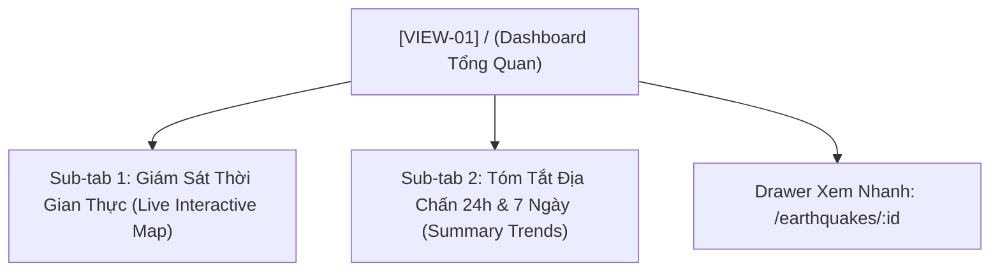

# [ĐẶC TẢ GIAO DIỆN VIEW: DASHBOARD ĐIỀU HÀNH TỔNG QUAN]

- **Mã view:** VIEW-01
- **Tên view:** Dashboard Điều Hành Tổng Quan
- **Route URL chính:** `/`
- **Khung bố cục kế thừa:** `LAYOUT-01 (Master App Shell)`
- **Chế độ hiển thị:** Dark Mode mặc định (`#0f172a`)
- **Tài liệu tham chiếu:**
  * [docs/planning/ui/00-master-app-shell.md](00-master-app-shell.md)
  * [docs/planning/features/02-usgs-ingestion.md](../features/02-usgs-ingestion.md)
  * [docs/planning/features/05-seismic-prediction.md](../features/05-seismic-prediction.md)
  * [docs/yeucaubatbuoc.md](../../yeucaubatbuoc.md) (§3. Giao diện, §4. Demo)
  * [docs/api/API.md](../../api/API.md) (§3.1, §3.2)

---

## 1. Mục Tiêu Nghiệp Vụ & Đối Tượng Sử Dụng (View Purpose & Persona)

### 1.1. Mục tiêu cốt lõi của view
- Là "bộ mặt trung tâm" của hệ thống GDMAS khi người dùng hoặc giảng viên vừa truy cập.
- Cung cấp cái nhìn bao quát 360 độ về hoạt động địa chấn toàn cầu trong 24 giờ qua: Tổng số sự kiện, trận động đất lớn nhất, độ sâu trung bình và chỉ báo dự báo rủi ro ngày mai ($t+1$).
- Tích hợp một bản đồ vệ tinh tương tác nhanh để quan sát các sự kiện địa chấn mới nhất vừa được thu thập từ USGS.

### 1.2. Kịch bản đánh giá của người dùng
- **Giảng viên / Người chấm thi:** Vừa mở trang là thấy ngay giao diện Dark Mode chuyên nghiệp, các chỉ số số liệu thực tế nạp từ API (kiểm tra qua F12 Network), không có dữ liệu hardcode tĩnh.
- **Nhà nghiên cứu / Người vận hành:** Nhận biết ngay vị trí xảy ra trận động đất mới nhất và mức độ nguy hiểm trong ngày kế tiếp.

---

## 2. Cây Cấu Trúc View & Các Thành Phần Con (Sub-Views & Tabs)



- **Sub-tab 1 (Mặc định):** Tập trung vào Bản đồ vệ tinh Leaflet hiển thị các chấm động đất theo mã màu Richter và danh sách 10 sự kiện mới nhất.
- **Sub-tab 2:** Biểu đồ xu hướng số lượng sự kiện 24h và 7 ngày qua, kèm phân bố cấp độ Richter.
- **Drawer chi tiết:** Mở trượt từ mép phải khi nhấp vào một sự kiện trên bản đồ hoặc danh sách.

---

## 3. Ma Trận Tổ Hợp Chức Năng Trên View (Features Composition Matrix)

| Vùng Hiển Thị Trên View | Chức Năng Tổ Hợp | Dữ Liệu Hiển Thị | Nguồn API / SSE |
| :--- | :--- | :--- | :--- |
| **4 Thẻ KPI Tóm Tắt** | `FEAT-02` (Ingestion) & `FEAT-05` (Prediction) | • Tổng số sự kiện 24h<br>• Trận lớn nhất ($M_{max}$)<br>• Độ sâu chấn tiêu trung bình<br>• Badge nguy cơ rủi ro $t+1$ | `GET /api/v1/statistics/earthquakes`<br>`GET /api/v1/predictions` |
| **Bản Đồ Địa Chấn Trực Quan** | `FEAT-02` (Events) & `FEAT-04` (Clustering) | Bản đồ Leaflet Dark Tile hiển thị các chấm động đất với bán kính tỷ lệ theo độ lớn | `GET /api/v1/earthquakes?limit=100` |
| **Biểu Đồ Tóm Tắt 24h / 7d** | `FEAT-03` (Analysis) | Biểu đồ Recharts cột phân bố số lượng động đất theo giờ trong ngày | `GET /api/v1/analysis/temporal?interval=day` |
| **Danh Sách Sự Kiện Mới Nhất**| `FEAT-02` (Ingestion) | Danh sách 10 sự kiện mới nạp từ USGS kèm thời gian tương đối ("5 phút trước") | `GET /api/v1/earthquakes?limit=10` |
| **Toast Thông Báo Nổi** | `FEAT-06` (Realtime SSE) | Pop-up trượt ở góc dưới khi có trận động đất mới phát sinh | `SSE /api/v1/events/stream` |

---

## 4. Bố Cục Không Gian Nội Dung Trong `<Outlet />` (Internal View Layout)

### 4.1. Sơ đồ phân vùng (ASCII Wireframe Layout)
```text
┌───────────────────────────────────────────────────────────────────────────────────┐
│ VIEW HEADER: Dashboard Điều Hành Trung Tâm │ Bộ chọn dải xem nhanh: [24h] [7d]   │
├───────────────────────────────────────────────────────────────────────────────────┤
│ KHỐI 1 (TOP): 4 THẺ KPI CHÍNH (Card Surface: #1e293b, Border: #334155)            │
│ ┌──────────────┐ ┌──────────────┐ ┌──────────────┐ ┌────────────────────────────┐ │
│ │ TỔNG SỰ KIỆN │ │ TRẬN LỚN NHẤT│ │ ĐỘ SÂU TB    │ │ DỰ BÁO RỦI RO NGÀY MAI     │ │
│ │ 142 sự kiện  │ │ M 6.2 Tonga  │ │ 28.4 km      │ │ 🟢 Normal Activity (46 eq) │ │
│ │ (+12% vs 24h)│ │ (Vùng biển)  │ │ (Chấn tiêu)  │ │ Độ tin cậy: 82%            │ │
│ └──────────────┘ └──────────────┘ └──────────────┘ └────────────────────────────┘ │
├────────────────────────────────────────┬──────────────────────────────────────────┤
│ KHỐI 2 (TRÁI 65% - PRIMARY WORKSPACE): │ KHỐI 3 (PHẢI 35% - EVENT FEED):          │
│ • Tabs: [Bản đồ tương tác] [Xu hướng]  │ • Tiêu đề: 10 Sự Kiện Mới Nhất           │
│ • Bản đồ Leaflet (Dark CartoDB layer)  │ • Danh sách thẻ cuộn dọc (Scrollable)    │
│   - Chấm đỏ: M >= 6.0                  │   [M 5.8] Honshu, Japan (12m trước)      │
│   - Chấm cam: 4.5 <= M < 6.0           │   [M 3.4] S. California, USA (25m trước) │
│   - Chấm xanh: M < 4.5                 │   [M 4.2] Fox Islands, Alaska (41m trước)│
│ • Popup thông tin nhanh khi click      │ • Nút "Xem tất cả sự kiện ->"            │
├────────────────────────────────────────┴──────────────────────────────────────────┤
│ KHỐI 4 (BOTTOM): BIỂU ĐỒ HOẠT ĐỘNG 24H VÀ PHÂN BỐ CẤP ĐỘ RICHTER                   │
│ • Biểu đồ cột Recharts phân bố 24 giờ qua │ • Biểu đồ tròn tỷ lệ cấp độ Richter    │
└───────────────────────────────────────────────────────────────────────────────────┘
```

---

## 5. Khả Năng Tương Tác & Điểm Cộng Người Dùng (§5.2)

### 5.1. Tương tác Bản đồ Trực quan
- **Phóng to / Thu nhỏ mượt mà:** Cho phép cuộn chuột Zoom và rê Pan khám phá các vùng địa chấn toàn cầu.
- **Tương tác Marker:** Khi nhấp chuột vào một điểm động đất, mở Popup hiển thị thông số chi tiết (Độ lớn Richter, Tọa độ, Độ sâu, Thời điểm xảy ra) và nút "Mở Drawer chi tiết".

### 5.2. Chuyển đổi nhanh dải quan sát (Quick Time Filter)
- Bộ nút chuyển đổi tức thì: `24 Giờ qua` | `7 Ngày qua` | `30 Ngày qua` (tự động cập nhật 4 thẻ KPI và bản đồ mà không cần tải lại trang).

---

## 6. Xử Lý Trạng Thái & Kịch Bản Phục Hồi Dữ Liệu (View States & Resilience)

1. **Trạng thái đang tải (Loading State):** Hiển thị 4 Skeleton Cards ở trên đỉnh và 2 Skeleton Containers giả lập bản đồ và danh sách.
2. **Trạng thái CSDL rỗng (Empty State - Bắt buộc cho kịch bản Demo §4):**
   * Khi giảng viên xóa sạch DB ở Bước 2 Demo, trang tự động hiển thị khối thông báo thẩm mỹ:
     > *"⚠️ Cơ sở dữ liệu hiện đang trống. Hãy chạy kịch bản phục hồi hoặc truy cập trang Hệ Thống để nạp lại dữ liệu."*
   * Đi kèm nút bấm hành động: `[Kích hoạt tính toán lại dữ liệu]`, điều hướng ngay sang `/system`.
3. **Trạng thái lỗi truy vấn API (Error State):** Bắt lỗi tại Error Boundary cục bộ, hiển thị banner đỏ và nút *"Tải lại"*.
4. **Trạng thái thời gian thực (Live SSE State):** Khi có sự kiện `earthquake_alert`, danh sách 10 sự kiện mới nhất tự động chèn dòng mới lên đầu với hiệu ứng đổi màu nhấp nháy (`animate-bounce` nhẹ).

---

## 7. Danh Mục API Endpoints Tiêu Thụ (Consumed APIs)

| Phương Thức | Đường Dẫn Endpoint | Mục Đích | Dữ Liệu Nhận Về |
| :--- | :--- | :--- | :--- |
| `GET` | `/api/v1/statistics/earthquakes` | Cung cấp số liệu cho 3 thẻ KPI đầu tiên | `total_count`, `max_magnitude`, `avg_magnitude` |
| `GET` | `/api/v1/predictions` | Cung cấp số liệu cho thẻ KPI Dự báo rủi ro | `predicted_value`, `predicted_label`, `confidence` |
| `GET` | `/api/v1/earthquakes?limit=100` | Cung cấp tọa độ vẽ các điểm trên bản đồ | Mảng danh sách 100 sự kiện địa chấn gần nhất |
| `GET` | `/api/v1/earthquakes?limit=10` | Cung cấp danh sách sự kiện mới nhất bên phải | Danh sách 10 sự kiện phân trang đầu tiên |
| `SSE` | `/api/v1/events/stream` | Lắng nghe sự kiện động đất mới theo thời gian thực | Event `earthquake_alert` |

---

## 8. Tiêu Chí Nghiệm Thu Giao Diện View (View Acceptance Criteria)

- [ ] **AC-VIEW-01-1 (KPIs & Dự báo thật):** 4 thẻ KPI hiển thị chuẩn xác, nạp 100% từ API (thẻ thứ 4 hiển thị đúng nhãn dự báo $t+1$ từ AI model).
- [ ] **AC-VIEW-01-2 (Bản đồ Leaflet mượt mà):** Bản đồ nạp các chấm động đất đúng hệ tọa độ WGS84, mã màu trực quan theo cấp độ Richter, không bị lag khi zoom.
- [ ] **AC-VIEW-01-3 (Cập nhật Realtime qua SSE):** Khi Terminal 2 nạp dữ liệu mới, danh sách 10 sự kiện tự động cập nhật mà không giật màn hình.
- [ ] **AC-VIEW-01-4 (Xử lý CSDL rỗng cho Demo §4):** Khi CSDL bị xóa, hiển thị đúng Empty state, có nút bấm dẫn sang `/system`, không xuất hiện lỗi đỏ console.
- [ ] **AC-VIEW-01-5 (Drawer xem chi tiết):** Nhấp vào sự kiện mở trượt Drawer chi tiết mượt mà, hiển thị đầy đủ thông số địa chấn và bản đồ vệ tinh thu nhỏ.

