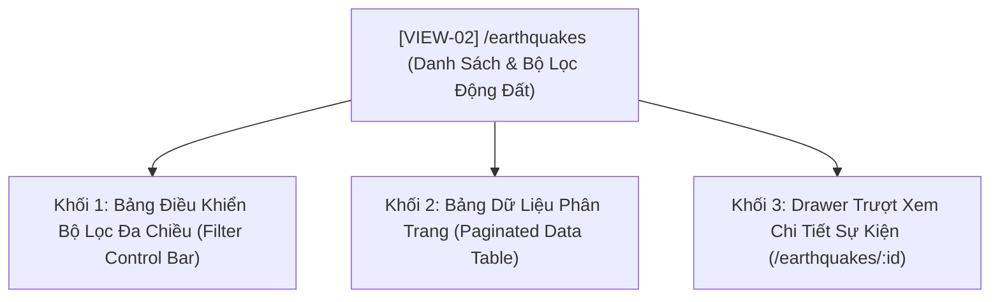

# [ĐẶC TẢ GIAO DIỆN VIEW: DANH SÁCH & BỘ LỌC ĐỘNG ĐẤT ĐA CHIỀU]

- **Mã view:** VIEW-02
- **Tên view:** Danh Sách & Bộ Lọc Động Đất Đa Chiều
- **Route URL chính:** `/earthquakes`
- **Khung bố cục kế thừa:** `LAYOUT-01 (Master App Shell)`
- **Chế độ hiển thị:** Dark Mode mặc định (`#0f172a`)
- **Tài liệu tham chiếu:**
  * [docs/planning/ui/00-master-app-shell.md](00-master-app-shell.md)
  * [docs/planning/features/02-usgs-ingestion.md](../features/02-usgs-ingestion.md)
  * [docs/yeucaubatbuoc.md](../../yeucaubatbuoc.md) (§3. Giao diện, §5.2. Điểm cộng tương tác lọc)
  * [docs/api/API.md](../../api/API.md) (§3.2. Endpoints `/api/v1/earthquakes`)

---

## 1. Mục Tiêu Nghiệp Vụ & Đối Tượng Sử Dụng (View Purpose & Persona)

### 1.1. Mục tiêu cốt lõi của view
- Cung cấp công cụ tra cứu, tìm kiếm và phân tích sâu toàn bộ kho dữ liệu địa chấn lịch sử và thời gian thực do USGS cung cấp.
- Cho phép người dùng lọc linh hoạt theo nhiều chiều dữ liệu: Cấp độ Richter, độ sâu chấn tiêu, khoảng thời gian và khu vực địa lý.
- Hiển thị bảng dữ liệu khoa học có phân trang mượt mà (20, 50, 100 bản ghi/trang) và hỗ trợ mở ngăn kéo (Drawer) xem chi tiết từng sự kiện.

### 1.2. Kịch bản đánh giá của người dùng
- **Giảng viên / Hội đồng chấm thi:** Kiểm tra tính năng lọc tương tác động (Điểm cộng §5.2). Khi kéo thanh trượt Richter hoặc chọn dải độ sâu, bảng dữ liệu tự động gọi API backend tương ứng (kiểm tra F12 tab Network có query params `min_magnitude`, `max_depth`).
- **Nhà nghiên cứu:** Tìm kiếm các trận động đất có độ sâu lớn hơn 300km hoặc lọc nhanh các trận động đất mạnh tại một khu vực cụ thể.

---

## 2. Cây Cấu Trúc View & Các Thành Phần Con (Sub-Views & Drawers)



- **Filter Control Bar:** Thanh công cụ phía trên gồm thanh trượt Slider Richter kép, bộ chọn độ sâu, bộ chọn khoảng ngày và nút xuất file CSV.
- **Paginated Data Table:** Bảng hiển thị thông số địa chấn chuẩn hóa, hỗ trợ sắp xếp theo cột (Thời gian, Độ lớn, Độ sâu).
- **Detail Drawer (Right-side slide-over):** Trượt ra từ mép phải khi người dùng bấm vào một dòng dữ liệu, hiển thị tọa độ WGS84, mã trạm USGS, URL gốc và bản đồ mini định vị chấn tâm.

---

## 3. Ma Trận Tổ Hợp Chức Năng Trên View (Features Composition Matrix)

| Vùng Hiển Thị Trên View | Chức Năng Tổ Hợp | Dữ Liệu Hiển Thị | Nguồn API / SSE |
| :--- | :--- | :--- | :--- |
| **Bảng Điều Khiển Bộ Lọc** | `FEAT-02` (Ingestion) | Slider độ lớn Richter ($0.0 - 9.0$), Dropdown độ sâu, Date Picker | Truyền params vào `GET /api/v1/earthquakes` |
| **Bảng Dữ Liệu Địa Chấn** | `FEAT-02` (Events) | Danh sách sự kiện: Cấp độ, Vị trí, Thời gian UTC/ICT, Độ sâu, Mã USGS | `GET /api/v1/earthquakes?page=1&limit=20` |
| **Drawer Chi Tiết Sự Kiện**| `FEAT-02` (Events) & `FEAT-06` | Toàn bộ metadata, tọa độ chi tiết, GeoJSON gốc `raw_data`, link USGS | `GET /api/v1/earthquakes/{id}` |
| **Thông Báo Realtime** | `FEAT-06` (Realtime SSE) | Nhấp nháy dòng mới khi có sự kiện vừa nạp từ USGS | `SSE /api/v1/events/stream` |

---

## 4. Bố Cục Không Gian Nội Dung Trong `<Outlet />` (Internal View Layout)

### 4.1. Sơ đồ phân vùng (ASCII Wireframe Layout)
```text
┌───────────────────────────────────────────────────────────────────────────────────┐
│ VIEW HEADER: Khám Phá & Tra Cứu Sự Kiện Địa Chấn │ Tổng cộng: 15,420 sự kiện      │
├───────────────────────────────────────────────────────────────────────────────────┤
│ KHỐI 1 (TOP): BỘ LỌC ĐA CHIỀU (Filter Bar - Surface: #1e293b, Border: #334155)    │
│ ┌──────────────────────┐ ┌────────────────┐ ┌──────────────────┐ ┌──────────────┐ │
│ │ SLIDER ĐỘ LỚN:       │ │ ĐỘ SÂU CHẤN:   │ │ KHOẢNG THỜI GIAN:│ │ HÀNH ĐỘNG:   │ │
│ │ [=====●========]     │ │ [ Tất cả độ sâu▼] │ [ 7 Ngày qua  ▼] │ │ [Đặt lại lọc]│ │
│ │ 3.0 - 8.5 Richter    │ │ <70km / 70-300km│ │ hoặc chọn ngày   │ │ [Xuất CSV]   │ │
│ └──────────────────────┘ └────────────────┘ └──────────────────┘ └──────────────┘ │
├───────────────────────────────────────────────────────────────────────────────────┤
│ KHỐI 2 (MAIN): BẢNG DỮ LIỆU ĐỊA CHẤN CÓ PHÂN TRANG (Paginated Data Table)          │
│ ┌──────┬────────┬─────────────────────────────┬───────────┬─────────┬───────────┐ │
│ │ CẤP  │ ĐỘ LỚN │ ĐỊA ĐIỂM (PLACE)            │ THỜI GIAN │ ĐỘ SÂU  │ CHI TIẾT  │ │
│ ├──────┼────────┼─────────────────────────────┼───────────┼─────────┼───────────┤ │
│ │ 🔴   │ M 6.2  │ Tonga Region (Biển)         │ 10:45 UTC │ 15.4 km │ [Xem ↗]   │ │
│ │ 🟡   │ M 4.8  │ 92 km W of Meulaboh, IDN    │ 10:12 UTC │ 35.0 km │ [Xem ↗]   │ │
│ │ 🟢   │ M 2.4  │ 8 km SSE of Pahala, Hawaii  │ 09:55 UTC │ 31.8 km │ [Xem ↗]   │ │
│ └──────┴────────┴─────────────────────────────┴───────────┴─────────┴───────────┘ │
│ THANH PHÂN TRANG: Hiển thị 1 - 20 trong 15,420 kết quả │ [<] [1] [2] [3] ... [771] [>]│
└───────────────────────────────────────────────────────────────────────────────────┘
```

---

## 5. Khả Năng Tương Tác & Điểm Cộng Người Dùng (§5.2)

### 5.1. Thanh trượt lọc độ lớn Richter (Magnitude Dual Slider)
- Thanh trượt 2 đầu (Range Slider) từ $0.0$ đến $9.0$ Richter.
- Cơ chế **Debounce 300ms**: Khi người dùng kéo trượt, giao diện không spam API liên tục mà chỉ gửi request sau khi người dùng dừng ngón tay/chuột 300ms, giúp ứng dụng cực kỳ mượt mà.

### 5.2. Bộ lọc độ sâu chấn tiêu (Depth Filter)
- Phân loại trực quan 3 tầng địa chấn:
  * **Nông (< 70 km):** Chiếm đa số, nguy cơ sạt lở hoặc rung chấn mặt đất cao.
  * **Trung bình (70 - 300 km):** Rung chuyển diện rộng.
  * **Sâu (> 300 km):** Chấn tiêu sâu trong lòng thạch quyển.

### 5.3. Drawer Xem Chi Tiết Sự Kiện (Right Slide-over Drawer)
- Chiều rộng `w-[480px]`, trượt ra từ mép phải với hiệu ứng làm mờ nền (Backdrop blur).
- Hiển thị bản đồ mini Leaflet phóng to đúng chấn tâm sự kiện kèm vòng tròn bán kính ảnh hưởng.
- Cung cấp liên kết trực tiếp tới trang phân tích USGS chính thức (`https://earthquake.usgs.gov/earthquakes/eventpage/...`).

---

## 6. Xử Lý Trạng Thái & Khả Năng Phục Hồi Dữ Liệu (View States & Resilience)

1. **Trạng thái đang tải (Loading State):** Hiển thị bảng Skeleton gồm 10 dòng nhấp nháy, giữ nguyên chiều rộng các cột.
2. **Trạng thái CSDL rỗng (Empty State - Bắt buộc cho kịch bản Demo §4):**
   * Khi CSDL bị xóa ở Bước 2 Demo, bảng hiển thị hàng trống kèm thông báo:
     > *"⚠️ Không tìm thấy sự kiện địa chấn nào trong CSDL. Hãy kích hoạt Terminal Ingestion hoặc Seeder để nạp lại dữ liệu."*
3. **Trạng thái không có kết quả phù hợp (No Results Filter State):**
   * Khi người dùng kéo bộ lọc quá khắt khe (ví dụ: $M > 8.5$ trong 24h qua), hiển thị: *"Không có sự kiện nào thỏa mãn điều kiện lọc. Nhấp 'Đặt lại bộ lọc' để xem toàn bộ sự kiện."*
4. **Trạng thái lỗi kết nối (Error State):** Hiển thị khối lỗi màu đỏ giữa bảng kèm nút bấm *"Thử lại"*.

---

## 7. Danh Mục API Endpoints Tiêu Thụ (Consumed APIs)

| Phương Thức | Đường Dẫn Endpoint | Tham Số Query Chính | Dữ Liệu Nhận Về |
| :--- | :--- | :--- | :--- |
| `GET` | `/api/v1/earthquakes` | `page`, `limit`, `min_magnitude`, `max_magnitude`, `min_depth`, `max_depth`, `start_time`, `end_time`, `sort_by`, `order` | Mảng danh sách sự kiện kèm `metadata` phân trang |
| `GET` | `/api/v1/earthquakes/{id}` | Không (truyền ID trên path) | Chi tiết toàn bộ sự kiện, tọa độ, `raw_data` |
| `SSE` | `/api/v1/events/stream` | Không | Lắng nghe `earthquake_alert` để chèn dòng mới |

---

## 8. Tiêu Chí Nghiệm Thu Giao Diện View (View Acceptance Criteria)

- [ ] **AC-VIEW-02-1 (Phân trang chuẩn xác):** Phân trang hoạt động trơn tru với các kích thước trang 20, 50, 100 bản ghi; chuyển trang dưới 100ms.
- [ ] **AC-VIEW-02-2 (Bộ lọc Slider Richter Debounce):** Kéo thanh trượt Richter phản hồi mượt mà, có debounce 300ms, gọi API đúng các tham số query `min_magnitude`/`max_magnitude`.
- [ ] **AC-VIEW-02-3 (Sắp xếp cột dữ liệu):** Nhấp vào tiêu đề cột (Thời gian, Độ lớn, Độ sâu) chuyển đổi linh hoạt chiều sắp xếp tăng dần / giảm dần.
- [ ] **AC-VIEW-02-4 (Drawer chi tiết mượt mà):** Mở xem chi tiết sự kiện hiển thị đúng bản đồ mini và thông số kỹ thuật, không làm tải lại toàn trang.
- [ ] **AC-VIEW-02-5 (Xử lý CSDL rỗng cho Demo §4):** Khi CSDL bị xóa, bảng hiển thị đúng Empty state, không phát sinh lỗi vỡ layout hoặc lỗi undefined.

