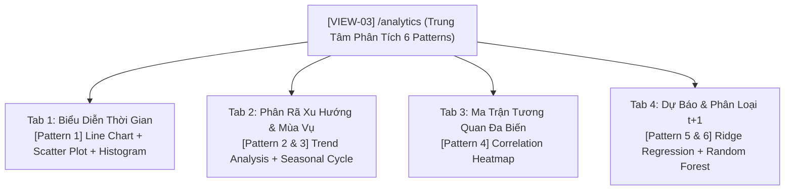

# [ĐẶC TẢ GIAO DIỆN VIEW: TRUNG TÂM PHÂN TÍCH 6 PATTERNS CHUỖI THỜI GIAN]

- **Mã view:** VIEW-03
- **Tên view:** Trung Tâm Phân Tích 6 Patterns Chuỗi Thời Gian (Time-Series Analytics Workspace)
- **Route URL chính:** `/analytics`
- **Khung bố cục kế thừa:** `LAYOUT-01 (Master App Shell)`
- **Chế độ hiển thị:** Dark Mode mặc định (`#0f172a`)
- **Tài liệu tham chiếu:**
  * [docs/planning/ui/00-master-app-shell.md](00-master-app-shell.md)
  * [docs/yeucaubatbuoc.md](../../yeucaubatbuoc.md) (§2. 6 Patterns bắt buộc, §3. Giao diện, §5.2. Điểm cộng Zoom & Filter)
  * [docs/planning/features/03-timeseries-analysis.md](../features/03-timeseries-analysis.md)
  * [docs/planning/features/05-seismic-prediction.md](../features/05-seismic-prediction.md)
  * [docs/api/API.md](../../api/API.md) (§3.3. Endpoints Phân tích Chuỗi thời gian)

---

## 1. Mục Tiêu Nghiệp Vụ & Đối Tượng Sử Dụng (View Purpose & Persona)

### 1.1. Mục tiêu cốt lõi của view
- **Trọng tâm đánh giá đồ án học phần (Chiếm 3.0 điểm bắt buộc):** Trực quan hóa trọn vẹn, khoa học và thẩm mỹ cao toàn bộ **6 Patterns phân tích chuỗi thời gian** theo chỉ đạo của TS. Phạm Tuấn.
- Cung cấp không gian làm việc chuyên sâu cho người dùng khám phá: Phân bố sự kiện theo thời gian, xu hướng dài hạn (Trend) sau Re-sampling, chu kỳ mùa vụ (Seasonality), tương quan đa biến (Correlation Heatmap) và kết quả dự báo/phân loại ngày mai ($t+1$).
- **Điểm cộng tương tác (§5.2):** Tích hợp thanh trượt phóng to dải thời gian (`<Brush />` trong Recharts) để người dùng kéo co giãn xem chi tiết từng giờ/ngày/tháng.

### 1.2. Kịch bản đánh giá của giảng viên / hội đồng
- Mở lần lượt 4 tiểu màn hình phân tích (Tabs), kiểm tra F12 tab Network để chứng minh:
  1. Dữ liệu vẽ biểu đồ được tính toán bởi thuật toán backend và nạp qua API thật (không hardcode số liệu tĩnh).
  2. Thao tác kéo thanh trượt Zoom Brush trên biểu đồ Line Chart phóng to thu nhỏ mượt mà.
  3. Khi xóa trắng CSDL (Bước 2 Demo), trang hiển thị Empty State cảnh báo CSDL trống thay vì biểu đồ trắng hoặc lỗi crash JavaScript.

---

## 2. Cây Cấu Trúc View & 4 Tiểu Màn Hình Phân Tích (Sub-Tabs Workspace)



---

## 3. Ma Trận Tổ Hợp 6 Patterns Bắt Buộc Trên Giao Diện

| Mã Pattern | Tên Pattern Nghiệp Vụ | Thư Viện Biểu Đồ | Tính Năng Tương Tác (§5.2) | Nguồn API Backend |
| :---: | :--- | :--- | :--- | :--- |
| **Pattern 1** | **Biểu diễn theo thời gian (3 biểu đồ):**<br>• `Line Chart`: Số lượng sự kiện<br>• `Scatter Plot`: Tương quan Thời gian - Độ lớn<br>• `Histogram`: Phân phối tần suất Richter | `Recharts`<br>(ResponsiveContainer, Line, Scatter, Bar) | • Chọn dải: Ngày / Tuần / Tháng<br>• **Thanh trượt Zoom Brush** kéo giãn dải quan sát | `GET /api/v1/analysis/temporal?interval=day` |
| **Pattern 2** | **Trend Analysis sau Re-sampling:**<br>Đường xu hướng dài hạn bóc tách từ chuỗi động đất | `Recharts` (ComposedChart: Line Trend + Area Actual) | Chuyển đổi tần suất Re-sampling: Theo Tuần (`W`) hoặc Theo Tháng (`M`) | `GET /api/v1/analysis/trend?resample_freq=M` |
| **Pattern 3** | **Seasonality sau Re-sampling:**<br>Đường chu kỳ mùa vụ lặp lại theo tháng trong năm | `Recharts` (Seasonal Line Chart kèm hệ số chu kỳ) | Xem giải thích chu kỳ tự động (Interpretation badge) | `GET /api/v1/analysis/seasonality?resample_freq=M` |
| **Pattern 4** | **Ma Trận Tương Quan (Correlation Heatmap):**<br>Tương quan giữa Độ lớn, Độ sâu, Tọa độ và Tần suất | Custom SVG / Canvas Heatmap Grid | Di chuột (Hover Tooltip) hiển thị hệ số tương quan Pearson ($r$) | `GET /api/v1/analysis/correlation` |
| **Pattern 5** | **Dự báo định lượng ngày mai ($t+1$):**<br>Số lượng sự kiện dự kiến kèm khoảng tin cậy | `Recharts` (Area Chart với dải tin cậy 95% Upper/Lower) | Xem sai số MAE, RMSE của mô hình dự báo | `GET /api/v1/predictions` |
| **Pattern 6** | **Phân loại rủi ro địa chấn ngày mai ($t+1$):**<br>Huy hiệu nhãn (`Low`, `Normal`, `High`) và phân bổ xác suất | Recharts Bar Chart ngang (Probability Scores) | Huy hiệu màu động (Xanh/Vàng/Đỏ) kèm độ chính xác F1-Score | `GET /api/v1/classifications` |

---

## 4. Bố Cục Không Gian Nội Dung Trong `<Outlet />` (Internal View Layout)

### 4.1. Sơ đồ phân vùng (ASCII Wireframe Layout)
```text
┌───────────────────────────────────────────────────────────────────────────────────┐
│ VIEW HEADER: Trung Tâm Phân Tích Chuỗi Thời Gian (6 Patterns Bắt Buộc)            │
│ ┌───────────────────────────────────────────────────────────────────────────────┐ │
│ │ TABS CHỌN PATTERN:                                                            │ │
│ │ [Tab 1: Biểu diễn TG (P1)] [Tab 2: Trend & Mùa vụ (P2,3)] [Tab 3: Heatmap (P4)] │
│ │ [Tab 4: Dự báo t+1 (P5,6)]                                                    │ │
│ └───────────────────────────────────────────────────────────────────────────────┘ │
├───────────────────────────────────────────────────────────────────────────────────┤
│ KHỐI NỘI DUNG CHÍNH CỦA TAB ĐƯỢC CHỌN (Surface: #1e293b, Border: #334155, P: 24px) │
│                                                                                   │
│ [VÍ DỤ TẠI TAB 1: BIỂU DIỄN THỜI GIAN & HISTOGRAM]                                 │
│ ┌───────────────────────────────────────────────────────────────────────────────┐ │
│ │ TIÊU ĐỀ: Biểu Đồ Đường Chuỗi Thời Gian │ Bộ chọn: [Ngày] [Tuần] [Tháng]       │ │
│ │                                                                               │ │
│ │    Số lượng                                                                   │ │
│ │      ▲         /\      /\                                                     │ │
│ │      │   /\   /  \    /  \        /---\                                       │ │
│ │      │--/--\-/----\--/----\------/-----\-------- (Line Chart)                 │ │
│ │      └───────────────────────────────────► Thời gian                          │ │
│ │       [======●========================●=======] <-- ZOOM BRUSH THANH TRƯỢT    │ │
│ └───────────────────────────────────────────────────────────────────────────────┘ │
│ ┌──────────────────────────────────────┬────────────────────────────────────────┐ │
│ │ BIỂU ĐỒ PHÂN TÁN (SCATTER PLOT)      │ BIỂU ĐỒ PHÂN PHỐI TẦN SUẤT (HISTOGRAM) │ │
│ │ • Trục X: Thời gian │ Trục Y: Độ lớn │ • Các cột phân khoảng cấp độ Richter   │ │
│ │ • Các chấm phân tán theo thời gian   │ • Bins: 1-2, 2-3, 3-4, 4-5, >=5        │ │
│ └──────────────────────────────────────┴────────────────────────────────────────┘ │
└───────────────────────────────────────────────────────────────────────────────────┘
```

---

## 5. Khả Năng Tương Tác & Điểm Cộng Người Dùng (§5.2)

### 5.1. Tương tác Phóng To Dải Thời Gian (Interactive Zoom Brush)
- Bên dưới biểu đồ đường chuỗi thời gian tích hợp thành phần `<Brush dataKey="date" height={30} stroke="#38bdf8" />`.
- Cho phép người dùng kéo 2 đầu thanh trượt để thu hẹp dải quan sát (ví dụ: phóng to xem chi tiết các ngày xảy ra chùm động đất lớn) hoặc kéo rê toàn bộ thanh trượt để xem dòng thời gian cuốn chiếu.

### 5.2. Chuyển đổi linh hoạt tần suất Re-sampling
- Tại Tab 2 (Trend & Seasonality), cho phép người dùng chuyển đổi tức thì giữa:
  * **Re-sampling theo Tuần (`W`):** Quan sát dao động ngắn hạn.
  * **Re-sampling theo Tháng (`M`):** Quan sát xu hướng vĩ mô dài hạn.

### 5.3. Tooltip Tương Tác Đa Chiều (Multi-Dimensional Tooltip)
- Khi rê chuột qua các điểm trên biểu đồ, Tooltip hiển thị:
  * Ngày / Giờ cụ thể.
  * Số lượng sự kiện thực tế và giá trị xu hướng.
  * Trận động đất lớn nhất trong chu kỳ đó kèm vị trí địa lý.

---

## 6. Xử Lý Trạng Thái & Khả Năng Phục Hồi Dữ Liệu (View States & Resilience)

1. **Trạng thái đang tải (Loading State):** Hiển thị khung Skeleton Loader giả lập 3 khung biểu đồ chữ nhật có hiệu ứng mờ nhấp nháy (`animate-pulse`).
2. **Trạng thái CSDL rỗng (Empty State - Bắt buộc cho kịch bản Demo §4):**
   * Khi giảng viên xóa sạch dữ liệu DB ở Bước 2 Demo, toàn bộ 4 tabs chuyển sang màn hình thông báo cảnh báo:
     > *"⚠️ Chưa có dữ liệu phân tích chuỗi thời gian trong CSDL. Hãy kích hoạt Terminal 03 (Analysis Worker) hoặc chạy script phục hồi tại trang Hệ Thống."*
   * Có nút bấm `[Chuyển sang trang Hệ Thống để chạy Worker]`, ngăn chặn tuyệt đối lỗi sập giao diện (Crash).
3. **Trạng thái lỗi tính toán thuật toán (Error State):** Hiển thị khối lỗi riêng biệt cho từng biểu đồ, không để lỗi của 1 pattern làm sập cả trang.

---

## 7. Danh Mục API Endpoints Tiêu Thụ (Consumed APIs)

| Pattern | Phương Thức | Đường Dẫn Endpoint | Tham Số Query | Dữ Liệu Nhận Về |
| :---: | :--- | :--- | :--- | :--- |
| **Pattern 1** | `GET` | `/api/v1/analysis/temporal` | `interval=day\|week\|month`, `start_time`, `end_time` | Mảng `line_chart`, `scatter_plot`, `histogram` |
| **Pattern 2** | `GET` | `/api/v1/analysis/trend` | `resample_freq=W\|M`, `metric=count` | Mảng chuỗi xu hướng `series`, độ dốc `slope`, `trend_direction` |
| **Pattern 3** | `GET` | `/api/v1/analysis/seasonality`| `resample_freq=M` | `seasonal_line`, `seasonality_strength`, `interpretation` |
| **Pattern 4** | `GET` | `/api/v1/analysis/correlation`| Không | Mảng danh sách biến `variables` và ma trận vuông `matrix` 2D |
| **Pattern 5** | `GET` | `/api/v1/predictions` | Không | `target_date`, `predicted_value`, `confidence_interval`, sai số `mae` |
| **Pattern 6** | `GET` | `/api/v1/classifications` | Không | `predicted_label`, `probabilities` 3 mức, `f1_macro` |

---

## 8. Tiêu Chí Nghiệm Thu Giao Diện View (View Acceptance Criteria)

- [ ] **AC-VIEW-03-1 (Độ bao phủ trọn vẹn 6 Patterns):** Hiển thị đầy đủ cả 6 patterns bắt buộc trên 4 tabs, nạp 100% từ API thật qua tab Network F12.
- [ ] **AC-VIEW-03-2 (Tương tác Zoom Brush mượt mà - Điểm cộng §5.2):** Thanh trượt `<Brush />` kéo giãn dải thời gian phản hồi dưới 50ms, biểu đồ tự động zoom in/zoom out mượt mà.
- [ ] **AC-VIEW-03-3 (Ma trận nhiệt Heatmap trực quan):** Heatmap tương quan đa biến hiển thị chuẩn thang màu từ $-1.0$ (Xanh âm) đến $+1.0$ (Đỏ dương), hover xem số liệu chi tiết.
- [ ] **AC-VIEW-03-4 (Dự báo t+1 & Dải tin cậy):** Tab dự báo hiển thị rõ ràng số liệu dự đoán ngày mai, dải tin cậy 95% và nhãn mức độ rủi ro địa chấn từ mô hình AI.
- [ ] **AC-VIEW-03-5 (Khả năng chịu lỗi Demo §4):** Khi CSDL rỗng, hiển thị đúng thông báo Empty state, tuyệt đối không xuất hiện màn hình trắng hoặc lỗi crash JavaScript.

