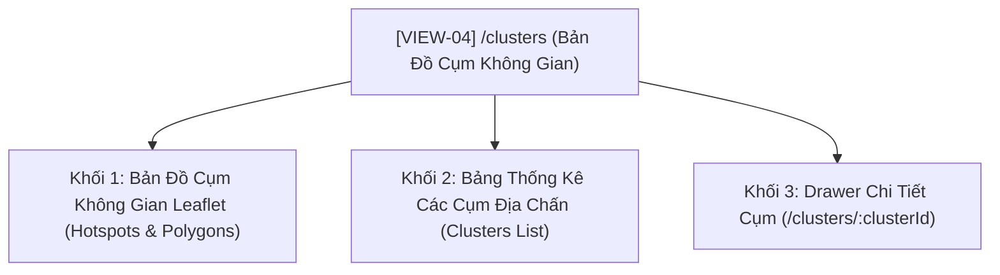

# [ĐẶC TẢ GIAO DIỆN VIEW: BẢN ĐỒ CỤM KHÔNG GIAN ĐỊA CHẤN]

- **Mã view:** VIEW-04
- **Tên view:** Bản Đồ Cụm Không Gian Địa Chấn (DBSCAN Spatial Clustering Map)
- **Route URL chính:** `/clusters`
- **Khung bố cục kế thừa:** `LAYOUT-01 (Master App Shell)`
- **Chế độ hiển thị:** Dark Mode mặc định (`#0f172a`)
- **Tài liệu tham chiếu:**
  * [docs/planning/ui/00-master-app-shell.md](00-master-app-shell.md)
  * [docs/planning/features/04-spatial-clustering.md](../features/04-spatial-clustering.md)
  * [docs/yeucaubatbuoc.md](../../yeucaubatbuoc.md) (§1. Kiến trúc hệ thống, §3. Giao diện)
  * [docs/api/API.md](../../api/API.md) (§3.4. Endpoints Phân Cụm `/api/v1/clusters`)

---

## 1. Mục Tiêu Nghiệp Vụ & Đối Tượng Sử Dụng (View Purpose & Persona)

### 1.1. Mục tiêu cốt lõi của view
- **Trực quan hóa kết quả phân cụm không gian của Terminal 4 (`FEAT-04`):** Sử dụng thuật toán học máy không giám sát **DBSCAN** (Density-Based Spatial Clustering of Applications with Noise) để tự động phát hiện các chùm động đất (Earthquake Swarms) và các đới đứt gãy hoạt động mạnh trên toàn cầu.
- Thể hiện trực quan ranh giới của các cụm địa chấn thông qua các đa giác bao lồi (Convex Hull) hoặc vòng tròn bán kính mật độ, phân biệt rõ ràng giữa các điểm thuộc cụm và các điểm nhiễu đơn lẻ (`noise points`).
- Cung cấp danh mục bảng phân tích chi tiết từng cụm: Vị trí tâm cụm, số lượng trận động đất, độ lớn trung bình, trận động đất mạnh nhất trong cụm và danh sách sự kiện chi tiết.

### 1.2. Kịch bản đánh giá của người dùng
- **Giảng viên / Người chấm thi:** Quan sát bản đồ Leaflet hiển thị các cụm động đất có màu sắc phân biệt rõ ràng. Nhấp chuột vào một cụm trên bản đồ để làm nổi bật (Highlight) cụm đó và mở Drawer hiển thị danh sách các trận động đất trong cụm.
- **Nhà địa chấn học:** Đánh giá mức độ tập trung động đất tại các "điểm nóng" (Ring of Fire - Vành đai lửa Thái Bình Dương, Đới đứt gãy San Andreas, Vùng rãnh Nhật Bản).

---

## 2. Cây Cấu Trúc View & Các Thành Phần Con (Sub-Views & Drawers)



- **MapArea (Khu vực bản đồ chính):** Chiếm diện tích chủ đạo, hiển thị các vòng tròn động đất tô màu theo mã cụm (`Cluster 1: Xanh`, `Cluster 2: Đỏ`, `Cluster 3: Cam`, `Nhiễu: Xám mờ`).
- **ClusterTable (Bảng danh mục cụm):** Đặt bên dưới hoặc cạnh bên, hiển thị danh sách các cụm đã phát hiện kèm thông số thống kê.
- **ClusterDrawer (Drawer danh sách sự kiện trong cụm):** Trượt ra từ mép phải khi người dùng chọn một cụm cụ thể.

---

## 3. Ma Trận Tổ Hợp Chức Năng Trên View (Features Composition Matrix)

| Vùng Hiển Thị Trên View | Chức Năng Tổ Hợp | Dữ Liệu Hiển Thị | Nguồn API / SSE |
| :--- | :--- | :--- | :--- |
| **Bản Đồ Cụm Không Gian** | `FEAT-04` (Clustering) & `FEAT-02` (Events) | Lớp bản đồ Leaflet Dark Theme hiển thị các điểm động đất gom nhóm và đa giác viền cụm | `GET /api/v1/clusters` |
| **Thẻ Tóm Tắt Thuật Toán** | `FEAT-04` (Clustering) | Tham số thuật toán: Thuật toán DBSCAN, Bán kính $\epsilon = 150$ km, $MinPts = 5$, Tổng số cụm phát hiện, Số điểm nhiễu | `GET /api/v1/clusters` (`parameters`, `clusters_count`, `noise_count`) |
| **Bảng Thống Kê Cụm** | `FEAT-04` (Clustering) | Danh sách từng cụm: Mã cụm, Tọa độ tâm, Số sự kiện, Độ lớn lớn nhất ($M_{max}$) | `GET /api/v1/clusters` (`clusters` array) |
| **Drawer Sự Kiện Trong Cụm**| `FEAT-04` & `FEAT-02` | Danh sách toàn bộ các trận động đất thuộc về cụm đang chọn | `GET /api/v1/earthquakes?cluster_id={id}` |

---

## 4. Bố Cục Không Gian Nội Dung Trong `<Outlet />` (Internal View Layout)

### 4.1. Sơ đồ phân vùng (ASCII Wireframe Layout)
```text
┌───────────────────────────────────────────────────────────────────────────────────┐
│ VIEW HEADER: Bản Đồ Cụm Không Gian Địa Chấn │ DBSCAN Algorithm (1 Ngày / Lần)      │
├───────────────────────────────────────────────────────────────────────────────────┤
│ KHỐI 1 (TOP STRIP): 3 THẺ TÓM TẮT PHÂN CỤM (Card Surface: #1e293b, Border: #334155)│
│ ┌──────────────────────┐ ┌──────────────────────┐ ┌─────────────────────────────┐ │
│ │ TỔNG SỐ CỤM PHÁT HIỆN│ │ ĐIỂM THUỘC CỤM / NHIỄU│ │ THAM SỐ THUẬT TOÁN (DBSCAN) │ │
│ │ 8 Cụm Địa Chấn       │ │ 1,240 điểm / 24 nhiễu │ │ Epsilon: 150km │ MinPts: 5  │ │
│ └──────────────────────┘ └──────────────────────┘ └─────────────────────────────┘ │
├────────────────────────────────────────┬──────────────────────────────────────────┤
│ KHỐI 2 (TRÁI 65% - CLUSTER MAP):       │ KHỐI 3 (PHẢI 35% - CLUSTERS SUMMARY):    │
│ • Bản đồ Leaflet (Dark CartoDB layer)  │ • Tiêu đề: Danh Sách 8 Cụm Địa Chấn      │
│ • Các cụm động đất phân màu khác nhau: │ • Danh sách thẻ cuộn dọc (Click to focus)│
│   - Cụm 1 (Đỏ): Vành đai Honshu, JP    │   ┌────────────────────────────────────┐ │
│   - Cụm 2 (Vàng): Vùng biển Tonga      │   │ [Cụm 1] Vùng Honshu, Nhật Bản      │ │
│   - Cụm 3 (Xanh): Nam California, Mỹ   │   │ 48 sự kiện │ Mmax: 6.1 │ Mtb: 4.6   │ │
│   - Điểm xám: Động đất phân tán nhiễu  │   │ [Nhấp để xem danh sách sự kiện ↗]  │ │
│ • Lớp đa giác viền bao cụm (ConvexHull)│   └────────────────────────────────────┘ │
│ • Phóng to / Thu nhỏ / Kéo rê mượt mà  │   ┌────────────────────────────────────┐ │
│                                        │   │ [Cụm 2] Quần đảo Tonga (Biển)      │ │
│                                        │   │ 32 sự kiện │ Mmax: 6.2 │ Mtb: 4.8   │ │
│                                        │   └────────────────────────────────────┘ │
└────────────────────────────────────────┴──────────────────────────────────────────┘
```

---

## 5. Khả Năng Tương Tác & Điểm Cộng Người Dùng (§5.2)

### 5.1. Tương tác Bản đồ & Đồng Bộ Danh Sách (Two-Way Map Synchronization)
- Khi người dùng nhấp chọn một dòng cụm trên bảng danh sách bên phải:
  * Bản đồ Leaflet tự động di chuyển khung nhìn (Pan & Zoom) mượt mà đến vị trí tọa độ tâm cụm (`center_latitude`, `center_longitude`).
  * Đa giác bao quanh cụm được làm sáng nổi bật (`highlight stroke`).
- Khi người dùng nhấp vào một điểm trên bản đồ:
  * Popup hiển thị thông tin: Trận động đất này thuộc về Cụm số mấy, độ lớn Richter và độ sâu.

### 5.2. Drawer Danh Sách Sự Kiện Chi Tiết Của Cụm
- Mở Drawer bên phải hiển thị danh sách tất cả các trận động đất cấu thành nên cụm đó, kèm biểu đồ thời gian nhỏ cho thấy chùm động đất bùng phát trong khoảng ngày nào.

---

## 6. Xử Lý Trạng Thái & Khả Năng Phục Hồi Dữ Liệu (View States & Resilience)

1. **Trạng thái đang tải (Loading State):** Hiển thị Skeleton Loader giả lập khung bản đồ lớn và 4 thẻ danh sách cụm bên phải.
2. **Trạng thái CSDL rỗng (Empty State - Bắt buộc cho kịch bản Demo §4):**
   * Khi CSDL bị xóa ở Bước 2 Demo, trang hiển thị Empty State thẩm mỹ:
     > *"⚠️ Chưa có dữ liệu phân cụm địa chấn trong CSDL. Hãy kích hoạt Terminal 04 (Clustering Worker) hoặc chạy kịch bản phục hồi tại trang Hệ Thống."*
   * Có nút bấm `[Chuyển sang trang Hệ Thống để chạy Worker]`, ngăn chặn crash JavaScript.
3. **Trạng thái chưa phát hiện cụm nào (No Clusters Found):**
   * Nếu dữ liệu quá thưa thớt không tạo thành cụm, hiển thị thông báo giải thích do mật độ địa chấn chưa đạt ngưỡng $MinPts$.

---

## 7. Danh Mục API Endpoints Tiêu Thụ (Consumed APIs)

| Phương Thức | Đường Dẫn Endpoint | Tham Số Query | Dữ Liệu Nhận Về |
| :--- | :--- | :--- | :--- |
| `GET` | `/api/v1/clusters` | Không | Danh sách các cụm, tham số `eps_km`, `min_samples`, số lượng nhiễu |
| `GET` | `/api/v1/earthquakes` | `cluster_id={id}` | Danh sách các sự kiện địa chấn thuộc về một cụm cụ thể |

---

## 8. Tiêu Chí Nghiệm Thu Giao Diện View (View Acceptance Criteria)

- [ ] **AC-VIEW-04-1 (Trực quan hóa cụm trên Leaflet):** Các cụm động đất hiển thị phân biệt rõ ràng bằng màu sắc, các điểm nhiễu hiển thị màu xám mờ.
- [ ] **AC-VIEW-04-2 (Đồng bộ tương tác Bản đồ - Danh sách):** Nhấp chọn cụm bên phải tự động bay bản đồ (`flyTo`) đến tâm cụm và làm nổi bật cụm đó.
- [ ] **AC-VIEW-04-3 (Thông số thuật toán minh bạch):** Hiển thị rõ ràng thuật toán DBSCAN, bán kính $\epsilon$, số điểm $MinPts$ nạp từ API backend.
- [ ] **AC-VIEW-04-4 (Drawer xem chi tiết sự kiện cụm):** Mở xem danh sách các trận động đất trong cụm mượt mà, có phân trang hoặc cuộn mượt.
- [ ] **AC-VIEW-04-5 (Khả năng chịu lỗi Demo §4):** Khi CSDL rỗng, hiển thị đúng Empty state, không phát sinh lỗi bản đồ Leaflet hoặc crash React.

