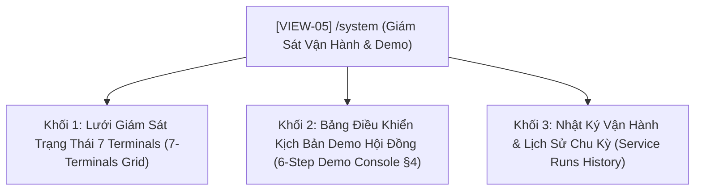

# [ĐẶC TẢ GIAO DIỆN VIEW: GIÁM SÁT VẬN HÀNH 7 TERMINALS & BẢNG ĐIỀU KHIỂN DEMO HỘI ĐỒNG]

- **Mã view:** VIEW-05
- **Tên view:** Giám Sát Vận Hành 7 Terminals & Bảng Điều Khiển Demo Hội Đồng (System Operations & Demo Console)
- **Route URL chính:** `/system`
- **Khung bố cục kế thừa:** `LAYOUT-01 (Master App Shell)`
- **Chế độ hiển thị:** Dark Mode mặc định (`#0f172a`)
- **Tài liệu tham chiếu:**
  * [docs/planning/ui/00-master-app-shell.md](00-master-app-shell.md)
  * [docs/yeucaubatbuoc.md](../../yeucaubatbuoc.md) (§1. 7 Terminals độc lập, §4. Kịch bản Demo bắt buộc)
  * [docs/tailieukientructuAI.md](../../tailieukientructuAI.md) (§5.2. Phân bổ 7 Terminals)
  * [docs/api/API.md](../../api/API.md) (§3.1. System & Health APIs)

---

## 1. Mục Tiêu Nghiệp Vụ & Đối Tượng Sử Dụng (View Purpose & Persona)

### 1.1. Mục tiêu cốt lõi của view
- **Chứng minh kiến trúc 7 Services độc lập (Chiếm 3.0 điểm kiến trúc):** Giám sát trạng thái hoạt động theo thời gian thực của 7 khối hệ thống chạy trên 7 terminals riêng biệt:
  * `T1 - Database`: PostgreSQL 16
  * `T2 - Ingestion Worker`: Nạp USGS 5 phút/lần
  * `T3 - Analysis Worker`: Phân tích 4 patterns chuỗi thời gian 5 phút/lần
  * `T4 - Clustering Worker`: Phân cụm DBSCAN 1 ngày/lần
  * `T5 - Prediction Worker`: Dự báo & phân loại $t+1$ 5 phút/lần
  * `T6 - Database API`: FastAPI REST & SSE
  * `T7 - Web Client`: React + Vite Frontend
- **Hỗ trợ thực nghiệm kịch bản Demo 6 bước (§4):** Cung cấp giao diện trực quan cho hội đồng và giảng viên TS. Phạm Tuấn trực tiếp kích hoạt kiểm tra khả năng xử lý lỗi (Failure Test khi CSDL rỗng) và khả năng tự động phục hồi dữ liệu khi khởi động lại các worker.
- **Minh bạch hóa lịch sử vận hành:** Hiển thị danh sách các phiên chạy của các worker trích xuất từ bảng `service_runs`.

### 1.2. Kịch bản đánh giá của người dùng
- **Giảng viên / Hội đồng:** 
  1. Kiểm tra bảng trạng thái 7 terminals: Đèn xanh, chu kỳ quét và thời điểm chạy gần nhất (`last_run`).
  2. Tại bảng điều khiển Demo: Nhấp nút *"Mô phỏng xóa sạch CSDL"* -> Xem thông báo cảnh báo CSDL rỗng xuất hiện -> Nhấp nút *"Kích hoạt tính toán lại dữ liệu"* -> Chứng kiến toàn bộ dữ liệu 6 patterns được phục hồi tự động mà không cần can thiệp dòng lệnh phức tạp.

---

## 2. Cây Cấu Trúc View & Các Thành Phần Con (Sub-Views & Tabs)



---

## 3. Ma Trận Tổ Hợp Chức Năng Trên View (Features Composition Matrix)

| Vùng Hiển Thị Trên View | Chức Năng Tổ Hợp | Dữ Liệu Hiển Thị | Nguồn API / SSE |
| :--- | :--- | :--- | :--- |
| **Lưới 7 Terminals** | Toàn bộ `FEAT-01` đến `FEAT-07` | Trạng thái (Online/Running), Tần suất chu kỳ, Thời điểm chạy gần nhất (`last_run`), Tên terminal | `GET /api/v1/system/status` |
| **Bảng Điều Khiển Demo §4** | `FEAT-01` (DB) & `FEAT-06` (API) | Các nút tương tác kích hoạt chu trình demo 6 bước, thanh tiến trình phục hồi | `POST /api/v1/demo/truncate`<br>`POST /api/v1/demo/recompute` |
| **Bảng Nhật Ký Service Runs** | `FEAT-01` (Bảng `service_runs`) | Lịch sử 20 lần chạy gần nhất: Tên service, Bắt đầu, Kết thúc, Số bản ghi xử lý, Trạng thái | `GET /api/v1/system/service-runs` |

---

## 4. Bố Cục Không Gian Nội Dung Trong `<Outlet />` (Internal View Layout)

### 4.1. Sơ đồ phân vùng (ASCII Wireframe Layout)
```text
┌───────────────────────────────────────────────────────────────────────────────────┐
│ VIEW HEADER: Giám Sát Vận Hành 7 Terminals & Trung Tâm Kịch Bản Demo (§4)          │
├───────────────────────────────────────────────────────────────────────────────────┤
│ KHỐI 1 (TOP): LƯỚI TRẠNG THÁI 7 TERMINALS ĐỘC LẬP (Surface: #1e293b, Border: #334155)│
│ ┌──────────────┐ ┌──────────────┐ ┌──────────────┐ ┌──────────────┐ ┌───────────┐ │
│ │ T1: DATABASE │ │ T2: INGESTION│ │ T3: ANALYSIS │ │ T4: CLUSTER  │ │ T5: PREDICT │ │
│ │ 🟢 Connected │ │ 🟢 Active    │ │ 🟢 Active    │ │ 🟢 Active    │ │ 🟢 Active   │ │
│ │ PG 16 Alpine │ │ 5m / lần     │ │ 5m / lần     │ │ 1d / lần     │ │ 5m / lần    │ │
│ │ Uptime: 24h  │ │ Run: 2m ago  │ │ Run: 2m ago  │ │ Run: 4h ago  │ │ Run: 2m ago │ │
│ └──────────────┘ └──────────────┘ └──────────────┘ └──────────────┘ └───────────┘ │
│ ┌──────────────────────────────┐ ┌──────────────────────────────────────────────┐ │
│ │ T6: DATABASE REST & SSE API  │ │ T7: INTERACTIVE WEB CLIENT                   │ │
│ │ 🟢 Active - Port 8000        │ │ 🟢 Connected - Port 3000                     │ │
│ │ Requests: 1,420/h            │ │ Latency: 12ms                                │ │
│ └──────────────────────────────┘ └──────────────────────────────────────────────┘ │
├───────────────────────────────────────────────────────────────────────────────────┤
│ KHỐI 2 (MIDDLE): BẢNG ĐIỀU KHIỂN KỊCH BẢN DEMO HỘI ĐỒNG (THEO §4 TS. PHẠM TUẤN)   │
│ ┌───────────────────────────────────────────────────────────────────────────────┐ │
│ │ BƯỚC 1: KIỂM TRA HỆ THỐNG   │ BƯỚC 2 & 3: KIỂM TRA LỖI (CSDL RỖNG)             │ │
│ │ • F12 DevTools Network tab  │ [🗑️ Mô Phỏng Xóa Sạch CSDL (Truncate Data)]     │ │
│ │ • Kết nối: 100% API thật    │ -> Tự động bắn tín hiệu SSE chuyển Web sang rỗng │ │
│ ├─────────────────────────────┴─────────────────────────────────────────────────┤ │
│ │ BƯỚC 4, 5 & 6: KÍCH HOẠT PHỤC HỒI DỮ LIỆU ĐỊNH KỲ                             │ │
│ │ [⚡ Kích Hoạt Tính Toán Lại Dữ Liệu 6 Patterns (Trigger Workers / Seeder)]    │ │
│ │ Tiến trình: [============================] 100% Hoàn tất (+1,250 bản ghi)      │ │
│ │ Thông báo: Dữ liệu đã phục hồi thành công. Tất cả biểu đồ đã tự cập nhật.     │ │
│ └───────────────────────────────────────────────────────────────────────────────┘ │
├───────────────────────────────────────────────────────────────────────────────────┤
│ KHỐI 3 (BOTTOM): NHẬT KÝ LỊCH SỬ CHU KỲ (SERVICE RUNS HISTORY - 10 RUNS GẦN NHẤT)   │
│ • Bảng: [Service Name] [Bắt đầu] [Kết thúc] [Thời gian chạy] [Bản ghi] [Trạng thái]│
└───────────────────────────────────────────────────────────────────────────────────┘
```

---

## 5. Khả Năng Tương Tác & Điểm Cộng Người Dùng (§5.2)

### 5.1. Bảng Điều Khiển Tự Động Hóa Kịch Bản Demo (One-Click Demo Runner)
- **Nút "Mô phỏng xóa sạch CSDL":** Khi bấm nút, hệ thống hiển thị hộp thoại xác nhận cảnh báo an toàn. Khi đồng ý, backend sẽ thực hiện xóa trắng các bảng phân tích (`analysis_results`, `clustering_results`, `prediction_results`) và phát sự kiện SSE `database_cleared` để lập tức thông báo cho toàn bộ các tab trình duyệt.
- **Nút "Kích hoạt tính toán lại dữ liệu":** Gọi API thực thi `demo_seeder` hoặc các worker runners, tự động hiển thị thanh tiến trình (Progress Bar) chạy từ $0\%$ đến $100\%$ và nảy Toast thông báo hoàn tất khi dữ liệu đã phục hồi vào PostgreSQL.

### 5.2. Tự Động Làm Mới Trạng Thái (Live Health Polling)
- Trang tự động cập nhật trạng thái của 7 Terminals mỗi 10 giây (hoặc qua SSE heartbeat), giúp người chấm thi luôn nhìn thấy số liệu thời gian thực mà không cần bấm F5.

---

## 6. Xử Lý Trạng Thái & Khả Năng Phục Hồi Dữ Liệu (View States & Resilience)

1. **Trạng thái đang tải (Loading State):** Hiển thị 7 Skeleton Cards đại diện cho 7 terminals nhấp nháy mượt mà.
2. **Trạng thái mất kết nối Backend API:** Nếu Database API tại Port 8000 bị tắt, toàn bộ thẻ đổi sang màu đỏ 🔴 kèm gợi ý:
   > *"⚠️ Không thể kết nối tới Database API. Hãy kiểm tra Terminal 06: `uv run uvicorn gdmas.main:app --port 8000`."*
3. **Trạng thái CSDL rỗng sau khi xóa:** Thẻ T1 Database chuyển sang trạng thái 🟡 `Empty Database (0 records)`, các nút phục hồi sáng lên để mời người dùng thực hiện Bước 4 của buổi Demo.

---

## 7. Danh Mục API Endpoints Tiêu Thụ (Consumed APIs)

| Phương Thức | Đường Dẫn Endpoint | Mục Đích | Dữ Liệu Nhận Về |
| :--- | :--- | :--- | :--- |
| `GET` | `/api/v1/health` | Kiểm tra độ sống của FastAPI và kết nối PostgreSQL | `status: healthy`, `database: connected` |
| `GET` | `/api/v1/system/status` | Lấy chi tiết trạng thái, uptime và chu kỳ 7 services | Đối tượng `services` chứa 7 khối |
| `GET` | `/api/v1/system/service-runs` | Lấy lịch sử 20 lần chạy gần nhất | Mảng danh sách bản ghi từ bảng `service_runs` |
| `POST` | `/api/v1/demo/truncate` | Kích hoạt kịch bản xóa trắng CSDL (Bước 2 Demo) | `{ success: true, message: "Database cleared" }` |
| `POST` | `/api/v1/demo/recompute` | Kích hoạt nạp lại và tính toán 6 patterns (Bước 4) | `{ success: true, records_processed: 1250 }` |

---

## 8. Tiêu Chí Nghiệm Thu Giao Diện View (View Acceptance Criteria)

- [ ] **AC-VIEW-05-1 (Đầy đủ 7 Terminals):** Lưới trạng thái hiển thị chuẩn xác đầy đủ 7 khối độc lập, đúng tần suất (5 phút / 1 ngày) và thời điểm chạy gần nhất.
- [ ] **AC-VIEW-05-2 (Nút mô phỏng xóa CSDL hoạt động chuẩn):** Bấm nút xóa CSDL phản hồi thành công, phát tín hiệu SSE và giao diện các trang khác chuyển sang Empty state ngay lập tức.
- [ ] **AC-VIEW-05-3 (Nút phục hồi dữ liệu tự động):** Bấm nút phục hồi dữ liệu hiển thị thanh tiến trình, kích hoạt nạp lại và tính toán thành công 100% dữ liệu vào CSDL.
- [ ] **AC-VIEW-05-4 (Nhật ký Service Runs chính xác):** Bảng lịch sử ghi nhận chuẩn xác thời điểm bắt đầu, thời gian thực thi (giây) và số bản ghi xử lý từ bảng `service_runs`.
- [ ] **AC-VIEW-05-5 (Thẩm mỹ & Dark Mode):** Giao diện thiết kế theo phong cách trung tâm điều khiển (Command Center), đèn LED trạng thái công nghệ cao.

