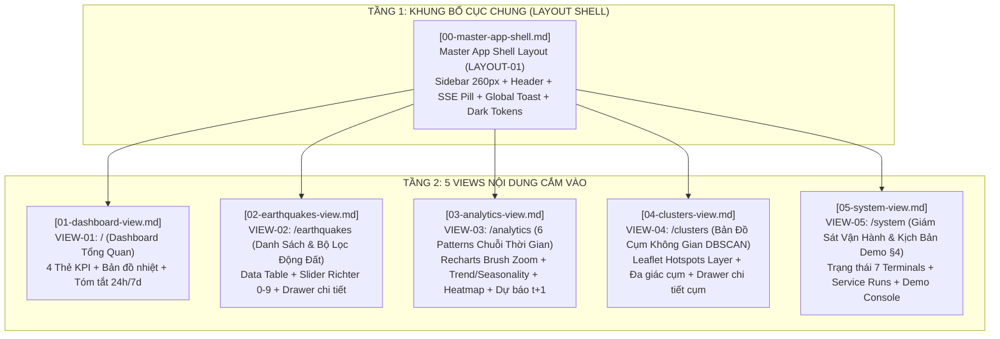

# Danh Mục & Kế Hoạch Quy Hoạch Giao Diện (UI Planning Catalog)

Thư mục này chứa toàn bộ tài liệu **Kế Hoạch & Đặc Tả Giao Diện Người Dùng (UI/UX Specifications)** của hệ thống **GDMAS**, được xây dựng theo kiến trúc **Layout-Centric & Two-Tier UI Architecture** (Quy hoạch Giao diện theo Bố cục 2 Tầng).

> [!IMPORTANT]
> - **Triết lý chống phân mảnh giao diện (Anti-UI Drift):** 95% màn hình hệ thống chia sẻ chung một khung điều hành **Master App Shell**. Việc tách bạch Tầng 1 (Layout) và Tầng 2 (View) ngăn chặn hoàn toàn việc AI hoặc lập trình viên tự ý sinh mã màu, kích thước, bo góc hay thanh điều hướng lệch chuẩn.
> - **Nguyên tắc Tổ hợp Chức năng (Features Composition):** Giao diện không phải là ánh xạ 1-1 với chức năng backend. Mỗi view là một không gian tổ hợp tích hợp nhiều dịch vụ (`FEAT-01` đến `FEAT-07`) phục vụ trải nghiệm người dùng liền mạch.
> - **Chuẩn mực Đồ án TS. Phạm Tuấn:** Đáp ứng 100% tiêu chí thẩm mỹ cao Dark Mode (`#0f172a`), hiển thị trọn vẹn 6 patterns chuỗi thời gian, tương tác Zoom & Filter (§5.2) và kịch bản thực nghiệm phục hồi CSDL rỗng (§4).

---

## 🗺️ Cây Phân Cấp Bố Cục & Bản Đồ Sitemap

---

## 📋 Bảng Danh Mục 6 Tệp Kế Hoạch Đặc Tả UI Chi Tiết

| Tên Tệp Đặc Tả | Tầng Kiến Trúc | Khung Layout Kế Thừa | Chức Năng Backend Tổ Hợp | Trọng Tâm Trực Quan & Tương Tác |
| :--- | :--- | :--- | :--- | :--- |
| [`00-master-app-shell.md`](00-master-app-shell.md) | **Tầng 1 (Layout)** | *Khung gốc hệ thống* | `FEAT-06` (SSE Stream) | Sidebar cố định 260px, Header Breadcrumb, Đèn SSE Pill, Global Toast Stack, Dark Tokens |
| [`01-dashboard-view.md`](01-dashboard-view.md) | **Tầng 2 (View)** | `Master App Shell` | `FEAT-02`, `FEAT-03`, `FEAT-04`, `FEAT-05` | 4 KPI Cards, Mini Live Map, Biểu đồ tóm tắt 24h, danh sách sự kiện mới nhất |
| [`02-earthquakes-view.md`](02-earthquakes-view.md) | **Tầng 2 (View)** | `Master App Shell` | `FEAT-02`, `FEAT-06` | Bảng phân trang 20/50/100, Slider Richter $0-9$, lọc độ sâu, Drawer chi tiết sự kiện |
| [`03-analytics-view.md`](03-analytics-view.md) | **Tầng 2 (View)** | `Master App Shell` | `FEAT-03`, `FEAT-05` | 6 Patterns chuỗi thời gian Recharts, thanh trượt Zoom Brush (§5.2), Heatmap tương quan, Dự báo $t+1$ |
| [`04-clusters-view.md`](04-clusters-view.md) | **Tầng 2 (View)** | `Master App Shell` | `FEAT-04` | Bản đồ không gian Leaflet hiển thị các chùm động đất DBSCAN, Hotspots layer, phân tích cụm |
| [`05-system-view.md`](05-system-view.md) | **Tầng 2 (View)** | `Master App Shell` | `FEAT-01` đến `FEAT-07` | Giám sát sức khỏe 7 Terminals, chu kỳ chạy, bảng điều khiển kịch bản Demo phục hồi CSDL (§4) |

---

## 🎨 Bảng Quy Chuẩn Design System Tokens (Dark Mode)

Toàn bộ 5 views cắm vào `<Outlet />` bắt buộc phải áp dụng bảng biến chuẩn dưới đây:

| Loại Token | Tên Biến Tailwind | Mã Hex Thực Tế | Mục Đích Sử Dụng |
| :--- | :--- | :--- | :--- |
| **Nền gốc (Root)** | `bg-slate-900` | `#0f172a` | Nền toàn bộ ứng dụng và khung ngoài cùng |
| **Nền thẻ (Surface)**| `bg-slate-800` | `#1e293b` | Nền cho các khối Card, Sidebar, Modal, Header |
| **Đường viền (Border)**| `border-slate-700` | `#334155` | Phân cách thẻ, đường kẻ bảng, viền ô nhập |
| **Nhấn chính (Primary)**| `text-sky-400`, `bg-sky-500` | `#38bdf8` | Thương hiệu, nút bấm chính, liên kết đang chọn |
| **Báo động (Danger)**| `text-rose-500`, `bg-rose-500` | `#f43f5e` | Động đất cấp độ mạnh ($M \ge 6.0$), lỗi hệ thống, mất mạng |
| **Cảnh báo (Warning)**| `text-amber-500`, `bg-amber-500` | `#f59e0b` | Động đất trung bình ($4.5 \le M < 6.0$), SSE reconnecting |
| **An toàn (Success)**| `text-emerald-500`, `bg-emerald-500` | `#10b981` | Động đất nhẹ ($M < 4.5$), dịch vụ hoạt động tốt, SSE Live |
| **Chữ chính (Text)** | `text-slate-50` | `#f8fafc` | Tiêu đề, số liệu đo lường, văn bản quan trọng |
| **Chữ phụ (Muted)** | `text-slate-400` | `#94a3b8` | Nhãn mô tả phụ, đơn vị đo lường, thời gian |

---

## 🛡️ Ma Trận Kiểm Soát 4 Trạng Thái Giao Diện Bắt Buộc

Mỗi view trong kế hoạch đều có đặc tả chi tiết về cách ứng xử với 4 trạng thái:

1. **Trạng thái đang tải (Loading State):** Sử dụng Skeleton nhấp nháy (`animate-pulse`) giả lập đúng bố cục bảng và biểu đồ, tránh hiện tượng co giật layout (Layout Shift - CLS).
2. **Trạng thái CSDL rỗng (Empty State - Bắt buộc cho kịch bản Demo §4):**
   * Khi giảng viên xóa sạch DB ở Bước 2 Demo, giao diện không được crash màn hình trắng mà phải hiển thị Empty State thẩm mỹ kèm nút bấm *"Kích hoạt tính toán lại dữ liệu"* dẫn thẳng sang View 05.
3. **Trạng thái lỗi truy vấn (Error State):** Bắt lỗi tại Error Boundary cục bộ, hiển thị thông báo thân thiện kèm nút *"Thử lại"*.
4. **Trạng thái thời gian thực (Real-time SSE State):** Khi có sự kiện địa chấn mới từ USGS, toast tự động nảy ở góc dưới phải và bảng dữ liệu nhấp nháy làm nổi bật dòng mới.

---

## 🔗 Tài Liệu Tham Chiếu
- [**Khuôn Mẫu Đặc Tả UI (TEMPLATE.md)**](TEMPLATE.md)
- [**Danh Mục Chức Năng Backend (docs/planning/features/)**](../features/README.md)
- [**Yêu Cầu Bắt Buộc Đồ Án Cuối Kỳ (docs/yeucaubatbuoc.md)**](../../yeucaubatbuoc.md)
- [**Đặc Tả Hợp Đồng REST API v1 (docs/api/API.md)**](../../api/API.md)
- [**Tài Liệu Kiến Trúc Hệ Thống (docs/architecture/SAD.md)**](../../architecture/SAD.md)

