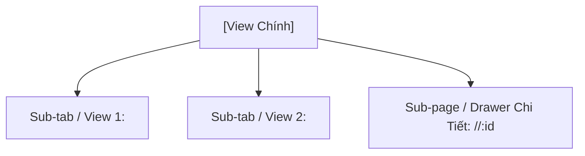

# [HƯỚNG DẪN & KHUÔN MẪU QUY HOẠCH GIAO DIỆN THEO BỐ CỤC (LAYOUT-CENTRIC UI TEMPLATE)]

> 💡 **Triết lý kiến trúc giao diện GDMAS (Layout-Centric & Design System First):**
>
> 1. **Giao diện không phải là ánh xạ 1-1 với chức năng:** Mỗi màn hình là một **không gian tổ hợp (Composition Workspace)** tích hợp nhiều khối chức năng (`FEAT-01` đến `FEAT-07`).
> 2. **Chống phân mảnh và độ lệch giao diện (Anti-UI Drift):** 95% màn hình chia sẻ chung một khung điều hành **Master App Shell**. Việc tách riêng tầng Layout và tầng View nội dung giúp đảm bảo tính nhất quán tuyệt đối về màu sắc Dark Mode (`#0f172a`), bo góc (`rounded-xl`), lề padding (`p-6`), font chữ, thanh điều hướng và thông báo thời gian thực SSE.
> 3. **Quy hoạch 2 tầng rõ rệt (Two-Tier UI Planning):**
>    - **Tầng 1 (Master Layout Shell & Design Tokens):** Đặc tả khung bao ngoài (Sidebar, Header, Breadcrumb, SSE Toast, Global States).
>    - **Tầng 2 (View / Page Content):** Đặc tả nội dung nghiệp vụ cắm vào vùng `<Outlet />` của Layout.

---

## 🌳 PHẦN A: CÂY PHÂN CẤP CẤU TRÚC TRANG & BẢN ĐỒ BỐ CỤC (PAGE WORK TREE & LAYOUT TAXONOMY)

Toàn bộ hệ thống giao diện GDMAS được phân loại theo kiến trúc bố cục và các view cắm vào như sau:

```mermaid
graph TD
    subgraph LAYOUT_TIER ["TẦNG 1: KHUNG BỐ CỤC CHUNG (LAYOUT SHELL)"]
        Shell["[LAYOUT-01] Master App Shell (Chính)<br/>Sidebar + Top Header + Breadcrumb + SSE Pill + Global Toast + Dark Theme"]
        Kiosk["[LAYOUT-02] Fullscreen Kiosk Shell (Tùy chọn)<br/>Bản đồ phóng to toàn màn hình không Sidebar (Demo hội đồng)"]
    end

    subgraph VIEW_TIER ["TẦNG 2: CÁC VIEW NỘI DUNG CẮM VÀO <Outlet />"]
        %% View 1
        Shell --> V1["[VIEW-01] / (Dashboard Tổng Quan)<br/>Trang điều hành trung tâm"]
        V1 --> V1_1["Sub-tab 1: Giám Sát Thời Gian Thực (Live Map + KPI)"]
        V1 --> V1_2["Sub-tab 2: Tóm Tắt Hoạt Động Địa Chấn 24h / 7d"]

        %% View 2
        Shell --> V2["[VIEW-02] /earthquakes (Danh Sách & Bộ Lọc Động Đất)"]
        V2 --> V2_1["Sub-view: Bảng Dữ Liệu Phân Trang (Data Table)"]
        V2 --> V2_2["Sub-view: Bộ Lọc Đa Chiều (Magnitude, Depth, Date Slider)"]
        V2 --> V2_3["Drawer Chi Tiết: /earthquakes/:id"]

        %% View 3
        Shell --> V3["[VIEW-03] /analytics (Phân Tích 6 Patterns Chuỗi Thời Gian)"]
        V3 --> V3_1["Sub-page 1: /analytics/time-distribution (Pattern 1: Line, Scatter, Histogram)"]
        V3 --> V3_2["Sub-page 2: /analytics/trend-seasonality (Pattern 2 & 3: Phân rã Trend & Mùa vụ)"]
        V3 --> V3_3["Sub-page 3: /analytics/correlation (Pattern 4: Ma trận nhiệt Heatmap)"]
        V3 --> V3_4["Sub-page 4: /analytics/predictions (Pattern 5 & 6: Dự báo t+1 & Phân loại rủi ro)"]

        %% View 4
        Shell --> V4["[VIEW-04] /clusters (Bản Đồ Cụm Không Gian - DBSCAN)"]
        V4 --> V4_1["Sub-view: Lớp Điểm Nóng Địa Chấn (Hotspots Map Layer)"]
        V4 --> V4_2["Drawer Chi Tiết: /clusters/:clusterId"]

        %% View 5
        Shell --> V5["[VIEW-05] /system (Giám Sát Vận Hành & Demo §4)"]
        V5 --> V5_1["Sub-tab 1: Trạng Thái 7 Terminals & Lịch Sử Service Runs"]
        V5 --> V5_2["Sub-tab 2: Bảng Điều Khiển Demo Phục Hồi Dữ Liệu (§4)"]

        %% View Kiosk
        Kiosk -.-> VK["[VIEW-K] /kiosk/map (Trình Chiếu Bản Đồ Toàn Màn Hình)"]
    end
```



### 📁 Danh mục các tệp tài liệu kế hoạch giao diện (`docs/planning/ui/`)

| Tên Tệp | Tầng Kiến Trúc | Phạm Vi & Mục Đích | Layout Sử Dụng |
| :--- | :--- | :--- | :--- |
| `00-master-app-shell.md` | **Tầng 1 (Layout)** | Khung giao diện dùng chung, Design Tokens, Sidebar, Header, SSE Indicator, Toast Container, Global Loading/Empty States | N/A (Chính là Layout) |
| `01-dashboard-view.md` | **Tầng 2 (View)** | Màn hình Dashboard tổng quan: 4 KPI cards, bản đồ tương tác nhanh, biểu đồ tóm tắt 24h/7d | `LAYOUT-01 (Master App Shell)` |
| `02-earthquakes-view.md` | **Tầng 2 (View)** | Khám phá dữ liệu: Bảng phân trang, bộ lọc Slider đa chiều, Drawer chi tiết sự kiện | `LAYOUT-01 (Master App Shell)` |
| `03-analytics-view.md` | **Tầng 2 (View)** | Trung tâm phân tích 6 patterns chuỗi thời gian: Phân rã xu hướng, ma trận tương quan, dự báo $t+1$ | `LAYOUT-01 (Master App Shell)` |
| `04-clusters-view.md` | **Tầng 2 (View)** | Trực quan hóa cụm không gian: Bản đồ phân cụm DBSCAN, đa giác convex hull, chi tiết cụm | `LAYOUT-01 (Master App Shell)` |
| `05-system-view.md` | **Tầng 2 (View)** | Giám sát vận hành 7 dịch vụ, tình trạng DB, công cụ demo hội đồng phục hồi dữ liệu (§4) | `LAYOUT-01 (Master App Shell)` |

---

## 🏛️ PHẦN B: KHUÔN MẪU ĐẶC TẢ TẦNG 1 — KHUNG LAYOUT CHUNG (MASTER LAYOUT SPEC)

*Dùng để soạn thảo tệp `00-master-app-shell.md` (hoặc các bố cục đặc thù như Kiosk nếu có).*

```markdown
# [ĐẶC TẢ BỐ CỤC GIAO DIỆN: <TÊN BỐ CỤC>]

- **Mã bố cục:** LAYOUT-0X (ví dụ: `LAYOUT-01`)
- **Tên bố cục:** `<Tên bố cục>` (ví dụ: `Master App Shell Layout`)
- **Phạm vi áp dụng:** Dùng chung cho các trang (`/`, `/earthquakes`, `/analytics`, `/clusters`, `/system`)
- **Vị trí nhúng nội dung động:** Thẻ `<Outlet />` (React Router v6)
- **Chế độ hiển thị:** Dark Mode mặc định (`Slate 900`)

---

## 1. Mục Tiêu & Nguyên Tắc Thiết Kế Bố Cục (Layout Objectives)
- Đảm bảo tính nhất quán thị giác 100% giữa tất cả các màn hình con.
- Đóng gói toàn bộ thanh điều hướng, cơ chế thông báo Real-time SSE toàn cục và trạng thái kết nối mạng.
- Cung cấp khung bao chuẩn để các màn hình con chỉ tập trung vào nghiệp vụ chuyên biệt.

---

## 2. Bản Đặc Tả Design Tokens Chuẩn (Design Tokens Specification)

> ⚠️ Mọi trang nội dung con bắt buộc phải tái sử dụng các biến token dưới đây, tuyệt đối không tự sinh mã màu hay kích thước lẻ.

### 2.1. Bảng màu chuẩn Dark Mode (Color Palette)
- **Nền chính (Background Root):** `#0f172a` (`slate-900`)
- **Nền khung thẻ / Card Surface:** `#1e293b` (`slate-800`)
- **Đường viền ngăn cách (Borders):** `#334155` (`slate-700`)
- **Màu nhấn thương hiệu (Primary Accent):** `#38bdf8` (`sky-400` / `sky-500`)
- **Màu cảnh báo địa chấn / Nguy cơ cao (Danger/Hotspot):** `#f43f5e` (`rose-500`)
- **Màu cảnh báo trung bình (Warning/Medium):** `#f59e0b` (`amber-500`)
- **Màu trạng thái an toàn / Dịch vụ online (Success):** `#10b981` (`emerald-500`)
- **Chữ chính (Text Primary):** `#f8fafc` (`slate-50`)
- **Chữ phụ (Text Secondary / Muted):** `#94a3b8` (`slate-400`)

### 2.2. Quy chuẩn Typography & Spacing
- **Font chữ:** Inter hoặc Tailwind `font-sans` (sạch sẽ, tối ưu hiển thị số liệu đo đạc).
- **Bo góc chuẩn:** `rounded-xl` (12px) cho Cards, `rounded-lg` (8px) cho Inputs/Buttons.
- **Lề & Đệm:** Padding nội dung trang mặc định `p-6` (24px), khoảng cách giữa các card `gap-6`.

---

## 3. Sơ Đồ Phân Vùng Khung Bố Cục (Wireframe Layout Shell)

```text
┌────────────────────────────────────────────────────────────────────────────────────────┐
│ TOP HEADER: Logo GDMAS │ Breadcrumbs │ Live Clock UTC/Local │ [🟢 SSE: Live] │ Theme   │
├──────────────┬─────────────────────────────────────────────────────────────────────────┤
│ SIDEBAR      │ MAIN CONTENT REGION (<Outlet />)                                        │
│ (W: 260px)   │                                                                         │
│              │                                                                         │
│ • Dashboard  │  [NỘI DUNG TỪNG TRANG SẼ ĐƯỢC CẮM VÀO KHU VỰC NÀY]                     │
│ • Danh Sách  │  (Dashboard View / Analytics View / Clusters View / System View)        │
│ • Phân Tích  │                                                                         │
│ • Cụm Không  │                                                                         │
│   Gian       │                                                                         │
│ • Hệ Thống   │                                                                         │
│              │                                                                         │
│ ──────────── │                                                                         │
│ DB Status:   │                                                                         │
│ [🟢 Active]  │                                                                         │
├──────────────┴─────────────────────────────────────────────────────────────────────────┤
│ GLOBAL TOAST CONTAINER (Góc dưới phải): Pop-up thông báo khi có trận động đất mới (SSE)│
└────────────────────────────────────────────────────────────────────────────────────────┘
```

---

## 4. Các Thành Phần Bao Ngoài Dùng Chung (Shared Shell Components)

### 4.1. Thanh Điều Hướng Cố Định (Fixed Sidebar Navigation)
- Menu gồm 5 mục chính kèm icon nhận diện:
  1. `Dashboard` (`/`) - Icon: LayoutDashboard
  2. `Động Đất` (`/earthquakes`) - Icon: Activity / Waves
  3. `Phân Tích` (`/analytics`) - Icon: LineChart / BarChart3
  4. `Bản Đồ Cụm` (`/clusters`) - Icon: MapPin / Globe
  5. `Hệ Thống & Demo` (`/system`) - Icon: Server / ShieldCheck
- Trạng thái Active: Nền sáng nhẹ `bg-sky-500/10`, viền trái nổi bật `border-l-4 border-sky-400`.
- Chân Sidebar: Widget thu nhỏ hiển thị trạng thái CSDL (`PostgreSQL Online`, `Total: X events`).

### 4.2. Thanh Tiêu Đề Trên (Top Navigation & Header)
- **Breadcrumb động:** Tự động phản ánh vị trí người dùng (ví dụ: `Trang chủ > Phân Tích > Xu Hướng & Mùa Vụ`).
- **SSE Connection Status Pill:**
  - 🟢 `Đang kết nối Realtime` (Ping đều đặn mỗi 15s).
  - 🟡 `Đang kết nối lại...` (Tự động retry sau 3s nếu đứt cáp).
  - 🔴 `Mất kết nối SSE` (Báo động hiển thị banner).
- **Bộ hiển thị đồng hồ thời gian thực:** Hiển thị giờ UTC và Giờ Việt Nam (ICT) phục vụ đo đạc địa chấn.

### 4.3. Ngăn Chứa Thông Báo Nổi Toàn Cục (Global Toast Stack Container)
- Cố định ở góc dưới cùng bên phải màn hình (`bottom-6 right-6 z-50`).
- Lắng nghe sự kiện SSE `earthquake_new`: Khi backend phát hiện trận động đất mới từ USGS, toast tự động xuất hiện với hiệu ứng trượt, hiển thị:
  * Huy hiệu độ lớn Richter (đổi màu theo cấp độ: Vàng < 4.5, Cam 4.5-6.0, Đỏ > 6.0).
  * Vị trí địa lý và thời gian xảy ra.
  * Nút "Xem ngay" dẫn thẳng đến Drawer chi tiết của sự kiện.

---

## 5. Xử Lý Các Trạng Thái Toàn Cục (Global Layout States)

### 5.1. Khung chờ tải trang (Global Skeleton Loading)
- Khi chuyển trang giữa các route, hiển thị Skeleton giả lập vùng Header + 4 Cards + 1 Khung biểu đồ lớn với hiệu ứng nhấp nháy mượt (`animate-pulse`).

### 5.2. Trạng thái mất kết nối Backend (Global Network Disconnected Banner)
- Nếu API Gateway `http://localhost:8000` không phản hồi, hiển thị banner cố định trên đỉnh đầu:
  > *"⚠️ Không thể kết nối tới Backend API. Vui lòng kiểm tra Terminal 01 (FastAPI Server)."*

---

## 6. Tiêu Chí Nghiệm Thu Bố Cục (Layout Acceptance Criteria)

- [ ] **AC-LAYOUT-01:** Khung Master App Shell hiển thị chuẩn mực trên độ phân giải Desktop (1366px - 1920px+).
- [ ] **AC-LAYOUT-02:** Đồng bộ trạng thái menu Active chính xác khi chuyển đổi giữa các trang.
- [ ] **AC-LAYOUT-03:** Đèn báo trạng thái SSE trên Header phản hồi chính xác khi backend bật/tắt.
- [ ] **AC-LAYOUT-04:** Toast thông báo Realtime nảy đều đặn và tự biến mất sau 5s hoặc khi người dùng đóng.
- [ ] **AC-LAYOUT-05:** 100% trang con thừa hưởng toàn bộ Design Tokens Dark Mode mà không phát sinh xung đột CSS.
```

---

## 📄 PHẦN C: KHUÔN MẪU ĐẶC TẢ TẦNG 2 — NỘI DUNG TỪNG TRANG / VIEW (VIEW CONTENT SPEC)

*Dùng để soạn thảo các tệp từ `01-dashboard-view.md` đến `05-system-view.md` cắm vào `<Outlet />`.*

```markdown
# [ĐẶC TẢ GIAO DIỆN VIEW: <TÊN VIEW>]

- **Mã view:** VIEW-0X (ví dụ: `VIEW-01`)
- **Tên view:** `<Tên trang tiếng Việt>` (ví dụ: `Dashboard Điều Hành Tổng Quan`)
- **Route URL chính:** `/<duong-dan>` (ví dụ: `/analytics`)
- **Khung bố cục kế thừa:** `LAYOUT-01 (Master App Shell)`
- **Tài liệu tham chiếu:**
  * `docs/planning/ui/00-master-app-shell.md` (Design tokens & Khung bao)
  * `docs/yeucaubatbuoc.md` (§2. Patterns, §3. Giao diện, §4. Demo)
  * `docs/planning/features/` (Danh mục các chức năng được tổ hợp)
  * `docs/api/API.md` (Các endpoints được view này tiêu thụ)

---

## 1. Mục Tiêu Nghiệp Vụ & Đối Tượng Sử Dụng (View Purpose & Persona)

### 1.1. Mục tiêu cốt lõi của view
- Màn hình này giải quyết bài toán gì và mang lại giá trị quan sát nào cho người dùng?
- Tại sao các khối thông tin trên màn hình này lại được tổ hợp với nhau?

### 1.2. Kịch bản đánh giá của người dùng
- **Giảng viên / Người chấm thi:** Quan sát những tiêu chí nào (tính thẩm mỹ Dark Mode, tính năng Zoom & Filter, kiểm tra F12 nạp API thật)?
- **Nhà nghiên cứu / Người vận hành:** Thao tác phân tích, lọc và tra cứu dữ liệu như thế nào?

---

## 2. Cây Cấu Trúc View & Các Thành Phần Con (Sub-Views, Tabs & Drawers)



- **Sub-tab / View 1:** <Mô tả mục đích và nội dung hiển thị>
- **Sub-tab / View 2:** <Mô tả mục đích và nội dung hiển thị>
- **Drawer / Modal chi tiết:** <Kích hoạt khi bấm vào đối tượng nào, dữ liệu hiển thị là gì>

---

## 3. Ma Trận Tổ Hợp Chức Năng Trên View (Features Composition Matrix)

> Bảng ánh xạ: View này tích hợp những Chức Năng nào (`FEAT-01` đến `FEAT-07`) và hiển thị ở khối nào?

| Vùng Hiển Thị Trên View | Chức Năng Được Tích Hợp | Dữ Liệu Hiển Thị | Nguồn API / SSE |
| :--- | :--- | :--- | :--- |
| **Thẻ KPI Đầu View** | `FEAT-02` (Ingestion) & `FEAT-05` (Prediction) | Tổng sự kiện 24h, Huy hiệu rủi ro $t+1$ | `GET /api/events/stats/summary`, `GET /api/prediction/classification/latest` |
| **Khối Bản Đồ / Biểu Đồ Chính** | `FEAT-02` (Events) & `FEAT-04` (Clustering) | Bản đồ Leaflet điểm động đất & Cụm DBSCAN | `GET /api/events`, `GET /api/clustering/latest` |
| **Khối Biểu Đồ Chuỗi Thời Gian**| `FEAT-03` (Analysis) | Biểu đồ chuỗi thời gian Recharts kèm thanh Zoom Brush | `GET /api/analysis/patterns` |
| **Bảng / Danh Sách Dữ Liệu** | `FEAT-02` (Events) | Bảng phân trang các sự kiện địa chấn | `GET /api/events?page=1&limit=20` |

---

## 4. Bố Cục Không Gian Nội Dung Trong `<Outlet />` (Internal View Layout)

### 4.1. Sơ đồ phân vùng (ASCII Wireframe bên trong Outlet)
```text
┌───────────────────────────────────────────────────────────────────────────────────┐
│ VIEW HEADER: Tiêu đề trang con, Bộ chọn dải ngày, Nút xuất báo cáo / Làm mới      │
├───────────────────────────────────────────────────────────────────────────────────┤
│ KHỐI 1 (TOP): 4 Thẻ KPI Tóm Tắt (Tổng số trận, Trận lớn nhất, Xu hướng, Rủi ro)   │
├────────────────────────────────────────┬──────────────────────────────────────────┤
│ KHỐI 2 (MAIN WORKSPACE - TRÁI 65%):    │ KHỐI 3 (CONTROL & LIST - PHẢI 35%):      │
│ • Component Trực quan hóa chính        │ • Bộ lọc động (Magnitude, Depth slider)  │
│   (Bản đồ Leaflet hoặc Biểu đồ lớn)    │ • Danh sách sự kiện địa chấn mới nhất    │
│ • Thanh trượt phóng to Zoom Brush      │ • Phân trang dữ liệu                     │
├────────────────────────────────────────┴──────────────────────────────────────────┤
│ KHỐI 4 (BOTTOM): Bảng số liệu thống kê phụ trợ / Biểu đồ chi tiết liên quan        │
└───────────────────────────────────────────────────────────────────────────────────┘
```

### 4.2. Các khối chức năng chính (Major UI Blocks)
- **Top View Header & Quick Action:** Tiêu đề, nút hành động nhanh.
- **KPI Summary Strip:** 4 thẻ đo lường chính.
- **Primary Visual Workspace:** Bản đồ Leaflet hoặc Biểu đồ Recharts.
- **Filter & Interaction Panel:** Thanh trượt Richter, dải độ sâu, bộ chọn thời gian.
- **Data Table / Detail Drawer:** Danh sách dữ liệu có phân trang và ngăn kéo chi tiết.

---

## 5. Khả Năng Tương Tác & Điểm Cộng Người Dùng (§5.2)

### 5.1. Bộ lọc động đa chiều (Dynamic Filters)
- **Lọc theo độ lớn Richter:** Thanh trượt Slider $0.0 - 9.0$ (cập nhật kết quả động, có debounce 300ms).
- **Lọc theo độ sâu chấn tiêu:** Nông (<70km), Trung bình (70-300km), Sâu (>300km).
- **Lọc theo thời gian:** Nhanh (`24h qua`, `7 ngày qua`, `30 ngày qua`) hoặc Date Range Picker.

### 5.2. Tương tác phóng to / phân rã (Zoom & Pan)
- **Biểu đồ Recharts:** Thanh `<Brush />` bên dưới trục hoành để kéo co giãn dải thời gian xem chi tiết.
- **Bản đồ Leaflet:** Cuộn chuột Zoom, rê Pan, nhấp chọn Marker hiển thị Popup thông số chi tiết.

---

## 6. Xử Lý Trạng Thái & Khả Năng Phục Hồi Dữ Liệu (View States & Resilience)

View này bắt buộc phải kiểm soát chặt chẽ **4 trạng thái hiển thị**:

1. **Trạng thái đang tải (Loading State):** Hiển thị Skeleton Loader giả lập khung biểu đồ và bảng dữ liệu.
2. **Trạng thái CSDL rỗng (Empty State - Bắt buộc cho kịch bản Demo §4):**
   - Khi giảng viên xóa sạch DB bằng tay, giao diện phải hiển thị thông báo rõ ràng:
     > *"⚠️ Chưa có dữ liệu địa chấn trong CSDL. Vui lòng kích hoạt các Terminal Worker tại Backend để nạp lại dữ liệu."*
   - Tuyệt đối không để crash màn hình trắng hoặc lỗi `undefined`.
3. **Trạng thái lỗi truy vấn API (Error State):** Hiển thị khối lỗi cục bộ kèm nút "Tải lại dữ liệu".
4. **Trạng thái cập nhật thời gian thực (Live Update State):** Khi có dữ liệu mới từ SSE, cập nhật dữ liệu mượt mà mà không làm giật trang hay reset vị trí cuộn của người dùng.

---

## 7. Danh Mục API Endpoints Tiêu Thụ (Consumed APIs)

| Phương Thức | Đường Dẫn Endpoint | Mục Đích Sử Dụng | Dữ Liệu Nhận Về |
| :--- | :--- | :--- | :--- |
| `GET` | `/api/events/stats/summary` | Cung cấp dữ liệu cho 4 thẻ KPI | Số liệu thống kê tóm tắt |
| `GET` | `/api/events` | Nạp danh sách sự kiện cho bảng & bản đồ | Mảng đối tượng địa chấn |
| `GET` | `/api/analysis/patterns` | Nạp chuỗi thời gian cho Recharts | Dữ liệu các patterns |

---

## 8. Tiêu Chí Nghiệm Thu Giao Diện View (View Acceptance Criteria)

- [ ] **AC-VIEW-01 (Đúng khuôn mẫu Master App Shell):** Khớp 100% với layout của App Shell, không tự ý sửa padding hay lệch màu Dark Mode.
- [ ] **AC-VIEW-02 (Dữ liệu động API thật):** 100% dữ liệu hiển thị nạp từ Backend API qua tab Network F12 (không dùng mock tĩnh).
- [ ] **AC-VIEW-03 (Tương tác Zoom & Filter mượt mà):** Thao tác kéo thanh trượt Slider và Zoom Brush phản hồi dưới 100ms.
- [ ] **AC-VIEW-04 (Khả năng chịu lỗi Demo §4):** Khi CSDL rỗng, hiển thị đúng Empty state, không phát sinh lỗi console nghiêm trọng.
- [ ] **AC-VIEW-05 (Drawer & Chi tiết):** Mở xem chi tiết sự kiện mượt mà mà không làm tải lại toàn bộ trang.
```

---

## 🎯 PHẦN D: NGUYÊN TẮC PHỐI HỢP DÀNH CHO AGENT & LẬP TRÌNH VIÊN

1. **Tuân thủ quy trình Spec-Driven:**
   - Trước khi lập trình, kỹ năng `write-proposal` sẽ lấy khuôn mẫu tại **Phần B** để sinh ra `00-master-app-shell.md`, và lấy khuôn mẫu tại **Phần C** để sinh ra các tệp `01-dashboard-view.md` đến `05-system-view.md`.
2. **Không vượt cấp trách nhiệm:**
   - Đặc tả UI trong thư mục `docs/planning/ui/` chỉ mô tả cấu trúc, ma trận tổ hợp, bố cục trực quan và tiêu chí nghiệm thu (`AC-UI-X`).
   - Tuyệt đối không viết cây thư mục mã nguồn `.tsx`, không viết code React giả, không tạo task checklist lập trình chi tiết trong tài liệu này (nhiệm vụ đó thuộc về `build-implementation` khi lập `plan.md`).
3. **Bảo toàn tính mở-đóng (RULE-03):**
   - Chỉ thêm mới các tài liệu đặc tả, không làm ảnh hưởng đến mã nguồn hệ thống hiện có.
