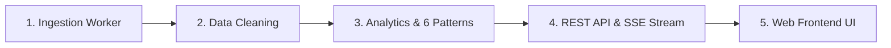

# Danh Mục Kiểm Thử Chức Năng (Functional Test Cases)

Tài liệu này tổng hợp toàn bộ các ca kiểm thử chức năng (Functional Testing) của hệ sinh thái **GDMAS (Global Disaster Monitoring & Analysis System)**, bao phủ quy trình khép kín từ cào dữ liệu, làm sạch, phân tích 6 patterns chuỗi thời gian, phân cụm không gian, suy luận mô hình ML đến hiển thị giao diện người dùng.

---

## 🧭 Cấu Trúc Các Phân Hệ Kiểm Thử Chức Năng

---

## 📋 Danh Sách Các Bộ Kiểm Thử Chức Năng

| Mã Phân Hệ | Tên Bộ Kiểm Thử | Tệp Đặc Tả | Phạm Vi Kiểm Thử | Trạng Thái |
| :--- | :--- | :--- | :--- | :--- |
| **FT-ING** | Ingestion & Deduplication | `tc-ingestion.md` | Cào USGS GeoJSON 5 phút/lần, chống trùng lặp `source_event_id`, ghi log `service_runs`. | ✅ PASS |
| **FT-CLN** | Preprocessing & Metrics | `tc-cleaning.md` | Chuẩn hóa tọa độ WGS84, tính năng lượng Joules $E = 10^{4.8 + 1.5M}$, phân loại độ sâu. | ✅ PASS |
| **FT-PAT** | 6 Patterns & DBSCAN | `tc-patterns.md` | Time-series, Trend re-sampling, Seasonality, Correlation matrix, ARIMA $t+1$, Random Forest. | ✅ PASS |
| **FT-API** | REST API Endpoints | `tc-api.md` | Xác thực Pydantic contracts, phân trang, bộ lọc đa biến (Mag, Depth, Place). | ✅ PASS |
| **FT-UI** | React Dashboard & Maps | `tc-frontend.md` | Trực quan hóa Recharts, chuyển đổi múi giờ UTC/UTC+7, Responsive HUD, Export JSON. | ✅ PASS |

---

## 1. Tóm Tắt Kịch Bản Kiểm Thử Cốt Lõi

### TC-F01: Nạp Dữ Liệu Tự Động Định Kỳ 5 Phút (Terminal 2 - Ingestion)
* **Tiền điều kiện:** Worker `gdmas-worker-ingestion` đang chạy.
* **Hành động:** Chờ chu kỳ cron 5 phút hoặc gọi thủ công endpoint `/api/v1/earthquakes/sync`.
* **Kỳ vọng:**
  * Bảng `earthquake_events` tăng thêm bản ghi mới.
  * Bảng `service_runs` ghi nhận bản ghi trạng thái `SUCCESS` với số lượng `records_processed`.
  * Không phát sinh lỗi duplicate key khi USGS trả về các sự kiện đã có trong DB.

### TC-F02: Tính Toán 6 Patterns Chuỗi Thời Gian (Terminal 3 & 4)
* **Tiền điều kiện:** CSDL có ít nhất 10 bản ghi địa chấn.
* **Hành động:** Kích hoạt service phân tích hoặc chạy `scripts/demo-init-patterns.ps1`.
* **Kỳ vọng:**
  * Bảng `analysis_results` có đủ 4 bản ghi (`time_series`, `trend`, `seasonality`, `correlation`).
  * Bảng `clustering_results` và `clustering_event_mapping` chứa thông tin phân cụm không gian DBSCAN.
  * Bảng `prediction_results` chứa dự báo định lượng ngày mai với `lower_bound` và `upper_bound`.
  * Bảng `classification_results` chứa xác suất phân loại rủi ro (`LOW`, `MEDIUM`, `HIGH`).

### TC-F03: Truy Vấn API & Đồng Bộ Contract
* **Tiền điều kiện:** API container `gdmas-api` đang hoạt động ở cổng 8000.
* **Hành động:** Gửi HTTP GET request tới `/api/v1/patterns` và `/api/v1/earthquakes`.
* **Kỳ vọng:**
  * Mã phản hồi HTTP `200 OK`.
  * Schema JSON trả về khớp 100% với định nghĩa TypeScript trong `contracts/index.ts`.

