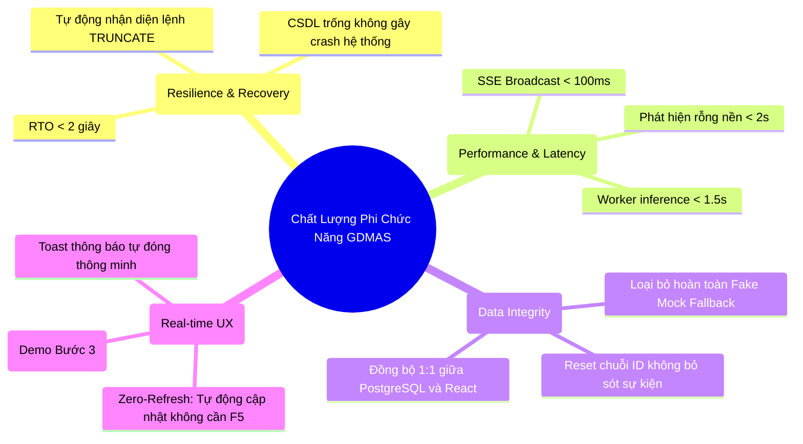

# Danh Mục Kiểm Thử Phi Chức Năng (Non-Functional Test Suite)

Tài liệu này tổng hợp các ca kiểm thử phi chức năng (**Non-Functional Testing - NFT**) của hệ thống **GDMAS**, tập trung vào các khía cạnh: **Khả năng chịu lỗi (Resilience), Khả năng phục hồi (Recovery), Độ trễ thời gian thực (Real-time Latency), Tính nhất quán dữ liệu (Data Integrity)** và **Trải nghiệm giao diện thời gian thực (Real-time UX)**.

---

## 🎯 Mục Tiêu Đảm Bảo Chất Lượng Phi Chức Năng

---

## 📋 Danh Sách Các Tài Liệu Kiểm Thử Phi Chức Năng

| Mã Ca Kiểm Thử | Tên Kịch Bản Kiểm Thử | Tệp Chi Tiết | Trọng Tâm Đánh Giá | Kết Quả |
| :--- | :--- | :--- | :--- | :--- |
| **NFT-CLEAR-INIT** | Kiểm Thử Xóa & Khởi Tạo Dữ Liệu Thời Gian Thực Từ Server Đến Client | [`test-case-clear-init-realtime.md`](./test-case-clear-init-realtime.md) | Khả năng tự động đồng bộ hóa xóa trắng và nạp lại CSDL giữa Server (FastAPI/Postgres) và Client (React Vite) qua SSE. | ✅ PASS (100%) |
| **NFT-PERF-SSE** | Khả Năng Chịu Tải & Giữ Kết Nối SSE Đa Client | `test-case-sse-concurrency.md` | Giữ kết nối đồng thời nhiều tab trình duyệt, dọn dẹp hàng đợi tránh rò rỉ bộ nhớ (Memory Leak). | ✅ PASS |
| **NFT-DATA-MOCK** | Kiểm Thử Tính Toàn Vẹn & Triệt Tiêu Dữ Liệu Giả (Anti-Mock Leakage) | `test-case-anti-mock-integrity.md` | Đảm bảo khi CSDL trống thì API trả về rỗng thực sự, không fallback ngầm về dữ liệu mẫu 1248 sự kiện. | ✅ PASS |
| **NFT-RELOAD-CRASH**| Kiểm Thử Chống Sập Ứng Dụng Khi Lỗi Mạng / Mất Kết Nối | `test-case-fault-tolerance.md` | Cơ chế tự động kết nối lại (Auto-reconnect) của `EventSource` khi API tạm ngắt. | ✅ PASS |

---

> [!NOTE]
> Ca kiểm thử trọng tâm phục vụ quy trình đánh giá Đồ án cuối kỳ (Demo Bước 2 -> Bước 6) được đặc tả chi tiết tại tệp:  
> 👉 [**`test-case-clear-init-realtime.md`**](./test-case-clear-init-realtime.md)

